# 1.1 目标用户现状痛点剖析与当前任务旅程还原 (Persona, Pain Points & As-Is Journey)

> 💡 **中枢定位**：
> 本文档承接【方案系统设计主线】步骤 1 的**两项核心决策**，产出下游 1.2 与说明书的输入：
> * **决策一：目标用户与现状痛点**——谁的哪件事被卡住，卡在哪个节点、被什么困住。
> * **决策二：主场景拆分与 As-Is 旅程**——本次需求覆盖哪几条可独立闭环的场景，各场景现状旅程怎么走、痛点插在哪。
>
> **产物去向**：主场景清单（含要办成的事、痛点名称 / 严重度 / 现状基线、困住方式、用户原话）→ 1.2 写体验目标；角色与场景表 → 《设计说明书》Part1 第 1、2 节。
> **交接边界**：As-Is 旅程图随本次运行对 1.2 可见（1.2 判定"哪一步被删掉"与证据①要用）；但它**不随说明书交付**，跨人 / 跨工具交接时以「触发情境 + 场景卡点清单 + 用户原话」代偿，缺这三样即判交接不完整。

> 🛑 **阶段铁律**：
> **需求分析是完全基于现状的（As-Is）。** 必须先拆出主场景，再按场景还原当前真实操作全貌并插旗；**严禁**揉成一条笼统旅程，也**严禁**出现任何“未来的优化后旅程图”。（未来旅程不再单独产出，优化动作直接落在后续页面设计中）。

---

## 一、需求理解与穿透方法论：从“伪需求”到“业务本质”

上游业务规划或产品经理递过来的原始需求，往往是**披着功能外衣的“伪方案”**（如：“在表格加个导出按钮”、“加个弹窗配 IP”）。资深设计师在动刀前，必须通过三层穿透法提纯出真实的业务本质。

### 1. 需求解构的三层真伪模型

```text
┌────────────────────────────────────────────────────────────────────────┐
│ 1. 表面功能层 (Feature Request) : 规划提的表象需求（如：“希望加个跨屏批量同步按钮”）│
│         ↓ 追问触发场景与前置上下文                                            │
│ 2. 业务目标层 (Business Goal)   : 业务真正要考核的产出（缩短现场交付工期，降低人力成本）│
│         ↓ 剥离 UI 形式，挖掘用户底层意图                                      │
│ 3. 用户本质意图：不想在弱网机房给 50 台设备重复抄录参数                │
└────────────────────────────────────────────────────────────────────────┘
```

### 2. 需求提纯的反向追问三部曲
在面对模糊需求时，设计者必须在脑内或向业务方发起三项关键追问：
1. **追问触发情境**：“用户在什么具体状态下会点击这个功能？前一秒他在干什么？后一秒他要拿着结果去向谁汇报？”
2. **追问现状阻塞点**：“现有系统为什么走不通？最折磨用户的具体是哪一个界面的哪一步？”
3. **追问风险代价**：“如果这个需求完全不做，最坏的结果是什么？会导致资金损失、违约罚款，还是引发高危宕机事故？”

> 🛑 **注意：这三问在自己脑子里问，不要甩给用户**。缺答案就按 `【假设】` 补（补齐规则见 1.2 第一节「输入里读不出来的怎么办」），一路跑到草图再一次性对齐。

### 3. 字段清单型 PRD 的专项处理（最容易照抄错的一类）

> 🛑 **实测病**：PRD 给的是一张字段表 + 一串动作清单，AI 就照着画成"12 列的台账 + 几个按钮"。结果**动作漏了四个、字段还被随意合并**，规划人员一眼就看出"这不是我要的"。

**两条铁律**：

| # | 铁律 | 怎么做 |
| :---: | :--- | :--- |
| **1** | **字段清单是信息备选池，不是列清单** | 每个字段都要能回答"它去了哪"：主表 / 详情 / 不展示（+ 原因）。**可以合并、可以下沉，但不许静默消失** |
| **2** | **动作清单是验收项，不是示意** | 每个动作（安装 / 升级 / 卸载 / 解绑 / 批量编辑 / 基础配置 / 导入 / 标签 / 导出）都要有页面落点，落不了的写"本期不做 + 原因" |

**还要做一次"意图复核"**：字段 + 动作只能说明"要做哪些功能"，说不出"为什么做"。必须再问一句——

> **"这套东西做出来，用户拿它办的是哪件重复发生的事？"**

| 若 PRD 只有字段与动作 | 常见真实意图 | 影响 |
| :--- | :--- | :--- |
| 终端台账 + 12 个字段 + 批量升级 | 可能是**日常运维**（谁没装好、谁版本旧），不是"管理台账" | 主战场从"列表"变成"待处理" |
| 报表字段 + 导出 | 可能是**对上汇报**，不是"自己看数" | 结论区与截图能力比表格更重要 |
| 配置项 + 校验 | 可能是**怕配错出事**，不是"配得快" | 影响预览比表单优化更重要 |

> 📌 **动作域齐全 ≠ 设计到位**：先把动作域铺全（不漏），再决定哪一条是主战场（有重点）。**漏是硬伤，平是其次。**

---

## 二、角色心智参考池与使用情境（本需求只收敛主 + 次两个）

必须将角色置入**真实的物理环境与心理压力**中去剖析痛点，杜绝坐在空调房里空想：

> 🛑 **下表是角色参考池，不是本需求的角色清单**：本需求只收敛出**主角色 1 + 次角色 1**（谁主用、谁被牵动），交说明书的角色卡也只有这两张；其余角色合并进次角色或不写，禁止照抄四类。

| 排序与角色分类 | 代表岗位与细分角色 | 真实使用情境与心智压力 | 核心体验痛点根源 |
| :--- | :--- | :--- | :--- |
| **① 管理员群体 (Admins - 最高频)** | 运维管理员、安全管理员、审计管理员、租户管理员 | **心智：求稳、防背锅、怕脏写**<br>面对海量异构设备与海量策略规则，最怕修改一个参数引发次生故障；日常频繁在多个业务系统切换。 | 专业术语理解门槛高；多场景（如内网/分支/SaaS）配置割裂无法统一；缺乏实时防呆预校验；配置修改后无法预知波及面。 |
| **② 一线交付 / 技服工程师 (Field & Service Engineers)** | 客户现场交付人员、售后技术支持、网络实施工程师 | **心智：开局快、别卡壳、客户在旁盯着**<br>常处于客户机房、弱网甚至无网环境；设备无显示屏，需临时接串口线；时间紧迫，交付延期面临扣款。 | 设备初始化繁琐；缺乏开箱即用指引（如即插即用、贴纸扫码指引）；授权激活流程割裂；批量配置流程冗长且极其容易漏配关键参数。 |
| **③ 客户侧管理者 / 决策者 (Decision Makers / Executives)** | CIO、CTO、安全总监 (CISO)、IT 运营负责人 | **心智：一屏掌控、量化因果、防被蒙蔽**<br>不关心具体某条日志，需要向上汇报汇报投资回报率（ROI）、业务可用性、SLA 达标率与安全态势。 | 数据颗粒度过碎，报表全是离散表格，看不出宏观趋势；系统给出的结论缺乏量化证据支撑，难以用于管理决策与汇报。 |
| **④ 企业终端员工 / 业务使用人员 (End-User Employees)** | 办公内网员工、分支机构外勤、普通业务申请人员 | **心智：别烦我、别打扰、一键自愈**<br>使用客户端仅为完成本职工作，极度厌恶复杂权限拦截与安全打扰；电脑卡顿时急需自愈。 | 安全合规管控频繁中断办公工作流；弹窗过多干扰视线；客户端卡顿甚至断流；报错提示全为技术代码（如 0x800401），不知如何恢复。 |

---

## 三、现状痛点微观解剖工具：基于“认知与操作阻碍”四维模型

资深设计师诊断痛点不是背诵大词，而是精准定位用户在界面上的具体**生理与认知阻碍**：

```text
┌──────────────┐     ┌──────────────┐     ┌──────────────┐     ┌──────────────┐
│  1. 看 (信息) │ ➔   │  2. 想 (认知) │ ➔   │  3. 动 (操作) │ ➔   │  4. 等 (反馈) │
│  盲区 / 噪音 │     │ 术语 / 恐惧  │     │ 折返 / 机械  │     │ 盲等 / 报错  │
└──────────────┘     └──────────────┘     └──────────────┘     └──────────────┘
```

### 1. 看（信息获取卡点）
* **视野盲区**：核心指标分散在 3 个以上的页面，没有单一视图能纵览全局因果链；
* **视觉噪音**：全屏告警满堂红，关键离群尖刺指标被淹没在 95% 的无效低危事件中；
* **人工拼图**：在监控系统看到时延高，需手动复制 IP 打开拓扑系统比对，再打开日志系统搜时间切片。

### 2. 想（决策推理卡点）
* **术语黑盒**：全是底层底层协议专业缩写（如 MTU、BGP MED、Keepalive），没有自然语言说明；
* **隐性冲突**：A 配置与 B 配置互斥，但界面不给任何提示，全凭老专家经验“口口相传”；
* **决策恐惧**：点击“提交”按钮时，界面无法直观预览影响面（不知道会断开多少个连接、产生多大流量抖动）。

### 3. 动（交互执行卡点）
* **路径折返**：为了给设备绑定一个标签，必须跳出当前向导去标签中心新建，返回时原表单被全部清空；
* **机械重复**：给 100 个分支下发相同策略，必须手动重复配置 100 次，不支持同源聚合下发；
* **零容错手抖**：高危删除或下线操作仅弹出一个普通“确认”按钮，无二次敲击确认或回滚快照。

### 4. 等（状态反馈卡点）
* **异步盲等**：点击批量下发后界面只有无休止的 Loading 转圈，无分步进度、无完成倒计时；
* **报错无效**：失败时仅弹出一句通用的“系统异常 (500)”，不告诉用户究竟是哪一行数据填错了，逼迫用户推倒重来。

---

## 四、主场景拆分 → 分场景 As-Is 链路与痛点插旗（内部）

> ⚠️ **强制顺序**：先拆**主场景**并标明痛点，再按场景串出现状链路、插旗定级。  
> 禁止把整模块揉成一条「大而全」旅程——不同触发情境下的主场景、角色压力与断点往往完全不同，混画会漏痛点、也导不出可落地的体验目标。

### 1. 主场景拆分：四步法（顺序不可跳）

> 🧭 **拆不出"面"，八成卡在第 1 步**：直接从 PRD 功能清单起手，拆出来的必然是一串动作。必须先把岗位职责铺开，再收敛成本次的主场景。

**拆分轴**：按责任域 / 生命周期阶段拆，不按页面、功能点或操作步骤拆（页面是手段，场景是用户真实要办成的一件事）。**判据是"这块工作归谁负责、按什么节奏反复做、做到什么算完"，不是"什么时候触发"**——按时机拆最容易把一段旅程劈成两半（"批量升级"＋"结果追踪"）。

#### Step 1｜盘点岗位职责（先定域，再成面）

**做什么**：在**本次需求背景划定的业务域内**，把主角色的相关职责写成一份「职责清单」，一行一项，此时还不叫场景。

> 🛑 **先定域，不要把岗位的全部工作倒进来**：管理员还要排障、还要看安全事件，但"终端管理"这类需求只覆盖终端的纳管与运维。**域外职责只记一行，不展开、不成场景**——否则清单越长越像样，拆出来的场景却有一半不在本次范围里。

**先写三个锚**（取自需求指令：立项目标 / 范围 / Non-Goals）：

| 锚 | 怎么定 | 例（终端管理需求） |
| :--- | :--- | :--- |
| **业务域** | 本次需求管哪些对象、哪些能力，到哪为止 | 终端的纳管、配置、合规与批量运维；不含网络策略、不含安全事件研判 |
| **主角色** | 谁是主用（主 1 + 次 1） | 终端运维管理员（主）/ 一线支持（次） |
| **域外相邻职责** | 同一岗位会干、但本次不覆盖的事 | 网络故障排查、安全事件处置 → 记一行，**不拆场景** |

**从哪取**（至少两类；取不到标 `【假设】`；**只捞与业务域同域的事**）：

| 证据源 | 取什么 |
| :--- | :--- |
| 需求指令 / PRD | 先定业务域与 Non-Goals，再反查职责有无漏项（**不从功能清单直接起手**） |
| 工单 / 报障记录 | 与本次业务对象相关、高频重复发生的事 |
| 值班表 / 巡检表 / 排班表 | 与本次业务对象相关、按固定节奏发生的事 |
| 操作日志 / 审计记录 | 系统里反复发生、且落在业务域内的事 |
| 岗位说明书 / SOP / 考核指标 | 组织要求他必须扛、且与本次业务域相关的责任 |
| 用户原话 | "我每天 / 每周都要……""这摊事一直是我在管"（只取与业务域相关的部分）；**取到的原话逐句留档，进交付模板第 4 项，不许提前改写成书面语 / 需求术语** |

**一行怎么写**：`责任对象 + 持续动作 + 节奏 + 交付物`，**责任对象必须落在业务域内**。
> 例：`终端合规状态 ｜ 监控与整改 ｜ 每周 ｜ 合规率 + 整改台账`

**合格线**（三条全过）：
1. 每条责任对象都在业务域内；域外的一律进「域外相邻职责」那一行，不进清单；
2. 职责条数 ≥ 本次要交的主场景数；
3. 每条都说得出**责任人**与**节奏**——说不出节奏的，基本是动作不是职责。

**反向检查（防发散）**：清单里出现与业务域无关的职责（做终端管理却列了"网络故障排查"）→ 删掉或移入域外行，**不得据此拆场景**。

#### Step 2｜职责成景（命名标准化）

**公式**：`业务对象 + 职责词（名词化）`

| 项 | 规则 |
| :--- | :--- |
| **必须在域内** | 名称描述的能力落在 Step 1 的业务域内；域外职责再完整也不成场景 |
| **必须命中职责词** | 运营 / 运维 / 管理 / 治理 / 盘点 / 交付 / 上架 / 值守 / 复核 / 审计 / 维护 |
| **禁用动作词** | 新建 / 查看 / 编辑 / 导入 / 导出 / 配置 / 提交 / 下发 / 查询 / 处理 / 设置 |
| **一票否决** | 说不出这个名称在产品里对应哪个能力域、下面挂哪 3~8 个子能力 → 回 Step 1 换职责 |

**替换对照（跨领域，用来校准自己的尺度）**：

| ❌ 动作名（一个点） | ✅ 职责名（一个面） | 这个面覆盖什么 |
| :--- | :--- | :--- |
| 新建检测任务 | **周期巡检运营** | 周期下发、异常浮出、处置清零、结果留档 |
| 查看告警列表 | **日常告警运营** | 接入降噪、分派处置、闭环复盘 |
| 配置合规基线 | **设备初始化上架** | 开箱、装基线、验通、交付上线 |
| 编辑用户权限 | **账号生命周期管理** | 入职开通、调岗变更、离职回收、定期复核 |
| 导入资产文件 | **资产台账盘点** | 多源采集、认领核对、差异处置、出账 |
| 修改策略规则 | **策略全生命周期管理** | 草稿、评审、灰度、生效、下线 |
| 升级设备固件 | **版本与补丁运营** | 版本盘点、灰度升级、失败回滚、版本收口 |
| 导出合规报表 | **合规交账与报表交付** | 口径对齐、取数、复核、出账 |
| 处理服务工单 | **服务工单运营** | 受理、分派、SLA 跟踪、回访 |
| 审批权限申请 | **权限申请与审批治理** | 申请、审批、授权、到期回收 |

#### Step 3｜颗粒度判定（五条判据，缺一即退回）

| 判据 | 问法 | 通过 |
| :--- | :--- | :--- |
| **有周期** | 这件事是按天 / 按周 / 按项目发生的，还是一次性的？ | 有周期或有一个完整的"起 → 终" |
| **成面** | 这是某个岗位持续承担的一项职责，还是本周做完就没有的一段任务链？ | 有稳定责任人与运营节奏，能常态反复发生 |
| **有终态** | 说得出"这件事算完了"的标志吗？（业务跑起来了 / 巡检有结论了 / 问题收了） | 有明确终态 |
| **不含操作词** | 名字里是不是"新建 / 配置 / 查看 / 提交"？ | **含操作词 = 拆碎了** |
| **能独立交给一个人** | 能不能说"这块工作归你负责"？ | 能 |

**追一问的自检法**（拆完主场景之后必问）：

> **"如果这件事只做了一半就停了，业务上会有什么后果？"**
> * 答得出来、且是个明显的问题 → 说明这是个完整主场景（比如巡检跑到一半没收尾，问题就挂着）；
> * 答"没什么后果，反正就是操作了一下" → **这是个动作，不是主场景**，往上合并。

**合并回哪个主场景？** 顺着问三句：这个动作是为了什么？那个"为了什么"又是为了什么？问到"业务上要达成的状态"为止——那就是主场景的颗粒度。

#### Step 4｜合并与收敛（收敛到 2~5 条）

**4.1 串行合并检验**（必做，与颗粒度判据同等）：

> 把两条候选场景摆在一起只问一句：**A 的终态，是不是 B 的触发情境？** 是 → 同一段旅程的两个阶段，**必须合并成一条**。
> 📌 **为什么要单独立这一条**：颗粒度判据看的是"名字像不像动作"，而串行拆分往往名字看着很"业务"（"批量升级"＋"结果追踪"），照样能把一段旅程劈成两半。**劈开之后，目标只能挂在半段上（"敢不敢点"），突破点只能在界面层打转，方案只能覆盖半段。**

| 体检 | 不合格信号 | 处理 |
| :--- | :--- | :--- |
| **串行检验** | B 的触发情境写着"A 完成之后……" | 合并为一条，终态取 B 的终态 |
| **终态检验** | A 的终态是"任务发出去了 / 操作点完了" | 这不是业务终态（用户拿到的是"发出去"，不是"跑起来了"）→ 合并或重定终态 |
| **半程检验** | 只做 A 不做 B，业务上没有明显后果 | A 是动作不是主场景，回 Step 3 |
| **名字检验** | 名字含"定位 / 追踪 / 查看 / 结果 / 下发 / 配置 / 新建" | 回 Step 2 改名 |
| **子集检验** | A 的子事项能被 B 全覆盖 | A 是 B 的子集 → 合并 |

> ✅ **合并后的正确写法：一个责任域 + 一个业务终态。**
> ❌ `S3 批量升级` ＋ `S4 结果追踪` → 两半都是半程，目标写不出闭环
> ✅ `S2 批量运维`：从选批、预检、下发，到逐台结果确认与失败重试，**终态是"这批终端按目标状态跑起来了，没成的有结论和处置"**

**4.2 边界收敛**：条数落在 **2~5 条**（<2 是没拆开，>5 是没收敛）；逐条标本次相关度（高 / 中 / 低），**本次不做的职责也要写明**，避免评审时才被问住。每条最终要说清四件事：**谁、在什么触发下、要办成哪件完整工作、若不做会怎样**。

---

#### 主场景清单模板（内部工作底稿 · 7 列）

> 🗂 **域外相邻职责不占场景行**：在清单表下方用一行记「本次不覆盖：网络排障、安全事件处置」，供评审时说明边界，不参与编号与插旗。

> ⚠️ 模板里的「这条主场景要办成的事」一栏，按上面的颗粒度填。示例那几行是"完整主场景"的写法，照着写，不要退回成"新建 xxx"。
> 📌 **主场景写"这份工作要维护／交付的那份东西 + 覆盖的工作内容"，且子事项要列 3~8 项**（少于 3 项说明还停在"点"上，回 Step 1 换职责），例如 `维护一份清晰可用的资产台账，含入库、分类、打标、出库`。**不写"从 A 到 B"**——那是体验目标的跨越句，写进主场景会让 1.2 无处可写，目标只能比主场景更小。
> 📌 **「触发情境」只在本表用来推演旅程与断点，不写进说明书**：设计说明书第 2 节的场景表固定四列（场景 / 主要角色 / 主场景要办成的事 / 现状卡点），因为"什么时候发生"单列一列既不省字，又诱使人按时机切场景。
> 📌 **编号和名称写在同一格**：`S1. 账号生命周期管理`，不拆成两列。编号是后面插旗、审查、旅行程时唯一的引用键，**跟名字贴在一起才不会错位**；单独一列既占宽，又容易被表格换行冲散。

| 场景（编号. 名称） | 触发情境 | 主要角色 | 这条主场景要办成的事 | 是否存在痛点 | 现状核心痛点概括 (As-Is 卡点) | 与本次需求的相关度 |
| :--- | :--- | :--- | :--- | :---: | :--- | :---: |
| **S1. 账号生命周期管理** | [如：入职 / 调岗 / 离职等人事事件] | [如：租户 / IT 管理员] | [如：**维护一份始终准确的账号与权限台账：入职按岗开通、调岗按新岗收放、离职一次收干净**] | 🔴 存在痛点 | [如：权限无套餐模板，需在多页面逐项勾选，耗时长且极易漏配] | 高 / 中 / 低 |
| **S2. …** | … | … | … | ⚪ 流程顺畅 | [无明显痛点 / 体验良好] | … |

> 🛑 **这 7 列是内部底稿，不进说明书**：「触发情境」只用于推演旅程与断点，「相关度」只用于决定要不要插旗。交说明书时**换成四列**（场景 `编号. 名称` / 主要角色 / 主场景要办成的事 / 现状卡点），见第五节交付模板。

#### 拆分示例：用户管理模块

| 场景（编号. 名称） | 触发情境 | 主要角色 | 这条主场景要办成的事 | 是否存在痛点 | 现状核心痛点概括 (As-Is 卡点) |
| :--- | :--- | :--- | :--- | :---: | :--- |
| **S1. 账号生命周期管理** | 入职 / 调岗 / 离职等人事事件 | 租户 / IT 管理员 | **维护一份始终准确的账号与权限台账：入职按岗开通、调岗按新岗收放、离职一次收干净，事后查得清谁在何时改了什么** | 🔴 存在痛点 | 权限无套餐模板，需人工在 5 个离散页面逐项勾选；账号禁用与关联资产 / 令牌解绑割裂，离职后存在越权悬挂 |
| **S2. 日常运维排障** | 用户报障「登不上 / 无权限」 | 一线运维 / 管理员 | **把报障处理到用户恢复可用，一个人走完、结论留痕，不惊动二线专家** | 🔴 存在痛点 | 报错全为技术代码无排查建议；排障需跨 3 个系统翻查离散日志，完全依赖二线专家 |
| **S3. 权限合规复核** | 季度审计 / 合规检查 / 离职审计 | 安全 / 审计管理员 | **定期把存量权限复核一遍：超权、僵尸账号、越权悬挂清零，并出得了可交账的复核记录** | 🔴 存在痛点 | 无双周期复核机制；复核口径靠人工拼表，无法按期交账 |
| **S4. 应用接入与授权治理** | 新系统上线、业务方申请接入 | 租户管理员 | **维护一份清晰的应用接入与授权台账：新系统按标准接入，谁申请、批给谁、给了多久全程留档** | ⚪ 流程顺畅 | 现有应用级授权流与审批链清晰闭环，无明显体验阻碍 |

> 📌 **主场景名的写法区别（纠偏）**：主场景要写"**这份工作要办成什么、覆盖哪些事**"，既不是"打开排障页""编辑权限"这类**动作**，也不是"从 A 到 B"的**改善句**——改善句是 1.2 体验目标要干的事。
> * ✅ `把"登不上 / 没权限"的报障处理到用户恢复可用，结论留痕`
> * ❌ `从"用户说不好用"到"确认恢复"`（这是目标，不是主场景；写进主场景会让 1.2 只能写得更小）

---

### 2. 分场景现状任务链路（内部推演，不进说明书）

对相关度为高/中的每条主场景，用一张 mermaid 链路把"现在实际怎么走"串出来，摩擦节点上标 🚩，作为插旗与严重度分级的依据。

> 🛑 **只服务内部分析**：说明书 Part1 第 2 节只收四列场景表，**不收现状流程图**；因此不要求配色、卡片样式与交互效果，节点顺序与卡点说清即可。


---

### 3. 再按主场景深度插旗与严重度分级 (As-Is Journey Deep Dive)

对清单中**本次相关度为高/中**的每一条主场景，分别绘制**当前实际发生的真实用户旅程**，并在断点上打上 **🚩 痛点旗帜**。  
各场景旅程互不合并；痛点编号建议带场景前缀（如 `S1-P1`），便于后续体验目标与设计说明书对齐。
> 🛑 旅程图**只做内部分析与插旗**，不进说明书；`🚩 Sx-Py` 也只留在这里和分级矩阵里。

#### 单场景旅程还原标杆（以「S3. 日常运维排障」为例，示例勿照抄业务）：

```mermaid
graph TD
    subgraph AsIsJourney ["当前用户真实排障旅程 (As-Is Journey) · 场景 Sx"]
        T1["节点 1: 告警群收通知<br>(微信/钉钉收到报警)"] --> T2["节点 2: 登录监控大盘<br>(查看全网时延曲线)"]
        
        T2 --> P1["🚩 痛点 1: 噪音淹没<br>多条链路同时报警，无法秒级获知受损源头"]
        P1 --> T3["节点 3: 跨系统开网页<br>(打开拓扑工具查找链路)"]
        
        T3 --> P2["🚩 痛点 2: 视线断流与拼图<br>拓扑与监控无联动，需人工肉眼搜索设备名"]
        P2 --> T4["节点 4: 登录跳板机查日志<br>(SSH 登录对应路由器)"]
        
        T4 --> P3["🚩 痛点 3: 专家经验依赖<br>新手不会敲CLI命令，排障被迫升级找二线专家"]
        P3 --> T5["节点 5: 策略下发与调度<br>(打开控制台手动修改策略)"]
        
        T5 --> P4["🚩 痛点 4: 无配额防呆<br>缺乏实时配额预校验，调度超限导致二次雪崩"]
        P4 --> T6["节点 6: 人工反复刷屏验证<br>(持续观察15分钟确认恢复)"]
    end
```



> 用户管理类需求时，应对 **S1 开通 / S2 注销 / S3 排障…** 各画一张同等粒度的 As-Is 图，勿只画「管理后台日常操作」一条笼统链路。

---

### 4. 分场景痛点严重度分级矩阵

每个主场景插旗后，各自出一张分级表（可汇总为一张总表，但**必须带场景编号**）：

| 场景 | 旗帜编号 | 发生节点 | 现状物理阻碍描述 | 用户困在 | 痛点等级 | 改善诉求与衡量基线 A |
| :--- | :--- | :--- | :--- | :---: | :---: | :--- |
| **S1. [场景名]** | **🚩 S1-P1** | [节点] | … | **烦 / 看不全 / 不敢信 / 说不清** | **P0 / P1 / …** | … |
| **S3. 日常运维排障** | **🚩 S3-P1** | 节点 2: 监控大盘 | 监控大盘无法秒级定界受损业务线，噪音事件占比达 80% | **看不全** | **P0 (阻塞级)** | 现状平均发现时间 (MTTD) 需 20 分钟 |
| **S3. 日常运维排障** | **🚩 S3-P2** | 节点 3: 拓扑定位 | 监控与拓扑系统相互割裂，用户需跨 3 个网页复制粘贴 IP 比对 | **烦** | **P1 (严重级)** | 每次排障平均跳页 6 次，视线严重断流 |
| **S3. 日常运维排障** | **🚩 S3-P3** | 节点 4: 日志下钻 | 缺少可视化的因果证据链，排障过程必须由资深专家登机敲命令 | **说不清** | **P0 (阻塞级)** | 依赖跨角色协助，平均排障时长 1.5 小时 |
| **S3. 日常运维排障** | **🚩 S3-P4** | 节点 5: 策略修改 | 策略配置缺乏配额试算与超限拦截，操作完全处于高危盲区 | **不敢信** | **P0 (高危级)** | 历史发生过 2 次超配额引发的业务中断 |

> 📌 **「场景」列写 `编号. 名称`，不要只写编号**：只写 `S3` 的表，读者得回头翻清单才知道 S3 是什么。
>
> 🛑 **「用户困在」是 1.2 定维度的唯一原料，必须逐条填**：烦（要反复干）→ 快/省；看不全（不知道有没有、范围多大）→ 可见性；不敢信（不敢引用、怕算错）→ 信任/可解释；说不清（交账要解释依据）→ 可解释/白盒化。**同一场景的不同痛点可以落在不同维度，不要一律写成"烦"。**

---

## 四之半、编号体系：什么时候用、什么时候不许露出来

> 🛑 **这是生成说明书时最常犯的一类错**：把内部用来对齐的编号（`P1`、`S1-P1`、`REQ-xxx`）原样印到给用户看的说明书里。**它们对我们有用，对读者是噪音。**

### 1. 三套编号，各有各的用途

| 编号 | 长什么样 | 用在哪 | 能不能出现在说明书里 |
| :--- | :--- | :--- | :--- |
| **场景编号** | `S1` `S3` | 表单首列、旗帜前缀、跨环节引用 | ✅ **可以**（跟名称写在一起时） |
| **痛点旗帜** | `🚩 S3-P2` | 旅程图节点、分级矩阵、1.3 突破点追溯 | ⚠️ **只在旅程图/插旗区出现，清单表里不写** |
| **原始需求号** | `REQ-HOST-004` `SRC-xxx` | 1.1 前三节的需求溯源、评审对账 | ❌ **不进说明书**（内外两套号，读者对不上） |

### 2. 三条红线

| # | 红线 | 症状 |
| :---: | :--- | :--- |
| 1 | **一个格子里不许出现两个编号** | 痛点描述单元格写成 `🚩 S2-P2：人工比对…`——**旗标已经说明了这是哪个痛点，前缀是重复的** |
| 2 | **原始需求号不进正文** | 每个痛点后面跟一句 `(REQ-HOST-006)`——读者不知道这是什么，只觉得乱 |
| 3 | **清单表不放单独编号列** | 表格里 `S1` `S2` 单独一列，既占宽又容易换行错位 |

### 3. 一条痛点一句话，多条用项目符号

> 📌 **症状**：一个单元格里塞了两三条痛点，用 `① ② ③` 或分号硬连，读起来像一坨。

**规范**：一个单元格写**一件事**；同一行确实有多条痛点时，**用项目符号分行**，不要挤成一段：

```html
<!-- ✅ 正确 -->
<td>
  <ul style="margin:0;padding-left:14px;">
    <li>来源分散：扫描、流量、终端、文件多路数据各出一份结果，无统一归口</li>
    <li>无统一口径：同一资产在不同来源里命名/标识不一致</li>
  </ul>
</td>

<!-- ❌ 错误：三条痛点挤成一段，还带编号前缀 -->
<td>🚩 S1-P1: 来源分散、口径不一；又缺少统一入口；重量整理仍难得到完整清单 (REQ-001)</td>
```

> 🛑 **编号留给图，文字留给表**：旅程图上必须带 `🚩 Sx-Py`（那是定位用的）；**清单表是给人读的，读的是"卡在哪"，不是"第几号"**。

---

## 五、交付标准物模板 (用于注入步骤 4《设计说明书》)

在完成本步骤分析后，设计者在《设计说明书》第一章节严格输出以下**纯现状还原内容**：

```markdown
### 一、目标用户与现状主场景（Part1 第 1、2 节）

#### 1. 核心服务角色（两张，主 + 次）
- **主角色**：[例如：资产运营人员]
  - **使用情境**：[例如：多源资产持续上报后的日常维护与交账]
  - **核心心智**：[例如：底账要准，别让我逐台核对]
- **次角色**：[例如：安全运营人员]
  - **被牵动的原因**：[例如：消费同一份资产结果，口径不一致就要回头解释]

#### 2. 本次需求主场景清单与现状痛点（四列）

> 🛑 **进说明书前先过三道**（详见「四之半、编号体系」）：
> ① 场景列写 `编号. 名称`，不单列编号；② 痛点格**不写** `🚩 Sx-Py` 前缀、**不写** `REQ-xxx`；③ 多痛点用项目符号分行，不挤成一段。
> 🛑 **只有四列**：`触发情境` 与 `相关度` 留在内部底稿，不带进说明书。

| 场景（编号. 名称） | 主要角色 | 主场景要办成的事 | 现状卡点 |
| :--- | :--- | :--- | :--- |
| **S1. [场景名]** | [角色] | [**这份工作要维护／交付的那份东西 + 覆盖的工作内容**] | [扼要描述现状摩擦卡点，多条用 `<ul><li>` 分行；无痛点写"无明显痛点"] |
| **S2. [场景名]** | [角色] | [同上] | [同上] |

#### 3. 分场景现状核心痛点清单 (基线 A)
> 🛑 本清单随说明书交付，**只写卡在哪，不写 `🚩 Sx-Py`**——编号只留在内部的旅程图里。
> 🛑 **说明书不收流程图与旅程图**：现状链路与插旗是 1.1 的内部推演物，交付只到「场景表 + 痛点清单 + 用户原话」。
> 🛑 **三段式缺一即不合格**：名称 / 困在 / 等级 + 基线，是 1.2 的唯一原料——只写"卡在哪"会让 1.2 的维度选择与判档退回猜。**无基线写「基线待补」+ 上线验法，不许留空**。

- **S1 · [痛点名称，一个短语，如"多页面逐项勾选"]**（困在：烦｜等级：P1｜基线 A：[次数 / 时长 / 漏配率等真数；无数写"待补 + 验法"]）——[物理阻碍一句话]
- **S1 · [痛点名称]**（困在：看不全｜等级：P0｜基线 A：…）——[心智摩擦 / 高危防呆缺失等]

#### 4. 用户原话清单（供 1.2「口语 → 书面语对照」原话引用）
> 🛑 **必须保留 1.1 的语域**：这里是吐槽语，照抄用户怎么说，**不许提前书面化、不许润色成需求术语**——1.2 才做语域切换，两边都改成书面语，对照就失效了。
> 🛑 **每个有痛点的主场景 1~2 句**，标注来源（访谈 / 工单 / 群聊 / 报障记录）；无原话写 `【假设】原话：…`，由规划人员在草图闸门一次确认。

- **S1. [场景名]**：「[如：录一个人要翻五个页面，谁记得住]」｜来源：[访谈 / 工单 #xxx]
- **S2. [场景名]**：「[如：别让我背锅，得看得出是谁改的]」｜来源：[群聊 / 报障记录]

*(说明：本步骤仅定锚主场景、现状旅程与痛点；优化动作不在本步展开)*
```
