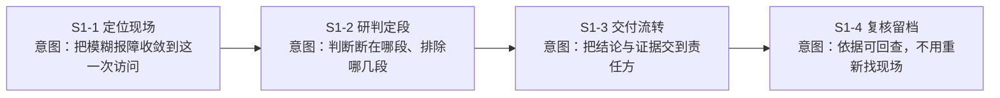

# 1.1 目标用户现状痛点剖析与当前任务旅程还原 (Persona, Pain Points & As-Is Journey)

> 💡 **中枢定位**：
> 本文档承接【方案系统设计主线】步骤 1 的**两项核心决策**，产出下游 1.2 与说明书的输入：
> * **决策一：目标用户与现状痛点**——谁的哪件事被卡住，卡在哪个节点、被什么困住。
> * **决策二：主场景拆分与 As-Is 旅程**——本次需求覆盖哪几条可独立闭环的场景，各场景现状旅程怎么走、痛点插在哪。
>
> **产物去向**：主场景清单（含要办成的事、痛点名称 / 严重度 / 现状基线、困住方式、用户原话）→ 1.2 写体验目标；**各主场景任务旅程（2~5 块任务 + 每步意图，作为 1.3 的现状覆盖基线，允许 1.3 通过范式跃迁合并或删除步骤）+ 核心数据与任务形态特征（为下游提供视觉与交互本质锚点）**；角色与场景表 → 《设计说明书》Part1 第 1、2 节。
> **交接边界**：As-Is 旅程图随本次运行对 1.2 可见（1.2 判定"哪一步被删掉"与证据①要用）；但它**不随说明书交付**，跨人 / 跨工具交接时以「触发情境 + 场景卡点清单 + 用户原话」代偿，缺这三样即判交接不完整。

> 🛑 **阶段铁律**：
> **需求分析是完全基于现状的（As-Is）。** 必须先拆出主场景，再按场景还原当前真实操作全貌并插旗；**严禁**揉成一条笼统旅程，也**严禁**出现任何“未来的优化后旅程图”。（未来旅程不再单独产出，优化动作直接落在后续页面设计中）。

---

## 一、需求理解与穿透方法论：从“伪需求”到“业务本质”

上游业务规划或产品经理递过来的原始需求，往往是**披着功能外衣的“伪方案”**（如：“在表格加个导出按钮”、“加个弹窗配 IP”）。资深设计师在动刀前，必须通过三层穿透法提纯出真实的业务本质。

### 1. 需求解构的三层真伪模型

```text
┌────────────────────────────────────────────────────────────────────────┐
│ 1. 表面功能层 (Feature Request) : 规划提的表象需求（如：“希望加个跨屏批量同步按钮”）│
│         ↓ 追问触发场景与前置上下文                                            │
│ 2. 业务目标层 (Business Goal)   : 业务真正要考核的产出（缩短现场交付工期，降低人力成本）│
│         ↓ 剥离 UI 形式，挖掘用户底层意图                                      │
│ 3. 用户本质意图：不想在弱网机房给 50 台设备重复抄录参数                │
└────────────────────────────────────────────────────────────────────────┘
```

### 2. 需求提纯的反向追问三部曲
在面对模糊需求时，设计者必须在脑内或向业务方发起三项关键追问：
1. **追问触发情境**：“用户在什么具体状态下会点击这个功能？前一秒他在干什么？后一秒他要拿着结果去向谁汇报？”
2. **追问现状阻塞点**：“现有系统为什么走不通？最折磨用户的具体是哪一个界面的哪一步？”
3. **追问风险代价**：“如果这个需求完全不做，最坏的结果是什么？会导致资金损失、违约罚款，还是引发高危宕机事故？”

> 🛑 **注意：这三问在自己脑子里问，不要甩给用户**。缺答案就按 `【假设】` 补（补齐规则见 1.2 第一节「输入里读不出来的怎么办」），一路跑到草图再一次性对齐。

### 3. 字段清单型 PRD 的专项处理（最容易照抄错的一类）

> 🛑 **实测病**：PRD 给的是一张字段表 + 一串动作清单，AI 就照着画成"12 列的台账 + 几个按钮"。结果**动作漏了四个、字段还被随意合并**，规划人员一眼就看出"这不是我要的"。

**两条铁律**：

| # | 铁律 | 怎么做 |
| :---: | :--- | :--- |
| **1** | **字段清单是信息备选池，不是列清单** | 每个字段都要能回答"它去了哪"：主表 / 详情 / 不展示（+ 原因）。**可以合并、可以下沉，但不许静默消失** |
| **2** | **动作清单是验收项，不是示意** | 每个动作（安装 / 升级 / 卸载 / 解绑 / 批量编辑 / 基础配置 / 导入 / 标签 / 导出）都要有页面落点，落不了的写"本期不做 + 原因" |

**还要做一次"意图复核"**：字段 + 动作只能说明"要做哪些功能"，说不出"为什么做"。必须再问一句——

> **"这套东西做出来，用户拿它办的是哪件重复发生的事？"**

| 若 PRD 只有字段与动作 | 常见真实意图 | 影响 |
| :--- | :--- | :--- |
| 终端台账 + 12 个字段 + 批量升级 | 可能是**日常运维**（谁没装好、谁版本旧），不是"管理台账" | 主战场从"列表"变成"待处理" |
| 报表字段 + 导出 | 可能是**对上汇报**，不是"自己看数" | 结论区与截图能力比表格更重要 |
| 配置项 + 校验 | 可能是**怕配错出事**，不是"配得快" | 影响预览比表单优化更重要 |

> 📌 **动作域齐全 ≠ 设计到位**：先把动作域铺全（不漏），再决定哪一条是主战场（有重点）。**漏是硬伤，平是其次。**

---

## 二、角色心智参考池与使用情境（本需求只收敛主 + 次两个）

必须将角色置入**真实的物理环境与心理压力**中去剖析痛点，杜绝坐在空调房里空想：

> 🛑 **下表是角色参考池，不是本需求的角色清单**：本需求只收敛出**主角色 1 + 次角色 1**（谁主用、谁被牵动），交说明书的角色卡也只有这两张；其余角色合并进次角色或不写，禁止照抄四类。

| 排序与角色分类 | 代表岗位与细分角色 | 真实使用情境与心智压力 | 核心体验痛点根源 |
| :--- | :--- | :--- | :--- |
| **① 管理员群体 (Admins - 最高频)** | 运维管理员、安全管理员、审计管理员、租户管理员 | **心智：求稳、防背锅、怕脏写**<br>面对海量异构设备与海量策略规则，最怕修改一个参数引发次生故障；日常频繁在多个业务系统切换。 | 专业术语理解门槛高；多场景（如内网/分支/SaaS）配置割裂无法统一；缺乏实时防呆预校验；配置修改后无法预知波及面。 |
| **② 一线交付 / 技服工程师 (Field & Service Engineers)** | 客户现场交付人员、售后技术支持、网络实施工程师 | **心智：开局快、别卡壳、客户在旁盯着**<br>常处于客户机房、弱网甚至无网环境；设备无显示屏，需临时接串口线；时间紧迫，交付延期面临扣款。 | 设备初始化繁琐；缺乏开箱即用指引（如即插即用、贴纸扫码指引）；授权激活流程割裂；批量配置流程冗长且极其容易漏配关键参数。 |
| **③ 客户侧管理者 / 决策者 (Decision Makers / Executives)** | CIO、CTO、安全总监 (CISO)、IT 运营负责人 | **心智：一屏掌控、量化因果、防被蒙蔽**<br>不关心具体某条日志，需要向上汇报汇报投资回报率（ROI）、业务可用性、SLA 达标率与安全态势。 | 数据颗粒度过碎，报表全是离散表格，看不出宏观趋势；系统给出的结论缺乏量化证据支撑，难以用于管理决策与汇报。 |
| **④ 企业终端员工 / 业务使用人员 (End-User Employees)** | 办公内网员工、分支机构外勤、普通业务申请人员 | **心智：别烦我、别打扰、一键自愈**<br>使用客户端仅为完成本职工作，极度厌恶复杂权限拦截与安全打扰；电脑卡顿时急需自愈。 | 安全合规管控频繁中断办公工作流；弹窗过多干扰视线；客户端卡顿甚至断流；报错提示全为技术代码（如 0x800401），不知如何恢复。 |

---

## 三、现状痛点微观解剖工具：基于“认知与操作阻碍”四维模型

资深设计师诊断痛点不是背诵大词，而是精准定位用户在界面上的具体**生理与认知阻碍**：

```text
┌──────────────┐     ┌──────────────┐     ┌──────────────┐     ┌──────────────┐
│  1. 看 (信息) │ ➔   │  2. 想 (认知) │ ➔   │  3. 动 (操作) │ ➔   │  4. 等 (反馈) │
│  盲区 / 噪音 │     │ 术语 / 恐惧  │     │ 折返 / 机械  │     │ 盲等 / 报错  │
└──────────────┘     └──────────────┘     └──────────────┘     └──────────────┘
```

### 1. 看（信息获取卡点）
* **视野盲区**：核心指标分散在 3 个以上的页面，没有单一视图能纵览全局因果链；
* **视觉噪音**：全屏告警满堂红，关键离群尖刺指标被淹没在 95% 的无效低危事件中；
* **人工拼图**：在监控系统看到时延高，需手动复制 IP 打开拓扑系统比对，再打开日志系统搜时间切片。

### 2. 想（决策推理卡点）
* **术语黑盒**：全是底层底层协议专业缩写（如 MTU、BGP MED、Keepalive），没有自然语言说明；
* **隐性冲突**：A 配置与 B 配置互斥，但界面不给任何提示，全凭老专家经验“口口相传”；
* **决策恐惧**：点击“提交”按钮时，界面无法直观预览影响面（不知道会断开多少个连接、产生多大流量抖动）。

### 3. 动（交互执行卡点）
* **路径折返**：为了给设备绑定一个标签，必须跳出当前向导去标签中心新建，返回时原表单被全部清空；
* **机械重复**：给 100 个分支下发相同策略，必须手动重复配置 100 次，不支持同源聚合下发；
* **零容错手抖**：高危删除或下线操作仅弹出一个普通“确认”按钮，无二次敲击确认或回滚快照。

### 4. 等（状态反馈卡点）
* **异步盲等**：点击批量下发后界面只有无休止的 Loading 转圈，无分步进度、无完成倒计时；
* **报错无效**：失败时仅弹出一句通用的“系统异常 (500)”，不告诉用户究竟是哪一行数据填错了，逼迫用户推倒重来。

---

## 四、主场景拆分 → 分场景 As-Is 链路与痛点插旗（内部）

> ⚠️ **强制顺序**：先拆**主场景**并标明痛点 → 再给每条主场景画**任务旅程（2~5 块任务）** → 再按场景串出现状链路、插旗定级。  
> 禁止把整模块揉成一条「大而全」旅程——不同触发情境下的主场景、角色压力与断点往往完全不同，混画会漏痛点、也导不出可落地的体验目标。

### 1. 主场景拆分：五步法（顺序不可跳）

> 🧭 **拆不出"面"，八成卡在第 1 步**：直接从 PRD 功能清单起手，拆出来的必然是一串动作。必须先把岗位职责铺开，再收敛成本次的主场景。

**拆分轴**：按**任务项**拆——一个任务项 = 用户要独立办成的一类事。不按页面、功能点或操作步骤拆（页面是手段，场景是用户真实要办成的一件事），**也不按生命周期阶段 / 流水线环节拆**（阶段是场景内部的步骤，不是场景）。**判据是"这块工作归谁负责、按什么节奏反复做、做到什么算完"，不是"什么时候触发"**——按时机或阶段拆，最容易把一条闭环劈成两半（"批量升级"＋"结果追踪"、"告警研判"＋"误报处置"）。

> 🛑 **阶段不是场景，这是本步最贵的一处混淆**：一条闭环（找入口 → 定位对象 → 研判分析 → 处置回写）里的每一段都是**子步骤**，合起来才是**一个**场景。把它按"运营 / 研判 / 处置"切成三条，后面每一步都会跟着失真——1.3 的方向只能挂在半段上，1.4 的场景 tab 变成同一条流水线的三截，1.2 的体验目标也只能写半句。
> 🛑 **不同任务项的边界**：两条场景之间的差别必须是**"办的是不同的事"**，不是"同一件事的不同阶段 / 不同页面 / 不同对象"。规则配置与运营（一条条把规则搭起来）／ 告警研判（规则生效后出现告警去处置）／ 周期性汇报（用了一段时间向管理层交账）——这三条各自有独立的触发、独立的终态产物，才是三条场景。

#### Step 1｜盘点岗位职责（先定域，再成面）

**做什么**：在**本次需求背景划定的业务域内**，把主角色的相关职责写成一份「职责清单」，一行一项，此时还不叫场景。

> 🛑 **先定域，不要把岗位的全部工作倒进来**：管理员还要排障、还要看安全事件，但"终端管理"这类需求只覆盖终端的纳管与运维。**域外职责只记一行，不展开、不成场景**——否则清单越长越像样，拆出来的场景却有一半不在本次范围里。

**先写三个锚**（取自需求指令：立项目标 / 范围 / Non-Goals）：

| 锚 | 怎么定 | 例（终端管理需求） |
| :--- | :--- | :--- |
| **业务域** | 本次需求管哪些对象、哪些能力，到哪为止 | 终端的纳管、配置、合规与批量运维；不含网络策略、不含安全事件研判 |
| **主角色** | 谁是主用（主 1 + 次 1） | 终端运维管理员（主）/ 一线支持（次） |
| **域外相邻职责** | 同一岗位会干、但本次不覆盖的事 | 网络故障排查、安全事件处置 → 记一行，**不拆场景** |

**从哪取**（至少两类；取不到标 `【假设】`；**只捞与业务域同域的事**）：

> 🛑 **`【假设】` 的边界（与 `EX-1.1-07` 配对）**：`【假设】` 可以补**业务域 / 角色 / 节奏**这类背景，**不能用来造场景**——一条场景若在需求文档里找不到出处（章节 / 原句），就不该进清单。**"产品里有这功能"不构成出处**：产品有规则配置、本次需求只改告警流程时，规则配置只能记在「本次不涉及」行。

| 证据源 | 取什么 |
| :--- | :--- |
| 需求指令 / PRD | 先定业务域与 Non-Goals，再反查职责有无漏项（**不从功能清单直接起手**） |
| 工单 / 报障记录 | 与本次业务对象相关、高频重复发生的事 |
| 值班表 / 巡检表 / 排班表 | 与本次业务对象相关、按固定节奏发生的事 |
| 操作日志 / 审计记录 | 系统里反复发生、且落在业务域内的事 |
| 岗位说明书 / SOP / 考核指标 | 组织要求他必须扛、且与本次业务域相关的责任 |
| 用户原话 | "我每天 / 每周都要……""这摊事一直是我在管"（只取与业务域相关的部分）；**取到的原话逐句留档，进交付模板第 4 项，不许提前改写成书面语 / 需求术语** |

**一行怎么写**：`责任对象 + 持续动作 + 节奏 + 交付物`，**责任对象必须落在业务域内**。
> 例：`终端合规状态 ｜ 监控与整改 ｜ 每周 ｜ 合规率 + 整改台账`

**合格线**（三条全过）：
1. 每条责任对象都在业务域内；域外的一律进「域外相邻职责」那一行，不进清单；
2. 职责条数 ≥ 本次要交的主场景数；
3. 每条都说得出**责任人**与**节奏**——说不出节奏的，基本是动作不是职责。

**反向检查（防发散）**：清单里出现与业务域无关的职责（做终端管理却列了"网络故障排查"）→ 删掉或移入域外行，**不得据此拆场景**。

#### Step 2｜职责成景（命名标准化）

**公式**：`业务对象 + 职责词（名词化）`

| 项 | 规则 |
| :--- | :--- |
| **必须在域内** | 名称描述的能力落在 Step 1 的业务域内；域外职责再完整也不成场景 |
| **必须命中职责词** | 运营 / 运维 / 管理 / 治理 / 盘点 / 交付 / 上架 / 值守 / 复核 / 审计 / 维护 |
| **禁用动作词** | 新建 / 查看 / 编辑 / 导入 / 导出 / 配置 / 提交 / 下发 / 查询 / 处理 / 设置 |
| **一票否决** | 说不出这个名称在产品里对应哪个能力域、下面挂哪 3~8 个子能力 → 回 Step 1 换职责 |

**替换对照（跨领域，用来校准自己的尺度）**：

| ❌ 动作名（一个点） | ✅ 职责名（一个面） | 这个面覆盖什么 |
| :--- | :--- | :--- |
| 新建检测任务 | **周期巡检运营** | 周期下发、异常浮出、处置清零、结果留档 |
| 查看告警列表 | **日常告警运营** | 接入降噪、分派处置、闭环复盘 |
| 配置合规基线 | **设备初始化上架** | 开箱、装基线、验通、交付上线 |
| 编辑用户权限 | **账号生命周期管理** | 入职开通、调岗变更、离职回收、定期复核 |
| 导入资产文件 | **资产台账盘点** | 多源采集、认领核对、差异处置、出账 |
| 修改策略规则 | **策略全生命周期管理** | 草稿、评审、灰度、生效、下线 |
| 升级设备固件 | **版本与补丁运营** | 版本盘点、灰度升级、失败回滚、版本收口 |
| 导出合规报表 | **合规交账与报表交付** | 口径对齐、取数、复核、出账 |
| 处理服务工单 | **服务工单运营** | 受理、分派、SLA 跟踪、回访 |
| 审批权限申请 | **权限申请与审批治理** | 申请、审批、授权、到期回收 |

#### Step 3｜颗粒度判定（六条判据，缺一即退回）

| 判据 | 问法 | 通过 |
| :--- | :--- | :--- |
| **有周期** | 这件事是按天 / 按周 / 按项目发生的，还是一次性的？ | 有周期或有一个完整的"起 → 终" |
| **成面** | 这是某个岗位持续承担的一项职责，还是本周做完就没有的一段任务链？ | 有稳定责任人与运营节奏，能常态反复发生 |
| **有终态** | 说得出"这件事算完了"的标志吗？（业务跑起来了 / 巡检有结论了 / 问题收了） | 有**独立的终态产物**——不是"提交了 / 下发了 / 点完了"这类操作终态 |
| **闭环自足** | 这一段做完，业务上**自己就交代完了**吗？还是必须等下一段来收尾？ | 本段内自带收尾动作（拒绝 / 回写 / 交接 / 留档），不靠下一段补 |
| **不含操作词** | 名字里是不是"新建 / 配置 / 查看 / 提交"？ | **含操作词 = 拆碎了** |
| **能独立交给一个人** | 能不能说"这块工作归你负责"？ | 能 |

**追一问的自检法（方向不许反）**：

> **"如果这件事只做了一半就停了，业务上会有什么后果？"**

| 答 | 判定 | 处置 |
| :--- | :--- | :--- |
| 没什么后果，反正就是操作了一下 | 这是**动作**，不是主场景 | 往上合并 |
| 有后果，**且要靠下一段工作来消除**（告警没研判就完不成、误报没撤销就还挂着） | 这是**闭环的一半**，不是完整场景 | **本段与下一段必须合并**，终态取最后一段的业务终态 |
| 有后果，**且本段内已有收尾动作**（本段就能拒绝 / 回写 / 交接 / 留档） | 这才是**完整闭环** | 可以单独成场景 |

> 🛑 **旧口径已反转**：过去把"做一半有明显后果"当作"完整主场景"的证据，正好判反了。**有后果且必须靠下一段来消，说明它被切开了**；只有"本段内自己收得了尾"才算闭环。这一条是本步最容易判反的地方。
> 📌 **代价**：合并不丢信息——被合并的那一段会作为**步骤**留在场景内（见第 2 节任务旅程），照样有意图、有完成标志、有痛点插旗。

**合并回哪个主场景？** 顺着问三句：这个动作是为了什么？那个"为了什么"又是为了什么？问到"业务上要达成的状态"为止——那就是主场景的颗粒度。

#### Step 4｜合并与收敛（收敛到 1~5 条）

**4.1 分合判据（一票否决，逐对场景比较）**

把任意两条候选场景摆在一起，先看「必须合并」这一列：**命中任一 → 合并成一条，不许留在清单里**。四条都不命中，再看「必须独立」是否同时成立。

| 必须合并（命中任一即合并） | 必须独立（要同时成立） |
| :--- | :--- |
| **串行**：A 的终态就是 B 的起点 / 触发（B 的触发写着"已处理完"） | 两条的**终态产物不同**（不是同一条流水线的前后节点） |
| **同产物**：A、B 的终态落在同一个产物 / 同一个状态字段上 | 两条的**触发时机不同源**（不同事件、不同节奏） |
| **同入口**：A、B 从同一个入口、同一批对象发起 | 两条**各有独立的需求出处** |
| **半程**：只做 A 不做 B，后果要**由 B 来消除** | 各自能独立说完"谁、在什么情况下、办成什么" |

> 📌 **为什么要单独立这一条**：颗粒度判据看的是"名字像不像动作"，而串行拆分往往名字看着很"业务"（"告警运营"＋"研判管理"＋"误报处置"），照样能把一段旅程劈成三截。**劈开之后，目标只能挂在半截上，突破点只能在界面层打转，方案只能覆盖半截。**

**4.2 辅助检验**（与上表配套，不单独成立）

| 体检 | 不合格信号 | 处理 |
| :--- | :--- | :--- |
| **终态检验** | A 的终态是"任务发出去了 / 操作点完了 / 看完了" | 这不是业务终态（用户拿到的是"发出去"，不是"跑起来了"）→ 合并或重定终态 |
| **名字检验** | 名字含"定位 / 追踪 / 查看 / 结果 / 下发 / 配置 / 新建 / 研判 / 处置 / 复核" | 回 Step 2 改名；**加个"管理 / 运营"糊过去不算改名**（见 4.3） |
| **子集检验** | A 的子事项能被 B 全覆盖 | A 是 B 的子集 → 合并 |

> ✅ **合并后的正确写法：一个责任域 + 一个业务终态。**
> ❌ `S3 批量升级` ＋ `S4 结果追踪` → 两半都是半程，目标写不出闭环
> ✅ `S2 批量运维`：从选批、预检、下发，到逐台结果确认与失败重试，**终态是"这批终端按目标状态跑起来了，没成的有结论和处置"**
> ❌ `S1 应用告警运营` ＋ `S2 内容告警研判` ＋ `S3 告警误报处置` → 一条告警闭环被切成三截
> ✅ `S1 告警闭环`：从找到入口、定位对象、研判分析，到处置与回写，**终态是"这条告警有了结论并落到设备/台账上"**

**4.3 条数怎么来：不是先定条数，是六问跑出来的**

条数 **1~5 条**，由需求范围决定，**没有下限（1 条完全合法）**。推导顺序固定：

```text
需求里的独立任务项（每条有需求出处）
        ↓ 组① 三问逐条筛（拿掉还成不成立 / 拆得出旅程 / 是行业 job）
候选场景
        ↓ 组② 两问两两合并（终态产物是否首尾相接 / 目标能否独立）
定稿 1~5 条
        ↓ 组③ 一问反证（合并后还有没有发力点）
定稿 / 回拆
```

> 🛑 **为什么不设 2 条下限**：需求本身可能就是一条流水线（"本次只做告警处理流程优化"），硬凑第二条必然靠联想扩展，或把闭环切开。**1 条不是没拆开，是这次真的只有一件事。**
> 🛑 **>5 条才是没收敛**：说明把动作或阶段当场景了，回 Step 3 与 4.1。
> 📌 **逐条标本次相关度**（高 / 中 / 低），**本次不做的职责也要写明**，避免评审时才被问住。每条最终要说清四件事：**谁、在什么触发下、要办成哪件完整工作、若不做会怎样**。

#### Step 5｜场景自检六问（内部自问自答，不向用户提问）

> 🛑 **为什么要有这一节**：上面所有判据都依赖"你填的字段"（终态、出处、名字），填得漂亮就能过——这是**自证式判据**的通病。反问换了个方向：不看你声明了什么，只看你**答不答得上来**。答不上来的那一条，就是拆错的。
> 🛑 **反问是内部动作**：1.1→1.4 一路贯通、中途不提问（第 0 条），**不许把这些问题抛给规划人员**。
> 🛑 **答案必须落盘**：填进下面「场景自检表」，否则只在脑子里过一遍等于没问。

**两句金标准**（念一遍就够，其余六问都是它的展开）：

| 组 | 金标准 |
| :--- | :--- |
| ① 闭环性 | **把这件事从用户的一天里拿掉，他还会不会专门去做？** 拿掉后工作不成立 → 它是步骤一环；拿掉后工作仍要做、只是更麻烦 → 它是场景 |
| ② 任务项 | **把所有场景的终态产物排成一列，看是不是一条流水线。** 首尾相接 → 一条场景；出现分叉 / 并行 → 多条 |

**组① 这一条站不站得住（逐条问，N 条问 N 次）**

| # | 反问 | 判法 | 不过怎么办 |
| :--: | :--- | :--- | :--- |
| 1 | **这是用户的日常任务，还是某个任务里的步骤一环？** | 用金标准；另加一侧证：它有没有**自己的触发时机**（不是非等别人先做完才存在） | 步骤一环 → 并入所属场景，不进清单 |
| 2 | **能不能拆出 2~5 块有意图的使用旅程？**（旅程 ≠ 点击、跳转） | 每块必须写得出"这一步要办成什么"。**写出来全是"点开 / 筛选 / 选择 / 提交"= 操作序列，不是旅程** | 拆不出 → 降为步骤；只拆得出 1~2 块 → 太薄，合并；>5 块且彼此无因果 → 多任务被捆，拆场景 |
| 3 | **这是网安行业常见的 user job 吗？** | 能说出它在行业里的**通用 job 名 + 所处环节**（资产盘点 / 策略运营 / 告警研判 / 事件响应 / 合规交账 / 变更发布），并能对上产线知识库里的角色职责 | 说不出通用名、也对不上产线职责 → 先复核需求出处；确属本产品自造流程，须写明"行业暂无对应 job，依据为需求第 X 节" |

**组② 场景之间该不该分（两两问，N 条问 N×(N-1)/2 次）**

| # | 反问 | 判法 | 不过怎么办 |
| :--: | :--- | :--- | :--- |
| 4 | **每条场景有独立的价值目标吗？** | 每条能单独回答"这件事做好了，谁得到什么"，且能与 1.2 的目标**一一对上** | 两条的目标必须并成一句才说得通 → 同一条场景 |
| 5 | **这些场景是不是都服务于同一个任务下的子步骤？** | 把所有终态产物排成一列：**首尾相接（A 的产出是 B 的输入）→ 是同一任务的子步骤** | 相接 → 合并，终态取最后一段的业务终态 |
| 6 | **合并之后，1.3 还有发力点吗？**（反向校验，防过度合并） | 合并后若说不出一处"这段能被删掉 / 被系统接管"的质变 → 原本就是两条任务 | 无发力点 → 拆回；这是防从"过度拆分"滑到"过度合并"的唯一闸口 |

**场景自检表（内部底稿，不进说明书）**

| 场景 | ① 日常任务？（拿掉还成立吗） | ② 可拆旅程（块数 + 块名） | ③ 行业 job 名 + 环节 | ④ 独立价值目标（对得上 1.2） | 终态产物（谁手上多了什么） | 两两合并结论 |
| :--- | :--- | :--- | :--- | :--- | :--- | :--- |
| **S1. …** | 日常任务（有独立触发） | 4 块：找入口 / 定位对象 / 研判 / 处置回写 | 告警研判 · 运营阶段 | 处置一条告警从 30 分钟降到 8 分钟 | 告警状态变为已处置，台账新增 1 条记录 | 与 S2（误报处置）首尾相接 → 已合并 |

> 📌 **两条出口留给下游**：组②第 4 问不过 → 回 1.1 合并（1.2 的目标会自然变成一条）；第 6 问不过 → 回 1.1 拆回（1.3 才有力可发）。**1.2 / 1.3 发现"目标只能写半句""方向落不了地"时，都退回这里，不许在 1.2 / 1.3 就地凑。**

---

#### 主场景清单模板（内部工作底稿 · 9 列）

> 🗂 **域外相邻职责不占场景行**：在清单表下方用一行记「本次不覆盖：网络排障、安全事件处置」，供评审时说明边界，不参与编号与插旗。**域内但本次需求没涉及的**另记一行「本次不涉及」，同样不占场景行。

> ⚠️ 模板里的「这条主场景要办成的事」一栏，按上面的颗粒度填。示例那几行是"完整主场景"的写法，照着写，不要退回成"新建 xxx"。
> 📌 **业务终态（新增硬字段）**：写成"办成之后，谁手上多了什么 / 什么状态变了"。只许写业务态，不许写"提交了 / 下发了 / 看完了"。**两条场景的终态若指向同一个产物、或正好是同一条流水线的前后节点 → 它们是同一条场景**（回 Step 4 · 4.1）。
> 📌 **需求出处（新增硬字段）**：写需求文档的章节号或原句片段，用来挡"联想扩展"。**不许写 `【假设】`**——`【假设】`只能用于场景内部细节（字段 / 阈值 / 异常态），不能用来造场景本身。
> 📌 **1 条场景也合法**：本次需求只覆盖一条流水线时，清单就一行。**不许为了凑条数把闭环切开**（回 Step 5 · 组①第 1 问）。
> 📌 **主场景写"这份工作要维护／交付的那份东西 + 覆盖的工作内容"，且子事项要列 3~8 项**（少于 3 项说明还停在"点"上，回 Step 1 换职责），例如 `维护一份清晰可用的资产台账，含入库、分类、打标、出库`。**不写"从 A 到 B"**——那是体验目标的跨越句，写进主场景会让 1.2 无处可写，目标只能比主场景更小。
> 📌 **「触发情境」只在本表用来推演旅程与断点，不写进说明书**：设计说明书第 2 节的场景表固定四列（场景 / 主要角色 / 主场景要办成的事 / 现状卡点），因为"什么时候发生"单列一列既不省字，又诱使人按时机切场景。
> 📌 **编号和名称写在同一格**：`S1. 账号生命周期管理`，不拆成两列。编号是后面插旗、审查、旅行程时唯一的引用键，**跟名字贴在一起才不会错位**；单独一列既占宽，又容易被表格换行冲散。

| 场景（编号. 名称） | 触发情境 | 主要角色 | 这条主场景要办成的事 | 业务终态（谁手上多了什么） | 需求出处 | 是否存在痛点 | 现状核心痛点概括 (As-Is 卡点) | 与本次需求的相关度 |
| :--- | :--- | :--- | :--- | :--- | :--- | :---: | :--- | :---: |
| **S1. 账号生命周期管理** | [如：入职 / 调岗 / 离职等人事事件] | [如：租户 / IT 管理员] | [如：**维护一份始终准确的账号与权限台账：入职按岗开通、调岗按新岗收放、离职一次收干净**] | [如：**台账与人事事件一致，离职次日无残留权限**] | [如：需求 §3.2 开通 / §3.4 离职回收] | 🔴 存在痛点 | [如：权限无套餐模板，需在多页面逐项勾选，耗时长且极易漏配] | 高 / 中 / 低 |
| **S2. …** | … | … | … | … | 需求 §… | ⚪ 流程顺畅 | [无明显痛点 / 体验良好] | … |

> 🛑 **这 9 列是内部底稿，不进说明书**：「触发情境」「业务终态」「需求出处」「相关度」只用于推演旅程、挡联想扩展与决定要不要插旗。交说明书时**换成四列**（场景 `编号. 名称` / 主要角色 / 主场景要办成的事 / 现状卡点），见第五节交付模板。

#### 拆分示例：用户管理模块

| 场景（编号. 名称） | 触发情境 | 主要角色 | 这条主场景要办成的事 | 是否存在痛点 | 现状核心痛点概括 (As-Is 卡点) |
| :--- | :--- | :--- | :--- | :---: | :--- |
| **S1. 账号生命周期管理** | 入职 / 调岗 / 离职等人事事件 | 租户 / IT 管理员 | **维护一份始终准确的账号与权限台账：入职按岗开通、调岗按新岗收放、离职一次收干净，事后查得清谁在何时改了什么** | 🔴 存在痛点 | 权限无套餐模板，需人工在 5 个离散页面逐项勾选；账号禁用与关联资产 / 令牌解绑割裂，离职后存在越权悬挂 |
| **S2. 日常运维排障** | 用户报障「登不上 / 无权限」 | 一线运维 / 管理员 | **把报障处理到用户恢复可用，一个人走完、结论留痕，不惊动二线专家** | 🔴 存在痛点 | 报错全为技术代码无排查建议；排障需跨 3 个系统翻查离散日志，完全依赖二线专家 |
| **S3. 权限合规复核** | 季度审计 / 合规检查 / 离职审计 | 安全 / 审计管理员 | **定期把存量权限复核一遍：超权、僵尸账号、越权悬挂清零，并出得了可交账的复核记录** | 🔴 存在痛点 | 无双周期复核机制；复核口径靠人工拼表，无法按期交账 |
| **S4. 应用接入与授权治理** | 新系统上线、业务方申请接入 | 租户管理员 | **维护一份清晰的应用接入与授权台账：新系统按标准接入，谁申请、批给谁、给了多久全程留档** | ⚪ 流程顺畅 | 现有应用级授权流与审批链清晰闭环，无明显体验阻碍 |

> 📌 **主场景名的写法区别（纠偏）**：主场景要写"**这份工作要办成什么、覆盖哪些事**"，既不是"打开排障页""编辑权限"这类**动作**，也不是"从 A 到 B"的**改善句**——改善句是 1.2 体验目标要干的事。
> * ✅ `把"登不上 / 没权限"的报障处理到用户恢复可用，结论留痕`
> * ❌ `从"用户说不好用"到"确认恢复"`（这是目标，不是主场景；写进主场景会让 1.2 只能写得更小）

---

#### 反例：一条闭环被切成三条（实测，最常见的错法）

| 错误切法 | 死在第几问 | 为什么 |
| :--- | :--- | :--- |
| **S1. 应用告警运营** | 组① 第 1 问 | 拿掉"运营"，后面的研判与处置这一天就不存在——它是同一条闭环的入口段，不是独立任务 |
| **S2. 内容告警研判** | 组② 第 5 问 | 它的终态（一条研判结论）正是 S3 的输入，产物首尾相接 |
| **S3. 告警误报处置** | 组① 第 1 问 | 不是独立 job，是"告警闭环"里的一个处置分支 |

> ✅ 合并后：**S1. 告警处置运营**（一条闭环，名字覆盖全程） —— 找入口 → 定位对象 → 研判分析 → 处置回写，**终态是"这条告警有了结论并落到设备 / 台账上"**。
> 📌 口诀：**单独的「运营 / 研判 / 处置 / 复核」是阶段词，不能单独当场景名**；名字要覆盖整条闭环才算职责名（如「告警处置运营」）。**阶段词可以做步骤名，不能做场景名。**

#### 正例：本次真的只有一条场景（需求只做告警处理流程优化）

| 场景 | 触发情境 | 主要角色 | 要办成的事 | 业务终态 | 需求出处 |
| :--- | :--- | :--- | :--- | :--- | :--- |
| **S1. 告警处置运营** | 高危告警产生 / 值班交接 | 安全运营工程师 | 把一条告警从发现处置到有结论、有回写，一个人走完 | 告警状态变为已处置 / 已驳回，处置记录落台账 | 需求 §2 告警处理流程优化 |

> 📌 产品里"规则配置"虽然已有，但**本次需求文档没涉及** → 不成场景，只记在「本次不涉及」行；"向 CIO 汇报"本次也没写 → 不联想扩展。
> 📌 这时 1.2 只写一条体验目标、1.3 只做这一条闭环里的 4 块任务——**条数少不是拆得不够，是需求本来就这一件事**。

---

### 2. 主场景任务旅程（2~5 步 · 每步是一块任务，作为 1.3 骨架）

> 主场景清单确定后、画现状链路前，**先把每条主场景"本该有的步骤"画出来**——只写"这件事正常应该怎么走完"，不掺现状痛点（痛点留给第 3、4 节）。这张旅程是 1.3 拆"体验突破方向"的骨架：**有几块任务，就到 1.3 出几条方向**。

**先定"什么才算一步"（最常错的地方）**

一步 = **一块能独立交代的任务**，不是一次操作。三条判据，缺一就是拆碎了：

| # | 判据 | 问法 |
| :---: | :--- | :--- |
| 1 | **有交付** | 这一步做完，手上多出一样东西或一个结论吗？（一个现场 / 一段定论 / 一份交接 / 一份记录） |
| 2 | **能交代** | 能对别人说"这块我负责、做到这里算完"吗？ |
| 3 | **不是操作** | 打开某页 / 输入 IP / 选时间范围 / 点查询 / 看某个字段 / 复制一条证据——这些是**步内动作**，不能单独成步 |

> 🛑 **点一下、输个 xx 不算一步**：旅程写成"① 输入 IP ② 选时间 ③ 点查询 ④ 看结果"，到 1.3 就只能拆出"让人输得更快"这类操作级方向，整条旅程的高度被锁死在界面上。
> 📌 **一步里可以有很多动作**：真正的步骤是"定位现场""研判定段""交付流转"这种块，块内动作几个都行，不必也不许拆开写。

**正反例（同一件事，两种切法）**

| ❌ 按操作切（不能这样写） | ✅ 按任务块切（这样写） | 为什么能合并成一步 |
| :--- | :--- | :--- |
| 输入 IP / 选时间范围 / 点查询 / 翻结果 | **定位现场**：把一句模糊报障收敛到这一次访问 | 四个动作只服务一个结论——"是哪一次访问" |
| 打开拓扑 / 看图 / 点节点 / 打开日志 | **研判定段**：判断问题出在哪一段、排除哪几段 | 换了三个系统，交付的还是同一个判断 |
| 复制证据 / 填说明 / 发群 | **交付流转**：把结论与证据交到责任方，对方能直接接手 | 一条交接任务，不该按介质拆成三步 |
| 导出记录 / 归档 / 回看 | **复核留档**：依据可回查，不用重找现场 | 一个留档任务 |

**做法**

1. 对每条主场景，按**任务块**列出步骤：**2~5 步**；不按页面、不按功能点、不按操作动作。**块数多说明这条场景的活重，处理方式是合并块，不是把场景拆开**——拆不拆场景只看 Step 4 的分合判据与 Step 5 的六问，**从不看块数**。
2. 每一步写一句「意图」：这块要办成什么、为什么需要它。
3. 步骤用路径图串起来（mermaid 或箭头链），意图写在步骤旁。
4. **步数对账**：**2~5 步 = 1.3 的方向数**。
5. **每步给稳定编号**：`Sx-n`（n 从 1 连续，如 `S1-1`）；这是 1.3、1.4 与下游逐字引用的键，不许改号、不许跳号。**场景编号与步骤编号必须一起出现**（只有"①"这种圆圈序号，下游对不上）。
6. **每步写「完成标志」**：这一步做完，屏幕上 / 手上多出什么（一条结论、一份记录、一个状态、一份可交接的材料）。**1.4 不再投影"看到"**：步骤头改由下一行「本步骤操作」写这一页做了什么动作；完成标志留给 1.3 的方向落点与 1.4 的末态块。
   - **< 2 步**：还没拆开，多半只写了"处理一下"→ 回主场景拆分按任务块重拆；
   - **> 5 步**：把操作当步骤了 → 按上表往上合并（一串动作只服务一个结论 = 一块任务）；
   - **合并不能合过界**：合并后仍要说得清"这块做完手上多出什么"，说不清说明把两块任务捏成一块了。

**示例（示意结构，勿照抄业务）**



**步骤卡（同时交这张表，1.3 / 1.4 都读它）**

| 步骤 | 步名（≤6 字） | 意图（一句） | 完成标志（做完看到什么） |
| :---: | :--- | :--- | :--- |
| S1-1 | 定位现场 | 把模糊报障收敛到这一次访问 | 锁定一个对象、一个时间窗 |
| S1-2 | 研判定段 | 判断断在哪段、排除哪几段 | 说得出断点段与已排除段 |
| S1-3 | 交付流转 | 把结论与证据交到责任方 | 一条已交接、可回查的记录 |
| S1-4 | 复核留档 | 依据可回查，不用重新找现场 | 从记录回到原始现场，不重跑 |

> 🛑 **这张表是下游的现状覆盖基线（2026-11-27 修订）**：1.3 的步骤溯源与 1.4 的场景剧本步骤头引用这里的 `Sx-n` 与步名；**但 1.3 允许通过范式跃迁将相邻步骤合并或前置吸收（标明“已由 Bx 吸收”），不再用 1:1 槽位把创新锁死在旧流程里。**
> 🎯 **同步提炼 1 行「核心数据与任务形态特征」**（紧跟步骤卡下方写出，供 1.3 嫁接原语卡与 1.4 选视觉形态）：说明本需求核心数据的内在结构（如：`多轮多模态对话 + MCP 工具调用树 + 规则命中明细` / `多层资产攻击路径图` / `高维部门×应用合规分布` / `高频值守清零队列`），避免下游无脑退回普通台账。
> 🛑 **标准旅程 ≠ 现状链路**：本节画"应该怎么走"（基线）；第 3、4 节画"现在实际怎么走 + 痛点"（插旗）。两者不要混。

---

### 3. 分场景现状任务链路（内部推演，不进说明书）

对相关度为高/中的每条主场景，用一张 mermaid 链路把"现在实际怎么走"串出来，摩擦节点上标 🚩，作为插旗与严重度分级的依据。

> 🛑 **只服务内部分析**：说明书 Part1 第 2 节只收四列场景表，**不收现状流程图**；因此不要求配色、卡片样式与交互效果，节点顺序与卡点说清即可。


---

### 4. 再按主场景深度插旗与严重度分级 (As-Is Journey Deep Dive)

对清单中**本次相关度为高/中**的每一条主场景，分别绘制**当前实际发生的真实用户旅程**，并在断点上打上 **🚩 痛点旗帜**。  
各场景旅程互不合并；痛点编号建议带场景前缀（如 `S1-P1`），便于后续体验目标与设计说明书对齐。
> 🛑 旅程图**只做内部分析与插旗**，不进说明书；`🚩 Sx-Py` 也只留在这里和分级矩阵里。

#### 单场景旅程还原标杆（以「S3. 日常运维排障」为例，示例勿照抄业务）：

```mermaid
graph TD
    subgraph AsIsJourney ["当前用户真实排障旅程 (As-Is Journey) · 场景 Sx"]
        T1["节点 1: 告警群收通知<br>(微信/钉钉收到报警)"] --> T2["节点 2: 登录监控大盘<br>(查看全网时延曲线)"]
        
        T2 --> P1["🚩 痛点 1: 噪音淹没<br>多条链路同时报警，无法秒级获知受损源头"]
        P1 --> T3["节点 3: 跨系统开网页<br>(打开拓扑工具查找链路)"]
        
        T3 --> P2["🚩 痛点 2: 视线断流与拼图<br>拓扑与监控无联动，需人工肉眼搜索设备名"]
        P2 --> T4["节点 4: 登录跳板机查日志<br>(SSH 登录对应路由器)"]
        
        T4 --> P3["🚩 痛点 3: 专家经验依赖<br>新手不会敲CLI命令，排障被迫升级找二线专家"]
        P3 --> T5["节点 5: 策略下发与调度<br>(打开控制台手动修改策略)"]
        
        T5 --> P4["🚩 痛点 4: 无配额防呆<br>缺乏实时配额预校验，调度超限导致二次雪崩"]
        P4 --> T6["节点 6: 人工反复刷屏验证<br>(持续观察15分钟确认恢复)"]
    end
```



> 用户管理类需求时，应对 **S1 开通 / S2 注销 / S3 排障…** 各画一张同等粒度的 As-Is 图，勿只画「管理后台日常操作」一条笼统链路。

---

### 5. 分场景痛点严重度分级矩阵

每个主场景插旗后，各自出一张分级表（可汇总为一张总表，但**必须带场景编号**）：

| 场景 | 旗帜编号 | 发生节点 | 现状物理阻碍描述 | 用户困在 | 痛点等级 | 改善诉求与衡量基线 A |
| :--- | :--- | :--- | :--- | :---: | :---: | :--- |
| **S1. [场景名]** | **🚩 S1-P1** | [节点] | … | **烦 / 看不全 / 不敢信 / 说不清** | **P0 / P1 / …** | … |
| **S3. 日常运维排障** | **🚩 S3-P1** | 节点 2: 监控大盘 | 监控大盘无法秒级定界受损业务线，噪音事件占比达 80% | **看不全** | **P0 (阻塞级)** | 现状平均发现时间 (MTTD) 需 20 分钟 |
| **S3. 日常运维排障** | **🚩 S3-P2** | 节点 3: 拓扑定位 | 监控与拓扑系统相互割裂，用户需跨 3 个网页复制粘贴 IP 比对 | **烦** | **P1 (严重级)** | 每次排障平均跳页 6 次，视线严重断流 |
| **S3. 日常运维排障** | **🚩 S3-P3** | 节点 4: 日志下钻 | 缺少可视化的因果证据链，排障过程必须由资深专家登机敲命令 | **说不清** | **P0 (阻塞级)** | 依赖跨角色协助，平均排障时长 1.5 小时 |
| **S3. 日常运维排障** | **🚩 S3-P4** | 节点 5: 策略修改 | 策略配置缺乏配额试算与超限拦截，操作完全处于高危盲区 | **不敢信** | **P0 (高危级)** | 历史发生过 2 次超配额引发的业务中断 |

> 📌 **「场景」列写 `编号. 名称`，不要只写编号**：只写 `S3` 的表，读者得回头翻清单才知道 S3 是什么。
>
> 🛑 **「用户困在」是 1.2 定维度的唯一原料，必须逐条填**：烦（要反复干）→ 快/省；看不全（不知道有没有、范围多大）→ 可见性；不敢信（不敢引用、怕算错）→ 信任/可解释；说不清（交账要解释依据）→ 可解释/白盒化。**同一场景的不同痛点可以落在不同维度，不要一律写成"烦"。**

---

## 四之半、编号体系：什么时候用、什么时候不许露出来

> 🛑 **这是生成说明书时最常犯的一类错**：把内部用来对齐的编号（`P1`、`S1-P1`、`REQ-xxx`）原样印到给用户看的说明书里。**它们对我们有用，对读者是噪音。**

### 1. 三套编号，各有各的用途

| 编号 | 长什么样 | 用在哪 | 能不能出现在说明书里 |
| :--- | :--- | :--- | :--- |
| **场景编号** | `S1` `S3` | 表单首列、旗帜前缀、跨环节引用 | ✅ **可以**（跟名称写在一起时） |
| **痛点旗帜** | `🚩 S3-P2` | 旅程图节点、分级矩阵、1.3 突破点追溯 | ⚠️ **只在旅程图/插旗区出现，清单表里不写** |
| **原始需求号** | `REQ-HOST-004` `SRC-xxx` | 1.1 前三节的需求溯源、评审对账 | ❌ **不进说明书**（内外两套号，读者对不上） |

### 2. 三条红线

| # | 红线 | 症状 |
| :---: | :--- | :--- |
| 1 | **一个格子里不许出现两个编号** | 痛点描述单元格写成 `🚩 S2-P2：人工比对…`——**旗标已经说明了这是哪个痛点，前缀是重复的** |
| 2 | **原始需求号不进正文** | 每个痛点后面跟一句 `(REQ-HOST-006)`——读者不知道这是什么，只觉得乱 |
| 3 | **清单表不放单独编号列** | 表格里 `S1` `S2` 单独一列，既占宽又容易换行错位 |

### 3. 一条痛点一句话，多条用项目符号

> 📌 **症状**：一个单元格里塞了两三条痛点，用 `① ② ③` 或分号硬连，读起来像一坨。

**规范**：一个单元格写**一件事**；同一行确实有多条痛点时，**用项目符号分行**，不要挤成一段：

```html
<!-- ✅ 正确 -->
<td>
  <ul style="margin:0;padding-left:14px;">
    <li>来源分散：扫描、流量、终端、文件多路数据各出一份结果，无统一归口</li>
    <li>无统一口径：同一资产在不同来源里命名/标识不一致</li>
  </ul>
</td>

<!-- ❌ 错误：三条痛点挤成一段，还带编号前缀 -->
<td>🚩 S1-P1: 来源分散、口径不一；又缺少统一入口；重量整理仍难得到完整清单 (REQ-001)</td>
```

> 🛑 **编号留给图，文字留给表**：旅程图上必须带 `🚩 Sx-Py`（那是定位用的）；**清单表是给人读的，读的是"卡在哪"，不是"第几号"**。

---

## 五、交付标准物模板 (用于注入步骤 4《设计说明书》)

在完成本步骤分析后，设计者在《设计说明书》第一章节严格输出以下**纯现状还原内容**：

> 🗂 **内部底稿另存，但必须交接**：**主场景任务旅程（2~5 块任务 + 每步意图）**、现状链路图与插旗图**不注入说明书**，但必须随 1.1 产物一并交给 1.3——那是 1.3 第 1 步「定框架」的唯一骨架，缺了 1.3 只能凭空编方向。

```markdown
### 一、目标用户与现状主场景（Part1 第 1、2 节）

#### 1. 核心服务角色（两张，主 + 次）
- **主角色**：[例如：资产运营人员]
  - **使用情境**：[例如：多源资产持续上报后的日常维护与交账]
  - **核心心智**：[例如：底账要准，别让我逐台核对]
- **次角色**：[例如：安全运营人员]
  - **被牵动的原因**：[例如：消费同一份资产结果，口径不一致就要回头解释]

#### 2. 本次需求主场景清单与现状痛点（四列）

> 🛑 **进说明书前先过三道**（详见「四之半、编号体系」）：
> ① 场景列写 `编号. 名称`，不单列编号；② 痛点格**不写** `🚩 Sx-Py` 前缀、**不写** `REQ-xxx`；③ 多痛点用项目符号分行，不挤成一段。
> 🛑 **只有四列**：`触发情境` 与 `相关度` 留在内部底稿，不带进说明书。

| 场景（编号. 名称） | 主要角色 | 主场景要办成的事 | 现状卡点 |
| :--- | :--- | :--- | :--- |
| **S1. [场景名]** | [角色] | [**这份工作要维护／交付的那份东西 + 覆盖的工作内容**] | [扼要描述现状摩擦卡点，多条用 `<ul><li>` 分行；无痛点写"无明显痛点"] |
| **S2. [场景名]** | [角色] | [同上] | [同上] |

#### 3. 分场景现状核心痛点清单 (基线 A)
> 🛑 本清单随说明书交付，**只写卡在哪，不写 `🚩 Sx-Py`**——编号只留在内部的旅程图里。
> 🛑 **说明书不收流程图与旅程图**：现状链路与插旗是 1.1 的内部推演物，交付只到「场景表 + 痛点清单 + 用户原话」。
> 🛑 **三段式缺一即不合格**：名称 / 困在 / 等级 + 基线，是 1.2 的唯一原料——只写"卡在哪"会让 1.2 的维度选择与判档退回猜。**无基线写「基线待补」+ 上线验法，不许留空**。

- **S1 · [痛点名称，一个短语，如"多页面逐项勾选"]**（困在：烦｜等级：P1｜基线 A：[次数 / 时长 / 漏配率等真数；无数写"待补 + 验法"]）——[物理阻碍一句话]
- **S1 · [痛点名称]**（困在：看不全｜等级：P0｜基线 A：…）——[心智摩擦 / 高危防呆缺失等]

#### 4. 用户原话清单（供 1.2「口语 → 书面语对照」原话引用）
> 🛑 **必须保留 1.1 的语域**：这里是吐槽语，照抄用户怎么说，**不许提前书面化、不许润色成需求术语**——1.2 才做语域切换，两边都改成书面语，对照就失效了。
> 🛑 **每个有痛点的主场景 1~2 句**，标注来源（访谈 / 工单 / 群聊 / 报障记录）；无原话写 `【假设】原话：…`，由规划人员在草图闸门一次确认。

- **S1. [场景名]**：「[如：录一个人要翻五个页面，谁记得住]」｜来源：[访谈 / 工单 #xxx]
- **S2. [场景名]**：「[如：别让我背锅，得看得出是谁改的]」｜来源：[群聊 / 报障记录]

*(说明：本步骤仅定锚主场景、现状旅程与痛点；优化动作不在本步展开)*
```
