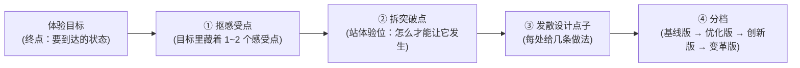

# 1.3 体验目标突破点拆解指南 (Goal → Breakthrough → Ideas)

> 💡 **中枢定位**：
> 本文档承接 **1.2《体验目标》** 与 **1.1《现状痛点》**，是【方案系统设计主线】步骤 1 的收尾环节。
> * 1.2 定的是"**要去哪**"（体验目标这个终点）；
> * 本步定的是"**在哪破、怎么破，并且摆出几个档位的选项**"。
>
> ⚠️ **这一步的性质是"破题"，不是"选型"。** 它不查组件、不定壳、不排页面，只做一件事：把"用户要的体验"拆成能发力的几处，再散出几种做法。

> 🛑 **阶段铁律**：
> 1. **站体验位**：主语是人，说的是人的感受。句子里一旦出现"系统 / 页面 / 数据 / 链路 / 断层"这类系统名词，即判跑偏，作废重来。
> 2. **手法不算突破点**："加个标红""加个图标""换个抽屉"是手段，不是突破点。
> 3. **档位名按"对标水位"取**（基线版 / 优化版 / 创新版 / 变革版）；判一档高不高，看"**用户还出多少力**"，不看"改了多少代码"。
> 4. **目标定多大，天花板就多高**：小目标只能做到"看得更快"，放不出创新版 / 变革版。

---

## 一、这一步产出什么

| 项 | 内容 |
| :--- | :--- |
| **输入** | 某主场景的 ① 体验目标（来自 1.2）② 该场景现状痛点（来自 1.1） |
| **产出** | ① **突破点清单**（2~4 处，用体验语言说"要打破什么"）② 每个突破点下的**分档设计点子** |

> 📌 **一句话**：把体验目标这个"终点"，拆成"要打破的几处体验卡点"（突破点），再顺着每处散出"基线版 / 优化版 / 创新版 / 变革版"几档做法。
> 🔗 **产物去向**：作为下游「**设计草图**」的原料——草图按档位成套输出（见第七节）。

---

## 二、四步法



### 第 1 步：抠感受点（不许跳过）

体验目标**不是一句话**，里面藏着 1~2 个"感受点"。先把感受点拎出来，后面才不会跑偏。

| 体验目标 | 抠出的感受点 | 感受点是什么意思 |
| :--- | :--- | :--- |
| 让管理员**一眼看清**哪台终端不合规、不合规在哪 | **"一眼"** | 不费力——不用找、不用逐个看 |
| | **"看清"** | 不模糊——不用读文字去猜 |
| 让管理员**敢信**系统的处置建议 | **"敢信"** | 有依据——结论背后能看见为什么 |

> 🛑 **红线**：感受点是"**人的感受**"，不是"系统的动作"。"数据同步""结果下钻"这类都不是感受点。

### 第 2 步：拆突破点（站体验位）

对着每一个感受点，追问一句"**怎么才能让它发生**"，得到的答案就是突破点——而且答案**必须仍然是体验语言**。

| 感受点 | 追问 | 突破点（体验语言） |
| :--- | :--- | :--- |
| 一眼（不费力） | 怎么才能"一眼"就看见？ | **让问题自己跳出来**：把违规的顶出来、把正常的退下去（降噪） |
| 看清（不模糊） | 怎么才能"看清"？ | **让人不读文字也能判断**：标识清晰、总结提炼、概览统计 |

> 🛑 **红线**：突破点一旦说成"打通结论与证据的断层""让问题终端浮出来"——那是**系统位**，不是体验位，作废。
> 🔎 **自检**：把突破点念一遍，主语应该是"人/用户"，说的应该是"感受到什么"。
> 🔗 **注意**：突破点**不止从感受点来**——还要按"用户工作类型"再扫一遍（第二个入口），见第八节。

### 第 3 步：发散设计点子

每个突破点下，**给几条做法，不是给一条**。这一步先不管档位，只管把可能的路子摊开。

### 第 4 步：分档

把摊开的做法按**对标水位**排档——问一句"这条做法，在行业里算什么水位"。名字按水位取；但一档高不高，看的是**用户还要出多少力**。

| 档位 | 什么意思（水位） | 用户出多少力 | 同一例子（知道哪台终端不合规） |
| :---: | :--- | :--- | :--- |
| **基线版** | 对齐行业 / 产线通用做法——别人怎么做，我们怎么做 | 人自己找 | 违规行有标记，人翻着看 |
| **优化版** | 在基线上拉体验：更快、更清、更少干扰 | 人不用找 | 结论前置 + 违规聚合置顶 + 降噪，一眼看到 |
| **创新版** | 换一种解决方式：改变路径或人机分工 | 人不用判断，只确认 | 默认视图就是"需要我处理的"清单，其余的不占地方 |
| **变革版** | 重新定义这件事：挑战"要不要做" | 人不用干 | 合规常驻实时管控，违规一出现就拦，不存在"巡检完才发现" |

> 📌 **基线版 / 优化版，动的是界面；创新版 / 变革版，动的是分工和前提。** 一档比一档高，高在——人本来干的活，被系统接走了一部分。
> 🛑 **目标封顶**："一眼看清"这种目标，顶天做到**优化版**；要放开**创新版 / 变革版**，目标本身得是"不用人管""别再出事"那个量级。

---

## 三、红线与判据（自查清单）

| # | 判据 | 通过标准 |
| :---: | :--- | :--- |
| 1 | **体验站位** | 突破点主语是"人/用户"，说的是感受；无系统名词 |
| 2 | **不是手法** | 突破点能统领多个具体做法；单一"标红/图标/抽屉"降级为手段 |
| 3 | **档位尺子** | 档位名按对标水位取；判高低看"用户还出多少力"，不是改动大小 |
| 4 | **真发散** | 几条点子必须在"**信息在哪一层、用户走几步、上下文丢不丢**"这类结构维度上真的不同；只是同一做法的宽窄微调 = 假发散 |
| 5 | **目标封顶** | 档位不超过该体验目标能撑起的天花板 |
| 6 | **高位档许可** | 出**创新版 / 变革版**时，**允许挑战前提**——"这件事能不能不做""能不能不让人做" |

---

## 四、常见跑偏（反面样本）

| 跑偏写法 | 为什么错 | 改法 |
| :--- | :--- | :--- |
| 突破点 = "打通结论与证据的断层" | 主语是系统，站在系统那边替用户设计 | 换成体验语言：**让人不跳页就能看到依据** |
| 突破点 = "结果页加个抽屉" | 这是手段，不是突破点 | 上升为：**让明细就地可见，视线不出页** |
| 三档 = 跳页 / 抽屉 / 同屏三段联动 | 换的都是"容器"，用户视角没变，还是得自己去看 | 换档要换"**人还要不要自己干**" |
| 创新版 = 改得多、动整个页面 | 按改动大小分档，不是按体验水位 | 创新版应是"**换一种解决方式**"——如系统先判断好、人只确认 |

---

## 五、完整示例

**体验目标**（假设来自 1.2）
> 让管理员**一眼看清**哪台终端不合规、不合规在哪。

**抠感受点** → "一眼"（不费力）+ "看清"（不模糊）

**拆突破点**

| 突破点 | 面对的感受点 | 突破点（体验语言） |
| :--- | :--- | :--- |
| 突破点 A | 一眼（不费力） | 让问题自己跳出来，正常的自动退下去 |
| 突破点 B | 看清（不模糊） | 让人不读文字也能判断合规与否 |

**发散点子 + 分档**（针对突破点 A）

| 档位 | 点子 | 用户出多少力 |
| :---: | :--- | :--- |
| 基线版 | 违规的行有标记 | 得自己一页页翻 |
| 优化版 | 违规的聚合置顶、正常的压下去 | 一眼就看到，不用翻 |
| 创新版 | 默认视图只给"需要我处理的"清单 | 不用筛，只看该看的 |

---

## 六、交付模板

```markdown
### 体验目标突破点拆解（场景 Sx）

#### 1. 体验目标与感受点
- **体验目标**：[来自 1.2 的目标]
- **感受点拆解**：[如："一眼" = 不费力；"看清" = 不模糊]

#### 2. 突破点清单
| 突破点 | 面对的感受点 | 突破点描述（体验语言） |
| :--- | :--- | :--- |
| 突破点 A | … | … |
| 突破点 B | … | … |

#### 3. 分档设计点子
| 突破点 | 档位 | 设计点子 | 用户出多少力 |
| :--- | :---: | :--- | :--- |
| 突破点 A | 基线版 | … | … |
| 突破点 A | 优化版 | … | … |
| 突破点 A | 创新版 | … | … |
| 突破点 A | 变革版 | … | … |
```

---

## 七、下游衔接：设计草图（占位 · 待定义）

> 📌 **衔接关系**：1.3 输出的「**突破点 + 分档设计点子**」，是下游「**设计草图**」的原料。
> 🧩 **草图怎么出（口径，细节待定义）**：
> * **按档位成套输出**——一个档位出一套草图，让规划人员直接对着不同水位看差别（变革版要不要出，由目标封顶决定）；
> * 每套草图只画**关键框架与布局占位、设计点的重点突出**，**不涉及设计细节**；
> * 每套草图配一句**设计思路简述**。
>
> ⚠️ **本节为占位**：草图的具体形态、出图规范与呈现方式，待后续定义后补入。

---

## 八、突破点的两个入口（经验侧待填）

> 📌 **突破点不是只从体验目标里抠出来的。** 只走目标这一个入口，会漏掉"目标没提到、但这类工作本该有的"机会点（例：GA 配置的"配完能看见结果"）。要扫全，得走**两个入口**，产出**合并去重**。

```text
              ┌─ 入口 1：抠体验目标 ──────────────┐
体验目标 ─────┤  目标里明说的感受与指标            ├─→ 突破点清单
              │  （0基础、一眼、统一、独立完成…）  │   （合并去重）
需求文档 ─────┤                                    │
              └─ 入口 2：按工作类型扫 ─────────────┘
                 调"这类工作该有的拔高经验"
                 （①配置运维 ②运营分析 ③排障闭环 ④价值感知）
```

### 入口 1：抠体验目标（第二节二~四步）

**保证：目标说到的，一个不漏。**

### 入口 2：按"用户工作类型"扫

1. 先判断这个需求属于哪一类**用户工作类型**（下表四类）；
2. 再调该类"**该有的拔高处理经验与思考经验**"，扫出目标没提到、但这类工作本该有的机会点。

**保证：目标没提到的，也能扫到。**

#### 用户的 4 种工作类型（顶层思考入口）

| 工作类型 | 典型动作 | 这类工作该追求什么（经验待填） |
| :---: | :--- | :--- |
| **① 配置运维** | 配策略、接资产、升版本、管账号 | 待填 |
| **② 运营分析** | 研判告警、查日志、做分析、挖威胁 | 待填 |
| **③ 排障闭环** | 处置告警和报障、排查异常、复核归档 | 待填 |
| **④ 价值感知** | 看效果、看态势、要汇报、对上负责 | 待填 |

#### 两条边界（别混）

- **两类经验**：入口 2 调的是【**思考经验**】（这类工作该往哪个方向拔高）+【**解法经验**】（这类工作里别人用过哪些招）。两者都**待沉淀**。
- **与 Type-01~07 独立**：Type 系列是**落地执行细节层**的经验参考（回答"具体怎么做"），**不在本环节使用**；本环节用的是上表 4 类**工作类型**（顶层思考入口）。二者**独立，不互相替代**。

> ⚠️ **待填状态**：上表"这类工作该追求什么"一栏为空，待经验沉淀后补入。补入前，入口 2 只能靠 AI 自发判断——会有缺漏（如本次 GA 演练漏掉"结果可视化预览"）。
