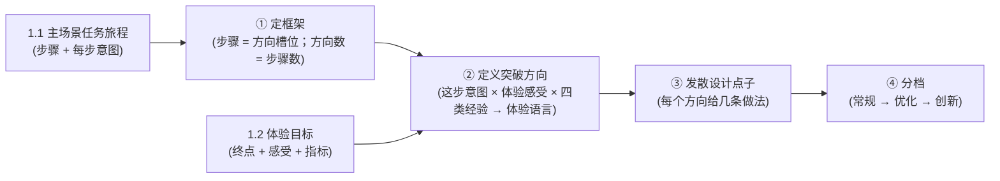

# 1.3 体验突破方向拆解指南 (Journey → Breakthrough → Ideas)

> 💡 **中枢定位**：
> 本文档承接 **1.1《需求理解》的主场景任务旅程** 与 **1.2《体验目标》**，是【方案系统设计主线】步骤 1 的收尾环节。
> * 1.1 给的是"**这件事正常怎么走完**"（旅程步骤 + 每步意图，方向的骨架）；
> * 1.2 给的是"**要去哪**"（体验目标这个终点与感受）；
> * 本步定的是"**在哪破、怎么破，并且摆出几个档位的选项**"。
>
> ⚠️ **这一步的性质是"破题"，不是"选型"。** 它不查组件、不定壳、不排页面，只做一件事：顺着旅程把"用户要的体验"拆成能发力的几处，再散出几种做法。
> 📌 **术语**：本文产出的"体验突破方向"即下游沿用的 `Bx`，旧称"突破点"，两者同义；标题与文件名沿用旧称只为不打断既有引用。

> 🛑 **阶段铁律**：
> 1. **站体验位**：主语是人，说的是人的感受。句子里一旦出现"系统 / 页面 / 数据 / 链路 / 断层"这类系统名词，即判跑偏，作废重来。
> 2. **方向数 = 旅程任务块数（2~5 条），不由感觉定**：不是从一堆方向里挑 5 条，而是 1.1 每条主场景本来就只切 2~5 块任务。**块内不许再拆方向，块外不许凭空加方向**；真不做的槽位写"本期不做 + 理由"，不许静默删掉。
> 3. **手法不算突破方向**："加个标红""加个图标""换个抽屉"是手段，不是方向。
> 4. **只有三档：常规版 / 优化版 / 创新版**；判一档高不高，看"**哪一维拿到了多大的体验落差**"，不看"改了多少代码"，也不看"提到了几维"。不设"基线档"（那是没设计），也不设第四档。
> 5. **点子不受技术手段与目标措辞限制**：只要这条做法能让体验目标那句更彻底地发生，就可以写，包括挑战"这件事要不要人来做"。技术前置、实现代价留给 1.4 与研发评估，**不在这里自我否决**。
> 6. **每条方向必须标来源**（感受点 / 工作类型 + 原则编号）。标不出来源的，是凭感觉拍的，退回重找依据。
> 7. **目标带硬指标时，点子要回头对指标**（时长、覆盖率、误报率这类）。创新档点子如果反而卡不住指标，它就不成立。

---

## 一、这一步产出什么

| 项 | 内容 |
| :--- | :--- |
| **读什么** | ① **1.1 的主场景 + 该场景的任务旅程（标准步骤 + 每步意图）**（骨架来源）② 该场景现状痛点（来自 1.1）③ 体验目标 + 定位小卡 + 三件证据（来自 1.2）④ **视觉只写收益、不写选型**：视觉列只写「这处让人多看见 / 少做什么」；不写风格母题、视觉库、选哪种图 |
| **不读什么** | ② 横向库 D-01~D-11 **默认不读**；**例外：可读各 D-0x 的「决策域定位 + 决策场景母尺」（上位原则），仅用于发散提点，不读 EP 级页面参数**（EP 是 Part 2 / 4.1 的料，读了会把页面结构提前定死，口径见 [2.0 设计决策总览与调度](../②设计思考与决策/2.0-设计决策总览与调度.md)「本文件管辖的是 Part2」）；[桥协议](../../04-workflows-and-cases/横向库承接与场景拆解桥协议.md) 与纵向库（需求大类设计决策，2026-11-10 起停用留档）任何环节都不读 |
| **输入** | ① **1.1 的主场景 + 该场景的任务旅程（步骤 + 每步意图）** ② 1.2 的体验目标（原话 + 可测锚）③ 1.2 的定位小卡与三件证据 ④ 该场景现状痛点（来自 1.1）。**四类工作经验不是输入，只在"把方向转成体验语言"时作为参考调用（骨架定完之后）。** |
| **产出** | ① **突破方向清单**（条数 = 1.1 该主场景的旅程任务块数，2~5 条），用体验语言说"这一步要让人怎么样" ② 每条方向下的**一张六列点子表**（点子发散 / 能力 / 交互 / 视觉 / 能否达成 / 收益与代价），一条点子三侧写全 |

> 📌 **一句话**：顺着 1.1 的旅程一段段走，把体验目标这个"终点"拆成"每一段要让人怎么样"（突破方向），再顺着每处散出"常规 / 优化 / 创新"三档做法。
> 🔗 **产物去向**：作为下游 [1.4 草图发散与方向确认](1.4-草图发散与方向确认.md) 的原料——草图按方向成套输出（见第七节交接表）。

---

## 二、四步法



> 🧭 **四步顺序不可换**：先由 1.1 的旅程定"在哪几处破"（结构）→ 再凑料写"这处要让人怎么样"（内容）→ 然后才摊做法 → 最后分档。**跳过第 1 步直接想点子，方向必然漏段；跳过第 2 步直接写点子，点子必然写成系统动作。**

### 第 1 步：定框架（步骤 = 方向槽位，不许跳过）

**这一步只定结构，不写内容。** 先把"这次要在哪几处发力"框死，后面才不会漏掉前段 / 后段，也不会凭感觉增删方向。

**做什么**：

1. 取 1.1 的**主场景任务旅程**（步骤 + 每步意图），只取当前这条主场景的；多个主场景各定各的框架。
2. **一步一个方向槽位**：方向数 = 旅程任务块数（1.1 每场景只切 **2~5 块任务**，故方向 **2~5 条**）。
3. 填框架底稿（内部用，不进交付）：

| 槽位 | 旅程阶段 | 这一步的意图（要办成什么） | 突破方向（第 2 步填） |
| :---: | :--- | :--- | :--- |
| ① | <1.1 的步骤名> | <该步意图> | 待填 |
| ② | … | … | 待填 |

**三条边界**：

- **不套通用模板**：不写"输入 → 处理 → 交付 → 复核"这类套话；1.1 几步就是几槽。
- **同一步内可合并去重，但不许跨步合并、不许因"这步不重要"删槽**：本期真不做 → 槽位保留并写"本期不做 + 理由"。
- **只写"在哪破"，不写"怎么破"**：一出现"加抽屉 / 上告警 / 做个看板"就是跑到第 3 步了，退回。

**收口**：槽位数 = 1.1 该场景的步骤数；每一槽都指得回 1.1 的哪一步。

### 第 2 步：定义体验突破方向（三份料合成一句话）

**一条方向句 = 这步的意图与任务 × 体验目标里的感受 × 这类工作该有的拔高**，写成"让人……"的体验语言。

#### 2.1 先取三份料（缺一份，方向就会偏）

| # | 料 | 从哪取 | 决定方向句里的什么 | 取到的判据 |
| :---: | :--- | :--- | :--- | :--- |
| ① | **骨架：这步的意图与任务** | 第 1 步框架（源自 1.1 任务旅程） | 方向管哪一段、到哪算成 | 说得出"这步不办成会怎样" |
| ② | **感受：体验目标的感受点** | 1.2 体验目标（词表对号 + 硬指标翻感受） | 方向句往哪说、用什么词 | 每个感受点对得上词表，或写明新增理由 |
| ③ | **拔高：四类工作经验** | 第八节入口 2（按场景判命中，整份读完再扫） | 方向的高度（目标没提、这类工作本该有的） | 扫出的机会点落得到某个槽位 |

> 🛑 **② 不再单独成步**：它只决定"这句话往哪儿说"。先单独抠感受点、再拆方向，会把方向拽回"感受点追问"，把 1.1 的旅程骨架丢掉——这正是旧版漏掉交付 / 复核整段的原因。
> 📌 **扫完必须留痕**：每个槽位写清命中的「类别 · 原则编号 + 原则名」（如 `②运营分析 · 1 结果易感知`），落在方向表的「命中经验 · 原则」列。只写"参考了运营分析经验"、或那一格留空，等于没扫。
> 📌 **① 与 ③ 的分工**：① 定"破在哪一段"，③ 定"这一段能拔到多高"。**骨架不许被经验改**——经验多了就加方向，等于方向跑出旅程；经验只用来把已有槽位写准、写高。

##### 料② 的取法：感受点词表

体验目标**不是一句话**，里面藏着 1~2 个"感受点"。感受点从目标句里抠，用来定方向句往哪儿说。

> 🛑 **感受点不是自由发挥的形容词**：网安域常用的感受点就那么几个，**含义固定、不能按字面理解**。抠出来的感受点必须能对上下表其中一个；对不上要写明为什么新增。

**感受点词表（网安域常用 8 个）**

| 感受点 | 它到底要求什么 | 常见误读（❌） | 对应 1.2 维度 |
| :--- | :--- | :--- | :--- |
| **一眼** | 不费力：不用找、不用逐个看，第一屏就该有 | 字大、色块醒目 | 快 / 降噪聚焦 |
| **看清** | **信息全貌且易获取**：全貌（谁、哪条链路、哪些对象）+ 根因（为什么发生）+ 影响面（波及多少人 / 哪些应用）+ 范围（哪些分支 / 区域），**缺一就是没看清** | ⚠️ **不是「字不模糊、对比度够」**——那是视觉问题，不是感受点 | **可见性** / 可解释 |
| **清晰** | 重点突出、**可视化**：结构与关系能**看见**，不是读出来的 | 排版整齐、留白够 | 可见性 / 降噪聚焦 |
| **独自** | 上手成本低：不看文档也能自己办成 | 加了几句引导提示 | 简单 / 易用 |
| **顺畅** | 旅程连贯不跳跃、无卡点：一件事在一处办完，不来回切页、不重填 | 步骤数少一点 | 无感低摩擦 / 响应闭环 |
| **敢操作** | 证据充分可信：看得到依据，敢按下这个按钮、敢把结论交出去 | 加二次确认弹窗 | 信任感 / 可解释 |
| **掌控感** | 清晰可视 + 信息全面：知道系统在做什么、做到哪一步、为什么这么判 | 加个进度条 | 掌控感 |
| **快** | 简单高效：同样结果，路径更短 | 页面加载快 | 快 / 高效 · 省 |

> 🛑 **「看清」和「清晰」在网安里是重词，不是视觉修饰**：团队说「看不清」，八成不是嫌字丑，是说**看不到全貌、看不出根因、不知道影响了多大范围**。把它读成「对比度不够」，整条方向就写歪了——写到「把字放大、加粗」上去。
> 📌 **词表外的感受点允许有，但要按同样格式写清「它到底要求什么」**（如「不怕漏」「敢放手」），不许只丢一个形容词。
>
> 🎯 **感受点硬要求（写体验突破方向时按这个对照；创新档逐项打钩）**：
> - 一眼 = 高效 + 全局 + 可视
> - 看清 = 全貌 + 根因 + 影响面 + 范围
> - 清晰 = 结构与关系看得见（不是读出来的）
> - 独自 = 不看文档也能办成
> - 顺畅 = 一件事一处办完、不来回
> - 敢操作 = 依据看得见、可复核、可回退
> - 掌控感 = 知道系统在做什么、为什么这么判
> - 快 = 同样结果、路径更短

**怎么用**：从目标句里抠出那个感受词 → 对到上表 → 用「它到底要求什么」那一列去写方向句（2.2）。

| 体验目标 | 抠出的感受点 | 展开成「它到底要求什么」 |
| :--- | :--- | :--- |
| 让管理员**一眼看清**哪台终端不合规、不合规在哪 | **一眼** | 不费力——不用逐个查、不用翻页找 |
| | **看清** | 全貌（哪些终端、什么违规）+ 根因（为什么会这样）+ 影响面（波及多少人 / 哪些应用）——**不是「字看得清」** |
| 让管理员**敢操作**系统的处置建议 | **敢操作** | 依据看得见、能复核、错了能回退 |

> 🛑 **红线**：感受点是「**人的感受**」，不是「系统的动作」。「数据同步」「结果下钻」这类都不是感受点。

##### 料② 里夹着硬指标怎么办：指标翻成感受

体验目标常带指标——"耗时从 2 天降到 10 分钟""覆盖率 100%""误报率 ≤ 5%"。**指标不是感受点，不能直接拿去写方向**（"10 分钟"拆不出人想要什么，只会写成"加载更快"）。

处理分两步：

1. **先翻**：问一句"这个指标达标时，人身上少了哪份难受"，翻出来的才是感受点。
2. **留原值**：指标原文另存一份，挂在感受点后面，分档后回校时要用（见第 4 步之后）。

| 目标里的硬指标 | 翻成的感受点 | 为什么不能直接用指标 |
| :--- | :--- | :--- |
| 巡检耗时 2 天 → ≤ 10 分钟 | **不用守**——不用反复回来看跑完没 | 只盯"10 分钟"，拆出来的全是"转得快一点"，拆不出"人不用在场" |
| 管理动作覆盖率达 100% | **不用对账**——不用点名核谁漏了 | 只盯"100%"，会拆成"加个覆盖率数字"，拆不出"漏了自动补" |
| 误报率 ≤ 5% | **不用白跑**——不用处置一批其实没事的 | 只盯"5%"，会拆成"调阈值"，拆不出"误报自己消失" |

> 📌 **一句话**：**指标是验收线，感受才是突破口。** 指标管"达没达标"，感受管"从哪儿下手"。
> ⚠️ 翻不出来，说明这条指标跟用户的感受无关（比如纯后台性能指标），那就别放进 1.2 的体验目标里。
> 📌 **翻出来的词也要落到感受点词表上**：如「不用守」→ 对到「顺畅」（不用回来反复看），「不用对账」→ 对到「快」（不用点名核）。词表没有的，按同样格式写清「它到底要求什么」。

#### 2.2 写方向句（三条硬杠）

1. **主语是人**：让人 / 让用户……。句子里出现"系统 / 页面 / 数据 / 链路 / 断层"作主语 = 系统位，退回。
2. **一句只写一处**：只围绕这一槽的旅程阶段，不放大到整条场景，也不缩小到某个控件。
3. **句里带着这步的痕迹**：读的人能对上 1.1 的哪一步；对不上，说明这句是放之四海皆准的口号，重写。

**示例（三份料 → 一句话）**：

| 槽位 · 旅程阶段 | 这步的意图 | 感受点 | 命中经验 · 原则 | 突破方向（体验语言） |
| :---: | :--- | :--- | :--- | :--- |
| ① 发现异常 | 知道这一轮有没有要处理的 | 一眼 | ②运营分析 · **1 结果易感知** | 让人打开就知道这轮有没有要处理的，不用自己筛 |
| ② 定位对象 | 把异常收敛到具体终端与违规项 | 看清 | ②运营分析 · **2 结果可验证** + **3 信息主次区分明显** | 让人一眼看清是哪几台、错在哪、波及多大范围 |
| ③ 判定处置 | 决定怎么处理、敢按下这个按钮 | 敢操作 | ③排障闭环 · **3 闭环动作高效便捷** | 让人敢按系统的处置建议动手，依据看得见、错了能回退 |

> 🛑 **「命中经验 · 原则」必须写得出编号与原则名**（如 `②运营分析 · 2 结果可验证`）：写不出 = 经验没真扫，只是凭感觉补了一句。**这一格是溯源的凭据，不是验收单**——一个槽位对上 1~2 条就够，不要求把某类的五条全落成做法（那会把方向写成检查表）。
> 🔗 **经验怎么扫**：见第八节（四类工作类型 + 命中判法）。**扫出来的机会点只能用来抬高已有槽位的方向，不能新增槽位**；确实要新增，回 1.1 补旅程步骤。

#### 2.3 收口校验：步骤 → 方向 → 点子 三级能指到

| 级 | 校验问句 | 不合格怎么办 |
| :--- | :--- | :--- |
| 步骤 → 方向 | 1.1 的每一步，是否都有一条方向承接？ | 缺 → 补方向，或写"本期不做 + 理由" |
| 方向 → 步骤 | 每条方向是否只围绕一步、不放大不缩小？ | 放大 / 缩小 → 重写该方向 |
| 方向 → 点子 | 每条方向下的点子，是否撑得住这句话？ | 撑不住 → 回第 3 步重摊，不许在分档时硬凑 |

> 📌 **合并去重仍在，但只在一步之内**：同一步骤内扫出多条可合并；**不许为凑数去砍某一步的方向，也不许把两步并成一槽**。
> 📌 **并入必须落点**：写"并入某方向"的，被并入的语义必须在该方向的点子里看得见；否则不许并入，单立或记候补。
> 📌 **术语**：本步产出的"体验突破方向"即下游沿用的 `Bx`（旧称"突破点"），两者同义，交付编号仍用 `Bx`。

### 第 3 步：发散设计点子

每条突破方向下，**给几条做法，不是给一条**。这一步先不管档位，只管把可能的路子摊开。

**主发散方式：八步走法（按顺序走，不是按维度填）**

1. 这一步要成什么？（从旅程阶段 + 体验目标读：用户、目标、做到什么算成、目标要求什么感受）
2. 现在卡在哪？（信息不在 / 要自己拼 / 要等 / 不敢信 / 交接要重来）
3. 假设挑战：没有任何限制时，最理想的达成方式是什么？一定要人判吗？一定要这页吗？一定要现在做吗？
4. 换主体 / 时机 / 介质：能不能让系统/算法/数据承担分析、人只确认？人找→系统推？事后→实时？填表→对话？看数据→看结论+证据？留在系统里→一键导出？
5. 用体验目标验收：能让目标那句更彻底发生吗？
6. 用任务旅程验收：目标里的每一步都有人接吗？
7. 最后才翻语料查漏，不照搬。
8. **峰值与短板**：达成后是否带来 wow？是否留下明显维度短板（掌控 / 高效 / 简单等）？

> 🛑 **不要求"六维各变一次"**：变维表 / 具象化已降为「参考语料」，卡壳时拿来换角度，不作必做清单。
> 📌 每条做法要能说清"出自八步走法哪一步、跟前面那条比多拿到什么"。

---

**参考语料（可选，用来换角度 / 查漏，不照搬）**

**变维表（六维）**：拿每条突破方向，顺着下表各问一遍——变完再挑，不要求全留。

| # | 维度 | 变的是什么 | 例子（假设方向 = 让人一眼看见哪台终端不合规） |
| :---: | :--- | :--- | :--- |
| 1 | 信息在哪一层 | 列表里 / 行内 / 详情页 / 悬浮 | 列表行内直接标违规项 vs 点进详情才看到 |
| 2 | 用户走几步 | 跳页 / 就地 / 同屏 | 跳到合规详情 vs 同屏展开 |
| 3 | 上下文丢不丢 | 换页之后还记不记得 | 看完证据回来还得重新找那台终端 vs 就地看 |
| 4 | 谁先动 | 人去找 / 系统推出来 / 系统先判断好、人只确认 | 人自己筛"不合规" vs 默认就给待处理清单 |
| 5 | 什么时候给 | 提交前 / 提交后 / 持续 | 巡检完出报告 vs 一违规就提示 |
| 6 | 默认状态 | 全量 / 只给该处理的 / 从空开始 | 默认全量列表 vs 默认只显示不合规 |

**具象化三问（另一种换角度）**：

1. 这件事在用户脑子里有画面吗？没有的话，他缺的是哪张图？
2. 现实里有没有对应的物理过程可以借？（加速 = 上车 → 高速 → 下车；合规 = 体检报告；告警 = 急诊分诊）
3. 能不能把抽象参数画成一条路径、一张地图、一个物件、一份回执？

> 🛑 这两样都是"参考语料"，不是必做清单；八步走法走不出来时再用。

### 第 4 步：分档（只有三档：常规 / 优化 / 创新）

把摊开的做法排成三档，**按"这档方案拿到了哪些体验收益"写，不按"用户还出多少力"排**。**只有三档，不设"基线档"**——"别人怎么做我们怎么做"不叫一档设计，那叫没设计。

> 🎯 **先质判，再分档（量级只作辅助）**：
> ① 人的角色 / 工作方式变了吗？
> ② 它能否很好支撑对应体验突破方向的达成？
> ③ 有没有留下明显维度短板（掌控 / 高效 / 简单…）？
> ④ 有没有 wow 惊喜？
> 答不出 ①② → 不进创新；③ 若是该突破方向依赖的维 → 降档；④ 答不出 → 降回优化。
> **允许"从 0 到 1"**：新的工作方式，X 端可能不存在，不强行套"从 X 到 Y"。
>
> 🛑 **告警 / 聚合流不算创新**：若"人找 → 系统推"实际做成了告警 / 聚合候选流 → 不判创新（它解决"提醒"不解决"定位"）。创新须是"系统主动推荐到具体现场 + 候选量 N + 从 N 收敛到 1 的方式"；写不出规模与收敛，最高判优化。

> 🛑 **为什么不能只用"用户还出多少力"这一把尺子**：它只量得到「省」。用它当唯一标尺会推出一个反常结论——**越往上走人越不用判，于是越不需要图、越不需要解释、越不需要就地闭环**。可那些恰恰是体验收益，不是剩余劳动力。单尺子还会把三档压成一条竖线，只能排出一二三名，排不出"两套各自最优"。

| 档位 | 档位标准说明 | 体验收益（维度 · 量级 · 从 X 到 Y） | 视觉侧要求 | 同一例子（知道哪台终端不合规） |
| :---: | :--- | :--- | :--- | :--- |
| **① 常规版** | 行业 / 产线通用做法：功能齐、能查能筛能排 | **最高量级只到「一般」**：可见性·一般（数据都在，能查到）／掌控感·明显（自己算、心里有底，但现状本就如此）。<br>**代价**：省、快两维为「无」——人自己找、自己比、自己判。 | 规范内标准视觉即可 | 违规的行有标记，人翻着看 |
| **② 优化版** | 同一条路上把体验拉起来：结论前置、降噪、就地、可比对。**同一条走法内的加强，能带来收益** | **最高量级到「明显」，无一维质变**：快·明显（从"翻页找"到"第一眼看到"）· 降噪·明显（正常项压下去）· 无感/低摩擦·明显（就地展开、不丢上下文）。<br>**代价**：判断仍由人下——掌控感不降，但也不升。 | 有针对性视觉优化（降噪 / 聚焦 / 层级） | 结论前置 + 违规聚合置顶，一眼看到 |
| **③ 创新版** | 换一种解决方式：换人机分工或换形态。**与常规方案思路有明显较大差异、对现有方案有明显体验提升**；**有流程改写，或交互方式、视觉体验上的较大创新**；**须属四类创新方向之一**（见下）；**且必过「峰值体验」一关**——答得出"人在哪一刻、因为什么、觉得超出预期" | **≥1 维到「质变」，其余可多可少**：省·质变（从"人自己逐段比"到"系统直接给该办的两件"）· 可见性·明显（从"读表格里的五段"到"看见哪一段异常"）· 掌控感·明显（给判词 + 把握程度）。<br>**代价**：必须写清哪一维被牺牲——常见是掌控感（只给结论）或防错（聚合口径风险）。 | **必须配品质感视觉 + 明确视觉主张（硬要求）**，不许"沿用常规" | a) 聚成"待处理的 3 件事"，人处理事件、不处理终端（换对象）<br>b) 按部门 / 网段铺成合规水位图，红格点进去才是终端（换载体） |

> 📌 **体验收益的词从哪来**：一律取 [1.2 的维度池](1.2-体验目标.md)（`快/高效 · 准 · 省 · 稳 · 简单 · 易用 · 品质感 · 信任感 · 专业 · 掌控感 · 降噪/聚焦 · 可解释/白盒化 · 无感/低摩擦 · 可见性 · 响应闭环`），**不许自造词**——自造词三档之间就没法并排比。
> 📌 **分档最常用的 7 维**（覆盖"操作—认知—信任"三层，其余 8 维按需补）：**省**（少点几下、少抄一遍、少等一次）· **快/高效**（多快到达结论）· **可见性**（关系 / 分布 / 时序能不能**看见**，而不是**读出来**）· **掌控感**（知不知道为什么这么判、能不能复核）· **可解释/白盒化**（能不能把依据说清楚）· **降噪/聚焦**（只给该看的）· **无感/低摩擦**（不打断、不用学）。

> 📌 **量级怎么定**（判档只用这个，不用维度个数）：
> · **质变**：原来要人自己找 / 算 / 判的，现在**不用了**；或原来**看不见**的，现在**一眼可见**。**必须写得出「从 X 到 Y」**，X 取自 1.1 的现状基线。
> · **明显**：同一件事做得更顺，但**人还得做**。
> · **一般**：略好，几乎不改变行为。
> · **无**：跟现状一样。
> 📌 **判档只看最高那一格**：全表最高只到「一般」= 常规；最高到「明显」且无一维质变 = 优化；**至少一维到「质变」= 创新**。**多维浅收益不抬档，一维深收益就够**——十维"明显"也进不了创新，一维"质变"就能进。
> 📌 **视觉辅助升档（交互定档、视觉为辅）**：基础档由交互侧定；视觉**最多升 1 级、不可降档**——常规交互 + 差异化视觉 → 可判优化；优化交互 + 高品质视觉 → 可判创新；创新交互 + 普通视觉**不降档**，仍判创新，但**必须补足品质感视觉（硬要求）**，否则不许进草图。
> 📌 **视觉升档的判据（不是"更好看"）**：升档必须是**视觉本身构成质变**——第一眼该看哪 / 阅读顺序发生可指认的变化；**纯美化（更精致、更协调）不升档**。
> 📌 **视觉列写到什么颗粒度**：每条点子的「内容呈现（视觉）」**只写"视觉要表达出什么结果"**——第一眼该看到什么、阅读顺序怎么变、注意力落在哪，用用户话说清即可。**不写"用了什么"**——风格母题、hero、组件、视觉技法、参考哪张图、色值 / 字号一律不写（这些库现在都不存在，留 5.0；草图长什么样由执行时模型能力上限决定）。
> 📌 **备注列（收益与代价）写到什么颗粒度**：**保留维度术语，但不许压成"可见性·一般"四个字**。每条收益写成「维度·量级 +（从 X 到 Y 的展开）」——说清原来他得怎样、现在变成怎样；代价写成「还留下哪一步 / 哪一维被牺牲」。判档的人读这三样就能复算档位，不必回头猜。
> 📌 **写不出「从 X 到 Y」的，一律降为「明显」**：不许用"更顺畅 / 更直观 / 更清晰"这类词冒充质变。
> 📌 **维度是分布，量级是高度**：维度交代"收益落在哪几方面"（有几条写几条），量级用来判档。**两者不可互相替代，更不许用维度个数代替量级。**
> 📌 **被牺牲的维不许是主打维度，也不许是该方向感受点依赖的维**：1.2 定位小卡里的「主打维度」若被牺牲成「无」，方案判**不成立**；**若被牺牲的维正是该方向感受点所依赖的维（如"看清"依赖"全貌 / 可见性"），同样不得进创新档**。
> 📌 **创新档要写 ≥2 条取向不同的点子**：下游 1.4 要靠它们拆出两套形态不同的方案。判据是「**能不能各自撑起一套不同形态的页面**」——第一步看到的东西不同（一份待办清单 vs 一张分布图）= 取向不同；同一个页面上只换配色 / 换排序 = 同一条。
> 📌 **只写出一条创新点子时**：必须写明另一条为什么不成立（能力不具备 / 目标撑不住 / 代价不可接受），否则视为没想透，回第 3 步重摊。

> 🛑 **创新档必过一关：峰值体验（wow）**
> 每个创新点子都要答得出三样——**在哪一刻**（用户做完哪一步、或看到哪一屏的时候）／**因为什么**（系统替他做了什么、或让他看见了什么）／**意外在哪**（这个反应本来不会发生，为什么会发生）。**三样缺一，这一处不许算创新档**：降回优化档，或回第 3 步重摊。
>
> | 判 | 例 |
> | :--- | :--- |
> | ✅ 过 | "点完'开始检测'的 2 秒后，屏幕上直接出现'这 38 台里有 3 台会被拦下，先看这 3 台'——他本来以为要等 10 分钟再自己翻结果" |
> | ❌ 不过 | "界面更清爽了""信息更全了""少点两下""配色更专业"——这些是优化，不是峰值 |
>
> 📌 **和视觉主张不是一回事，两个都要，不能互相顶替**：视觉主张答"**看起来**有品质吗"；峰值体验答"**用起来**哪一刻被惊到"。只写"品质感视觉"而没有峰值时刻的，按 R7 仍算创新但**必须补齐这一关**，补不出就降档。
> 📌 **wow 不是加装饰**：给系统加一句"恭喜完成"、加一个动效，不构成峰值——峰值必须让**这件事本身**变得比预期轻或比预期清楚。

> 📌 **"代价"必填**：只报喜不报代价，等于没做取舍；三档一旦都写成"全是好处"，又退回成一条竖线，用户只能按"哪个好"选，选不出"我要哪一个"。

> 📌 **一档比一档高，但"高"不止一种高法**：首选看"人还剩多少活"（省 / 快）的落差，**但流程改写、交互方式、视觉体验上的较大创新同样能构成「质变」**——不能因为"人还是出这么多次力"，就判它没抬档、按回优化版。**判"是哪一档"看最高那一格的量级；判"是不是真创新"看它跟常规方案差多远。**
> 📌 **创新档的四个方向（发散抓手，不是高度分级；可融合）**：四类是"思考维度"不是"标签限制"——一条创新点子**可融合多类**，标注"**主方向 + 融合方向**"（如 主④内容呈现 + 融合②新交互范式）；每条仍须"质变 + 从 X 到 Y"，**贴类型标签但无质变 = 不成立**——
> | 类型 | 定义 | 发散问句 | 对应维度 |
> | :--- | :--- | :--- | :--- |
> | **① 大幅缩减成本类** | 大幅降低使用成本或提效；含降低核对 / 理解 / 信任成本（可信、可解释归此） | 用户最耗时 / 最费劲 / 最不敢信的是哪一步？能砍几步、几分？ | 省、快 |
> | **② 新交互范式类** | 新的交互方式、使用习惯改变（AI 替代、对话式、主动推荐、角色互换） | 能不能不按原方式操作？能不能系统先做、人只确认？ | 谁先动、换分工 |
> | **③ 新旅程定义** | 传统任务旅程大的变革；含触发时机（事后→实时、人找→系统推、手动→自动） | 旅程能怎么重排 / 合并 / 前置？什么时候给最对？ | 流程改写、换时机 |
> | **④ 内容呈现类** | 新的视觉展现形式，更好更快更美观，视觉对任务达成加分 | 能否换一种形状 / 结构 / 视觉语言被看见？第一眼该看哪？ | 换载体、视觉（接视觉升档） |
> 两套创新方案靠**融合重心不同**区分（如 方案一主②辅④、方案二主④辅②），**不是一维一条**。
> 🛑 **三档必须真拉开**：同一处的三档要在"信息在哪一层 / 走几步 / 谁先动手 / **形态**"上真不同。**"形态"包括它拿什么承载信息（表格 / 图 / 时间轴 / 拓扑 / 结论件），不只是换哪个容器。** 只换容器（跳页改抽屉）、只换颜色、只加一排统计卡，都不算抬档，退回重想。**（注：换信息形状若改变"第一眼该看哪 / 阅读顺序"，可构成质变，不属"只换颜色"；视觉侧最多升 1 级、不可降档。这里说的是信息形状本身变了，不是去参考某个视觉库选风格。）**
> 🛑 **常规版不是凑数项**：常规版要写成"正经做法"（功能齐、路径顺），**不许写成体验差的样子**（让人一条条勾、一个个比、抄来抄去）。写不出正经的常规版，说明这处还没想清，别拿它当陪衬。
> ✅ **点子只看一件事：能不能让目标那句更彻底地发生。** 不设技术手段限制，不设"先改目标才成立"的门槛——怎么实现、要不要新增能力，是 1.4 与研发的代价问题，不是这一步的筛选条件。写不出来只可能是"没想到"，不可能是"不许写"。

#### 第 4 步之后：回头对指标

目标里带硬指标时，分完档**必须回校一遍**——每一档、每一条点子，都要能回答"它满足指标吗"。

| 检查项 | 问法 | 不合格怎么办 |
| :--- | :--- | :--- |
| 指标还达标吗 | 这条点子做完，那个数还达得到吗？（如"系统自动下发"必须仍然 ≤ 10 分钟完成） | 不达标 → 标红，或者补一句达标条件，别放在那儿当亮点 |
| 靠谁达标 | 指标是靠"人干得更快"达成的，还是靠"人不用干了"达成的？ | 靠人的 → 顶多到优化版，别写成创新版 |
| 指标会不会被牺牲 | 为了追一个指标，是否牺牲了另一条（追覆盖率 → 狂下发 → 断业务） | 会 → 这条方向必须同时写"防误伤"，见案例 C 的 B3 |
| 指标缺了怎么办 | 目标只有定性描述，没有数 | 不硬凑指标，但要在交付时写一句"上线后用哪个数验"（接 1.2 第七节指标池） |

> 📌 **指标和档位的关系**：指标是验收线，不再兼任档位天花板；但创新档点子仍要回头验证指标（本节）——只做后一半，就会出"点子很漂亮但指标崩了"的方案。

---

## 三、红线与判据（自查清单）

> 🥇 **第 0 关（最先查）：骨架对齐**——方向数 = 1.1 该场景的旅程任务块数（2~5），每一槽都有方向承接，没有槽位被静默删掉。**这一关不过，下面 9 条都不用看。**

| # | 判据 | 通过标准 |
| :---: | :--- | :--- |
| 1 | **体验站位** | 突破方向主语是"人/用户"，说的是感受；无系统名词 |
| 2 | **不是手法** | 突破方向能统领多个具体做法；单一"标红/图标/抽屉"降级为手段 |
| 3 | **三档尺子** | 只有常规 / 优化 / 创新三档；判高低看**最高一格的落差量级**（质变 / 明显 / 一般 / 无），不是改动大小，也不是维度个数 |
| 4 | **真发散** | 几条点子必须在"**信息在哪一层、用户走几步、上下文丢不丢**"这类结构维度上真的不同；只是同一做法的宽窄微调 = 假发散 |
| 5 | **三档真拉开** | 同一处的常规 / 优化 / 创新在"信息在哪一层、走几步、谁先动手、形态"上真不同；只换容器、只加装饰的不算抬档 |
| 6 | **创新档不许自我否决** | 出创新版时**允许挑战前提**——"这件事能不能不做""能不能不让人做"；不设技术手段限制，也不设目标授权门槛 |
| 7 | **来源可追** | 每条方向都标了来源（感受点 / 工作类型 + 原则编号）；标不出的回退重找 |
| 8 | **指标回校** | 目标带硬指标时，已逐档核过"还达不达标"；不达标的已标红或补了达标条件。**目标无数字时不许跳过**：改用 1.2 的可测锚（一位新人 / 一次 / 十分钟 / 三个对象）当回校线，逐档核"这档做法还撑不撑得住这个测法" |
| 9 | **创新档峰值体验（wow）** | 每个创新点子都写清了"哪一刻 / 因为什么 / 意外在哪"三样；三样缺一的已降回优化档，或已回第 3 步重摊。**用"更清爽 / 更全 / 少点两下 / 更专业"充当峰值的，判不过** |

### 价值反问闸门（G-02 · 每条方向收口前必答）

> 🛑 **收口前对每条突破方向自问，三问须有答案才能进入三档点子**：
> 1. **是不是真痛点**：如果这处不做，用户今天靠什么凑合？凑合方式存在 → 保留；**答不出 → 回 1.1 重找痛点，不得凭经验硬立**。
> 2. **该不该在这里做**：有没有比改界面更本质的解法（流程调整 / 权限 / 上游数据 / 线下规范）？有 → 写进交接说明，本需求不硬做。
> 3. **有没有更本质解法**：这处收益是不是只能靠"系统替人判断"实现？是 → 必须写出人如何复核与纠正，否则判"掌控感透支"，**不得进创新档**（或须补齐复核机制）。

### 判据 5 的补充：「别全上」什么时候成立

四类经验里都写着"别 N 条全上，原则是扫描方向不是验收项"。**但有例外，别把这句话当铁律**——演练案例 A 就撞上了：一个"新建检测任务"的配置页，① 的四条原则**全中**（不懂参数、影响面、复用、结果可见，一个不少）。

| 场景性质 | 会命中几条 | 怎么处理 |
| :--- | :--- | :--- |
| **定位、浏览、看数据**类页面 | 通常 1~2 条 | 按经验里的"主角"挑，其余只作查漏 |
| **新建 / 配置 / 下发任务**类页面 | 常常 3~4 条全中 | 不作验收单用，但**也不许删**——按"错一次的代价"排优先级，代价最大的那 1~2 条做主角，其余降为基线补齐项 |
| **处置 / 流转 / 归档**类页面 | 2~3 条 | 按流程阶段挑（对应经验文件里的"阶段 → 原则"映射） |

> 📌 判一句：**这块界面上用户只有一次机会成事（配错就下发错了），"全上"就是对的；用户可以反复看、看错不致命，"挑主角"才对。**

> 🧭 **这一节的"主角"是"同一类内部"的主角，别和跨类的主角混**：本表讲的是**同一类工作内部**（如 ① 的四条原则）哪条做主角、哪几条降为基线；**跨类叠加时**（一个页面同时命中 ① 和 ②），先按第八节判命中、再在各类内部各自分主角。两层的"主角"不能互相顶替——不能说"① 已是主角，这页就不用扫 ② 了"。

---

## 四、常见跑偏（反面样本）

| 跑偏写法 | 为什么错 | 改法 |
| :--- | :--- | :--- |
| 突破方向 = "打通结论与证据的断层" | 主语是系统，站在系统那边替用户设计 | 换成体验语言：**让人不跳页就能看到依据** |
| 突破方向 = "结果页加个抽屉" | 这是手段，不是方向 | 上升为：**让明细就地可见，视线不出页** |
| 三档 = 跳页 / 抽屉 / 同屏三段联动 | 换的都是"容器"，用户视角没变，还是得自己去看 | 换档要换"**人还要不要自己干**"，或换"**它拿什么承载信息**"（表 / 图 / 时间轴 / 结论件） |
| 创新版 = 改得多、动整个页面 | 按改动大小分档，不是按体验落差 | 创新版应是"**换一种解决方式**"——如系统先判断好、人只确认 |

---

## 五、完整示例

**体验目标**（假设来自 1.2）
> 让管理员**一眼看清**哪台终端不合规、不合规在哪。

**第 1 步 定框架**（内部底稿，不进交付；假设 1.1 的旅程是 4 块任务，则 4 个槽位、不增不减）

| 槽位 | 旅程阶段 | 这步的意图（要办成什么） |
| :---: | :--- | :--- |
| ① | 发现异常 | 知道这一轮有没有要处理的 |
| ② | 定位对象 | 把异常收敛到具体终端与违规项 |
| ③ | 判定处置 | 决定怎么处理、敢按下这个按钮 |
| ④ | 复核留档 | 处置完能交代、能回查 |

**第 2 步 定义突破方向**（这步意图 × 感受点 × 命中经验 · 原则）

| 编号 | 步骤 | 旅程阶段 | 感受点 | 命中经验 · 原则 | 突破方向（体验语言） |
| :--- | :---: | :--- | :--- | :--- | :--- |
| B1 | S1-1 | 发现异常 | 一眼（不费力） | ②运营分析 · 1 结果易感知 | 让问题自己跳出来，正常的自动退下去 |
| B2 | S1-2 | 定位对象 | 看清（全貌 + 根因 + 影响面） | ②运营分析 · 2 结果可验证 + 3 信息主次区分明显 | 把全貌、根因、影响面一次摆齐，不用自己拼 |
| B3 | S1-3 | 判定处置 | 敢操作 | ③排障闭环 · 3 闭环动作高效便捷 | 让人敢按系统的处置建议动手，依据看得见、错了能回退 |
| B4 | S1-4 | 复核留档 | 顺畅 | ③排障闭环 · 4 同类的别再从头查 | 复核时依据还在原地，不用重跑一遍 |

**第 3~4 步 发散点子 + 分档**（以方向 B1 为例；六列按交付模板写）

- **方向 B1**：让问题自己跳出来，正常的自动退下去
- 设计点子：

| 点子发散 | 能力 | 交互 | 视觉 | 体验突破方向能否达成 | 收益与代价 |
| :--- | :--- | :--- | :--- | :--- | :--- |
| **常规** | 支持 合规状态字段展示、按状态筛选、按时间排序 | 用户旅程可通过 进入合规列表 → 筛"不合规" → 逐行核对，实现"能查到" | 利用 行内状态标记 + 现有列表承载 违规信息，便于 逐行核对 | 【部分能】高效：一般；可见性：一般（数据都在，能查到）；省：无（还得一页页翻） | 收益：功能齐、能查能筛；代价：人要自己找、自己比 |
| **优化** | 支持 按严重度排序、正常项折叠、同源违规聚合 | 用户旅程可通过 打开即默认"待处理"视图 → 违规项已在首屏 → 就地展开看违规项，实现"第一屏就看到" | 利用 首屏分组 + 视觉重心随风险走承载 待处理，便于 一眼锁定 | 【部分能】高效：明显（从"一页页翻"到"第一屏看到"）；降噪：明显（正常项退下去）；省：无变化（判断仍由人下） | 收益：第一屏就能开始处理；代价：判断仍靠人 |
| **创新1**（主②新交互范式 + 融合③新旅程定义） | 支持 同源违规归并、按影响面 × 置信度排序，输出"待处理的 3 件事"及每件涉及的终端与依据 | 用户旅程可通过 打开即拿到 3 件事 → 逐件确认或处置 → 处理事件而非终端，实现"只处理 3 件事" | 利用 事件卡（发生什么 / 影响谁 / 依据 / 建议）承载 每次处置，便于 逐件收口 | 【能】省：质变（从"逐台翻查"到"只处理 3 件事"）；可见性：明显（每件事给出终端与依据）；**wow**：点开就给出"这 3 件事"，本以为要逐台过一遍 | 收益：从逐台到逐件；代价：掌控感·一般（看不到全量分布，要另开视图查） |
| **创新2**（主④内容呈现 + 融合②） | 支持 按部门 / 网段聚合合规率、异常格标注涉及终端数、点格下钻 | 用户旅程可通过 看水位图 → 点红格 → 进终端清单，实现"一眼看见哪一片红" | 利用 网格热力图承载 分布与水位，便于 一眼定位片区 | 【部分能】可见性：质变（从"读行上的标记"到"看见一片红"）；高效：质变；省：一般（还得点进去看明细）；**wow**：整片红一眼可见，本来要逐行读 | 收益：分布与水位一眼可见；代价：明细要多一步下钻 |

---

## 六、交付模板

```markdown
### 体验突破方向拆解

> 📐 **写法**：一个主场景一块，块内先给旅程骨架、再给突破方向、最后逐方向挂设计点子。抬头**逐字复述场景名与目标原话**，不写 S1 这类场景编号；**方向编号用 `B1..Bn`（按旅程顺序，与说明书第 4 节、6.2「承接突破点」同号）**——这是下游唯一认得的键，换编号 6.2 就对不上。
> 🔁 **跨场景共用**：同一突破方向出现在多个场景时，**各块重复写一遍**，不设"适用场景"列。

#### 场景块：<主场景全名>

- **主场景**：<完整复述，不编号>
- **体验目标**：<完整复述 1.2 原话，一字不改>
- **目标里的硬指标**：<逐条摘出；无则写"无">
- **抠出的感受点**：<一眼 / 看清 / 敢操作…>（须对到词表；词表外的写明为什么新增）
- **旅程骨架**：<① … → ② …>（逐字取自 1.1 的任务旅程）｜共 <N> 块任务 → **方向数 = <N>**

**突破方向（6 列：编号｜步骤（1.1 的 `Sx-n`）｜旅程阶段（这步要办成什么）｜感受点｜命中经验 · 原则｜突破方向；不设"适用场景"列）**

| 编号 | 步骤 | 旅程阶段（这步要办成什么） | 感受点 | 命中经验 · 原则 | 突破方向（体验语言） |
| :--- | :---: | :--- | :--- | :--- | :--- |
| B1 | <Sx-n> | <旅程步骤>：<该步意图> | <一眼 / 看清 / 敢操作…> | <②运营分析 · 2 结果可验证> | 让人…… |
| B2 | <Sx-n> | <旅程步骤>：<该步意图> | <感受点> | <类别 · 原则编号 + 原则名> | 让人…… |

> **两列来源只作溯源，不作验收单**：感受点对 1.2 的词表；经验写「类别 · 原则编号 + 原则名」，写不出就是没扫、方向是拍的，退回第 2 步。**一个方向对上 1~2 条即可**，不许把某类的五条全落成做法。
> 方向数 = 1.1 旅程任务块数（**2~5 条**）；每块一条方向，同一步内可合并去重，**不许跨步合并，也不许块内再拆方向**。
> 方向只围绕该步、不放大不缩小；某步"本期不做"就保留槽位并写明理由，**不要靠感受点没提到就跳过**。

**设计点子（6 列）**

- **方向 B1**：<复述突破方向>
- 设计点子：

| 点子发散 | 能力 | 交互 | 视觉 | 体验突破方向能否达成 | 收益与代价 |
| :--- | :--- | :--- | :--- | :--- | :--- |
| 常规 | 支持 xxx / xxx | 用户旅程可通过 xxx，实现 xxx | 利用 xxx 承载 xxx，便于 xxx | 【能/不能/部分能】+ 该方向涉及维度逐条评 | 收益一句；代价一句 |
| 优化 | 同上 | 同上 | 同上 | 同上；最高到「明显」，人还得做 | 同上 |
| 创新1 | 同上；注明"主方向 + 融合方向" | 同上 | 同上；写"第一眼看到的东西变了 / 阅读顺序变了" | 同上；wow：哪一刻 / 因为什么 / 意外在哪 | 同上 |
| 创新2 | 主方向与融合方向要和创新1拉开 | 同上 | 同上 | 同上；wow 三样，峰值时刻与创新1不同 | 同上 |

> 🛑 **三侧（能力/交互/视觉）每一档都必须写全**，缺一退回补全。
> 🛑 **能否达成**：先定性，再评该方向描述里涉及的维度；判【不能】仍主推 → 退回或降档。
> 🛑 **收益代价**：放最右、简单写（收益一句 + 代价一句），量级已由"能否达成"承载。

- **方向 B2**：…（同上，按旅程顺序把每一条方向写满，条数 = 骨架任务块数）

> 🛑 **三档缺一档就是没想透**：尤其创新档写不出来，说明这处只想到了界面微调，回第 3 步换维度重摊。
> 🛑 **常规版要写成正经做法**：功能齐、路径顺（能查能筛能排）。**不许把常规版写成"让人一条条勾、一个个比"的烂体验**——那不是常规，那是没设计。
> 🛑 **不写"要改目标才成立"**：点子成立与否只看能不能让目标那句更彻底地发生。代价与技术前置写到 1.4 的代价段，不在这里当门槛。

#### 观察（内部留档，不进说明书）

| 观察点 | 结果 |
| :--- | :--- |
| 骨架对账 | 1.1 几步？出了几条方向？有没有槽位被静默删掉 |
| 入口 2 净增量 | 有几处？分别是哪几条原则扫出来的？ |
| 合并记录 | 哪一步合并了几条、合并后语义是否还找得到 |
| 高位档 | 最高那一格的量级到哪（质变 / 明显 / 一般）？落在哪一维？被什么卡住（目标措辞 / 指标 / 经验本身的边界） |
| 混类边界 | 命中了哪几类？有没有两类说了重复的话 |
| 指标回校 | 有没有"点子漂亮但指标崩"的？怎么处理的 |
| 经验异常 | 某类经验在这个场景明显不适用 / 说法不成立？记下来，回去改经验文件 |
```

### 全量收口：跨场景一致性

> 用同一套「旅程骨架 + 三级覆盖表」复跑所有主场景，逐场景检查前段 / 中段 / 后段是否齐；有场景只覆盖中段，回该场景补方向。**三个场景不能各拆各的标准**。

---

### 交付时怎么给规划人员看

不要把整张表直接丢过去，按下面三层给：

1. **一句话结论**：这个目标能撑到哪一档，最值钱的一条突破方向是什么、它来自感受还是经验。
2. **按场景块的突破方向 + 三档点子**（场景/目标抬头已复述）：给选档用。
3. **观察区**：这是给方法本身看的，不是给甲方看的——内部留档，别混进说明书（说明书怎么收，见第 5 项待办）。
---

## 七、下游衔接：设计草图（见 1.4）

> 📌 **衔接关系**：1.3 输出的「**突破方向（`Bx`）+ 分档设计点子**」，是下游「**设计草图**」的原料。草图环节的完整规范见 [1.4 草图发散与方向确认](1.4-草图发散与方向确认.md)。

**传下去的四样东西**（少一样，草图就会走偏）：

| # | 交什么 | 1.4 拿它干什么 |
| :---: | :--- | :--- |
| 1 | **突破方向**（按场景块、体验语言） | 定"这版草图必须解决哪几件事" |
| 2 | **每条突破方向的三档点子** | 组成方向时按结构挑、按档位配 |
| 3 | **感受点** | 每个方向的设计思路要能说回"让人不费力 / 不冒险" |
| 4 | **三档点子的收益量级**（维度 + 质变/明显/一般/无 + 从 X 到 Y） | 1.4 据此配档；创新档要能说清"换掉了哪一步分工 / 换成了什么承载形态"与"怎么防误伤"，说不出就退回优化版 |

> 🛑 **边界提醒**：1.3 到此为止。**不要在 1.3 里画页面、定结构**——那是 1.4 的事。1.3 一旦开始想"这个抽屉放哪"，就说明已经跑到下一步去了。
> 🔁 **回链（1.4 说"某处没料"时走这里）**：先回本步三处找料——① 目标是否被写低（回 1.2 走提级四问）；② 入口 2（工作类型经验）是否漏扫了某个场景；③ 某处创新档是否因"怕代价"被自己划掉。**三处都查过仍无料，才允许 1.4 把方案一改叫"上限版"并写明天花板。**
> 🔁 **回退路径**：1.4 如果发现某个方向的档位组合"某条突破方向根本没有对应点子撑得住"，退回 1.3 补点子，不要在草图这一步硬画。

---

## 八、方向的三个取料口：骨架 / 感受 / 经验

> 📌 **方向不由单一入口产生。** 第 1 步已从 1.1 拿到骨架（槽位定死）；第 2 步还要凑另外两份料——**感受**（入口 1）与**拔高经验**（入口 2）。只走感受这一个入口，会漏掉"目标没提到、但这类工作本该有的"机会点（例：GA 配置的"配完能看见结果"）。

```text
1.1 主场景任务旅程 ──→ 骨架：方向槽位（第 1 步定，不可被经验改写）
1.2 体验目标 ────────→ 入口 1：感受点 + 硬指标翻感受
页面任务 / 需求文档 ──→ 入口 2：四类工作经验的拔高方向
                          ↓
                  每个槽位合并去重 → 一条突破方向（体验语言）
```

> 🛑 **三份料各司其职，不许互相顶替**：骨架定"破在哪一段"，感受定"往哪个体验说"，经验定"这一段能拔到多高"。**经验再多也不许加槽位**；骨架不许因"目标没提"就被删。

### 入口 1：体验目标里的感受（第 2 步 2.1 料②）

**保证：目标说到的，一个不漏。** 取法见 2.1 与感受点词表（含硬指标翻感受）。

### 入口 2：按"用户工作类型"扫（第 2 步 2.1 料③）

1. **按场景 / 页面判，不按需求判**：一个需求往往由多个场景和页面组成，逐个场景看"用户在这块界面上要完成什么任务"，再对到下表四类；同一个需求可以同时命中多类，四类互补、不互斥。同一个页面混着两类任务时（如配置页顶部带生效状态概览），两类各扫一遍。
2. 再调该类"**该有的拔高处理经验与思考经验**"——**命中几类，就整份读完几份**（各文件「二、拔高方向」「三、原则」「四、怎么往上想」「六、参考解法」都要过），再逐条扫，扫出目标没提到、但这类工作本该有的机会点。**只读文件名、凭印象扫 = 没读**，不得据此出方向。
3. 扫出的机会点**按场景归档**，与入口 1 的结果在同一场景下合并去重。

**保证：目标没提到的，也能扫到。**

#### 用户的 4 种工作类型（顶层思考入口）

| 工作类型 | 典型动作 | 这类工作该追求什么（拔高方向） | 经验文件 |
| :---: | :--- | :--- | :--- |
| **① 配置运维** | 配策略、接资产、升版本、管账号 | 别只让他"把配置填完"，要让他**改前心里有数、改时少出错、改完知道成没成**。效率只是一层，**结果可见**最容易被漏、也最值钱 | [①配置运维](方案设计思考经验/①配置运维.md) |
| **② 运营分析** | 研判告警、查日志、做分析、挖威胁 | 别只让他"看完数据自己判断"，要让他**打开就知道有没有事、凭什么这么判、下一步该干什么**。最贵的成本是注意力，不是操作时间 | [②运营分析](方案设计思考经验/②运营分析.md) |
| **③ 排障闭环** | 处置告警和报障、排查异常、复核归档 | 别只让他"一步步试"，要让他**快找到位置、看得懂为什么、几步就能收尾**；同类问题下次别再从头查 | [③排障闭环](方案设计思考经验/③排障闭环.md) |
| **④ 价值感知** | 看效果、看态势、要汇报、对上负责 | 别只让他"自己从大屏里找数字"，要让他**一眼看到价值和状况、数字经得起追问、汇报能直接拿走、回看说得清成效**。这类工作"说得清"比"说得好"重要 | [④价值感知](方案设计思考经验/④价值感知.md) |

> 📌 **怎么扫**：点进对应经验文件，按它的「三、原则」逐条问扫描问句 → 定到具体症结 → 按「四、怎么往上想」变出做法 → 最后用「六、参考解法」查漏（只做参考，不当匹配源）。
> 📐 **扫描粒度**：按**场景 / 页面 / 任务**判，不按"需求"判；一个需求可同时命中多类，逐场景扫、按场景（Sx）归档。

#### 🛑 扫之前先看一眼主场景的颗粒度

> **上表「典型动作」那一列写的是动作，不是主场景。** 判断"命中哪类"用的是动作（他在这页要改东西还是要判事），但**定方向的高度，取决于底下的主场景有多宽**。

| 底下的主场景 | 你能扫出来的最好结果 | 举例（巡检类） |
| :--- | :--- | :--- |
| **一次操作**（新建检测任务） | 只能扫出"配得快、配不错、配完看得见"——**全在界面上打转** | 分组预置、影响面预览、状态提示 |
| **一段完整工作**（周期巡检运营：按周期自动查、异常浮出、处置到清零） | 能扫出"人不用守着、问题自己浮上来、处置到闭环"——**开始动人机分工** | 系统自动巡检并按风险排、异常才推人、处置到清零才收口 |

> 📌 **一句话**：**同一类工作，主场景越宽，能扫出的位置越高。** 所以扫的时候不要只盯当前页面"能加什么"，要问"这个人在一整段时间里，这件事的哪一段最耗他"。
> 🔗 **发现主场景太窄怎么办**：不要在这里硬撑，**退回 1.1 / 1.2 重拆**（1.2 有主场景颗粒度的一票否决检查）。这里只负责如实反映。

#### 两条边界（别混）

- **两类经验**：入口 2 调的是【**思考经验**】（这类工作该往哪个方向拔高，见上表与各文件的"二、拔高方向"）+【**解法经验**】（这类工作里别人用过哪些招，见各文件的"六、参考解法"）。现已按四类沉淀，均为**初稿、未验证**。
- **与 Type-01~07 独立**：Type 系列是**落地执行细节层**的经验参考（回答"具体怎么做"），**不在本环节使用**；本环节用的是上表 4 类**工作类型**（顶层思考入口）。二者**独立，不互相替代**。

#### 扫的时候三个高频错判

演练里已经撞出来的三种情况，扫之前先看一眼：

| 错判 | 长什么样 | 怎么判 |
| :--- | :--- | :--- |
| **该命中的没命中** | 页面明明在处置告警，却没扫 ③ | 只看页面动作会漏。多问一句"**这块界面上产生的结论，后面还有没有人接**"——有人接着干，就还有下一类（见下条） |
| **条件命中当成无条件** | 一律给流程型页面都套 ③ | ③ 只在这件事**要跟踪到恢复正常**时才扫。动作只到"下发通知"就结束了，扫 ③ 会把闭环硬塞进来 |
| **一类当成全篇** | 整个需求只判了一类 | 一个需求往往有多个页面、多个任务。**按页面 / 任务逐个判，同一个页面混两类任务就各扫一遍**，最后按场景归档 |

#### 一个判命中的快法

拿页面问三句，答案对上哪类就是哪类：

1. **他在这里是要"改东西"吗？** → ① 配置运维
2. **他在这里是要"看出一件事、下个判断"吗？** → ② 运营分析
3. **他在这里是要"把一件已经发生的事弄明白、收掉"吗？** → ③ 排障闭环
4. **他在这里是要"拿结论去跟别人交代"吗？** → ④ 价值感知

> 📌 四句可以同时成立（案例 C 就是四句全对上了），不是单选。**判完再看这个页面主要卡在哪一步，主要那一步对应的类做主角。**

> 🚧 **状态**：四类经验已成稿并接入本入口，但**尚未验证**——验证只认演练：拿真实需求跑，能稳定扫出目标之外的机会点（如"配完能看见结果"），才算这类经验可用。扫不出来，改经验文件的原则 / 症结，不要绕过去。
