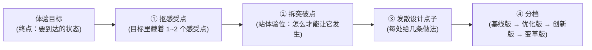

# 1.3 体验目标突破点拆解指南 (Goal → Breakthrough → Ideas)

> 💡 **中枢定位**：
> 本文档承接 **1.2《体验目标》** 与 **1.1《现状痛点》**，是【方案系统设计主线】步骤 1 的收尾环节。
> * 1.2 定的是"**要去哪**"（体验目标这个终点）；
> * 本步定的是"**在哪破、怎么破，并且摆出几个档位的选项**"。
>
> ⚠️ **这一步的性质是"破题"，不是"选型"。** 它不查组件、不定壳、不排页面，只做一件事：把"用户要的体验"拆成能发力的几处，再散出几种做法。

> 🛑 **阶段铁律**：
> 1. **站体验位**：主语是人，说的是人的感受。句子里一旦出现"系统 / 页面 / 数据 / 链路 / 断层"这类系统名词，即判跑偏，作废重来。
> 2. **手法不算突破点**："加个标红""加个图标""换个抽屉"是手段，不是突破点。
> 3. **档位名按"对标水位"取**（基线版 / 优化版 / 创新版 / 变革版）；判一档高不高，看"**用户还出多少力**"，不看"改了多少代码"。
> 4. **目标定多大，天花板就多高**：小目标只能做到"看得更快"，放不出创新版 / 变革版——**真要往上走，就把目标一起改**（改法有明确格式，见第二节第 4 步），改完它就能被摆进 1.4 的高水位方案。
> 5. **每处突破点必须标来源**（目标 / 工作类型 + 原则编号）。标不出来源的突破点，是凭感觉拍的，退回重找依据。
> 6. **目标带硬指标时，点子要回头对指标**（时长、覆盖率、误报率这类）。高水位点子如果反而卡不住指标，它就不成立。

---

## 一、这一步产出什么

| 项 | 内容 |
| :--- | :--- |
| **输入** | 某主场景的 ① 体验目标（来自 1.2）② 该场景现状痛点（来自 1.1） |
| **产出** | ① **突破点清单**（2~4 处，用体验语言说"要打破什么"）② 每个突破点下的**分档设计点子** |

> 📌 **一句话**：把体验目标这个"终点"，拆成"要打破的几处体验卡点"（突破点），再顺着每处散出"基线版 / 优化版 / 创新版 / 变革版"几档做法。
> 🔗 **产物去向**：作为下游 [1.4 草图发散与方向确认](1.4-草图发散与方向确认.md) 的原料——草图按方向成套输出（见第七节交接表）。

---

## 二、四步法



### 第 1 步：抠感受点（不许跳过）

体验目标**不是一句话**，里面藏着 1~2 个"感受点"。先把感受点拎出来，后面才不会跑偏。

| 体验目标 | 抠出的感受点 | 感受点是什么意思 |
| :--- | :--- | :--- |
| 让管理员**一眼看清**哪台终端不合规、不合规在哪 | **"一眼"** | 不费力——不用找、不用逐个看 |
| | **"看清"** | 不模糊——不用读文字去猜 |
| 让管理员**敢信**系统的处置建议 | **"敢信"** | 有依据——结论背后能看见为什么 |

> 🛑 **红线**：感受点是"**人的感受**"，不是"系统的动作"。"数据同步""结果下钻"这类都不是感受点。

#### 目标里夹着硬指标怎么办：指标翻成感受

体验目标常带指标——"耗时从 2 天降到 10 分钟""覆盖率 100%""误报率 ≤ 5%"。**指标不是感受点，不能直接拿去拆突破点**（"10 分钟"拆不出人想要什么，只会拆成"加载更快"）。

处理分两步：

1. **先翻**：问一句"这个指标达标时，人身上少了哪份难受"，翻出来的才是感受点。
2. **留原值**：指标原文另存一份，挂在感受点后面，第 4 步回校时要用。

| 目标里的硬指标 | 翻成的感受点 | 为什么不能直接用指标 |
| :--- | :--- | :--- |
| 巡检耗时 2 天 → ≤ 10 分钟 | **不用守**——不用反复回来看跑完没 | 只盯"10 分钟"，拆出来的全是"转得快一点"，拆不出"人不用在场" |
| 管理动作覆盖率达 100% | **不用对账**——不用点名核谁漏了 | 只盯"100%"，会拆成"加个覆盖率数字"，拆不出"漏了自动补" |
| 误报率 ≤ 5% | **不用白跑**——不用处置一批其实没事的 | 只盯"5%"，会拆成"调阈值"，拆不出"误报自己消失" |

> 📌 **一句话**：**指标是验收线，感受才是突破口。** 指标管"达没达标"，感受管"从哪儿下手"。
> ⚠️ 翻不出来，说明这条指标跟用户的感受无关（比如纯后台性能指标），那就别放进 1.2 的体验目标里。

### 第 2 步：拆突破点（站体验位）

对着每一个感受点，追问一句"**怎么才能让它发生**"，得到的答案就是突破点——而且答案**必须仍然是体验语言**。

| 感受点 | 追问 | 突破点（体验语言） |
| :--- | :--- | :--- |
| 一眼（不费力） | 怎么才能"一眼"就看见？ | **让问题自己跳出来**：把违规的顶出来、把正常的退下去（降噪） |
| 看清（不模糊） | 怎么才能"看清"？ | **让人不读文字也能判断**：标识清晰、总结提炼、概览统计 |

> 🛑 **红线**：突破点一旦说成"打通结论与证据的断层""让问题终端浮出来"——那是**系统位**，不是体验位，作废。
> 🔎 **自检**：把突破点念一遍，主语应该是"人/用户"，说的应该是"感受到什么"。
> 🔗 **注意**：突破点**不止从感受点来**——还要按"用户工作类型"再扫一遍（第二个入口），见第八节。

#### 扫完先合再裁：2~4 处的算法

两个入口合并去重后，常常扫出 5~6 处，超过 2~4 的上限（案例 B 就扫出 5 处）。**不能随手砍，也不能全留**——砍错了，最值钱的那处可能正好被砍掉（案例 C 里最值钱的 B3 完全来自经验入口，目标里一个字没提）。

按下面顺序裁，砍到 4 处为止：

| 顺序 | 判据 | 怎么用 |
| :---: | :--- | :--- |
| 1 | **先保"错了代价最大"的** | 这处没做，会出事 / 会误伤 / 会返工吗？会 → 必留，哪怕目标没提 |
| 2 | **再保"目标明说的"** | 目标是验收线，目标里点了名的，不能漏 |
| 3 | 然后看**用户还出多少力** | 两处都在争最后的名额时，留"能让人少干一截活"的那处，砍"只是看得舒服点"的 |
| 4 | 最后看**能不能合并** | 两处其实是同一件事的两面（如"看得清依据"和"自己就能定结论"），合成一处，用一句话统领 |
| — | **被砍的不要丢** | 记进"候补"行，注明砍的理由（超出上限 / 与某处重复 / 目标撑不住）。下一轮目标变了，它可能就回来了 |

> 📌 一句话：**先按代价，再按目标，然后按省力，最后能合就合。**
> 🛑 **别按"好不好做"裁**：好做不好做是后面选型的事，这一步只看值不值。

### 第 3 步：发散设计点子

每个突破点下，**给几条做法，不是给一条**。这一步先不管档位，只管把可能的路子摊开。

**怎么摊：按变维表挨个变。** 拿每个突破点，顺着下表六个维度各变一次，一轮下来就有几条结构不同的做法——比"想到哪写到哪"稳。

| # | 维度 | 变的是什么 | 例子（假设突破点 = 让人一眼看见哪台终端不合规） |
| :---: | :--- | :--- | :--- |
| 1 | 信息在哪一层 | 列表里 / 行内 / 详情页 / 悬浮 | 列表行内直接标违规项 vs 点进详情才看到 |
| 2 | 用户走几步 | 跳页 / 就地 / 同屏 | 跳到合规详情 vs 同屏展开 |
| 3 | 上下文丢不丢 | 换页之后还记不记得 | 看完证据回来还得重新找那台终端 vs 就地看 |
| 4 | 谁先动 | 人去找 / 系统推出来 / 系统先判断好、人只确认 | 人自己筛"不合规" vs 默认就给待处理清单 |
| 5 | 什么时候给 | 提交前 / 提交后 / 持续 | 巡检完出报告 vs 一违规就提示 |
| 6 | 默认状态 | 全量 / 只给该处理的 / 从空开始 | 默认全量列表 vs 默认只显示不合规 |

> 📌 前三个维度动的是"信息怎么摆"，变出来多在基线版 / 优化版；后三个动的是"谁干活、什么时候干"，一动手就省了，基本进创新版。

> 🛑 **不必六条全留**：变完再挑。同一结构下的差异（比如同样是行内，只换个颜色）不算一条；留下的每条都要能说出"跟前面那条比，用户少出了哪份力"。

**还有一种摊法：先找画面（具象化）。** 变维表变的是"信息怎么摆、谁来干"，出来多在优化版；要出创新版 / 变革版，往往得先把抽象的东西变成用户脑子里能看见的形态。

三问：

1. **这件事在用户脑子里有画面吗？** 没有的话，他缺的是哪张图？（缺"流量从哪进、在哪下车" → 缺一张路径图）
2. **现实里有没有对应的物理过程可以借？**（加速 = 上车 → 高速 → 下车；合规 = 体检报告；告警 = 急诊分诊；优先级 = 排队）
3. **能不能把抽象参数画成一条路径、一张地图、一个物件、一份回执？**

同一个突破点（让人知道有没有加速上），两种摊法出来的东西不一样：

| 走法 | 出来的点子 | 档位 |
| :--- | :--- | :---: |
| 变维表 | 把生效状态放到提交后的弹窗里 | 优化 |
| 具象化 | 左侧填写，右侧实时画出"终端 → 接入点 → 骨干 → 源站"的链路，跟着变 | 创新 |
| 具象化 + 变维（谁来生成 → 系统先判断） | 用户只说"哪个应用要快"，系统把链路画好，人只确认 | 变革 |

### 第 4 步：分档

把摊开的做法按**对标水位**排档——问一句"这条做法，在行业里算什么水位"。名字按水位取；但一档高不高，看的是**用户还要出多少力**。

| 档位 | 什么意思（水位） | 用户出多少力 | 同一例子（知道哪台终端不合规） |
| :---: | :--- | :--- | :--- |
| **基线版** | 对齐行业 / 产线通用做法——别人怎么做，我们怎么做 | 人自己找 | 违规行有标记，人翻着看 |
| **优化版** | 在基线上拉体验：更快、更清、更少干扰 | 人不用找 | 结论前置 + 违规聚合置顶 + 降噪，一眼看到 |
| **创新版** | 换一种解决方式：改变路径或人机分工 | 人不用判断，只确认 | 默认视图就是"需要我处理的"清单，其余的不占地方 |
| **变革版** | 重新定义这件事：挑战"要不要做" | 人不用干 | 合规常驻实时管控，违规一出现就拦，不存在"巡检完才发现" |

> 📌 **基线版 / 优化版，动的是界面；创新版 / 变革版，动的是分工和前提。** 一档比一档高，高在——人本来干的活，被系统接走了一部分。
> 🛑 **目标封顶是"默认上限"，不是"禁止通行"**："一眼看清"这种目标，默认顶到**优化版**；要往上走，**必须明码标价**——写清"本档要把目标从 A 改成 B、指标从 X 换成 Y"。
> ⚠️ **封顶看的是"目标承诺到哪"，不是"目标写得多漂亮"**：目标里已经写明"系统接管执行"的（AI 辅助、自动下发、耗时压缩到硬指标），变革版就是被授权的；目标只要求"人自己做对"的，变革版要标成"**要改目标才成立**"，并把目标与指标的变更写全。
> 🔁 **标价之后它可以进方案**：1.4 会把越顶的档位拼进"**高水位**"那套方案，由规划人员在闸门处一并授权目标变更。**要拦的不是"越顶"，而是"越顶还不说"。**
> 🛑 **不标价就降档**：既不肯改目标、又不写变更的，这处只能按创新版往下走，不许拿"变革版"三个字占位。

#### 第 4 步之后：回头对指标

目标里带硬指标时，分完档**必须回校一遍**——每一档、每一条点子，都要能回答"它满足指标吗"。

| 检查项 | 问法 | 不合格怎么办 |
| :--- | :--- | :--- |
| 指标还达标吗 | 这条点子做完，那个数还达得到吗？（如"系统自动下发"必须仍然 ≤ 10 分钟完成） | 不达标 → 标红，或者补一句达标条件，别放在那儿当亮点 |
| 靠谁达标 | 指标是靠"人干得更快"达成的，还是靠"人不用干了"达成的？ | 靠人的 → 顶多到优化版，别写成创新版 |
| 指标会不会被牺牲 | 为了追一个指标，是否牺牲了另一条（追覆盖率 → 狂下发 → 断业务） | 会 → 这处突破点必须同时写"防误伤"，见案例 C 的 B3 |
| 指标缺了怎么办 | 目标只有定性描述，没有数 | 不硬凑指标，但要在交付时写一句"上线后用哪个数验"（接 1.2 第七节指标池） |

> 📌 **指标和档位的关系是双向的**：目标里的指标决定天花板（前文"目标封顶"），高水位点子反过来也要回头验证指标（本节）。只做前一半，就会出"点子很漂亮但指标崩了"的方案。

---

## 三、红线与判据（自查清单）

| # | 判据 | 通过标准 |
| :---: | :--- | :--- |
| 1 | **体验站位** | 突破点主语是"人/用户"，说的是感受；无系统名词 |
| 2 | **不是手法** | 突破点能统领多个具体做法；单一"标红/图标/抽屉"降级为手段 |
| 3 | **档位尺子** | 档位名按对标水位取；判高低看"用户还出多少力"，不是改动大小 |
| 4 | **真发散** | 几条点子必须在"**信息在哪一层、用户走几步、上下文丢不丢**"这类结构维度上真的不同；只是同一做法的宽窄微调 = 假发散 |
| 5 | **目标封顶（越顶须标价）** | 档位原则上不超过目标天花板；越顶的已显式写出"目标改哪句、指标换哪个、怎么防误伤"，无静默上调 |
| 6 | **高位档许可** | 出**创新版 / 变革版**时，**允许挑战前提**——"这件事能不能不做""能不能不让人做" |
| 7 | **来源可追** | 每处突破点都标了来源（目标 / 工作类型 + 原则编号）；标不出的回退重找 |
| 8 | **指标回校** | 目标带硬指标时，已逐档核过"还达不达标"；不达标的已标红或补了达标条件 |

### 判据 5 的补充：「别全上」什么时候成立

四类经验里都写着"别 N 条全上，原则是扫描方向不是验收项"。**但有例外，别把这句话当铁律**——演练案例 A 就撞上了：一个"新建检测任务"的配置页，① 的四条原则**全中**（不懂参数、影响面、复用、结果可见，一个不少）。

| 场景性质 | 会命中几条 | 怎么处理 |
| :--- | :--- | :--- |
| **定位、浏览、看数据**类页面 | 通常 1~2 条 | 按经验里的"主角"挑，其余只作查漏 |
| **新建 / 配置 / 下发任务**类页面 | 常常 3~4 条全中 | 不作验收单用，但**也不许删**——按"错一次的代价"排优先级，代价最大的那 1~2 条做主角，其余降为基线补齐项 |
| **处置 / 流转 / 归档**类页面 | 2~3 条 | 按流程阶段挑（对应经验文件里的"阶段 → 原则"映射） |

> 📌 判一句：**这块界面上用户只有一次机会成事（配错就下发错了），"全上"就是对的；用户可以反复看、看错不致命，"挑主角"才对。**

---

## 四、常见跑偏（反面样本）

| 跑偏写法 | 为什么错 | 改法 |
| :--- | :--- | :--- |
| 突破点 = "打通结论与证据的断层" | 主语是系统，站在系统那边替用户设计 | 换成体验语言：**让人不跳页就能看到依据** |
| 突破点 = "结果页加个抽屉" | 这是手段，不是突破点 | 上升为：**让明细就地可见，视线不出页** |
| 三档 = 跳页 / 抽屉 / 同屏三段联动 | 换的都是"容器"，用户视角没变，还是得自己去看 | 换档要换"**人还要不要自己干**" |
| 创新版 = 改得多、动整个页面 | 按改动大小分档，不是按体验水位 | 创新版应是"**换一种解决方式**"——如系统先判断好、人只确认 |

---

## 五、完整示例

**体验目标**（假设来自 1.2）
> 让管理员**一眼看清**哪台终端不合规、不合规在哪。

**抠感受点** → "一眼"（不费力）+ "看清"（不模糊）

**拆突破点**

| 突破点 | 面对的感受点 | 突破点（体验语言） |
| :--- | :--- | :--- |
| 突破点 A | 一眼（不费力） | 让问题自己跳出来，正常的自动退下去 |
| 突破点 B | 看清（不模糊） | 让人不读文字也能判断合规与否 |

**发散点子 + 分档**（针对突破点 A）

| 档位 | 点子 | 用户出多少力 |
| :---: | :--- | :--- |
| 基线版 | 违规的行有标记 | 得自己一页页翻 |
| 优化版 | 违规的聚合置顶、正常的压下去 | 一眼就看到，不用翻 |
| 创新版 | 默认视图只给"需要我处理的"清单 | 不用筛，只看该看的 |

> 📚 **更多演练案例**：见 [1.3 突破点拆解演练集](演练案例/1.3-突破点拆解演练集.md)——每个案例都标出突破点来自目标还是工作类型经验，可直接对照扫法。

---

## 六、交付模板

```markdown
### 体验目标突破点拆解（场景 Sx）

#### 0. 场景与口径
- **覆盖场景**：S1 [场景名] / S2 [场景名] / …（单场景就只写一个）
- **是否跨场景共用**：是 / 否
  - 是 → 在「突破点清单」里加"适用场景"列，一个突破点可挂多个场景
  - 否 → 不写这一列

#### 1. 体验目标与感受点
- **体验目标（原话）**：[来自 1.2 的目标，一字不改]
- **目标里的硬指标**：[逐条摘出来；没有就写"无"]
- **感受点拆解**：
| 感受点 | 什么意思 | 由哪句目标 / 哪个指标翻来 |
| :--- | :--- | :--- |
| … | … | 指标"2 天 → 10 分钟"翻成"不用守" |

#### 2. 突破点清单（合并去重 + 裁剪后）
| 突破点 | 面对的感受点 | 突破点描述（体验语言） | 来源 | 适用场景 |
| :--- | :--- | :--- | :--- | :--- |
| 突破点 A | … | … | 目标 + ①原则3 | S1 |
| 突破点 B | … | … | **①原则4（目标没提）** | S1、S2 |
| 突破点 C | … | … | 目标（部分）+ ②原则3 | S2 |

> 来源写法：`目标` / `工作类型 + 原则编号` / 两者都有。**来自经验、目标没提的，加粗** —— 这是入口 2 的净增量，一眼要能数出来。
> 超过 4 处时，另起一行记候补：
> **候补（未纳入）**：[突破点] —— 砍的理由：[超出上限 / 与 B 重复 / 目标撑不住]

#### 3. 分档设计点子
| 突破点 | 档位 | 设计点子 | 用户出多少力 | 指标达标？ |
| :--- | :---: | :--- | :--- | :--- |
| 突破点 A | 基线版 | … | … | ✅ / ⚠️ 需补条件 / — （无硬指标） |
| 突破点 A | 优化版 | … | … | … |
| 突破点 A | 创新版 | … | … | … |
| 突破点 A | 变革版 | … | … | … |

> 变革版写不出来的，直接写"**要改目标才成立：目标需从「…」改到「…」**"，不留空、也不硬凑。
> 📌 **写了这一行的变革版，后续可以进 1.4 的"高水位方案"**（越顶档位必须明码标价，见第二节第 4 步的补充）；没写这一行的，只能当注记，不许当选项摆给用户。

#### 4. 观察
| 观察点 | 结果 |
| :--- | :--- |
| 入口 2 净增量 | 有几处？分别是哪几条原则扫出来的？ |
| 裁剪记录 | 扫出几处、留几处、砍的依据是哪条 |
| 高位档 | 最高的那档到哪？被什么卡住（目标措辞 / 指标 / 经验本身的边界） |
| 混类边界 | 命中了哪几类？有没有两类说了重复的话 |
| 指标回校 | 有没有"点子漂亮但指标崩"的？怎么处理的 |
| 经验异常 | 某类经验在这个场景明显不适用 / 说法不成立？记下来，回去改经验文件 |
```

### 交付时怎么给规划人员看

不要把整张表直接丢过去，按下面三层给：

1. **一句话结论**：这个目标能撑到哪一档，最值钱的一处突破点是什么、它来自目标还是经验。
2. **突破点清单 + 分档表**：给选档用。
3. **观察区**：这是给方法本身看的，不是给甲方看的——内部留档，别混进说明书（说明书怎么收，见第 5 项待办）。
---

## 七、下游衔接：设计草图（见 1.4）

> 📌 **衔接关系**：1.3 输出的「**突破点 + 分档设计点子**」，是下游「**设计草图**」的原料。草图环节的完整规范见 [1.4 草图发散与方向确认](1.4-草图发散与方向确认.md)。

**传下去的四样东西**（少一样，草图就会走偏）：

| # | 交什么 | 1.4 拿它干什么 |
| :---: | :--- | :--- |
| 1 | **突破点清单**（体验语言的描述） | 定"这版草图必须解决哪几件事" |
| 2 | **每处突破点的四档点子** | 组成方向时按结构挑、按档位配 |
| 3 | **感受点** | 每个方向的设计思路要能说回"让人不费力 / 不冒险" |
| 4 | **目标与指标（含封顶判断 + 越顶标价）** | 卡住水位上限；要越顶的，必须带着"目标改哪句 / 指标换哪个"一起交，由 1.4 摆进高水位方案、让用户一并授权 |

> 🛑 **边界提醒**：1.3 到此为止。**不要在 1.3 里画页面、定结构**——那是 1.4 的事。1.3 一旦开始想"这个抽屉放哪"，就说明已经跑到下一步去了。
> 🔁 **回链（1.4 说"高水位没料"时走这里）**：先回本步三处找料——① 目标是否被写低（回 1.2 走提级四问）；② 入口 2（工作类型经验）是否漏扫了某个场景；③ 某处变革档是否因"怕代价"被自己划掉。**三处都查过仍无料，才允许 1.4 把方案一改叫"上限版"并写明天花板。**
> 🔁 **回退路径**：1.4 如果发现某个方向的档位组合"某个突破点根本没有对应点子撑得住"，退回 1.3 补点子，不要在草图这一步硬画。

---

## 八、突破点的两个入口

> 📌 **突破点不是只从体验目标里抠出来的。** 只走目标这一个入口，会漏掉"目标没提到、但这类工作本该有的"机会点（例：GA 配置的"配完能看见结果"）。要扫全，得走**两个入口**，产出**合并去重**。

```text
              ┌─ 入口 1：抠体验目标 ──────────────┐
体验目标 ─────┤  目标里明说的感受与指标            ├─→ 突破点清单
              │  （0基础、一眼、统一、独立完成…）  │   （合并去重）
需求文档 ─────┤                                    │
              └─ 入口 2：按工作类型扫 ─────────────┘
                 调"这类工作该有的拔高经验"
                 （①配置运维 ②运营分析 ③排障闭环 ④价值感知）
```

### 入口 1：抠体验目标（第二节二~四步）

**保证：目标说到的，一个不漏。**

### 入口 2：按"用户工作类型"扫

1. **按场景 / 页面判，不按需求判**：一个需求往往由多个场景和页面组成，逐个场景看"用户在这块界面上要完成什么任务"，再对到下表四类；同一个需求可以同时命中多类，四类互补、不互斥。同一个页面混着两类任务时（如配置页顶部带生效状态概览），两类各扫一遍。
2. 再调该类"**该有的拔高处理经验与思考经验**"，扫出目标没提到、但这类工作本该有的机会点。
3. 扫出的机会点**按场景归档**，与入口 1 的结果在同一场景下合并去重。

**保证：目标没提到的，也能扫到。**

#### 用户的 4 种工作类型（顶层思考入口）

| 工作类型 | 典型动作 | 这类工作该追求什么（拔高方向） | 经验文件 |
| :---: | :--- | :--- | :--- |
| **① 配置运维** | 配策略、接资产、升版本、管账号 | 别只让他"把配置填完"，要让他**改前心里有数、改时少出错、改完知道成没成**。效率只是一层，**结果可见**最容易被漏、也最值钱 | [①配置运维](方案设计思考经验/①配置运维.md) |
| **② 运营分析** | 研判告警、查日志、做分析、挖威胁 | 别只让他"看完数据自己判断"，要让他**打开就知道有没有事、凭什么这么判、下一步该干什么**。最贵的成本是注意力，不是操作时间 | [②运营分析](方案设计思考经验/②运营分析.md) |
| **③ 排障闭环** | 处置告警和报障、排查异常、复核归档 | 别只让他"一步步试"，要让他**快找到位置、看得懂为什么、几步就能收尾**；同类问题下次别再从头查 | [③排障闭环](方案设计思考经验/③排障闭环.md) |
| **④ 价值感知** | 看效果、看态势、要汇报、对上负责 | 别只让他"自己从大屏里找数字"，要让他**一眼看到价值和状况、数字经得起追问、汇报能直接拿走、回看说得清成效**。这类工作"说得清"比"说得好"重要 | [④价值感知](方案设计思考经验/④价值感知.md) |

> 📌 **怎么扫**：点进对应经验文件，按它的「三、原则」逐条问扫描问句 → 定到具体症结 → 按「四、怎么往上想」变出做法 → 最后用「六、参考解法」查漏（只做参考，不当匹配源）。
> 📐 **扫描粒度**：按**场景 / 页面 / 任务**判，不按"需求"判；一个需求可同时命中多类，逐场景扫、按场景（Sx）归档。

#### 🛑 扫之前先看一眼 Job 的颗粒度

> **上表「典型动作」那一列写的是动作，不是 Job。** 判断"命中哪类"用的是动作（他在这页要改东西还是要判事），但**定突破点的高度，取决于底下的 Job 有多宽**。

| 底下的 Job | 你能扫出来的最好结果 | 举例（巡检类） |
| :--- | :--- | :--- |
| **一次操作**（新建检测任务） | 只能扫出"配得快、配不错、配完看得见"——**全在界面上打转** | 分组预置、影响面预览、状态提示 |
| **一段完整工作**（日常定期巡检，有问题浮出来、处置到清零） | 能扫出"人不用守着、问题自己浮上来、处置到闭环"——**开始动人机分工** | 系统自动巡检并按风险排、异常才推人、处置到清零才收口 |

> 📌 **一句话**：**同一类工作，Job 越宽，能扫出的位置越高。** 所以扫的时候不要只盯当前页面"能加什么"，要问"这个人在一整段时间里，这件事的哪一段最耗他"。
> 🔗 **发现 Job 太窄怎么办**：不要在这里硬撑，**退回 1.1 / 1.2 重拆**（1.2 有 Job 颗粒度的一票否决检查）。这里只负责如实反映。

#### 两条边界（别混）

- **两类经验**：入口 2 调的是【**思考经验**】（这类工作该往哪个方向拔高，见上表与各文件的"二、拔高方向"）+【**解法经验**】（这类工作里别人用过哪些招，见各文件的"六、参考解法"）。现已按四类沉淀，均为**初稿、未验证**。
- **与 Type-01~07 独立**：Type 系列是**落地执行细节层**的经验参考（回答"具体怎么做"），**不在本环节使用**；本环节用的是上表 4 类**工作类型**（顶层思考入口）。二者**独立，不互相替代**。

#### 扫的时候三个高频错判

演练里已经撞出来的三种情况，扫之前先看一眼：

| 错判 | 长什么样 | 怎么判 |
| :--- | :--- | :--- |
| **该命中的没命中** | 页面明明在处置告警，却没扫 ③ | 只看页面动作会漏。多问一句"**这块界面上产生的结论，后面还有没有人接**"——有人接着干，就还有下一类（见下条） |
| **条件命中当成无条件** | 一律给流程型页面都套 ③ | ③ 只在这件事**要跟踪到恢复正常**时才扫。动作只到"下发通知"就结束了，扫 ③ 会把闭环硬塞进来 |
| **一类当成全篇** | 整个需求只判了一类 | 一个需求往往有多个页面、多个任务。**按页面 / 任务逐个判，同一个页面混两类任务就各扫一遍**，最后按场景归档 |

#### 一个判命中的快法

拿页面问三句，答案对上哪类就是哪类：

1. **他在这里是要"改东西"吗？** → ① 配置运维
2. **他在这里是要"看出一件事、下个判断"吗？** → ② 运营分析
3. **他在这里是要"把一件已经发生的事弄明白、收掉"吗？** → ③ 排障闭环
4. **他在这里是要"拿结论去跟别人交代"吗？** → ④ 价值感知

> 📌 四句可以同时成立（案例 C 就是四句全对上了），不是单选。**判完再看这个页面主要卡在哪一步，主要那一步对应的类做主角。**

> 🚧 **状态**：四类经验已成稿并接入本入口，但**尚未验证**——验证只认演练：拿真实需求跑，能稳定扫出目标之外的机会点（如"配完能看见结果"），才算这类经验可用。扫不出来，改经验文件的原则 / 症结，不要绕过去。
