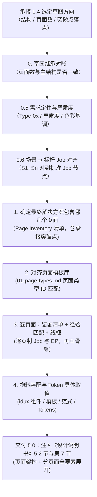

# 4.1 业务解决方案架构、页面清单与框架选型指引 (Solution Architecture & Page Inventory)

> 💡 **中枢定位**：
> 本文档是【方案系统设计主线 · Part2】的主控与框架选型指引。
> 承接 1.4 选定草图方向与 1.3 突破点，将业务流程落地为**端到端最终解决方案蓝图**：
> 1. **明确解决方案包含哪几个页面/视图**（主页面、抽屉、弹窗的页面清单）；
> 2. **对齐页面模板库**（严格从 [`03-design-assets/page-templates/01-page-types.md`](../../03-design-assets/page-templates/01-page-types.md) 中选择标准页面类型 ID）；
> 3. **为每个页面产出界面布局线框图**（Wireframe Schematics）；
> 4. **将标杆设计经验（EP-xx）与真实 idux 组件进行分页面深度装配**，彻底避免信息孤岛。

---

## 一、Part2 最终解决方案推导工作流

> 🔗 **本步在全链路中的位置**：`1.3 突破点 → 1.4 草图方向（用户确认）→ [本步] 定性 + Job 对齐 + 页面清单 + 逐页装配 + 线框图 → 5.0 说明书`。
> ⚠️ **本步不是"重新设计一遍"**：结构已在 1.4 定过，这里做的是**把它落到组件与 Token 的精度**。
> 🆕 **原 2.1 已并入本步**：类型定性 / 严肃度 / 色彩基调、场景→标杆 Job 对齐、逐页经验匹配，现在都是本步的原生动作（见 §0.5、§0.6、§3 第 1.7 条）。**"设计发力点"这一说法已废弃**——它就是 1.3 的「突破点」，以 1.3 为准，不再另立一套 L1。

---

## 零、方案落地前先定"度"：类型定性与严肃度（原 2.1 迁入）

> 📌 **为什么放在页面清单之前**：定性不改变"做什么"（那是 1.3 与 1.4 的事），但决定**克制到什么程度、能不能用红色、变更要不要二次确认**。这些一旦定错，后面所有页面的语气都会跟着错。

### 0.5 需求类型与严肃度

先判 `Type-0x`（对照 [`需求大类设计决策/00-总览与类型定性.md`](../②设计思考与决策/需求大类设计决策/00-总览与类型定性.md)），再按业务性质定"度"：

| 业务大类 | 严肃程度 | 典型场景 | 推荐审美风格与色彩基调 | 关键交互原则 |
| :--- | :--- | :--- | :--- | :--- |
| **可视化运维类** | 极高 (Mission-Critical) | 拓扑监控、故障自愈、流量调度、节点巡检 | **深沉克制 / 石墨冷灰** 底色通透、去框线化，色彩仅留给红/黄/绿告警脉冲 | In-situ 图内原地展开、视线锚定、三级联动排障流 |
| **策略与业务配置类** | 高 (High-Reliability) | WAF 规则集、BGP 路由划拨、安全拦截策略 | **严谨理性 / 逻辑清晰** 蓝灰主调、明确步骤条、高对比度参数表单 | 强配额预校验、严密防呆、变更前后对比 (Diff) |
| **对象与资源管理类** | 中 (Standard Enterprise) | 资产清单、主机列表、证书管理、用户鉴权 | **现代扁平 / 高效规整** 白底卡片、32px 高度紧凑搜索、40px 行高表格 | 冻结关键列、多维批量操作、高频快捷抽屉编辑 |
| **复杂报表与运营分析** | 中偏低 (Analytics) | 计费账单、流量大盘、访问趋势、SLA 达标报表 | **通透开阔 / 丰富可视化** 双色阶图表、KPI 四联胶囊、高亮离群值 | 多维时间切片对比、Top N 数据过滤、图表/表格一键切换 |

> 🛑 **严肃度只定"度"，不改"向"**：它不能因为"这事很重要"就把 1.4 定的结构推翻。它的作用范围只有三个——语气、克制程度、防呆强度。
> 📌 **一句判据**：**错一次会不会出事？** 会 → 走"极高 / 高"两档（防呆优先、色彩克制）；不会 → 走"中 / 中偏低"（效率优先、信息密度可以高）。

### 0.6 场景 ➔ 标杆 Job 对齐

从 1.1 的主场景 `S1~Sn` 出发，去需求大类分册看该类型沉淀了哪些标准 Job 节点，逐个对齐：

| 业务场景 | 场景名与核心痛点 | 匹配标杆 Job 节点 | Job 核心命题 | 该 Job 下值得关注的 EP |
| :--- | :--- | :--- | :--- | :--- |
| S1 | [名]（痛点 `🚩S1-Px`） | Job N | [这个 Job 要解决什么] | EP-xx、EP-xx |

> 📌 **对齐不到的怎么办**：写"未命中标杆 Job → 业务独立推导"，并在页面上显式标注 `业务独立推导`，不许硬塞一个 Job 进去。
> 🔗 **与横向库的关系**：命中纵向分册走纵向（`EP-xx`）；未命中或分册未覆盖，按 [`横向库承接与场景拆解桥协议.md`](../../04-workflows-and-cases/横向库承接与场景拆解桥协议.md) 走横向（`D0x-EPxx`）。**这张表的"业务场景 + 痛点"就是桥协议 Layer A 的输入**（原 Layer A 里的"发力点 Ln"一栏，改用 1.3 的 `Bx`，见下文）。

---

## 二、页面模板选型参考（全量 14 类，对齐 `01-page-types.md`）

> 🧭 **选型动线（先经验、后模板）**：**先看本页承接的标杆经验（`EP-xx`）指向何种骨架 → 再到 [`01-page-types.md`](../../03-design-assets/page-templates/01-page-types.md) 选定对应的页面类型 ID**；若该页属于标杆未覆盖的**业务独立推导**部分，仍以本库页面模板作为承载基线，不得自造模板型号。
> 🛑 **这里是全量 14 类，不是"常用 7 类"**：少列一类，Agent 就回落到 `page-table-basic`——"什么需求都做成一张台账"通常就是这么来的。族符号（F1~F8）对应 4.2 能力族裁决表：**族定形态，模板 ID 定骨架**。

### 2.0 列表类（6）

| 页面类型 ID | 模板名称 | 骨架特征 | 典型场景 | 族 |
| :--- | :--- | :--- | :--- | :--: |
| `page-table-basic` | **基础表格页** | 标题栏 + 表格工具栏 + 主数据表格 + 分页栏 | 基础对象查看、简单列表维护 ① | F1 |
| `page-table-tree` | **左树表格页** | 标题栏 + 左侧组织树/标签树 (240px) + 右侧数据表格 | 强组织架构层级归属的对象管理 ① | F1 |
| `page-table-overview` | **概览表格页** | 页面标题栏 + 顶部 KPI / 汇总卡片区 + 工具栏 + 数据表格 | 带宏观指标的资产或任务列表 ①④ | F1 |
| `page-table-overview-tree` | **概览左树表格页** | KPI 概览区 + 左树 + 右表格（左切范围、右看明细） | 按租户 / 分支先切范围，再看汇总与明细 ①④ | F1 |
| `page-list-modal` | **弹窗列表页** | 弹窗内搜索 + 筛选 + 勾选 + 关闭 | 操作途中临时选数据：选资产、选用户、选策略模板、选通知对象 ① | F1 |
| `page-list-drawer` | **抽屉列表页** | 抽屉内搜索 + 筛选 + 分页 + 简单操作 | 不离开当前页看关联数据：资产关联告警、策略关联设备、任务执行结果、未收到终端清单 ②③ | F1 |

### 2.1 详情类（3）

| 页面类型 ID | 模板名称 | 骨架特征 | 典型场景 | 族 |
| :--- | :--- | :--- | :--- | :--: |
| `page-detail-drawer` | **抽屉详情页** | 右侧抽屉 (640~800px) + 详情卡片 / 双栏排障 + 证据链 | In-situ 就地排障与体检下钻（EP-07）。**详情默认走这个** ②③ | F6 |
| `page-detail-drilldown` | **下钻详情页** | 独立页 + 多 Tab 或继续下钻 | 详情信息量很大、含多个 Tab、且还要再往下钻——**慎用**，能用抽屉就用抽屉 ②④ | F6 |
| `page-detail-log` | **日志详情页** | 单条日志的完整字段平铺（不承载层级与复杂展示） | 操作日志、告警日志、任务执行日志、同步日志 ③ | F6 |

### 2.2 配置类（4）

| 页面类型 ID | 模板名称 | 骨架特征 | 典型场景 | 族 |
| :--- | :--- | :--- | :--- | :--: |
| `page-form-drawer` | **抽屉表单页** | 右侧抽屉 (480~640px) + 纵向表单 + 底部固定操作栏 | 轻量对象新建、就地快速配置（EP-01） ① | F3 |
| `page-form-modal` | **弹窗表单页** | 居中模态弹窗 (480~600px) + 紧凑表单 + 底部确认/取消 | 简短参数修改、标签编辑、加白申请 ① | F3 |
| `page-form-config` | **配置表单页** | 独立页 + 分组表单 + 锚点 / 页内导航 + 未保存离开提醒 | 字段多、需分组、需独立保存的配置。**配置项超约 1.5 屏必须用这个**，塞抽屉就是迷宫 ① | F3 |
| `page-form-stepper` | **下钻步骤条配置页** | 顶部步骤条 (Steps) + 中部动态表单 + 底部引导操作底栏 | 多阶段向导、极复杂策略编排 ① | F3 |

### 2.3 可视化类（1）

| 页面类型 ID | 模板名称 | 骨架特征 | 典型场景 | 族 |
| :--- | :--- | :--- | :--- | :--: |
| `page-dashboard` | **Dashboard** | 全由概览卡片组成（无表格内容区），卡距 8px，1~4 卡组合 | 控制台首页、运营驾驶舱、态势总览 ④ | F7 |

> 🛑 **三个硬约束**：
> 1. **ID 逐字照抄**（步骤条配置页的正式 ID 是 `page-form-stepper`）——自检第 3 项校验存在性，**写错一个字直接拦**；
> 2. **详情默认走抽屉**（`page-detail-drawer`），只有"信息量很大 / 多个 Tab / 还要继续下钻"三个条件同时成立才用 `page-detail-drilldown`；
> 3. **配置超 1.5 屏不许塞抽屉**，改 `page-form-config`；反过来，≤6 字段的轻改不许开独立页。

> 🔁 **选不到模板时**：借最相近的 ID + 在页面清单里写明「借用 X + 参考案例 Y」，**不许自造 ID**（同 5.0 铁律 7）。
> 📌 **已知形态缺口：弹窗内 + 步骤条**（最典型是批量导入向导：下载模板 → 上传 → 字段映射 → 校验结果）。资产库目前只有独立页版 `page-form-stepper` 和弹窗版 `page-form-modal`，**没有"弹窗 + 步骤条"这一型**。遇到时借 `page-form-stepper` 并把弹窗化差异写进设计批注，别自造新 ID。

---

## 三、Part2 标准交付契约（分页面装配，直供 5.0 汇流）

> 🧭 **本节阅读顺序**：1 页面清单 → 1.5 继承对账 → 1.6 物料装配 → 1.8 字段落位 → 2 分页面展开（2.1 线框五要素 / 2.2 状态七态 / 2.5 档位兑现门禁）→ 1.7 逐页经验匹配。**编号沿用旧序**（1.7 是收口环节，排在最后），按上面的顺序读，别按编号大小读。

完成本步推导后，必须输出以下两大结构化内容，作为注入 5.0 设计说明书的硬性输入：

### 1. 最终解决方案架构与页面清单总览 (用于设计说明书 5.2 节)
* **页面清单表**：列明每个页面编号（`Page-01`, `Page-02`...）、页面名称、交互形态（主页/抽屉/弹窗）、模板类型 ID、承担的用户 Job、**承接的突破点（`Bx`）、来源草图（`方向X / Pn`）**。

> 🛑 **两张必查表（定稿页面清单前跑完）**：
> * **覆盖率自检**（业务对象 × 动作 / 状态全集逐项认领页面落点，落不了地的显式标"本期不做 + 原因"）—— 见 SOP Step 3；
> * **草图继承校验**（草图里的页面是否都在、页面数是否被私自扩张）—— 见下一条。

### 1.5 从草图继承：开工前先对一次账

> 📌 **为什么**：1.4 已经把方向定了、页面结构定了。4.1 若从零开始"重新想页面"，等于把用户刚选完的方向又改一遍，**这是主线里最伤信任的一种走偏**。

开工前，拿 1.4 的选定方向逐项对账：

| 对账项 | 判定 | 不通过怎么办 |
| :--- | :--- | :--- |
| 页面数量 | 草图画了几个页面，清单是不是就几个 | 少了 → 补齐或说明为何合并；多了 → **回 1.4 改方向**，不许在线框层擅自加页 |
| 主结构 | 草图是"一屏工作台"还是"列表+详情"，清单必须同构 | 不一致 → 停，回 1.4 重新确认，不许"做着做着觉得两页更好" |
| 进入关系 | 草图的"从哪进到哪"是否保留 | 变了 → 说明导航级改动，回 1.4 |
| 突破点落点 | 草图里圈的 `Bx` 在新清单里都有归属页面 | 有突破点无处落 → 要么补页面，要么明确"该突破点降级/本期不做 + 原因" |
| **档位是否被降级** | 草图定的档位（如 `B1 变革版`）在线框里要有对应机制，不许落成"优化版" | 改回；确需降档 → 回 1.4 重确认方向，并在清单里写明降到哪档 |
| **目标与指标是否同步** | 选高水位时声明的目标/指标变更，本步与 5.0 必须使用**改后的**版本 | 回 1.2 补录变更，不许沿用旧目标写新方案 |

> ✅ **一个健康的信号**：4.1 之后如果页面清单和草图的差异超过 30%，**不要硬推**，回 1.4 补一版草图——大概率是草图当时没想全，而不是草图错了。

### 1.6 物料装配：什么时候"装配"、什么时候"选型"

> 📌 **你的流程里"页面及物料装配"是独立一步**。它和"经验匹配"不是一回事：经验回答**用什么做法**，物料回答**用哪些现成件**。两者要分开判，否则会出现"经验选了抽屉，结果从组件库随便找了个抽屉"的脱节。

对每个页面，先定**装配清单**（要哪些物料），再定**具体选哪个**：

| 物料 | 先问"要不要" | 再问"用哪个" | 出处 |
| :--- | :--- | :--- | :--- |
| 页面模板 | 这页属于哪种骨架 | 从 `01-page-types.md` 选 ID；无专属则借用 + 注明参考案例 | [`page-templates/01-page-types.md`](../../03-design-assets/page-templates/01-page-types.md) |
| 组件 | 这处交互要什么能力 | 从 `idux-component-map.md` 映射真实组件名；查无则保留真实名 + 声明来源 | [`components/idux-component-map.md`](../../03-design-assets/components/idux-component-map.md) |
| 功能模块 | 是否属于高频通用能力（批量/导入导出/周期/标签/优先级） | 直接调 `feature/` 对应规范，不重新设计 | [`feature/`](../../03-design-assets/feature/) |
| 设计范式 | 这页有没有可套用的成熟范式（P-01~P-08） | 只在发力点已定后按本质反查，**不许反向用范式定发力点** | [`patterns/`](../../03-design-assets/patterns/) |
| Token | 需要定尺寸 / 色值 / 间距 | 优先沿用经验库案例 Token，其次资产库通用表 | [`tokens-cheatsheet.md`](../../03-design-assets/tokens-cheatsheet.md) |

> 🛑 **装配不等于凑齐**：一个页面用了 12 种组件不叫装配好，叫没想清楚。**物料数量应与该页承接的突破点数量成正比**（2 处突破点的页面，通常 5~8 个物料足够）。

### 1.8 字段落位：每个字段都要说得出"去了哪"

> 📌 **这一节是 1.1 第一节铁律的下半段**：字段清单是信息备选池，不是列清单——**每个字段都要能回答"它去了哪"：主表 / 详情 / 不展示（+ 原因）**。可以合并、可以下沉，**不许静默消失**（1.1 里最常翻车的一类：PRD 给 12 个字段，最后只剩 7 个，没人说得清另外 5 个去哪了）。

画线框之前，把本次需求的全部字段（PRD 字段表 + 1.1 意图复核补出来的）逐个认领：

| 字段 | 来源 | 落位 | 所在页面 | 说明（不展示 / 合并的理由，或该处承担什么） |
| :--- | :--- | :--- | :--- | :--- |
| 终端名称 | PRD 字段表 | 主表列（第 1 列，可点进详情） | Page-01 | 列表的主要识别键 |
| 最近一次扫描时间 | PRD 字段表 | 详情 | Page-02 | 主表已 9 列，此项不是列表上的判断依据 |
| 合规基线版本 | 1.1 意图复核补充 | 不展示 | — | 只在任务配置页选一次，结果页没有判断价值 |
| 风险等级 | PRD 字段表 | 主表列 + 详情 | Page-01 / Page-02 | 列表用于排序，详情用于看依据 |

🛑 三条判定：

1. **落「不展示」的必须写原因**——写不出原因，就是漏了，回去补位；
2. **合并的写在「落位」里**（如「合入『状态』列，悬停展开」），不许只写"合并"不说去哪；
3. **一个字段允许多处出现**，但每处要说明各自承担什么（列表排序 / 详情下钻），否则就是无意义重复。

> ✅ **交付前的对账口径**：`PRD 字段数 = 主表认领字段数 + 仅详情字段数 + 不展示字段数`（同一字段多处出现只按一处计）。**数量对不上，就是有字段被吞了**——这一刻就能发现，不必等评审提问。
> 🔗 **与下游的关系**：这张表留在 4.1，**不进说明书**（说明书第 7 节只呈现线框与映射清单）；但线框里少一列、多一列，必须能回到这张表找到依据。

---

### 2. 分页面全要素深度展开清单 (用于设计说明书第 7 节)
针对解决方案中的**每一个**页面/视图，依次结构化输出：
1. **页面定位与用户 Job**：该页面承担什么核心任务，翻转了哪几个现状痛点（插旗 `🚩Sx-Py`）；
2. **界面结构线框示意图 (Wireframe Schematic)**：标注头部套头、筛选栏、卡片区、主表格/拓扑区、操作底栏。**"清晰"不算标准，必须过 §2.1 的五条要素**（分区与层级 / 主操作唯一 / 密度匹配 / 状态覆盖 / 进出动线）；
3. **承载的设计经验与 Why 因果**：明确本页面落地了哪几条标杆设计经验（如 `EP-01`, `EP-02`, `EP-04`, `EP-07`），说明为何在此采用此解法；
4. **页面模板与真实 idux 组件清单**：列明选用的模板 ID、所用真实组件（`IxTable`, `IxDrawer`, `IxProgress`, `IxPopconfirm` 等）、尺寸与 Token 硬指标（`h32`, `h28`, `rounded-[2px]`, `#1C6EFF` 等）；
5. **关键交互与状态流转机制**：原地闭环逻辑、实时计算或心跳防死信规则；**状态按 §2.2 的七态逐项勾过**，缺的写明理由；
6. **与草图的一致性对账（在 4.1 内部完成，不进说明书）**：本页对应 `方向X / Pn` 的哪一个草图、哪些分区被完整继承、哪些做了偏离及其理由（偏离到主结构层面的，必须回 1.4 重确认，不能在此自行说明后放行）。

> 🔎 **为什么对账留在 4.1**：它是"方向没有被偷偷改掉"的唯一凭证；但说明书读者要看的是线框质量，所以对账结论留在本步，说明书只呈现页面清单与线框，页面头部不写一致性声明。

#### 2.1 线框五要素（"清晰"的可判定版本）

> 🛑 **线框是审阅主体，所以它必须有判据。** 下面五条全绿才算合格；一条不过就重画，**不要靠批注解释**。

| # | 要素 | 合格线 | 不合格长什么样 |
| :---: | :--- | :--- | :--- |
| 1 | **分区与层级** | 主区块 ≤4 个；信息层级 ≤3 层（排障 / 详情类允许 4 层，须在批注里说明为什么） | 一屏切 6 个框、每个框里再套 Tab——"框套框" |
| 2 | **主操作唯一** | 一页只有一个主按钮，其余为次按钮 / 文字按钮 / 图标按钮 | 顶部"新建"和表格上方"添加"都是主按钮蓝，用户不知道先点哪个 |
| 3 | **密度匹配** | 按 §0.5 的密度档：对象 ≤10 条且字段 ≤8 → 卡片流；对象多、字段固定 → 紧凑表 | 6 条数据铺满 40px 行高的大表，半屏空白 |
| 4 | **状态覆盖** | §2.2 的七态逐项勾过，缺的写明理由 | 只有"有数据"一种样子，空 / 失败 / 无权限全靠开发现场编 |
| 5 | **进出动线** | 说得出这页从哪进、办完去哪、返回时筛选与滚动位置回不回填 | 改完返回回到列表顶部，用户重新找刚才那条 |

> 📌 **第 1 条的层级口径**：分区 = 视觉上能独立成块的内容区（表格区 / 概览区 / 操作区…）；层级 = 页面 → 区块 → 区块内元素的嵌套深度。**每多一层，扫视成本翻一倍**，所以默认卡在 3 层。

#### 2.2 状态与异常覆盖：七态逐页勾

> 🛑 **线框只画"有数据"是这一类返工的头号原因**：开发做到失败态时只能自己编，上线后失败提示是一句「系统异常 (500)」，用户来报 bug，最后整页重做。

每个页面过一遍下面七态，**不要的写理由，"不需要"三个字不算理由**：

| 状态 | 要问的一句 | 常见不合格 |
| :--- | :--- | :--- |
| **空** | "什么都没有"和"筛掉了"分得开吗？后者给不给清筛选的出口？ | 一句"暂无数据"打发两种空 |
| **加载** | 首屏 / 翻页 / 局部刷新分别是什么样子？ | 整页白屏转圈，翻页也整页闪 |
| **失败** | 接口失败、下发失败、校验失败，用户能看到"哪一条、为什么"吗？ | 只弹"操作失败"，不给原因与重试入口 |
| **部分成功** | 成功 7 条、失败 3 条时，失败的那 3 条在哪看、能不能重试？ | 只给"部分失败"，没有失败清单 |
| **无权限** | 看得到但改不了，还是整块隐藏？拦下时说了原因吗？ | 按钮直接消失，用户以为系统坏了 |
| **超限 / 配额** | 超了是提交前拦还是提交后报错？给不给试算？ | 提交后才报错，用户白填一遍 |
| **降级 / 不可用** | 依赖的系统挂了、终端离线，这页显示什么？ | 一直转圈，用户分不清是自己网络还是系统挂了 |

> ✅ 交付时每页附一行：`本页状态覆盖：空 ✓ / 加载 ✓ / 失败 ✓ / 部分成功 ✓ / 无权限 n-a（本页无写操作）/ 超限 n-a / 降级 ✓`
> 📌 **七态里最容易被漏的是「部分成功」和「降级」**——恰恰是安全类产品最容易出事故的两处。

#### 2.5 档位兑现门禁：画完线框，回头核一次方向

> 📌 **§1.5 的对账在开工前（防跑偏），这一道在收工前（防降档）。** 草图定的档位是用户在闸门处买到的东西；线框把它做成优化版，等于交付了另一个方案，而用户不会知道。

逐页回填，一行一处 `Bx`（同页多处就多行）：

| 页面 | 突破点 | 草图定档 | 这页的兑现机制（具体到分区 / 交互） | 判定 |
| :--- | :--- | :--- | :--- | :---: |
| Page-02 | B1 让人不用懂参数也能说清要查什么 | 变革版 | 抽屉顶部换成「一句话说明要查什么 → 系统出规则草案」，人只改差异 | ✅ |
| Page-01 | B3 配过的规则组能直接复用 | 创新版 | 列表侧边挂「规则模板库」抽屉，选一套改差异 | ✅ |
| Page-03 | B4 提交后知道谁没收到 | 变革版 | 只做了「完成 / 失败」两个状态标签 | ❌ 降档 |

三条判定：

1. **❌ 不许在 4.1 自行解释后放行**——回 1.4 重新确认方向，或在页面清单里写明"降为 X 版 + 用户已知情"；
2. **兑现机制要写"哪一块、怎么动"**，写"通过优化交互实现"等于没写；
3. **一页出现两处以上 ❌，这页的设计基本没开始**——重画比补说明便宜。

> 🔗 **回填到 1.4**：这张表是 1.4 §八「档位是否被偷偷降级」的答复凭证，交付时连同页面清单一起给，**不单独进说明书**。

---

### 1.7 逐页经验匹配（原 2.1 第二遍，已并入本步）

> 📌 **为什么放在这里而不是单开一环**：经验要"逐页"判才准，而页面清单正是在这一步产出的。**在页面确定的地方判经验，是最省事也最不容易漏的位置**——单独跑一趟"回头再匹配"，往往会退化成把同一批经验糊到每一页上。

对每个页面，配经验之前先问四句：

| # | 问句 | 答不上来说明什么 |
| :---: | :--- | :--- |
| 1 | **这页用户要办成什么事？**（一句话，不是功能罗列） | 页面职责没划清，回 §1 重定 |
| 2 | **这页承接了 1.3 的哪几处突破点 `Bx`？** | 页面和突破点断链了——可能这页多余，也可能突破点漏了落点 |
| 3 | **这页对应哪个标杆 Job？该 Job 下有哪几条 `EP-xx` 正好治这个事？** | 对不上 Job → 标"业务独立推导"，不许硬塞 |
| 4 | **这条经验会不会改掉 1.4 定的结构？** | 会改结构 → 停，回 1.4 确认方向，不许在线框层偷偷换骨架 |

结果直接落在「分页面装配清单」里，不另开表：

| 页面 | 承接突破点 | 用户核心任务 | 对应 Job | 采纳经验 | 采纳理由（能说回 `Bx` 或 `🚩Sx-Py`） | 业务独立推导 |
| :--- | :--- | :--- | :--- | :--- | :--- | :--- |
| Page-01 | B1、B3 | [一句话] | Job 1 | EP-03、EP-04 | 新建要保留列表上下文 + 影响面要前置（对 B3） | 预置分组的命名与粒度 |

两条常见错判：

| 错判 | 长什么样 | 怎么改 |
| :--- | :--- | :--- |
| **一页堆满经验** | 一个页面采纳 8 条 EP，什么都要 | 按"这页最需要解决的那一件事"选 2~4 条，其余降为基线要求或不采纳 |
| **跨页复用被算两次** | 同一条 EP 在 3 个页面都写"采纳" | 允许，但要写清"每页落地的是它的哪一段"，否则等于没说 |

> 🔎 **判据**：每页至少一条"采纳理由"要能说回突破点 `Bx` 或痛点 `🚩Sx-Py`。说不回的，这条经验是顺手抄的，删掉。
> 📌 **与说明书的对应**：这张表是**唯一装配源**——5.0 第 6.2 节由它投影生成，第 7 节各页的「设计经验与组件选型映射清单」也用它，**不另建格式**。

**列口径（7 列，一张表贯穿 4.1 / 4.2 / 5.0）**：

| 本表列 | 5.0 §6.2 对应列 | 投影规则 |
| :--- | :--- | :--- |
| 页面 | 业务场景 | 同场景多页时取主页面，括号注 `Page-xx` |
| 承接突破点 | 承接突破点 | 同名列，写成 `Bx（档位）`，档位取自 1.4 留档 |
| 采纳经验 | 命中的设计决策经验 | 纵向 `EP-xx` 标（纵）、横向 `D0x-EPxx` 标（横） |
| 采纳理由 | 系统设计解法 | 一句话写"这条经验解决这页哪个判断"，不许抄经验标题 |
| 业务独立推导 | 自行设计补充 | **列名固定写"自行设计补充"**，格内标签固定 `业务独立推导` |
| 用户核心任务 | —（留档） | 6.2 是场景级，不重复登记；第 7 节每页头部已写 |
| 对应 Job | —（留档） | 同上，回 §0.6 可查 |

> 🛑 **不许把两个名字混用**：`业务独立推导` 是格内标签，`自行设计补充` 是列名——列名是名词、标签是结论。评审时按列名找、按标签判来源。
