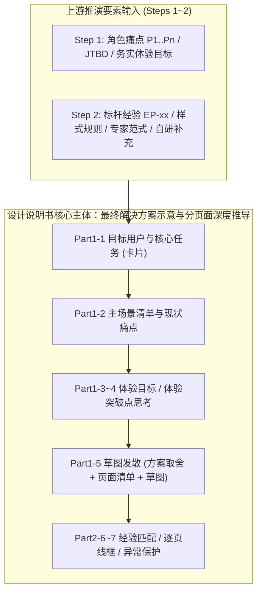

# 织雨设计智脑：标准设计说明书模板 (Design Specification Template)

> 💡 **中枢定位**：
> 本文档是织雨在执行 **【方案系统设计主线】** 步骤 4 的核心交付物模板。
> 它是资深设计师在动工写代码前，向业务规划人员呈递的**“端到端最终解决方案全景共识协议”**。
>
> 🛑 **系统化整合铁律（拒绝碎片化与机械堆叠）**：
> 设计说明书绝不是把 1~3 步推演产物机械、孤零零地各放一块内容！
> 它必须是将每一步的信息（业务痛点、标杆经验、场景旅程、组件选型）**全面汇流、整理并结构化映射到最终的解决方案中**：
> 明确回答本次需求**最终包含哪几个页面、各页面的界面结构线框图如何、每个页面融合承载了哪些标杆设计经验、以及具体采用了哪些页面模板和 idux 真实组件与 Token 样式**。
>
> 📐 **排版顺序与表达核心铁律（防退化硬规则）**：
> 1. **两段式结构**：全篇固定为 **Part1 需求分析与思考（1~5 节）** + **Part2 需求解决方案全景（6~8 节）**，评审共识关卡作为末尾 `<div class="checkpoint">` 浮层，不设第九章。旧“五章”结构的说明书仍可被自检脚本识别，不做强制迁移。
> 2. **经验只在两处出现（去冗余）**：第 6.2 节「业务场景 → 经验匹配与承接突破点」用**单表穿透**（6 列，强制保留「自行设计补充」列）；**具体机制与采纳结论落在第 7 节每页的「设计经验与组件选型映射清单」里**。原「经验采纳明细」独立小节已取消——每页清单已说清"用了哪条、用在哪"，再单列一节属重复登记。
> 3. **第 7 节严格“先线框、后清单”**：每个分页面小节固定四段：`① 页面定位与核心任务 + 选用页面模板（各一行） ➔ ② 结构线框图 ➔ ③ 设计经验与组件选型映射清单（排在线框下方） ➔ ④ 设计批注 (wf-annotation)`；含可视化件的页面再追加第 ⑤ 段《可视化件声明》。**批注三行标题固定为「💡 为什么这样布局」「🧭 这页能做什么」「🛡️ 哪些做不了、拦下后怎么提示」，一行为一句大白话**；严禁再出现「架构定位与 Why 依据 / 业务动作落点 (CRUD 闭环) / 状态机与异常规则」这类需要专业人士翻译的黑话标题。**线框是审阅主体，必须排在映射表之前**；页面头部**只留这两行**，不写「承接突破点」「档位达成证据」「与草图的一致性」等解释性条目——用户看的是线框质量，不是推导过程。
> 4. **双轨制归因标注**：映射清单中，标杆复用必须使用 `<span class="tag-exp">EP-xx</span>`（绿底实线），标杆未覆盖的自研推导必须使用 `<span class="deriv">业务独立推导</span>`（灰底虚线），血统泾渭分明。
> 5. **EP 经验与真实 UI 文本彻底解耦**：线框图中的按钮、标签、表头文字必须是 **100% 干净真实的业务语言**，**严禁**在 UI 文案中写入 `(EP-xx)`（如禁止写 `立即执行 (EP-05)`），EP 编号只允许出现在代码注释、映射表与底部批注中。
> 6. **文风去 AI 套话与黑话**：拒绝“极速赋能”、“零心智负担”、“立体感知”等无物虚词，拒绝虚拟人设吹嘘；采用简约、清晰、克制的设计师直白表达与量化对比（如“30 分钟 ➔ 30 秒”、“首页管任务、详情管终端”）。
> 7. **模板借用规范**：若 [`01-page-types.md`](../../03-design-assets/page-templates/01-page-types.md) 暂无专属模板，严禁杜撰不存在的 template ID，必须借用相近模板并显式注明参考案例（如：`套头借用 page-table-overview + 自定义主从分栏，参考 XDR 模板管理案例`）。
> 8. **表单书写必须严格参考设计资产规范输出（左右结构铁律）**：所有线框图中的表单书写**必须严格参考设计资产规范 [`03-design-assets/components/design-form.md`](../../03-design-assets/components/design-form.md) 输出**。所有表单片段必须遵循**左右结构**（左文本标题 Label、右组件内容 Control），**严禁出现 Ant Design 默认的上标题下组件（Vertical）布局**（严禁在 Label 文本后使用 `<br/>` 断行堆叠表单项）。非必填项左侧必须留星号占位空间确保文字像素级垂直对齐。
> 9. **顶部概要只留四项、且不写状态**：方案制定者 / **产线（仅产线名）** / **需求定性（上层工作类型可多列：主角标「主」排在最前，其余标「条件命中」，再接具体需求类别）** / **需求输入（需求文件名）**。**多列只列真正扫过并出了突破点的类型，没扫的不写、不凑数；主角只能有一个**（判法见 1.3 第八节）。**禁止出现「当前状态」「协同状态」「⏳ 交付完成 / 待评审」等状态行与状态徽标**——进度只在文末 checkpoint 说一次；也去掉「面向对象」，产线不写模块路径。
> 10. **角色只写主次两个**：Part1 第 1 节用 `.role-grid` 卡片（**不用 `<ul>`**），固定 **2 张：主角色 1 + 次角色 1**，只判定"谁主用、谁被牵动"。**不列审计、旁观、领导等凑数角色**——角色多时合并进次角色，或只写主角色一张。
> 11. **编号体系不外泄**：症状编号 `Sx-Py`、原始需求号 `REQ-xxx` 一律不进正文（详见 1.1 第四节「编号体系」）。
> 12. **正文不写“写法说明”**：说明书是交付物，不是模板教学。**任何“本节回答什么 / 为什么这么排 / 规则是什么 / 与哪一步对应”的解释性段落一律不写进成品**——那些是生成时的规矩，属于本铁律区与各节结构约束，不属于读者要看的内容。读者只该看到**结论、表、图**。
> 13. **场景表固定四列**：`场景（编号. 名称）` / 主要角色 / 用户 Job / 现状卡点（**不再设「触发情境」列**——时机是场景内的细节，单列一列既占宽、又诱使按"什么时候发生"切场景）。编号与名称合并一列；痛点格用项目符号分行，**不写 `🚩` 前缀、不写 `REQ-xxx`**（详见 1.1 第四节「编号体系」）。**用户 Job 一栏写"这个场景要维护／交付的那份东西 + 覆盖的工作内容"（如：维护一份清晰可用的资产台账，含入库、分类、打标、出库），不写"从 A 到 B"的改善句——那是第 3 节体验目标的活，提前写进 Job 会把目标挤到比 Job 更小。场景按责任域切，A 的终态若是 B 的触发情境必须合并；成品场景数 2~5 条、名称不含阶段词，此项由自检第 1 项硬校验。**
> 14. **内容预算（超了就是没收敛）**：主场景 ≤5 行 · 体验目标 ≤5 条（每条一句，= 主场景数）· 突破点 ≤5 条 · 角色 2 张 · 每页映射清单 ≤8 行。**任何表都不许为"显得完整"加说明性列**（如「本方案取档」「落点页面」「备注」）；一列如果删掉以后读法不变，就是该删的列。
> 15. **不写方案取舍复盘**：说明书**不设**「方案取舍」「档位组合与授权记录」两节——这些留在 1.4 草图闸门的留档里，说明书只呈现选定结果对应的页面与组件。第 5 节只保留 **页面清单** 与 **草图** 两块。
> 16. **弹窗与提示条按组件规范画线框**：弹窗严格按 [`comp-modal.md`](../../03-design-assets/components/comp-modal.md)——标题栏 `48px`（标题 `16px/600`、左边距 `16px`、**无底部分割线**）、内容区左右 `32px`（上下不加 padding）、按钮栏 `56px`（**无顶部分割线**、按钮 `32px`/`14px`、间距 `8px`、**按钮组右对齐且主按钮在左、取消在右**）；提示条严格按 [`comp-alert.md`](../../03-design-assets/components/comp-alert.md)——**一律无边框**，普通条 `#F7F7F8`/`#6F7785`、告警条 `#FFFAF2`/`#A35F40`（图标 `16px`、与正文间距 `8px`）。**红色三元组 `#FFF1F0`/`#D9363E`/`#FFA39E` 不得用作 Alert 底色或边框**——comp-alert 只有普通与告警两档，没有红色档；标杆样例里出现的红底警示块属于偏离规范的样本，禁止照抄（逐条反例见 [`comp-modal.md`](../../03-design-assets/components/comp-modal.md) 与 [`comp-alert.md`](../../03-design-assets/components/comp-alert.md) 末节「反例」，与内部调优文档或外部截图冲突时一律以组件规范为准）。
> 17. **映射清单默认只露前 3 行**：每页映射清单超过 4 行时（即至少 2 行要收），第 4 行起加 `class="rows-extra"`，第 3 行后插入 `<tr class="rows-toggle-row">` 折叠按钮（模板已内置 CSS/JS，无需另写脚本）；只有 4 行的清单不折叠，直接全显。**折叠只是渲染，严禁删行、严禁把行搬出 `<tbody>`、严禁省略组件名与 Token 数值**——Step 6 的 Coding AI 按源码全量读取，折叠态不影响还原精度。
> 18. **线框必须贴合真实页面数据，不得沿用草图标准**：第 7 节线框图**禁止出现 `__` 之类占位符**，必须用一套**跨页自洽的真实示例数据**（对象名、数量、状态、时间、证据来源）填满；草图上为守"不编数字"而留空的量、以及**草图没展示全的字段与异常态**（长文本截断、空值、无权限、过期、超限降级），线框里要**尽量补全并显性表达**。示例数据的口径在第七节开头用一行声明（示例环境 + 快照时间 + 规模），**明确它是示例样本、不构成客户事实**。判据一句话：**草图守"结构级"可以留占位，线框守"落地级"必须给真值——两份精度必须拉开**；没值的线框等于把"放不放得下、会不会截断"的判断成本退回给评审人。
> 19. **说明书必须"完本自包含"，能脱离对话交给他人或其他工具编码**：除 Part1 与逐页线框外，第 7 节尾部必须补齐**六节编码契约**——① 交互逻辑与状态机（逐页：元素 / 触发 / 系统响应 / 状态变化 / 不可用边界 ＋ 前端状态字段 ＋ 页面与浮层关系）；② 数据口径与演示数据集（每个数字的定义与真源 ＋ 可整节替换的 mock 数据 ＋ 一致性铁律）；③ 组件、Token 与全局样式契约（尺寸栅格 / 颜色白名单 / 组件选型与禁止替换 / 动效）；④ 固定文案与状态词表（逐字照抄的责任边界句 ＋ 状态标签映射 ＋ 空态文案 ＋ 禁用词与格式）；⑤ 验收清单（页面级 / 交互异常级 / 账实边界 ＋ 手工自测步骤）；⑥ 实现边界（不做清单 ＋ 只读约束 ＋ 禁令）。**判据：把文件单独发给一个没参与对话的人或另一个 AI，他不问一句就能做出同款页面。** 缺任一节即判"未完本"，不得标记交付。
> 🛡️ **交付前自检铁律（强制 · 未过不得汇报）**：
> 出稿后**必须**运行 `bash tools/gate-sp.sh _output/<业务名>/design-spec-<业务名>.html`——SP-S/A/W/C/D 五组全过，方可进入「🚦 人机共识确认闸门」。门禁编号与判据见 [`准出门禁总表.md`](../../04-workflows-and-cases/准出门禁总表.md)；单跑 `design-spec-selfcheck.sh`（11 项）只覆盖 SP-A / SP-W，**不算过闸门**。

---

## 一、章节内容结构（两段式骨架：Part1 思考 / Part2 方案）



---

## 二、HTML 骨架模板（包含 Wireframe 视觉组件与全要素结构）

将下方骨架中的 `[方括号占位]` 替换为真实内容，产出单个 `.html` 文件即可在浏览器中获得兼具专业推演、视觉线框与工程组件映射的方案说明书。

```html
<!DOCTYPE html>
<html lang="zh-CN">
<head>
  <meta charset="UTF-8" />
  <meta name="viewport" content="width=device-width, initial-scale=1.0" />
  <title>织雨体验设计方案说明书：[方案名称]</title>
  <script src="https://cdn.jsdelivr.net/npm/mermaid@10/dist/mermaid.min.js"></script>
  <style>
    :root {
      --bg: #F7F9FC; --card: #FFFFFF; --border: #E1E5EB;
      --text: #2F3540; --text-sub: #6F7785; --text-mute: #A1A7B3;
      --blue: #1C6EFF; --blue-l: #E8F4FF; --blue-border: #BAE6FD;
      --warn-t: #FA8C16; --warn-b: #FFFBE6; --warn-bd: #FFE58F;
      --green-t: #12A679; --green-b: #F6FFED; --green-bd: #B7EB8F;
      --danger-t: #D9363E; --danger-b: #FFF1F0; --danger-bd: #FFA39E;
    }
    * { box-sizing: border-box; }
    body {
      margin: 0; background: var(--bg); color: var(--text);
      font-family: "Inter", "PingFang SC", "Helvetica Neue", Arial, sans-serif;
      font-size: 13px; line-height: 1.7;
    }
    .wrap { max-width: 1040px; margin: 0 auto; padding: 24px; }
    .doc { background: var(--card); border: 1px solid var(--border); border-radius: 6px; padding: 36px; box-shadow: 0 1px 3px rgba(15,23,42,0.04); }
    h1 { font-size: 22px; line-height: 30px; font-weight: 700; margin: 0 0 16px; color: #1E293B; }
    h2 { font-size: 16px; line-height: 24px; font-weight: 600; margin: 36px 0 14px; padding-bottom: 8px; border-bottom: 1px solid var(--border); color: #1E293B; }
    h3 { font-size: 14px; font-weight: 600; margin: 24px 0 10px; color: #2F3540; }
    h4 { font-size: 13px; font-weight: 600; margin: 16px 0 6px; color: var(--text-sub); }
    
    .meta { color: var(--text-sub); font-size: 12px; margin-bottom: 24px; line-height: 2; background: #F8FAFC; padding: 12px 16px; border-radius: 4px; border: 1px solid var(--border); }
    .meta b { color: var(--text); }
    .status { display: inline-block; padding: 2px 8px; border-radius: 2px; background: var(--warn-b); color: var(--warn-t); border: 1px solid var(--warn-bd); font-size: 11px; font-weight: 500; }
    
    table { width: 100%; border-collapse: collapse; margin: 12px 0; font-size: 12px; }
    th { background: #EDF1F7; color: #454C59; font-weight: 500; text-align: left; height: 32px; padding: 0 12px; border-bottom: 1px solid var(--border); white-space: nowrap; }
    td { height: 38px; padding: 6px 12px; border-bottom: 1px solid var(--border); vertical-align: top; }
    .num { text-align: right; font-variant-numeric: tabular-nums; }
    
    /* 标签双轨制：标杆复用实线绿 vs 业务独立推导虚线灰 */
    .tag { display: inline-block; padding: 1px 8px; border-radius: 2px; font-size: 11px; background: var(--blue-l); color: var(--blue); border: 1px solid var(--blue-border); }
    .tag-exp { display: inline-block; padding: 1px 8px; border-radius: 2px; font-size: 11px; background: var(--green-b); color: var(--green-t); border: 1px solid var(--green-bd); font-weight: 600; }
    .deriv { display: inline-block; padding: 1px 8px; border-radius: 2px; font-size: 11px; background: #F1F5F9; color: #454C59; border: 1px dashed #94A3B8; }
    .flag { display: inline-block; padding: 1px 6px; border-radius: 2px; font-size: 11px; background: var(--danger-b); color: var(--danger-t); border: 1px solid var(--danger-bd); }
    
    .mermaid { background: #F8FAFC; border: 1px solid var(--border); border-radius: 4px; padding: 16px; margin: 14px 0; text-align: center; overflow-x: auto; }
    ul { margin: 8px 0; padding-left: 20px; }
    li { margin: 4px 0; }
    .note { background: #F8FAFC; border-left: 3px solid var(--blue); padding: 8px 14px; margin: 10px 0; font-size: 12px; color: #454C59; }

    /* ========== 通用线框图视觉基础原语 (Universal Wireframe Primitives) ========== */
    .wf-container { background: #F8FAFC; border: 1px dashed #CBD5E1; border-radius: 6px; padding: 16px; margin: 16px 0; }
    .wf-label { display: inline-block; font-size: 11px; font-weight: 700; color: #454C59; margin-bottom: 6px; }
    .wf-shell { background: #FFFFFF; border: 1px solid #E2E8F0; border-radius: 4px; box-shadow: 0 1px 3px rgba(15,23,42,0.05); overflow: hidden; }
    .wf-header { background: #F1F5F9; border-bottom: 1px solid #E2E8F0; padding: 8px 12px; display: flex; justify-content: space-between; align-items: center; font-size: 11px; font-weight: 600; color: #454C59; }
    .wf-body { padding: 12px; }
    .wf-row { display: flex; gap: 10px; margin-bottom: 10px; align-items: stretch; }
    .wf-col { flex: 1; }
    .wf-card { background: #F8FAFC; border: 1px solid #E1E5EB; border-radius: 2px; padding: 8px 10px; font-size: 11px; }
    .wf-table { width: 100%; border-collapse: collapse; font-size: 11px; margin-top: 6px; }
    .wf-table th { background: #EDF1F7; padding: 6px 8px; border-bottom: 1px solid #E2E8F0; text-align: left; height: auto; }
    .wf-table td { padding: 6px 8px; border-bottom: 1px dashed #E2E8F0; color: #64748B; height: auto; }
    .wf-btn { display: inline-block; padding: 2px 10px; border-radius: 2px; font-size: 11px; background: #FFFFFF; color: #2F3540; border: 1px solid #D3D7DE; }
    .wf-btn-primary { display: inline-block; padding: 2px 10px; border-radius: 2px; font-size: 11px; background: var(--blue); color: #FFFFFF; border: 1px solid var(--blue); }
    .wf-btn-disabled { display: inline-block; padding: 2px 10px; border-radius: 2px; font-size: 11px; background: #EDF1F7; color: #BEC3CC; border: 1px solid #E2E8F0; }
    .wf-drawer-overlay { display: flex; background: rgba(15, 23, 42, 0.15); border: 1px dashed #94A3B8; border-radius: 4px; min-height: 280px; position: relative; }
    .wf-drawer-body { width: 440px; background: #FFFFFF; border-left: 2px solid var(--blue); padding: 16px; margin-left: auto; box-shadow: -4px 0 16px rgba(15,23,42,0.12); display: flex; flex-direction: column; }
    .wf-modal-overlay { display: flex; justify-content: center; align-items: center; background: rgba(15, 23, 42, 0.25); border: 1px dashed #94A3B8; border-radius: 4px; min-height: 240px; padding: 20px; }
    .wf-modal-body { width: 480px; background: #FFFFFF; border: 1px solid #CBD5E1; border-radius: 4px; padding: 16px; box-shadow: 0 4px 16px rgba(15,23,42,0.14); }
    .wf-annotation { font-size: 11px; color: #1C6EFF; background: #E8F4FF; padding: 6px 10px; border-radius: 2px; border-left: 3px solid var(--blue); margin-top: 10px; line-height: 1.6; }

    /* 表单专用线框原语（严格左右结构：左 Label 固定宽 + 间距 16px + 右 Control） */
    .wf-form-item { display: flex; align-items: flex-start; margin-bottom: 12px; }
    .wf-form-label { width: 110px; flex-shrink: 0; color: #6F7785; font-size: 11px; padding-top: 4px; text-align: left; }
    .wf-form-control { flex: 1; min-width: 0; }

    /* 底部评审共识关卡浮层 */
    .checkpoint { background: var(--blue-l); border: 1px solid #BAE6FD; border-radius: 4px; padding: 16px 20px; margin-top: 36px; font-size: 12px; color: #1C6EFF; line-height: 1.8; }
    .checkpoint b { display: block; margin-bottom: 6px; font-size: 13px; color: #1C6EFF; }

    /* ========== Part 标题（两段式结构） ========== */
    h2.part { font-size: 19px; font-weight: 800; letter-spacing: -.3px; color: #2F3540;
      margin: 34px 0 14px; padding: 10px 0 8px; border-top: 2px solid #1C6EFF; border-bottom: 1px solid #E1E5EB; }

    /* ========== 折叠区（草图 / 门禁明细） ========== */
    details.sketch-fold { border: 1px solid #E1E5EB; border-radius: 6px; background: #FFFFFF; margin: 12px 0; }
    details.sketch-fold > summary { cursor: pointer; padding: 9px 14px; font-size: 12px; font-weight: 600;
      color: #1C6EFF; background: #F7F9FC; border-radius: 6px; list-style: none; }
    details.sketch-fold > summary::-webkit-details-marker { display: none; }
    details.sketch-fold > summary::before { content: "▸ "; }
    details.sketch-fold[open] > summary::before { content: "▾ "; }
    details.sketch-fold[open] > summary { border-bottom: 1px solid #E1E5EB; border-radius: 6px 6px 0 0; }
    details.sketch-fold .sketch-body { padding: 12px 14px; }

    /* ========== 准出门禁结论条 ========== */
    .gate-pass { display: flex; align-items: center; gap: 10px; background: #F6FFED;
      border: 1px solid #B7EB8F; border-radius: 4px; padding: 10px 14px; font-size: 12px; color: #454C59; }
    .gp-badge { font-weight: 700; color: #12A679; white-space: nowrap; }

    /* ========== 角色卡片 (Role Cards) ========== */
    .role-grid { display: grid; grid-template-columns: repeat(auto-fit, minmax(300px, 1fr)); gap: 14px; margin: 14px 0 6px; }
    .role-card { background: #FFFFFF; border: 1px solid #E1E5EB; border-radius: 6px; padding: 0; overflow: hidden; display: flex; flex-direction: column; }
    .role-card.primary { border-color: #BAE6FD; box-shadow: 0 1px 4px rgba(28,110,255,0.06); }
    .role-hd { display: flex; gap: 10px; align-items: center; padding: 13px 14px; background: #F7F9FC; border-bottom: 1px solid #EDF1F7; }
    .role-card.primary .role-hd { background: #F0F3FF; }
    .role-avatar { width: 34px; height: 34px; flex-shrink: 0; border-radius: 50%; background: #EDF1F7;
      display: flex; align-items: center; justify-content: center; font-size: 15px; color: #6F7785; }
    .role-card.primary .role-avatar { background: #E8F4FF; color: #1C6EFF; }
    .role-name { font-size: 13px; font-weight: 700; color: #2F3540; line-height: 1.35; }
    .role-post { font-size: 11px; color: #8A92A1; margin-top: 1px; }
    .role-bd { padding: 12px 14px 14px; display: flex; flex-direction: column; gap: 10px; flex: 1; }
    .role-row { font-size: 12px; line-height: 1.65; }
    .role-row .k { display: block; font-size: 10.5px; color: #A1A7B3; letter-spacing: .3px; margin-bottom: 2px; }
    .role-row .v { color: #454C59; }
    .role-jtbd { background: #F8FAFC; border-left: 3px solid #1C6EFF; border-radius: 0 3px 3px 0;
      padding: 8px 11px; font-size: 12px; color: #2F3540; line-height: 1.7; }
    .role-jtbd .q { color: #1C6EFF; font-weight: 700; margin-right: 3px; }
    .role-tags { display: flex; flex-wrap: wrap; gap: 5px; margin-top: 2px; }
    .role-tag { font-size: 10.5px; padding: 1px 8px; border-radius: 9px; background: #F1F5F9; color: #64748B; border: 1px solid #E2E8F0; }

    /* ========== 映射清单折叠：默认只显示前 3 行，其余点击展开（DOM 中内容完整保留，不删行） ========== */
    tr.rows-extra { display: none; }
    tr.rows-toggle-row > td { padding: 4px 12px; }
    .rows-toggle { background: none; border: 0; padding: 0; color: #1C6EFF; font-size: 12px; font-family: inherit; cursor: pointer; }
    .rows-toggle:hover { text-decoration: underline; }
  </style>
</head>
<body>
<div class="wrap">
  <div class="doc">
    <h1>🎨 织雨体验设计方案说明书：[方案名称]</h1>
    <div class="meta">
      <b>方案制定者</b>：设计师织雨 (Virtual Designer Zhiyu)<br/>
      <b>产线</b>：[仅写产线名称，如：SASE / XDR / aES，不写模块路径]<br/>
      <b>需求定性</b>：[主角工作类型]（主）｜[条件命中类型]（条件命中） | [具体需求类别]，如：<code>价值感知（主）｜运营分析、配置运维（条件命中） | 总部全局掌握</code><br/>
      <b>需求输入</b>：<a href="[需求文件相对路径]">[需求文件名]</a>
    </div>

    <!-- ==================== Part1 需求分析与思考 ==================== -->
    <h2 class="part">Part1　需求分析与思考</h2>

    <h3>1. 目标用户与核心任务 (JTBD)</h3>
    <div class="role-grid">

      <!-- 主角色卡片 -->
      <div class="role-card primary">
        <div class="role-hd">
          <div class="role-avatar">👤</div>
          <div>
            <div class="role-name">[核心角色 1，如：企业安全运维管理员]</div>
            <div class="role-post">[岗位细分，如：SecOps / 一线运维]</div>
          </div>
        </div>
        <div class="role-bd">
          <div class="role-row">
            <span class="k">使用情境</span>
            <span class="v">[描述用户核心心理状态、压力与场景，如：夜里被叫起来处理告警，怕改错、怕背锅]</span>
          </div>
          <div class="role-jtbd">
            <span class="q">“</span>[用大白话第一人称写他要办成的事，拒绝技术黑话]<span class="q">”</span>
          </div>
          <div class="role-tags">
            <span class="role-tag">[关注点 1，如：求稳]</span>
            <span class="role-tag">[关注点 2，如：怕误伤]</span>
          </div>
        </div>
      </div>

      <!-- 次角色卡片 -->
      <div class="role-card">
        <div class="role-hd">
          <div class="role-avatar">👥</div>
          <div>
            <div class="role-name">[核心角色 2，如：安全合规负责人]</div>
            <div class="role-post">[岗位细分，如：CISO / 审计员]</div>
          </div>
        </div>
        <div class="role-bd">
          <div class="role-row">
            <span class="k">使用情境</span>
            <span class="v">[描述全局监管、汇报或审计要求]</span>
          </div>
          <div class="role-jtbd">
            <span class="q">“</span>[第一人称写宏观掌控与凭据交付诉求]<span class="q">”</span>
          </div>
          <div class="role-tags">
            <span class="role-tag">[关注点 1，如：说得清]</span>
            <span class="role-tag">[关注点 2，如：数字经得起追]</span>
          </div>
        </div>
      </div>

    </div>

    <h3>2. 主场景清单与现状痛点</h3>
    
    <table>
      <thead>
        <tr><th style="width:16%;">场景（编号. 名称）</th><th style="width:14%;">主要角色</th><th style="width:30%;">用户 Job</th><th style="width:40%;">现状卡点</th></tr>
      </thead>
      <tbody>
        <tr>
          <td><b>S1. [责任域名]</b></td>
          <td>[角色]</td>
          <td><b>[要维护／交付的那份东西 + 覆盖的工作内容，如：维护一份清晰可用的资产台账，含入库、分类、打标、出库]</b></td>
          <td>
            <ul style="margin:0;padding-left:14px;">
              <li><b>[痛点名称]</b>：[一句话描述]</li>
              <li><b>[痛点名称]</b>：[一句话描述]</li>
            </ul>
          </td>
        </tr>
        <tr>
          <td><b>S2. [责任域名]</b></td>
          <td>[角色]</td>
          <td><b>[把某件事推到终态，如：把一批终端推到目标状态，没成的有结论]</b></td>
          <td>
            <ul style="margin:0;padding-left:14px;">
              <li><b>[痛点名称]</b>：[一句话描述]</li>
            </ul>
          </td>
        </tr>
      </tbody>
    </table>

    <h3>3. [场景名]：体验目标</h3>
    <ul>
      <li><b>[目标短语]</b>：[一句话写完，不分点、不加小标题、不写"从 A 改成 B："的脚手架；句式＝谁（含门槛变化）现在能做成什么 ➔ 具体业务动作 ➔ 效果。**可衡量即可，不强制百分比**：有数用数，无数给测法（一位没用过的人，不看帮助文档，10 分钟内独立做完某件事）。**不写界面实现**——分列 / 标签 / 弹窗 / 抽屉 / 一屏内 / 往返 N 次属于第 7 节的方案；也不写成"能力清单"]</li>
      <li><b>[目标短语]</b>：[同上，≤5 条]</li>
    </ul>

    <h3>4. 体验突破点思考</h3>

    <p><b>4.1 体验突破点清单（来自 1.3）</b></p>
    <table>
      <thead>
        <tr><th style="width:8%;">编号</th><th style="width:18%;">面对的感受点</th><th style="width:48%;">突破点（体验语言）</th><th style="width:26%;">来源</th></tr>
      </thead>
      <tbody>
        <tr><td>B1</td><td>[如：不查]</td><td>[如：让人不用懂底层参数也能说清要查什么]</td><td>[目标 / ①原则1]</td></tr>
        <tr><td>B2</td><td>[感受点]</td><td>[突破点]</td><td>[来源]</td></tr>
      </tbody>
    </table>
    <div class="note">📌 只留「编号 / 感受点 / 突破点 / 来源」四列。取档与落点页**不进这张表**——档位留档于 1.4，页面落点由 6.2 的「承接突破点」列承担。</div>

    <h3>5. 页面清单与草图</h3>

    <p><b>5.1 页面清单与职责划分</b></p>
    <table>
      <thead>
        <tr><th style="width:9%;">页面</th><th style="width:21%;">名称</th><th style="width:13%;">形态</th><th style="width:24%;">职责</th><th style="width:19%;">承接突破点</th><th style="width:14%;">新建 / 改现有</th></tr>
      </thead>
      <tbody>
        <tr><td>P1</td><td>[页面名]</td><td>[列表 / 抽屉 / 弹窗]</td><td>[一句话：这页只管什么]</td><td>B1、B3</td><td>[改现有]</td></tr>
        <tr><td>P2</td><td>[页面名]</td><td>[形态]</td><td>[一句话]</td><td>B2、B4</td><td>[新建]</td></tr>
      </tbody>
    </table>

    <p><b>5.2 草图</b></p>

    <!-- 方式一：折叠内嵌（默认） -->
    <details class="sketch-fold">
      <summary>展开查看草图（方案一 · 共 3 个页面）</summary>
      <div class="sketch-body">
        
        <div class="wf-container">
          <div class="wf-label">P1 · [页面名]（草图占位）</div>
          <div class="wf-shell" style="min-height:160px;display:flex;align-items:center;justify-content:center;color:#A1A7B3;font-size:11px;">［在此放入草图］</div>
        </div>
      </div>
    </details>

    <!-- 方式二：外链（草图超大时使用）
    <p>📎 草图文件：<a href="./草图-<业务名>.html" target="_blank">草图-&lt;业务名&gt;.html</a>（随本说明书同目录交付）</p>
    -->

    <!-- ==================== Part2 需求解决方案全景 ==================== -->
    <h2 class="part">Part2　需求解决方案全景</h2>

    <h3>6. 设计决策经验匹配与采纳</h3>

    <h4>6.1 需求类型分析</h4>
    <ul>
      <li><b>需求类型定性</b>：[对照 2.2 标杆库门户定性，如：Type-07 检测任务与批量巡检类]。</li>
      <li><b>业务属性与严肃度</b>：[说明业务严肃级别，为什么高危、为何要克制稳重、严防误操作]。</li>
      <li><b>色彩基调</b>：[说明基底底色 #F7F9FC、去框线化原则、语义点染原则，严禁红色按钮]。</li>
    </ul>

    <h4>6.2 业务场景 → 设计决策经验匹配与承接突破点</h4>
    <div class="note">
      💡 <b>推导逻辑</b>：从 Part1 拆出的业务场景出发，按 [`横向库承接与场景拆解桥协议.md`](../../04-workflows-and-cases/横向库承接与场景拆解桥协议.md) 把场景拆成设计问题、用分析维度取值去 D-01~D-11 读数；命中即采纳（<code>D0x-EPxx</code>），未命中则转业务独立推导。<b>本表经验只带编号（外键），机制与采纳结论见第 7 节各页的映射清单。</b>
      <br/>📌 <b>第三列直接填 Part1 第 4 节表的 <code>Bx</code>，不另起名。</b>早期文档里这一列叫"设计发力点"，现已统一为"体验突破点"——同一件事两套说法，评审时会被追问两次。
      <br/>🔗 <b>本表来源是 4.1 §1.7 的分页面装配表</b>，按下面的投影填，别另立一套：<code>页面 → 业务场景</code>（同场景多页时取主页面，括号注 Page 编号）・<code>采纳经验 → 命中的设计决策经验</code>（纵向 <code>EP-xx</code>、横向 <code>D0x-EPxx</code>，各自标（纵）/（横））・<code>承接突破点 → 同名列，写成 Bx（档位）</code>・<code>采纳理由 → 系统设计解法</code>・<code>业务独立推导 → 自行设计补充</code>。<b>列名固定写"自行设计补充"，格内标签固定写 <code>&lt;span class="deriv"&gt;业务独立推导&lt;/span&gt;</code></b>——两者名字不同是刻意的：列名是名词，标签是结论。
    </div>
    <table>
      <thead>
        <tr>
          <th style="width:10%;">业务场景</th>
          <th style="width:16%;">命中的设计决策经验</th>
          <th style="width:16%;">承接突破点</th>
          <th style="width:18%;">用户痛点</th>
          <th style="width:22%;">系统设计解法</th>
          <th style="width:16%;">自行设计补充</th>
        </tr>
      </thead>
      <tbody>
        <tr>
          <td>场景 1<br/><span style="color:var(--text-sub);font-size:11px;">[场景名]</span></td>
          <td><span class="tag-exp">D0x-EPxx</span>（横）<br/><span class="tag-exp">EP-xx</span>（纵）</td>
          <td><b>B1</b>（[档位]）</td>
          <td>[用户实际卡点]</td>
          <td>[系统设计解法]</td>
          <td>[未命中经验 / 未覆盖时的自研补充说明]</td>
        </tr>
        <tr>
          <td>场景 2<br/><span style="color:var(--text-sub);font-size:11px;">[场景名]</span></td>
          <td><span class="tag-exp">D0x-EPxx</span>（横）</td>
          <td><b>B2</b>（[档位]）</td>
          <td>[用户实际卡点]</td>
          <td>[系统设计解法]</td>
          <td>[自研补充说明]</td>
        </tr>
      </tbody>
    </table>

    <h3>7. 核心页面线框示意与深度推导</h3>

    <!-- 每个页面小节：① 两条头部 ➔ ② 线框 ➔ ③ 映射清单 ➔ ④ 批注（+ ⑤ 可视化件声明） -->
    <h4>7.1 Page-01：[主页面名称] ([交互形态] · [管辖对象维度])</h4>
    <ul>
      <li><b>页面定位与核心任务</b>：[一句话：这页只管什么、管辖哪个对象维度]。</li>
      <li><b>选用页面模板</b>：<code>page-table-overview</code></li>
    </ul>

    <div class="wf-container">
      <div class="wf-label">📐 界面结构线框示意图 (Wireframe Layout)</div>
      <div class="wf-shell">
        <div class="wf-header">
          <span>[一级模块] / [二级模块] / [功能页面]</span>
          <div><span class="tag">产线规范</span></div>
        </div>
        <div class="wf-body">
          <div class="wf-row">
            <div class="wf-card wf-col">
              <span class="wf-label">指标名称</span>
              <div style="font-size:18px;font-weight:700;color:var(--blue);">94.2%</div>
              <span style="font-size:10px;color:var(--text-sub);">辅助指标说明</span>
            </div>
          </div>
          <!-- 主操作栏与内容线框 -->
          <div class="wf-row" style="background:#F1F5F9;padding:6px 10px;border-radius:2px;align-items:center;">
            <span class="wf-btn-primary">+ 新建任务</span>
            <span class="wf-btn" style="margin-left:8px;">次级操作</span>
          </div>
        </div>
      </div>
      <!-- 步骤 3：底部设计批注 (ANNOTATION THIRD) -->
      <div class="wf-annotation">
        💡 <b>为什么这样布局</b>：[解释为什么选择此种布局，解决什么根本矛盾]。<br/>
        🧭 <b>这页能做什么</b>：<b>增</b>＝[操作落点]；<b>查</b>＝[操作落点]；<b>改</b>＝[操作落点]；<b>删</b>＝[操作落点与二次确认]。<br/>
        🛡️ <b>哪些做不了、拦下后怎么提示</b>：[先说哪些条件下动作不可用（运行中加锁、状态互斥、未勾选、必填未填），再说用户当时看到什么（置灰 + Tooltip 说明原因 / 字段内联报错 / 空态文案），一条规则一句话]。
      </div>
    </div>

    <!-- 线框之后：设计经验与组件选型映射清单 -->
    <p><b>Page-01 设计经验与组件选型映射清单</b></p>
    <table>
      <thead>
        <tr>
          <th style="width:20%;">界面区域 / 业务能力项</th>
          <th style="width:16%;">组件 (idux / 蒸馏名)</th>
          <th style="width:18%;">规范引用</th>
          <th style="width:22%;">关键尺寸与 Token 硬指标</th>
          <th style="width:14%;">设计经验</th>
          <th style="width:10%;">来源</th>
        </tr>
      </thead>
      <tbody>
        <tr>
          <td>页面框架与面包屑</td>
          <td><code>IxHeader</code></td>
          <td>01-page-types.md</td>
          <td>底色 <code>#F7F9FC</code>、容器边框 <code>#E1E5EB</code>、标题 <code>16px/600 #2F3540</code></td>
          <td>产线标准框架</td>
          <td>模板还原</td>
        </tr>
        <tr>
          <td>宏观态势概览区</td>
          <td><code>IxCard</code> + <code>IxText</code></td>
          <td>tokens-cheatsheet.md</td>
          <td>卡片圆角 <code>2px</code>、边框 <code>#E1E5EB</code>、主数字 <code>20px</code> 等宽字体</td>
          <td><span class="deriv">业务独立推导</span> (管理审计视角)</td>
          <td>业务独立推导</td>
        </tr>
        <tr>
          <td>任务卡片流主容器</td>
          <td><code>IxCard</code></td>
          <td>04-interaction-patterns.md</td>
          <td>整卡宽 <code>100% × 126px</code>、内边距 <code>12px 16px</code>、圆角 <code>2px</code>、边框 <code>#E1E5EB</code></td>
          <td><span class="tag-exp">EP-01</span> 单列任务卡片流</td>
          <td>标杆复用</td>
        </tr>
        <!-- ↓ 清单超过 4 行时：第 3 行之后插这一行折叠按钮，第 4 行起每行加 class="rows-extra"（行内容照写，不得省略） -->
        <tr class="rows-toggle-row"><td colspan="6"><button type="button" class="rows-toggle" aria-expanded="false">展开其余 N 行</button></td></tr>
        <tr class="rows-extra">
          <td>[界面区域 4]</td>
          <td><code>IxXXX</code></td>
          <td>[规范文件名].md</td>
          <td>[尺寸与 Token 硬指标]</td>
          <td><span class="tag-exp">EP-xx</span></td>
          <td>标杆复用</td>
        </tr>
      </tbody>
    </table>


    <!-- 步骤 5（仅当本页含可视化件时输出）：可视化件声明 (VIZ DECLARATION) -->
    <!-- ⚠️ 铁律：块容器固定为 <div class="viz-decl">；含可视化件的页面必须输出，且五字段齐全（交付前自检第 11 项核对） -->
    <div class="viz-decl">
      <b>🧩 可视化件声明 (Visualization Declaration · 本页含可视化件时必出)</b>
      <table>
        <tbody>
          <tr><td style="width:22%;"><b>件型</b></td><td>[顶部统计概览 / 顶部对象信息卡 / 功能原理示意图 / 顶部帮助指引卡 / 配置逻辑图解 / 配置联动展示件 / 状态流程条]</td></tr>
          <tr><td><b>位置与占位</b></td><td>[第几块 · 宽度档位 · 能否收起]</td></tr>
          <tr><td><b>图形编码规则</b></td><td>[语义 → 形 / 色 / 线型，如：正常 = 绿实线 1.8px；核心故障 = 红线 3px；下游影响 = 半透明置灰]</td></tr>
          <tr><td><b>风格规范</b></td><td>[引用 03-design-assets/visual-styles/README.md 的对应件型规范]</td></tr>
          <tr><td><b>图标</b></td><td>[语义 → idux 图标名；查无则标“需按风格绘制”]</td></tr>
          <tr><td><b>交互与退化</b></td><td>[收起 / 与主内容联动 / 窄屏退化；引用 D-11 对应经验编号]</td></tr>
          <tr><td><b>可替代性</b></td><td>[可参数化重绘 / 定制不可仿（后者走保留件并附素材）]</td></tr>
        </tbody>
      </table>
    </div>

    <!-- 4.2 Page-02 抽屉页面小节示范 (DRAWER ARCHETYPE) -->
    <h4>7.2 Page-02：[抽屉页面名称] (右侧抽屉 · [管辖对象维度])</h4>
    <ul>
      <li><b>页面定位与核心任务</b>：[如：配置新建/编辑，或单对象深度下钻排障，就地闭环不跳页]。</li>
      <li><b>选用页面模板</b>：<code>page-form-drawer</code></li>
    </ul>

    <div class="wf-container">
      <div class="wf-label">📐 抽屉界面结构线框示意图 (Drawer Layout)</div>
      <div class="wf-drawer-overlay">
        <div class="wf-drawer-body">
          <div class="wf-header" style="background:#FFFFFF;padding:0 0 10px 0;margin-bottom:12px;border-bottom:1px solid #E2E8F0;">
            <span style="font-size:13px;font-weight:600;color:#1E293B;">[抽屉标题]</span>
            <span style="cursor:pointer;color:#94A3B8;">✕</span>
          </div>
          <div style="flex:1;overflow-y:auto;font-size:11px;color:#454C59;">
            <div class="wf-card" style="margin-bottom:10px;">
              <span class="wf-label" style="margin-bottom:10px;display:block;">分组信息 / 核心配置</span>
              <!-- 标准表单项示范：严格遵循 design-form.md 左右结构 (左 Label 110px + 16px 间距 + 右 Control) -->
              <div class="wf-form-item">
                <div class="wf-form-label"><span style="color:#F52727;margin-right:4px;">*</span>配置名称：</div>
                <div class="wf-form-control">
                  <input type="text" value="标准输入项示例" style="width:100%;max-width:320px;height:28px;border:1px solid #D3D7DE;border-radius:2px;padding:0 8px;font-size:11px;" readonly />
                </div>
              </div>
              <div class="wf-form-item">
                <div class="wf-form-label"><span style="visibility:hidden;margin-right:4px;">*</span>生效状态：</div>
                <div class="wf-form-control">
                  <label><input type="checkbox" checked disabled /> 启用此策略</label>
                </div>
              </div>
            </div>
            <div class="wf-card">
              <span class="wf-label">明细清单 / 规则项</span>
              <div style="margin-top:6px;color:#64748B;">[明细内容排版]</div>
            </div>
          </div>
          <!-- 抽屉页脚：按钮组左对齐（comp-drawer.md）；主按钮在最左 -->
          <div style="padding-top:12px;border-top:1px solid #E2E8F0;display:flex;justify-content:flex-start;gap:8px;">
            <span class="wf-btn-primary">确定</span>
            <span class="wf-btn">取消</span>
          </div>
        </div>
      </div>
      <div class="wf-annotation">
        💡 <b>为什么这样布局</b>：[解释抽屉设计的就地闭环优势]。<br/>
        🧭 <b>这页能做什么</b>：<b>保存/提交</b>＝[点击底部确定]；<b>取消</b>＝[点击取消或蒙层退出]。<br/>
        🛡️ <b>哪些做不了、拦下后怎么提示</b>：[表单脏检查提示、异步提交 Loading 加锁]。
      </div>
    </div>

    <p><b>Page-02 设计经验与组件选型映射清单</b></p>
    <table>
      <thead>
        <tr>
          <th style="width:20%;">界面区域 / 业务能力项</th>
          <th style="width:16%;">组件 (idux / 蒸馏名)</th>
          <th style="width:18%;">规范引用</th>
          <th style="width:22%;">关键尺寸与 Token 硬指标</th>
          <th style="width:14%;">设计经验</th>
          <th style="width:10%;">来源</th>
        </tr>
      </thead>
      <tbody>
        <tr>
          <td>抽屉容器与遮罩</td>
          <td><code>IxDrawer</code></td>
          <td>01-page-types.md</td>
          <td>宽度 <code>440px</code> / <code>640px</code>、右侧滑出、<code>z-index: 1000</code></td>
          <td>产线标准抽屉</td>
          <td>模板还原</td>
        </tr>
        <tr>
          <td>表单主体或信息分栏</td>
          <td><code>IxForm</code></td>
          <td>design-form.md</td>
          <td>表单项间距 <code>12px</code>、左对齐标签固定宽 <code>110px</code>、间距 <code>16px</code>、水平左右结构</td>
          <td><span class="deriv">业务独立推导</span></td>
          <td>模板还原</td>
        </tr>
        <tr>
          <td>抽屉底部操作条</td>
          <td><code>IxButton</code></td>
          <td>comp-button.md</td>
          <td>高度 <code>32px</code>、唯一主按钮 + 描边取消按钮</td>
          <td>标准双按钮操作条</td>
          <td>模板还原</td>
        </tr>
      </tbody>
    </table>


    <!-- 4.3 Page-03 模态弹窗小节示范 (MODAL ARCHETYPE) -->
    <h4>7.3 Page-03：[模态弹窗名称] (模态弹窗 · [高危阻断或确认])</h4>
    <ul>
      <li><b>页面定位与核心任务</b>：[高危破坏性动作二次防呆阻断，或轻量阻断式交互]。</li>
      <li><b>选用页面模板</b>：<code>page-form-modal</code></li>
    </ul>

    <div class="wf-container">
      <div class="wf-label">📐 模态弹窗结构线框示意图 (Modal Layout)</div>
      <div class="wf-modal-overlay">
        <div class="wf-modal-body" style="width:480px;padding:0;">
          <!-- 标题栏：48px、标题 16px/600、左边距 16px、无底部分割线（comp-modal.md） -->
          <div style="height:48px;display:flex;align-items:center;justify-content:space-between;padding:0 16px;">
            <span style="font-size:16px;font-weight:600;color:#2F3540;">[高危动作 / 确认标题]</span>
            <span style="cursor:pointer;color:#94A3B8;font-size:14px;">✕</span>
          </div>
          <!-- 内容区：左右 32px、上下不加额外间距、溢出内部滚动（comp-modal.md）；提示条用告警条，无边框（comp-alert.md） -->
          <div style="padding:0 32px;font-size:12px;color:#454C59;line-height:1.6;">
            <div style="display:flex;align-items:flex-start;gap:8px;background:#FFFAF2;color:#A35F40;border-radius:2px;padding:6px 8px;min-height:32px;margin-bottom:8px;">
              <span style="font-size:16px;line-height:1.1;">⚠</span>
              <span><b>影响说明</b>：[明确说明操作的影响范围与不可逆代价，杜绝技术黑话]。</span>
            </div>
            <div>[二次确认文案或轻量输入项]</div>
          </div>
          <!-- 按钮栏：56px、无顶部分割线、按钮 32px/14px、按钮组右对齐、主按钮在左取消在右（comp-modal.md） -->
          <div style="height:56px;display:flex;align-items:center;justify-content:flex-end;gap:8px;padding:0 32px;">
            <span class="wf-btn-primary" style="height:32px;line-height:30px;padding:0 16px;font-size:14px;">确认执行</span>
            <span class="wf-btn" style="height:32px;line-height:30px;padding:0 16px;font-size:14px;">取消</span>
          </div>
        </div>
      </div>
      <div class="wf-annotation">
        💡 <b>为什么这样布局</b>：[说明为何必须采用强阻断模态弹窗而非静默执行]。<br/>
        🧭 <b>这页能做什么</b>：<b>确认</b>＝[执行什么、给出什么反馈]；<b>取消</b>＝[关闭后的状态传递]。<br/>
        🛡️ <b>哪些做不了、拦下后怎么提示</b>：禁止红色实心按钮，统一使用品牌蓝主按钮；需回显对象全名防止误操作；[提交中互斥、二次点击拦截等]。
      </div>
    </div>

    <p><b>Page-03 设计经验与组件选型映射清单</b></p>
    <table>
      <thead>
        <tr>
          <th style="width:20%;">界面区域 / 业务能力项</th>
          <th style="width:16%;">组件 (idux / 蒸馏名)</th>
          <th style="width:18%;">规范引用</th>
          <th style="width:22%;">关键尺寸与 Token 硬指标</th>
          <th style="width:14%;">设计经验</th>
          <th style="width:10%;">来源</th>
        </tr>
      </thead>
      <tbody>
        <tr>
          <td>模态对话框容器</td>
          <td><code>IxModal</code></td>
          <td>01-page-types.md</td>
          <td>宽度 <code>480px</code>、居中悬浮、高斯暗黑蒙层；标题栏 <code>48px</code>（标题 <code>16px/600</code>、左边距 <code>16px</code>、无分割线）、内容区左右 <code>32px</code>、底部按钮栏 <code>56px</code>（无分割线）</td>
          <td>防呆二次阻断</td>
          <td>模板还原</td>
        </tr>
        <tr>
          <td>风险警示与影响范围</td>
          <td><code>IxAlert</code></td>
          <td>comp-alert.md</td>
          <td>告警提示条：浅底 <code>#FFFAF2</code>、文字与图标 <code>#A35F40</code>、<b>无边框</b>、最小高 <code>32px</code>、左右内边距 <code>8px</code>、圆角 <code>2px</code>、图标 <code>16px</code> 且与正文间距 <code>8px</code></td>
          <td>破坏性操作防呆</td>
          <td>模板还原</td>
        </tr>
      </tbody>
    </table>


    <!-- ==================== 五、页面体验与异常保护规则 ==================== -->
    <h3>7.4 页面体验与异常保护规则</h3>
    <ul>
      <li>🛑 <b>状态覆盖完备性</b>：[明确终态、非终态、错误态、超时态的流转规则]。</li>
      <li>🛑 <b>加载态与空状态</b>：列表加载使用 <code>IxSkeleton</code>，局部操作使用 <code>IxSpin</code>；空数据必须保留工具栏并展示 <code>IxEmpty</code>。</li>
      <li>🛑 <b>高危破坏性操作防呆</b>：删除操作必须使用 <code>IxPopconfirm</code> 原样回显对象全名；覆盖性操作必须显式警告数据丢失代价。</li>
      <li>🎨 <b>按钮用色铁律（核心安全带）</b>：全系统只有品牌蓝主按钮（<code>#1C6EFF</code>）与描边普通按钮，<b>绝对禁止红色实心按钮</b>；危险操作收纳进更多下拉菜单，通过二次确认承载。</li>
      <li>🛑 <b>客户端文案人性化</b>：向终端员工弹出的提示文案必须是大白话，严禁出现底层报错代码。</li>
      <li>🛑 <b>批量动作安全带</b>：未勾选行时批量按钮必须置灰禁用（<code>#EDF1F7 / #BEC3CC</code>），勾选后激活并回显“已选 N 项”。</li>
      <li>🧩 <b>可视化件退化规则</b>：局部可视化件须声明<b>无数据 / 加载中 / 窄屏</b>三种退化行为（整件隐藏 / 保留骨架 / 降级为统计数字 / 收起），对齐 <a href="../②设计思考与决策/通用设计决策/D-11-局部嵌入式可视化.md">D-11</a> 母尺 ⑦⑧。</li>
    </ul>

    <!-- 底部评审确认关卡（固定于全文末尾） -->

    <h3>8. 设计说明书准出门禁检视情况</h3>

    <div class="gate-pass">
      <span class="gp-badge">✅ 11 / 11 全绿</span>
      <span class="gp-text">于 2026-10-20 20:05 通过；其中 <b>2 项自适应跳过</b>（已注明原因），无未通过项。</span>
    </div>

    <details class="sketch-fold">
      <summary>展开查看逐项检视明细</summary>
      <div class="sketch-body">
        <table>
          <thead>
            <tr><th style="width:6%;">#</th><th style="width:22%;">检查项</th><th style="width:14%;">结论</th><th style="width:58%;">说明</th></tr>
          </thead>
          <tbody>
            <tr><td>1</td><td>结构完整性</td><td>✅ 通过</td><td>Part1 / Part2 齐备，分页面小节存在</td></tr>
            <tr><td>2</td><td>组件真实性</td><td>✅ 通过</td><td>全部 <code>Ix*</code> 组件在组件映射表登记</td></tr>
            <tr><td>3</td><td>模板真实性</td><td>✅ 通过</td><td>全部 <code>page-*</code> 模板 ID 真实存在</td></tr>
            <tr><td>4</td><td>色值合规</td><td>✅ 通过</td><td>所有色值命中设计资产色板</td></tr>
            <tr><td>5</td><td>按钮用色铁律</td><td>✅ 通过</td><td>无红色 / 危险型实心按钮</td></tr>
            <tr><td>6</td><td>引用文件可解析</td><td>✅ 通过</td><td>引用的 <code>.md</code> 全部存在</td></tr>
            <tr><td>7</td><td>经验落点</td><td>✅ 通过</td><td>引用的每条经验在页面小节都有承载</td></tr>
            <tr><td>8</td><td>表单左右结构</td><td>✅ 通过</td><td>无上下堆叠反模式</td></tr>
            <tr><td>9</td><td>标杆特征物保真度</td><td>⏭ 跳过</td><td>本需求类型未配置特征指纹契约，自适应放行</td></tr>
            <tr><td>10</td><td>线框规范符合度</td><td>✅ 通过</td><td>按钮顺序 / 无图标 / 星号占位 / 宽度档位 / 容器一致 / 无编号泄漏 / 弹窗三段分区 / 提示条无边框无红底</td></tr>
            <tr><td>11</td><td>可视化件声明完整性</td><td>⏭ 跳过</td><td>本说明书未声明可视化件</td></tr>
          </tbody>
        </table>
        <p class="note">🛑 <b>「跳过」不等于「通过」</b>：跳过的项要在说明里写清原因，未通过项（如有）必须写处置结论，不能空着。</p>
      </div>
    </details>

    <div class="checkpoint">
      <b>🚦 人机协作共识确认关卡 (Human-in-the-loop Checkpoint)</b>
      规划老师好，以上为您梳理的【最终解决方案全景与分页面深度推导】设计说明书。请重点把关：<br/>
      1. <b>页面清单与架构拓扑</b>：本方案划分的页面与视图层级是否完整覆盖业务闭环？<br/>
      2. <b>标杆复用与自研推导边界</b>：第 6、7 节标注的标杆复用（EP-xx）与业务自研推导（.deriv）是否符合预期？<br/>
      3. <b>线框图与真实组件</b>：各页面的线框结构、idux 组件选型与尺寸 Token 是否严谨？<br/>
      <br/>
      <b>若您认可，请回复【确认】；若需调整，请指出具体细节。共识达成前，织雨绝不提前生成前端代码！</b>
    </div>

  </div>
</div>

<script>
  mermaid.initialize({ startOnLoad: true, theme: "neutral", securityLevel: "loose" });

  // 映射清单折叠/展开（只影响渲染，不影响源码内容；Coding AI 须按源码全量读取）
  document.querySelectorAll('button.rows-toggle').forEach(function (btn) {
    btn.addEventListener('click', function () {
      var tb = btn.closest('tbody');
      var rows = tb.querySelectorAll('tr.rows-extra');
      var expanded = btn.getAttribute('aria-expanded') === 'true';
      rows.forEach(function (r) { r.style.display = expanded ? 'none' : 'table-row'; });
      btn.setAttribute('aria-expanded', String(!expanded));
      btn.textContent = expanded ? ('展开其余 ' + rows.length + ' 行') : ('收起，只看前 3 行');
    });
  });
</script>
</body>
</html>
```

---

## 三、生成与交付前自检铁律 (Self-Check Gateways)

为确保产出的设计说明书达到**资深设计师基准水平**，全流程必须严格遵守以下工程纪律与机器自检闸门：

### 1. 单文件自包含与资产合规
* **纯自包含**：CSS 必须内嵌在 HTML 的 `<style>` 中，严禁外链本地 CSS 文件；除 Mermaid CDN 脚本外不依赖任何第三方运行时，离线双击即可完整浏览。
* **零随机值与色值合规**：全篇所有色值必须取自 [`tokens-cheatsheet.md`](../../03-design-assets/tokens-cheatsheet.md) 白名单，严禁 AI 自由发挥发明新色值（如 `#15803D`, `#1E40AF` 均属违规，必须使用规范中的 `#12A679`, `#1C6EFF`）。
* **按钮用色绝对安全带**：全系统仅允许品牌蓝主按钮（<code>#1C6EFF</code>）与普通描边按钮，**绝对禁止红色实心按钮**。

### 2. SP 准出闸门（11 项机检是其中一段）
出稿后、向业务规划人员汇报前，**必须在终端执行准出闸门**：
```bash
bash tools/gate-sp.sh _output/<业务名>/design-spec-<业务名>.html
# 串行两段，任一 FAIL 即整体 FAIL：
#   node tools/gate.js sp                 → SP-S 结构规模 / SP-W-04 数据完整 / SP-C 内容一致 / SP-D 六节契约
#   bash tools/design-spec-selfcheck.sh   → SP-A 资产真实性 / SP-W 线框规范（下表 11 项）
# 退出码 0 = SP-S/A/W/C/D 全绿（方可进入共识确认）；退出码 1 = 按报出编号退回
```
> ⚠️ 下表 11 项由 `design-spec-selfcheck.sh` 承载，**只覆盖 `SP-A` / `SP-W`**；单跑 11/11 不等于过 SP，`SP-C` 与 `SP-D` 必须由 `gate.js sp` 跑到。

| # | 检查项 | 判定标准 | 拦截的历史退化 |
| :---: | :--- | :--- | :--- |
| **1** | **结构完整性** | Part1 / Part2 两段式（2 个 `h2.part`）齐备，且包含具体的分页面小节（第 7 节 `h4 7.x`）。**另校验场景切分：主场景 2~5 条，场景名不含「定位 / 追踪 / 查看 / 结果 / 下发 / 配置 / 新建」等阶段词**（串行旅程必须合并，判据见 1.1）。旧五章结构亦可识别。 | 章节缺失或擅自增设 / 场景按动作阶段切碎 |
| **2** | **组件真实性** | 出现的所有 `Ix*` 组件名必须在 [`idux-component-map.md`](../../03-design-assets/components/idux-component-map.md) 登记，或如实声明保留蒸馏名。 | 凭空杜撰不存在的前端组件 |
| **3** | **模板真实性** | 引用的 `page-*` 模板 ID 必须存在于 [`01-page-types.md`](../../03-design-assets/page-templates/01-page-types.md)，或显式注明“套头借用 + 参考案例”。 | 杜撰非标模板 ID |
| **4** | **色值严格合规** | 检查所有十六进制颜色代码，必须 100% 命中设计资产白名单。 | AI 自造刺眼或非标配色 |
| **5** | **按钮用色铁律** | 严格扫描不存在“危险型”按钮文本，不存在任何红色背景实心按钮。 | 红色警示按钮误用 |
| **6** | **引用可解析性** | 凡说明书中提及的 `.md` 规范文件路径，本地必须真实存在。 | 死链与空头文档引用 |
| **7** | **标杆经验落点** | 在第 6.2 节引用的每条经验，在第 7 节分页面中必须有具体的承载落点。 | 挂羊头卖狗肉的虚假引用 |
| **8** | **表单左右结构** | 严格遵循左 Label 右 Control 水平左右结构，严禁上下堆叠反模式（`design-form.md` 第 14 条）。 | 表单上下堆叠 |
| **9** | **标杆特征物保真度** | 动态加载对应类型的 `signatures/<Type-xx>.json`，核验声明 EP 的物理指纹（未配契约的类型自适应跳过）。 | 经验执行降级与缩水 |
| **10** | **线框规范符合度** | 弹窗/抽屉页脚主按钮在左、取消在右；操作按钮不带前置图标；表单 Label 非必填项留星号占位；弹窗/抽屉宽度命中允许档位；页面模板与线框容器原语一致；线框 UI 文案不泄漏 `EP-xx`；**弹窗/抽屉标题栏无底部分割线且标 48px、按钮栏标 56px、弹窗按钮组右对齐（抽屉左对齐）**；**提示条无边框、无红色底块**。 | 线框与设计资产规范对不上 / 编号泄漏进界面 / 红底警示块与贴左按钮 |

**人工必核四条（语义复核项，脚本只能判"形"，判不了"意"；出稿前逐条过，未过不得汇报）**：
> 🔢 **编号映射（口径以 [`准出门禁总表.md`](../../04-workflows-and-cases/准出门禁总表.md) 为准）**：D 场景切分 → `SP-S-03`｜A 突破点落地 → `SP-C-03`｜B 方向未被偷改 → `SP-S-02`｜C 目标与指标同步 → `SP-C-01`。**其中机检可判的部分（条数、是否落到 6.2、页面数是否相等）已由 `gate.js sp` 覆盖；本节保留人工语义复核**。原 SKILL 铁律里的"两条"、execution-sop 里的"三条"、以及临时产物 G0~G6 **均已作废**，不再各写一套。

| # | 检查项 | 判定标准 | 拦住的病 |
| :---: | :--- | :--- | :--- |
| **D** | **场景切分（最高优先级）** | ① 每条场景对应**一个责任域 + 一个业务终态**（不是"下发完/点完"这类操作终态）；② 逐对检查：**A 的终态是不是 B 的触发情境**？是 → 同一旅程的两阶段，必须合并；③ 场景名不含「定位 / 追踪 / 查看 / 结果 / 下发 / 配置 / 新建」等阶段词；④ 合并后场景数 2~5 条；⑤ 用户 Job 写的是"要维护／交付的那份东西 + 覆盖的工作内容"，不是"从 A 到 B"的改善句 | **拆碎后目标只能挂半段、突破点只能在界面层打转、方案跟着降智**——这是最上游、最贵的一种错 |
| A | **突破点落地** | Part1 第 4 节表里的每个 `Bx`，在 6.2 的「承接突破点」列里有对应行，且该行的解法在第 7 节线框里看得见 | 突破点写了却没做，写成"理念很足方案很空" |
| B | **方向未被偷改** | 页面清单与 1.4 选定草图逐页对得上（页面数 / 主结构 / 关键分区一致）；偏离能追到 1.4 的确认记录 | 用户选的方向被悄悄换成设计师自己想做的那个 |
| C | **目标与指标同步** | 选高水位时声明的目标/指标变更，第 1、3 节用的是**变更后**的版本，不是 1.2 原版 | 用旧验收线验收新方案，方案与指标自相矛盾 |

### 3. 未通过自检时的自愈与处理流程
* **严禁带病汇报**：`gate-sp.sh` 未达 SP 五组全绿之前（含 11/11 未满），**严禁进入人机共识确认关卡**，严禁向规划人员汇报“已完成”，更严禁偷跑 Step 6 生成 Demo 代码。
* **按项靶向修复**：
  * 若报 **1/11 结构缺失** ➔ 检查是否少写 Part1 / Part2 或分页面小节，按两段式结构归位；
  * 若报 **2/10 组件杜撰** ➔ 查阅 `idux-component-map.md` 替换为真实组件名，或显式标注“业务自研保留”；
  * 若报 **4/10 色值超标** ➔ 替换为 `tokens-cheatsheet.md` 中的标准 Token（如绿色替换为 `#12A679/#F6FFED`）；
  * 若报 **7/11 经验空挂** ➔ 回到第 7 节各页面映射清单中补充该 EP 的具体落地项；
  * 若报 **10/11 线框不合规** ➔ 按报错逐项修正：页脚主按钮移到取消左侧、去掉按钮前置图标、为表单非必填项补隐形星号占位、把弹窗/抽屉宽度改到允许档位。

### 4. 保持人机共识确认闸门
**说明书顶部不写任何状态**（不放「当前状态」「⏳ 交付完成 · 待评审」之类），进度只在末尾 `<div class="checkpoint">` 里说一次。在规划人员明确回复【确认】前，坚决不进入代码编写阶段。
