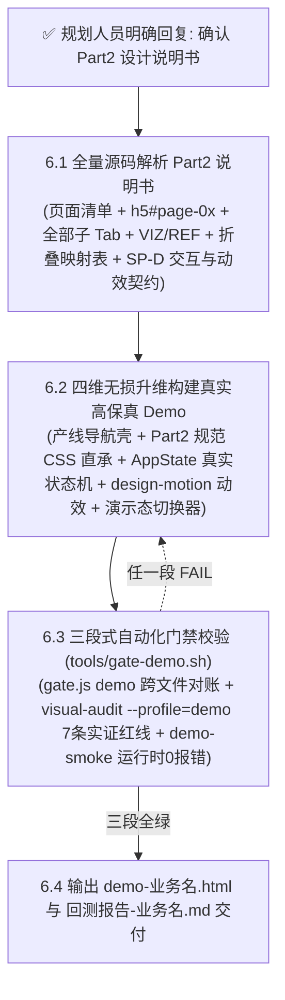

# 织雨设计智脑：Part3 真实高保真 Demo 输出与回测规范 (Frontend Demo & Verification)

> 💡 **中枢定位（2026-11-27 Part3 提质升级）**：
> 本文档是织雨在执行 **【方案系统设计主线】** 终局阶段 **Part3（`6.0` 前端高保真 Demo 生成与自动化回测）** 的完整规范手册；日常执行默认先读精简入口 [`6.0-Part3执行精简卡.md`](6.0-Part3执行精简卡.md)。
> **前置闸门**：必须在规划人员对 Part2《设计说明书》（`design-spec-<业务名>.html`）明确回复【确认】后才触发执行，严禁偷跑代码。
> **终局品质铁律**：`Part3 ≥ Part2 > Part1` —— 交付物是用户可直接打开、全量操作验收的**真实产品级高保真交互 Demo**，内容零遗漏、交互与动效全闭环、视觉规范精度绝不较 Part2 打折。

---

## 一、Part3 执行流水线



---

## 二、6.1 Part2 说明书全量源码解析纪律（零遗漏前提）

动笔编码前，**严禁用截图、浏览器可见文本或 `innerText` 作为取数依据**，必须按 HTML 源码逐项解析 `design-spec-<业务名>.html`：

1. **顶部概要与产线归属**：提取产线名（SASE / aTrust / XDR / aES 等）→ 决定是否装配 [`03-design-assets/product-lines-knowledge/`](../../03-design-assets/product-lines-knowledge/) 对应真实左侧导航壳；
2. **第 5.1 节页面清单与第 7 节 `h4.domain` / `h5#page-0x`**：提取全部菜单分组、页面编号、页面名称与承载形态（独立菜单页 / 右侧抽屉 / 模态弹窗）；
3. **页内全部子 Tab（`[data-wf-tab]` / `[data-wf-pane]`）**：记录每个子 Tab 的标题、括号计数、表格列数、条目明细、多模态卡片与图形——**Part3 必须 100% 账实相符还原，严禁只画默认 Tab 或删减明细行**；
4. **折叠附录全量读取**：每页 `<details class="sec-fold">` 内的「设计经验与组件选型映射清单」（含 `class="rows-extra"` 折叠行）与《可视化件声明》全部纳入实现清单；
5. **可视化件双轨分流**：
   - **轨 A · 在册件型（`VIZ-*` / `CHART-*`）**：读 [`件型样式卡.md`](../../03-design-assets/visual-styles/内容件/件型样式卡.md) + [`token/README.md`](../../03-design-assets/visual-styles/token/README.md) §六 + [`件型线框.md`](../../03-design-assets/visual-styles/内容件/件型线框.md) + 跑 `node tools/viz-ref.js <件型键>` 抽取 DOM / CSS / 填空槽（无样板键按线框手写；图标换语义不换规格，状态图标原样保留）；
   - **轨 B · 规范外创新可视化（`data-viz="REF / 资产未覆盖"`）**：**100% 保骨直承 Part2 的 SVG/DOM 结构与视觉层次**（如桑基分流图、融合瀑布 Trace、结构化 AI 洞察卡、热力矩阵），绝不降级成普通卡片或静态占位，并补齐鼠标悬浮提示、点击选中高亮与跨区联动；
6. **尾部六节编码契约（`SP-D`）**：完整读取「① 逐页交互行为表」「② 数据口径与演示数据集」「③ 组件/Token 与动效微契约（引用 [`design-motion.md`](../../03-design-assets/global-styles/design-motion.md)）」「④ 固定文案与状态词表」「⑤ 验收清单」「⑥ 实现边界」。

---

## 三、6.2 单文件高保真交互 Demo 工程架构规范

默认交付 **单文件自包含、离线双击可运行** 的 `_output/<业务名>/demo-<业务名>.html`（不依赖外部构建工具或外链本地 CSS，可离线直接打开）：

### 1. 五层标准代码结构
1. **CSS Token 与动效基底层**：完整引入 [`tokens-cheatsheet.md`](../../03-design-assets/tokens-cheatsheet.md) 色板/字阶/间距/圆角/投影 Token + [`design-motion.md`](../../03-design-assets/global-styles/design-motion.md) 全套动效变量（`--motion-dur-fast/base/slow`、`--motion-ease-out/in/std`、`prefers-reduced-motion`）；
2. **规范级高保真 UI 组件层**：直接继承并升维 Part2 已过检的组件样式（32px 控件/表头、40px 表格行高、12px 正文、14px 抽屉/弹窗页脚、2×12px 蓝竖条、428px 复合日期、四套状态三元组、无边框 Alert、表格防折护栏、按钮禁红），补齐 `:hover` / `:active` / `:focus-visible` / `:disabled` / Loading 交互态；
3. **产线导航壳与页面容器层**：
   - 有产线归属 → 装配对应产线侧边栏导航（支持折叠/展开、当前菜单高亮、其他非本次需求菜单点击给轻量 Toast 引导，不留死链）；
   - 每个说明书页面挂 `data-demo-page="Page-0x"`，每个页内子 Tab 挂 `data-demo-tab="<Tab名>"` 与对应面板 `data-demo-pane`；
4. **单一状态源 `AppState` 与全交互引擎**：
   - 集中维护 `dataset`（严格对齐说明书 ② 数据口径，总计与分项可复算）、`filters`（时间/下拉/关键字/可视化流带过滤）、`sort`、`pagination`、`drawer`（当前对象 ID / 激活子 Tab / 激活瀑布节点 / 未读集合）、`modal`、`demoMode`（当前演示态）；
   - 任何写操作（如标记误报、编辑保存、删除、启停）均通过统一 `dispatch` 更新 `AppState` 并同步重绘受影响的 KPI、列表行、抽屉头部与 Toast 反馈；
5. **右下角可折叠「演示态切换器（Demo State Switcher）」**：
   - 默认收起为轻量胶囊，根容器标记 **`data-demo-chrome="true"`**（自动豁免业务区视觉审计）；
   - 支持一键切换：**正常态** / **空数据态（`IxEmpty`）** / **加载骨架态（`IxSkeleton`）** / **AI 降级异常态** / **权限受限态** + **重置演示数据**，所有文案逐字取自说明书 ④ 固定文案表。

### 2. 六类必备交互闭环与零死按钮铁律
- **闭环 1（导航与路由）**：主页面与面包屑可切换，非本期菜单项点击提示「演示环境暂未开放该模块」而非死链；
- **闭环 2（查询/筛选/排序/分页真联动）**：复合日期快捷项切换、筛选下拉/ProSearch 添加和删除条件 Tag、点击搜索（或回车）实时过滤表格并刷新分页数、列头点击切换升/降序、一键重置；筛选结果为空时展示标准 `IxEmpty` +「重置筛选」按钮；
- **闭环 3（浮层完整生命周期）**：抽屉右侧滑入（`280ms`）+ 遮罩淡入，保持背后列表筛选与滚动位；弹窗居中缩放淡入（`220ms`）+ 影响面预演 + 表单校验 + 提交 `300ms` Loading 防连点 + 成功 Toast；均支持 `✕` / 取消 / 遮罩 / `ESC` 退出；
- **闭环 4（子 Tab 与可视化真联动）**：页内子 Tab 平滑切换不重置顶部主信息；桑基流带、瀑布时间轴节点、拓扑节点支持点击高亮选中、再次点击取消，并实时联动列表过滤或原地证据/JSON 面板切换；
- **闭环 5（边界与安全带）**：禁用态按钮 Hover 展示真实原因 Tooltip；长文本 `ellipsis` + `title`；严禁 `href="#"` 空锚点；
- **闭环 6（动效克制合规）**：全部过渡遵循 `design-motion.md`（≤280ms、无弹性过冲、不阻塞操作、静态截图终态完整可见）。

---

## 四、按需可选分支：外部工程 Coding Prompt 组装规范

仅当用户明确要求“不要单文件 HTML，给我输出可直接贴给 Coding AI 合入现有 Vue/React 仓库的 Prompt”时启用，Prompt 必须包含：
1. **角色、业务场景与目标仓库约束**；
2. **页面框架、产线路由与组件硬指标**（含全部 `Page-0x`、子 Tab 与折叠映射行）；
3. **可视化件双轨取码指令**（`VIZ-*` 附 `viz-ref.js` 抽样，`REF` 附 Part2 SVG/DOM 骨架）；
4. **交互行为表与动效 Token**（直接内联说明书 `SP-D` 交互表与 `design-motion.md` 变量）；
5. **四重防破坏安全带**：不删既有文件、不改公共样式、不动无关路由、不引未登记外部依赖。

---

## 五、6.3 自动化准出门禁与保真度回测规程 (`EX-6.0-01~12`)

### 1. 必跑三段式门禁命令
```bash
bash tools/gate-demo.sh _output/<业务名>/demo-<业务名>.html _output/<业务名>/design-spec-<业务名>.html
```
退出码为 `0`（三段全绿）方可交付；任一段 FAIL 立即回 Demo 修复，严禁带病汇报。

### 2. 回测检查维度（写进 `_output/<业务名>/回测报告-<业务名>.md`）

| 门禁编号 | 回测维度 | 校验方式 | 达标标准 |
| :---: | :--- | :---: | :--- |
| **EX-6.0-01** | **框架套头与导航壳** | M+H | 产线导航壳/顶栏/面包屑/操作区完整，全部 `Page-0x` 在 Demo 中均有 `data-demo-page` 承载 |
| **EX-6.0-02** | **业务能力与入口覆盖** | M+H | 说明书列出的能力项 100% 有真实组件与交互入口承载，无遗漏 |
| **EX-6.0-03** | **组件硬指标** | M+H | 表头 32px / 行高 40px / 控件 32px / 抽屉 48·56px / 表单蓝竖条与左右结构达标 |
| **EX-6.0-04** | **视觉降噪与按钮禁红** | M | 无高饱和纯色、状态走柔和三元组、严禁红色实心按钮 |
| **EX-6.0-05** | **异常安全带与演示态切换** | M+H | 长文本截断 + Tooltip、空态兜底、内置可折叠「演示态切换器」可一键切换各异常态 |
| **EX-6.0-06** | **可视化件全量落地** | M+H | 全部 `VIZ-*` 与 `REF` 实例数与声明对齐，无通用占位、无降级画丑 |
| **EX-6.0-07** | **页内子 Tab 与折叠映射行完整** | M | 全部子 Tab 均有对应非空面板且条目数与标题计数 100% 一致；折叠映射行无遗漏 |
| **EX-6.0-08** | **防破坏与自包含边界** | M+H | 单文件离线可运行（外部工程模式不删既有文件/不改公共样式/不动无关路由） |
| **EX-6.0-09** | **可视化件样式与取码溯源** | M+H | 回测报告附「件型 → 命名 Token → 实际 CSS 值 → 取码出处（`viz-ref <键>` / `保骨直承 Part2 REF`）」四列表 |
| **EX-6.0-10** | **交互行为与动效落地** | M+H | 逐条覆盖说明书 `SP-D` 交互表，引入 `design-motion.md` 动效 Token，零 `href="#"` 与零死按钮 |
| **EX-6.0-11** | **7 条人工实证视觉红线** | M | `visual-audit.js --profile=demo` 通过 `V-05 / V-06 / V-07 / V-20 / V-23 / V-24 / V-25` |
| **EX-6.0-12** | **浏览器运行时冒烟零报错** | M | `demo-smoke.js` 验证 0 `console.error` / 0 `pageerror`，自动点击页面/子 Tab/抽屉/弹窗/演示态正常且无布局塌陷 |

---

## 六、交付规划人员的最终成果汇报模板

> 📁 **落盘位置**：`demo-<业务名>.html` 与 `回测报告-<业务名>.md` 一律写进 `_output/<业务名>/`（与 `草图-` / `design-spec-` 同目录，不入库）。

```markdown
### 🏁 方案系统设计 Part3 最终交付成果

- **真实高保真交互 Demo**：`_output/<业务名>/demo-<业务名>.html`（单文件自包含，离线双击即可运行体验）
- **保真度与交互回测报告**：`_output/<业务名>/回测报告-<业务名>.md`
- **三段门禁结果（`gate-demo.sh`）**：
  * `gate.js demo`：页面 X/X、页内子 Tab Y/Y、可视化件（VIZ + REF）Z/Z、交互与动效全部通过
  * `visual-audit --profile=demo`：7 条人工实证视觉红线（`V-05/06/07/20/23/24/25`）全绿
  * `demo-smoke.js`：0 控制台报错，导航/子 Tab/抽屉/弹窗/演示态切换冒烟通过
- **核心可体验闭环**：[3~4 条一句话列出用户可亲自点测的关键交互、联动与右下角演示态切换]
```
