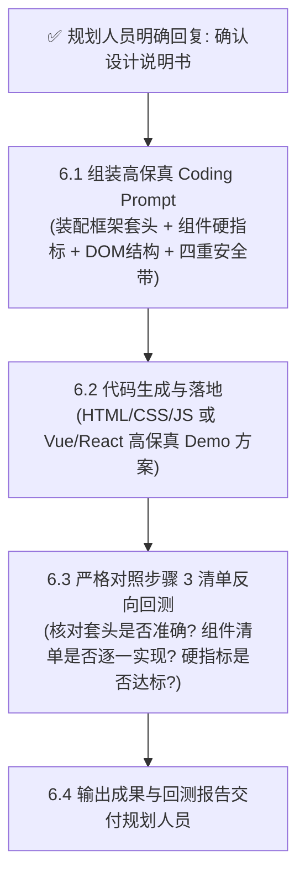

# 织雨设计智脑：前端 Demo 方案输出与清单回测规范 (Frontend Demo & Verification)

> 💡 **中枢定位**：
> 本文档是织雨在执行 **【方案系统设计主线】** 的终局闭环第 5 步。
> 必须在规划人员对步骤 4 的《设计说明书》明确回复“确认”后才触发执行。
> 负责生成面向 Coding AI 的高保真可落地代码，并严格反向回测核对是否准确落实了步骤 3 中的业务框架模板与能力组件清单。

---

## 1. 步骤 5 执行流水线



---

## 2. 6.1 Coding Prompt 自动化组装规范

在输出给 Coding AI（Antigravity / Cursor / Claude 等）或直接生成 Demo 代码时，必须包含以下核心段落：
1. **角色与目标**：明确当前业务场景与定性审美风格；
2. **页面框架与布局**：严格采用步骤 3 约定的业务框架套头骨架；
3. **组件落地细则**：逐一实现步骤 3 清单中的组件，并注入客观数值（表头 32px、按钮 56px、行高 40px 等）；
4. **色彩与视觉规范**：调用 `03-design-assets/tokens-cheatsheet.md` 中的状态三元组与石墨灰阶；
5. **四重防破坏约束**：防外层破坏、防数据丢失、防边界崩溃、防体验裸奔；
6. **可视化件绘制（含取料前置铁律）**：说明书《可视化件声明》里声明的每个件，必须按「**图形编码规则 + 风格规范值**」绘制——**可参数化重绘的按规则生成；定制不可仿的走保留件（原样带上素材）；严禁用通用占位图糊弄，严禁直接忽略**。
   - **🛑 取料前置（不可跳过）**：动笔前必须物理读取 ① [`visual-styles/内容件/件型样式卡.md`](../../03-design-assets/visual-styles/内容件/件型样式卡.md) 对应件型节 ② [`visual-styles/token/README.md`](../../03-design-assets/visual-styles/token/README.md) §六（风格档 A/B 六项值）③ 图表件另读 [`token/图表-渐变与投影.md`](../../03-design-assets/visual-styles/token/图表-渐变与投影.md)。**读到值再画**——禁止用"说明书写了档 B"代替取料，禁止凭参数化记忆配色。
   - **六项必落**：档名 / 容器底（`bg-blue-wash` 三段渐变全值或纯底 token）/ 描边（`border-ghost` 或 `graphite-l30`）/ 阴影（`glow-blue-s1` 全值）/ 圆角与字阶（`r2`、`24px/700`）/ 件型特有项（指标图标渐变徽章、柱体竖向渐变 + 上阴影等）。
   - **回测必交**：`回测报告-<业务>.md` 附「**件型 → 命名 token → 实际 CSS 值**」三列表，逐件填写（见 `EX-6.0-09`）；只写"已按样式卡绘制"不算证据。
   - 图标语义查 `03-design-assets/components/icon-map.md`；风格档冲突以 `token/README.md` §六 为准。
7. **读全量源码，不读折叠态**：说明书里每页的「设计经验与组件选型映射清单」默认只展开前 3 行，第 4 行起在源码里带 `class="rows-extra"`（仅 CSS 折叠）。**解析时按 HTML 源码全量读取 `<tbody>` 内所有 `<tr>`，折叠行同样计入**；严禁用截图、浏览器可见文本或 `innerText` 作为取数依据——折叠行不会出现在渲染结果里，按可见文本读必漏组件、Token 与经验编号。

---

## 3. 6.3 基于步骤 3 的保真度回测规程 (Verification Checklist)

生成 Demo 代码后，织雨必须执行逐项回测（Verification），并在交付时附带回测检查表：

| 回测维度 | 检查内容 | 达标标准 | 回测状态 |
| :--- | :--- | :--- | :---: |
| **框架套头回测** | 页面外层是否准确使用了选定的框架模板？ | 具备完整的导航面包屑、操作区、时间切片或向导底栏 | [ ] 通过 |
| **能力清单回测** | 步骤 3 中列出的业务能力是否 100% 都有对应组件承载？ | 无遗漏项，每项能力在界面中均有明确的交互入口 | [ ] 通过 |
| **组件硬指标回测** | 基础组件是否遵循 `03-design-assets/components/` 规则？ | 表头 32px、行高 40px、双字按钮 56px、数字强制右对齐 | [ ] 通过 |
| **视觉降噪回测** | 是否杜绝了高饱和度纯色？是否遵循三元组规范？ | 告警/成功标签均为浅底深字浅边，辅助标签统一浅灰底 | [ ] 通过 |
| **安全带回测** | 是否注入了长文本截断、防抖、空状态兜底？ | 极端超长字符具备 `truncate` + Tooltip，容器含 Empty 状态 | [ ] 通过 |
| **可视化件回测** | 说明书声明的每个可视化件，是否按「图形编码规则 + 风格规范值」真画了？ | 可参数化的已按规则生成、不可仿的走保留件；无通用占位、无遗漏 | [ ] 通过 |
| **可视化件样式还原回测** | 声明里的六项值是否真落进 CSS？（`EX-6.0-09`） | 渐变三停靠点、阴影 rgba、圆角 `r2`、字阶 `24px/700`、件型特有项逐项命中；无「档 B 却画成灰底 + 裸图标」这类降级 | [ ] 通过 |
| **映射清单完整性回测** | 折叠起来的那几行是否也实现了？ | 实现条目数 = 源码 `<tbody>` 内 `<tr>` 数（不含折叠按钮行）；折叠行无遗漏 | [ ] 通过 |

---

> 📁 **落盘位置**：`demo-<业务名>.html` 与 `回测报告-<业务名>.md` 一律写进该需求的 `_output/<业务名>/` 任务文件夹（与 `草图-` / `design-spec-` 同目录）；`_output/` 已 gitignore，不入库。

## 4. 交付规划人员的最终成果汇报模板

```markdown
### 🏁 方案系统设计最终交付成果

- **高保真 Demo 代码/Prompt**：已完成落地生成。
- **业务框架套头落地状态**：已准确装配 [选定的模板名称]。
- **能力与组件清单回测结果**：
  * [x] 能力项 1（如全局检索）：已通过 Pro-Search 实现，高度 32px 规范达标；
  * [x] 能力项 2（如异常明细）：已通过紧凑表格实现，表头 32px，数字已右对齐；
  * [x] 能力项 3（如就地排障）：已通过右侧滑动抽屉实现，层级与遮罩达标。
- **可视化件落地状态**：说明书声明的 [件型] 已按图形编码规则绘制（可参数化重绘）/ 已走保留件原样带上；无占位、无遗漏。
- **可视化件样式对照**：见回测报告「件型 → 命名 token → 实际 CSS」三列表，逐件与 `件型样式卡.md` 一致（档名 / 容器底 / 描边 / 阴影 / 圆角字阶 / 件型特有项）。
- **防破坏与可用性自检**：四重安全带已全部注入。
```
