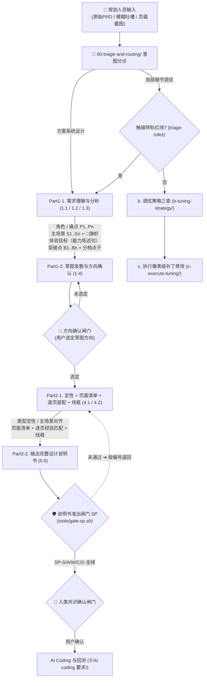
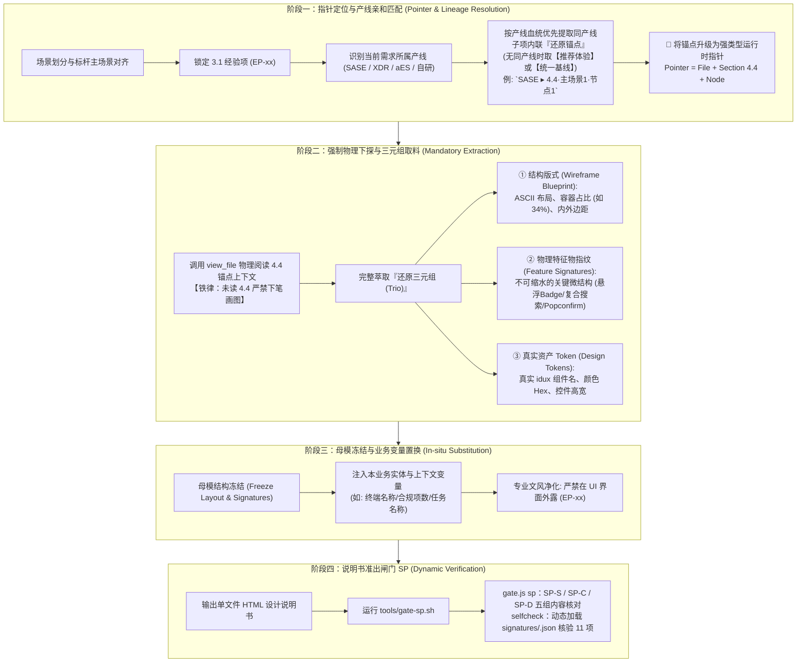
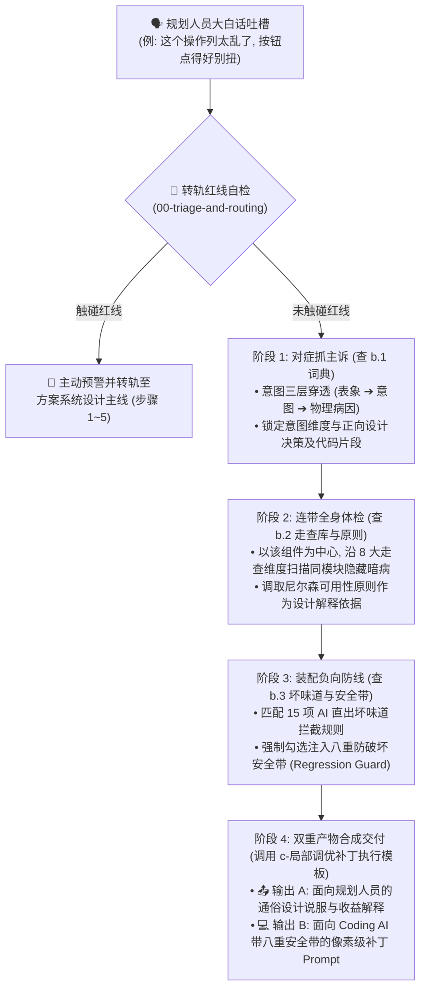

# 织雨体验设计智脑：全链路执行工作流 SOP 说明书 (Execution Workflow SOP)

> 💡 **中枢定位**：
> 本文档是织雨体验设计智脑（Virtual Designer Zhiyu）作为个人设计 Agent 的标准作业程序。
> 它将资深体验设计师的思考执行全景图，严格沉淀为 **两大赛道（方案系统设计 vs 局部细节调优）** 的端到端标准流水线。

---

## 🛑 第 0 原则（高于本文件其余所有步骤）

> ### **禁止囫囵吞枣、不读完参考内容就草草完成任务，以输出质量第一、效率第二为原则。**

---

## 🗺️ 全链路执行工作流全景图 (Workflow Overview)



> 🧭 **两段式命名**：Part1（1.1~1.4）= **需求分析与思考**，产出一个"用户认可的方案方向"；Part2（4.1~5.0）= **设计细节执行决策**，把方向落到组件与 Token。**Part1 的终点是一道闸门，不是一份文档**——这是它与旧版"1~5 直线流程"最本质的差别。
> 📎 **Part2 已收敛为两步**：原「2.1 设计思考 → 4.1 页面清单 → 2.1 第二遍逐页匹配 → 5.0」简化为「**4.1（含定性与逐页匹配）→ 5.0**」。原因：2.1 的"发力点"与 1.3 的"突破点"是同一件事，两套术语并存只会让人把 `Bx` 再翻译一遍；而"逐页匹配经验"离开页面清单就判不准，放在页面清单同一处最省事。**`2.1-设计思考与发力点.md` 已废弃。**

---

## 📋 方案系统设计主线规程 (System Solution SOP · Part1 → Part2)

### Part1 · 需求分析与思考（1.1 → 1.2 → 1.3 → 1.4 → 🚦）

> 🛑 **执行纪律（本段最重要的一条）：1.1 → 1.4 一路贯通，中途不停，不许提问。**
> 缺信息就自己补 `【假设】`（角色 / 现状 / 判定口径 / 数据），随交付物一起给出；只有 **1.4 草图交付完毕**才停一次，发 `1.4` §七的**固化四句话术**（做了什么分析 → 请看草图确认哪套 → 确认后我做什么 → 不合预期可指问题或邀请共创），**≤6 行，不铺推荐理由/代价/假设/页面清单**（用户追问再补）。**字段怎么拆、判定条件怎么定、模板 ID、章节编号——一律不问，自己定并标注。**
> 🛑 **"一次停顿"是可跳过的，但只能由用户明说**：用户没说跳过，就必须先把草图交出来再问（"给我出说明书""你直接做吧"不算跳过）；用户明确说跳过草图时，直接以**方案一（高水位）**执行，不再追问。

1. **Step 1.1: 需求理解与现状旅程**（调用 `01-system-solution-design/①需求理解与分析/`）：
   * 调取 [`1.1-需求理解.md`](../01-system-solution-design/①需求理解与分析/1.1-需求理解.md) 明确目标角色画像，深挖现状物理卡点与心智摩擦，抽象黄金路径与本质任务（JTBD）；
   * 产出：角色 + 痛点编号 `P1..Pn`（**带等级与现状基线**）+ 主场景清单 `S1..Sn` + 分场景现状旅程与痛点插旗 + **用户原话清单**（每场景 1~2 句，保留吐槽语域，供 1.2 语域对照）。
2. **Step 1.2: 体验目标定义**：
   * 调取 [`1.2-体验目标.md`](../01-system-solution-design/①需求理解与分析/1.2-体验目标.md)：每主场景一句**能力陈述句**（谁的门槛降了 → 凭什么 → 能做成什么），指标内嵌句中；**不写「从 A 改成 B」、不追加验收尾巴、不写界面手段**（判档交给 1.3，方案交给 1.4）；
   * 每个主场景一句目标，指标内嵌；**目标即天花板**，后面能放多高的档位由这里决定。
3. **Step 1.3: 体验突破点拆解**：
   * 调取 [`1.3-体验突破点拆解.md`](../01-system-solution-design/①需求理解与分析/1.3-体验突破点拆解.md)：先抠感受点（硬指标先翻成感受），再从**两个入口**扫突破点（目标 + 按工作类型经验），合并去重后裁到 2~5 处，每处散出**三档**点子（常规 / 优化 / 创新）并回校指标；
   * 每处突破点必须标**来源**（目标 / 工作类型 + 原则编号），来自经验的净增量加粗标出。
4. **Step 1.4: 草图发散与方向确认**（**Part1 的收尾，也是主线第一道闸门**）：
   * 调取 [`1.4-草图发散与方向确认.md`](../01-system-solution-design/①需求理解与分析/1.4-草图发散与方向确认.md)：先按五个岔口（谁先动 / 任务放在哪 / 主线纵向还是横向 / 一屏管几件事 / 改动落在哪）想出 3~4 种走法 → 给每条走法配**一组档位** → 按「**走法 × 档位**」两维拼成 **2 套**：**方案一（高水位，≥2 处创新版）+ 方案二（稳水位，全部优化版）**；两套的走法与档位必须**都不同**，只有档位差 = **拼盘**，退回重岔；
   * **高水位必须"看得见"**：≥2 处 `Bx` 与方案二不同档、且至少 1 处落在主战场页；并说得出"**用户少干了哪一件具体的事**"（首屏 / 步数 / 结果三处至少两处不同）。**达不到就不许贴"高水位"标签**——改叫 `方案一 · 上限版` 写明天花板，或只出一套 + 一页备选档位；**硬造的高水位比只给一套更伤信任**；
   * **常规版不画**——它只是优化版/创新版的地基，不需要被选择；
   * **结构级规范必须跟，精度级不管**：主按钮用主题蓝、主左取右、**抽屉页脚贴左 / 弹窗页脚贴右**、抽屉/弹窗/整页不混用、页面分区骨架定死、**能力位的位置（筛选在页头 / 工具栏在表上 / 排序挂表头）**——这几条在草图阶段就要对，否则线框一变用户就觉得"方案被改了"；精确像素 / **单元格字段值** / 星号占位 / 图标 / 动效一律不管，管了草图就变线框；**列名不算精度**（列名是覆盖凭据，要按 PRD 列全）；
   * **交付前过草图门禁**：运行 `bash tools/sketch-selfcheck.sh _output/<业务名>/草图-<业务名>.html` 取得 **5/5**，未过不得给用户确认（脚本只查上面 5 条结构级规范）；
   * **先交动作覆盖表**（业务对象 × 动作 / 状态 → 页面认领）：PRD 里出现的安装 / 升级（含三类组件）/ 卸载 / 解绑 / 批量编辑 / 基础配置 / 导入 / 标签 / 导出，**逐项要有页面落点**；落不了的写"本期不做 + 原因"并在交付话术里点一次；
   * **先交信息架构（三件套，缺一退回）**：模块定位（新增一级模块 / 挂在哪 / 只读消费谁）→ 功能域树（模块 → 3~5 个功能域 → 页面 → 页面内视图，**每个节点都标承载形态**）→ **页面 × 对象 × 动作映射**（每页带：所属功能域 / 核心对象与**实例基数（一份/多份）** / **匹配维度（主体·客体·时段·组织）** / 承载形态 / 承载动作 / **不在这页做什么** / 两套差异）；**不再单列「核心对象模型」表与「页面清单」表**——它们与映射表重复，两张表写同一件事必然对不齐；**动作覆盖表只用于校验落点，不许用来倒推页面**；
   * **层级必须拆到叶子，每层判定承载形态**（门禁 `EX-1.4-16`，规则见 [`patterns/01-navigation-and-hierarchy.md`](../03-design-assets/patterns/01-navigation-and-hierarchy.md)）：一级 → 二级（功能域/菜单）→ 三级（页面/叶子）→ 页面内（Tab / 抽屉 / 弹窗），逐层写"承载形态 + 一句依据"；**菜单 ≤3 级**、收敛顺序"独立菜单页 → 菜单下 Tab → 页面内轻量入口"、**下钻 ≤4 层（页面 → 抽屉 → 弹窗，不许抽屉开页面 / 弹窗开抽屉）**；名字独立但只是辅助配置的，挂在相关对象页里，不单独成菜单；**只写到功能域名、写不出承载形态 = IA 没做完**；
   * **每个核心对象先判「实例基数」，再定页面形态**（门禁 `EX-1.4-15`，防"只画单条详情"）：问一句"**这类东西在客户环境里是一份还是很多份？**"——**多实例**（策略 / 质量模型 / 任务 / 模板 / 名单 / 探针）必须给出**集合页**（列表：状态、命中对象数、优先级、最近变更 + 新增 / 复制 / 启停 / 删除）**＋ 详情页 / 详情抽屉**（编辑态、保存、生效）；**单实例**（概览 / 诊断 / 初始化向导）才给单页。**只在详情页上画配置项，等于把"新增多条、按对象差异化"整块能力丢掉**；
   * **配置类对象还要判"匹配条件能不能表达业务差异"**：策略/模型这类，先列出它的**匹配维度**（主体：用户 / 用户组 / 终端；客体：应用 / 站点 / 域名 / IP；再加上端口、时段、组织），维度不全就画不出差异化——**维度在 IA 阶段定，不在线框阶段补**；
   * **页面名必须名词化、≤6 字、可进导航与说明书目录**：不写问句（交给谁 / 这一片还有谁）、不用指示代词（一次 / 这一片）、不并列两个动作或产物、产物优先于动作（证据包 > 交接）；**同一核心对象的多个视图合并为一页 + Tab / 抽屉，不页化**（现场 / 影响范围 / 证据交接 = 一个「访问诊断」页的三个视图）；
   * **不线上化的能力必须显式标注**：页面清单与映射表写 `❌ 否` + 线下承接方式（邮件 / 群 / 人工台账），交付时口头点一次；**不许静默删掉，也不许造没人维护的空壳页**；
   * **文件开头先给页面规模 + 三件套**：一行`本次需求一共 N 个页面（M 个功能域 / K 个页内 Tab）`→ 功能域树 → 映射表（页面 / 所属功能域 / 核心对象与实例基数 / 匹配维度与承载形态 / 承载动作 / 不在这页做的 / 两套差异）；**不设页面清单表与对象模型表**；档位差进内部留档；
   * **载体是带 tab 的单文件 HTML**：顶部（页头 / 本次需求一共 N 个页面 / 页面清单 / **两套方案对比表**）固定，下面 `方案一 | 方案二` 两个 tab 切换；**每页 = 草图（带标号）+ 图下标号说明（做法 + 为什么）**；相同页用占位条（`P5 ×××：与方案一相同`）交代、不重复画，不许留"见共用页面"的跳转；两套页面顺序与编号一致；
   * **框里写内容、不写解释；解释写在草图正下方**：`检测项` `安装结果` 这类内容标题必须有（否则别人不知道这块是什么）；**每条标号在图下都要有一段"做法 + 为什么"**，缺说明的标号等于没标；
   * **能力项一律占位表达，不许只写在正文说明里**（门禁 `EX-1.4-14`）：筛选项、排序、搜索、新增、批量、导出、刷新、分页、编辑、启停、复制、删除——**每一个都要在它该在的位置占一块**，块里写清"这是什么能力"（如 `筛选区：时间范围 / 对象 / 状态`、`工具栏：新增 / 批量 / 导出`、`排序：按影响人数 ↓`），**不画具体组件样式、不画下拉选项、不画交互**；
   * **能力项的位置是结构，不许挪**：列表页的**筛选区在页头右侧**、**工具栏在表格上方**、**排序挂在表头列上**；详情 / 诊断页的**页内 Tab 条在"标题栏 → 顶部主信息 → Tab 条 → 内容 → 操作区"的第三层**（`03-design-assets/page-templates/01-page-types.md` 下钻详情页骨架）；把筛选/排序塞到表格下方、把 Tab 条省掉或顶到页头、或只在正文里用一句话交代，**一律算漏能力**——下游线框会跟着漏，用户拿到的就是功能缺失；
   * **多面页面必须画出页内 Tab 切换条**（门禁 `EX-1.4-14`）：一条横向 Tab 区写全 Tab 名并标出当前选中，每个 Tab 只画自己的内容；**顶部主信息（对象名 / 关键状态 / 主操作）放在 Tab 之上、不放进 Tab**；**禁用「视图①/②/③」这类自造词**，只写 `页内 Tab：…` / `抽屉：…`；标了抽屉的面必须画抽屉形态（右侧浮层 + 露出背后页）；
   * **数据精度可以和能力精度分离**：列名按 PRD 如实列全（列名是结构，用户靠它核对覆盖）；表内字段值可留 1~2 行示意值或灰条；但**结论句里的数字（人数 / 占比 / 评分 / 时长 / 时间点）必须是仿真真值且可复算**；
   * **块标题必须是名词短语，且写成固定格式**（门禁 `EX-1.4-11`）：`<b class="t">标题</b>　内容`，标题里只放名字、不混内容；五条判据——①无标点 ②无口语词（我/你/他/这/那/哪/谁/什么/怎么/为什么/吗/呢/吧）③不以动词短语开头（不是/按/一起/先问/交给/导出/标记/看一下/打开/新增/发布新）④≤12 字 ⑤命中名词词尾（范围/对象/条件/通知/状态/记录/清单/模型/指标/阈值/等级/分布/归因/结论/材料/方式/规则/版本/探针/分段/维度/评分…）；**黑名单查不住无限组合的口语，所以判据是结构不是词表**；发现一个口语标题，必须把全篇所有 `class="t"` 标题重过一遍；
   * **必要配置项不得隐藏或省略**（门禁 `EX-1.4-12`）：判据是「把这一页交给实施，他能不能不追问就配完」；策略页八项（生效范围 / 对象分组 / 指标阈值 / 触发条件 / 通知配置 / 合并静默 / 生效时间与启停 / 变更记录）、采集页四项（接入形态 / 检查校验 / 对象圈定 / 数据可见）、模型页四项（指标 / 阈值 / 权重或等级 / 版本）必须逐项有落点；本期不做的写「本期不做 + 原因」，不许静默省略；
   * **交付前必须逐页检视，不许"用户指哪改哪"**（`1.4` §三之先 第 8 条）：六类页面各有一张自查表（概览看判断链 / 列表看状态与时间列 / 详情看结论与把握度 / 配置看必备项 / 交接看接收方）；发现一类问题要**全文扫净**，所有分页、比例、人数、时间必须**能前后复算**；改完一遍再交，避免把用户当质检员；
   * **数据必须是仿真数据**（门禁 `EX-1.4-13`）：对象带标识（`VU-2041 张伟 · 研发部` / `APP-07 CRM` / `POP-02 接入节点-02`）、字段完整（时间戳到分秒、状态枚举、来源与变更人）、量级自洽（`1,240 = 1,082 + 121 + 37`）、时间线不倒序、跨页同一批数；页头声明「示例环境 + 快照时间 + 规模 + 仿真数据不构成客户事实」；**禁止 `__` 这类空占位**（表内字段值用灰条不算漏，结论句数字必须是真值）；
   * 方案**只叫「方案一」「方案二」**：不写"方案一：<…>"这类标题句、不标水位徽标、不标"推荐/次选"；
   * 交付形态：**页头（`需求草图示意` + "仅用于思路对齐，不涉及详细设计"）→ 页面规模一行 + 功能域树 + 映射表 → 两套方案对比表（整体设计说明含代价 + 各自的设计思考点）→「草图思路发散」标题 + 分段切换条 → 各 tab 内逐页（草图 + 图下标号说明）**；不放场景 / 目标 / 档位台账；
   * **视觉与克制六条**：① 切换条做成**分段控件**（**左对齐**、吸顶、**下方不加分割线**、选中项 `#1C6EFF` 实底白字），**上方必须有「草图思路发散」标题**；② 页面编号徽标统一主题蓝（`#1C6EFF` 底白字），不用黑/深灰；③ **占位只有一套样式**（灰底 `#F2F4F7` / 12px 斜体 / 不加粗 / 字色 `#6F7785`），**筛选区·时间范围·工具栏·排序·分页·编辑入口都算占位**，文案 ≤20 字只写"这是什么能力"，**禁止写"到线框再补"这类解释**；④ 图下说明**默认只展开 2 条**，第 3 条起折叠进「展开更多（N 条）」（源码保留全部），**草图容器内不许出现竖向滚动条**（抽屉与页内 Tab 按内容全高展开，不用 `overflow:auto`）；⑤ **同一信息只表达一次**：有 Tab 切换条就不再写"页内 Tab：A｜B（当前选中…）"，有工具栏就不再配说明行；**同类表格不得并存**（旧表必须整块删掉）；⑥ 表格内不加粗；页内 Tab 用按钮语义（**禁止 `href="#"`**，切换不许把页面滚回顶部）；
   * **所有文案站在用户视角**：说清"会看到什么、能做什么、做完会怎样"；不写机制名、不写 `Bx`、不造词（采信 / 回执 / 留痕 / 处置 / 裁决 / 认领）；
   * **🚦 强制停在方向确认闸门，且话术固化（照抄 1.4 §七，≤6 行）**：`我已经对需求文档做了 <X 分析>，梳理了信息架构（N 个功能域 / N 个页面）以及两套草图思路 → 请您查看 <草图路径>，确认哪套思路更优 → 确认后我将基于此方向做更进一步的设计与物料装配（逐页线框 → 设计说明书）→ 若两种思路均不合预期，可随时指出其中问题，或邀请我一起做思路共创`。**推荐哪套 / 五段代价 / `【假设】` / 页面清单一律不进顿点**（都在草图文件里，用户追问时按 1.4 §七「用户追问时才补」一次补一层）；**若推荐高水位，"目标改哪句、指标换哪个、流程角色要不要动"写进草图文件的推荐行，不在顿点里展开**；用户答复为"不合预期要共创 / 选定 / 选定但要改 / 都不满意 / 要合并"五类，按 1.4 **第七节**处置（"不合预期"先进共创：同一版上改、两轮上限、每轮列改动）；**用户选高水位 = 同时授权改目标，当场回填 1.2 的目标与指标并留档**（否则说明书用旧目标验收新方案）；
   * **未获方案选定，严禁进入 Part2**（不得出页面清单、模板 ID、组件名、线框图）。
   * **交付下游**：选定方案的整套草图 + 突破点→档位（写在方案依据里）+ 动作覆盖表 + 设计说明（含五段代价）+ 未采纳方案的一句话结论 + **档位组合与目标/指标变更记录**（4.1 逐页核档位降级，5.0 用改后的目标与指标）。

---

### Part2 · 设计细节执行决策（2.1 → 4.1 → 2.1 第二遍 → 5.0 → 🚦 → 6.0）

5. **Step 4: 定性 + 页面清单 + 逐页装配 + 线框**（调用 `01-system-solution-design/④布局与结构/`、`②设计思考与决策/` 双决策库与 `03-design-assets/`）：
   * **先定"度"**（[`4.1`](../01-system-solution-design/④布局与结构/4.1-业务页面框架选型指引.md) §0.5 / §0.6）：
     * **类型与严肃度定性**（`Type-01~07`，对照 [`00-总览与类型定性.md`](../01-system-solution-design/②设计思考与决策/需求大类设计决策/00-总览与类型定性.md)），定出色彩基调与克制程度；
     * **业务场景 ➔ 标杆主场景对齐**（S1~Sn 逐个对到标准主场景节点；对不上的标"业务独立推导"）。
   * **经验来源路径**：命中纵向分册 → 走纵向（标杆主场景 → `EP-xx`）；未命中 / 未覆盖 → 走横向，按 [`横向库承接与场景拆解桥协议.md`](横向库承接与场景拆解桥协议.md) 把场景拆成「设计问题 + 分析维度取值」，读数命中 `D0x-EPxx`；多产线冲突或大类未覆盖时用【通用设计决策】裁决与兜底（候选池 × 裁决器，见 [`2.0`](../01-system-solution-design/②设计思考与决策/2.0-设计决策总览与调度.md)）；
   * **禁改结构**：结构已由 1.4 与用户共同定过，经验只做填充，不许用经验反推骨架；
   * **先做草图继承对账**（[`4.1`](../01-system-solution-design/④布局与结构/4.1-业务页面框架选型指引.md) 第 1.5 节）：页面数量 / 主结构 / 进入关系 / 突破点落点 / **功能域是否继承** / **页面名是否逐字一致**逐项对，差异超 30% 就回 1.4 补草图，不许在线框层硬改；
   * **功能域必须继承**（门禁 `EX-4.1-03`）：1.4 的 IA 树里每个功能域，在页面清单里都要能找到同名；**不许在本步新造功能域，也不许把功能域压平成一张页面表**——说明书第 7 节按功能域组织章节，这一列丢了 IA 就断在 4.1；页面名逐字沿用草图，改名须回 1.4 并重跑 `EX-1.4-08`；
   * **确定解决方案页面清单 (Page Inventory)**：列明每个页面的编号、**所属功能域**、名称、交互形态、模板 ID、承担主场景、**承接突破点 `Bx`、来源草图 `方向X/Pn`**；
   * **覆盖率自检闸门（定稿页面清单前必做 · 门禁编号 `EX-4.1-01`，静默执行、不停顿）**：先从 PRD 第一性拆出「**业务对象 × 动作 / 状态**」全集（增 / 删 / 改 / 查 / 状态机动作 / 治理动作），逐项认领**页面落点**；**无法落地的必须显式标注「本期不做 + 原因」，严禁静默消失**；跑 `bash tools/gate-ex.sh 4.1 _output/<业务名>/草图-<业务名>.html` 机检。样例见 [`cases/sase-endpoint-compliance-coverage-check.md`](cases/sase-endpoint-compliance-coverage-check.md)；
   * **逐页经验匹配**（4.1 第 1.7 节）：页面确定后，逐页问四句——这页要办成什么事 / 承接哪几处 `Bx` / 对应哪个主场景、该主场景下哪几条 `EP-xx` 治这个事 / 这条经验会不会改掉草图结构。产出分页面经验采纳矩阵，**每页 2~4 条，每条"采纳理由"要说回 `Bx` 或 `🚩Sx-Py`**；
   * **物料装配：先问"要不要"，再问"用哪个"**（4.1 第 1.6 节）：模板 / 组件 / 功能模块 / 范式 / Token 五类分别判，物料数量应与该页突破点数量成正比；
   * **模板选用与借用规范**：页面模板以命中的标杆经验为取向、在 [`03-design-assets/page-templates/01-page-types.md`](../03-design-assets/page-templates/01-page-types.md) 中选定页面类型 ID。**若暂无专属模板，严禁杜撰不存在的 template ID，必须借用相近模板并显式注明参考案例（如：`套头借用 page-table-overview + 自定义主从分栏，参考 XDR 模板管理案例`）**；
   * **组件与 Token 严格取材**：常规组件名对照 [`03-design-assets/components/idux-component-map.md`](../03-design-assets/components/idux-component-map.md) 映射为真实 idux 组件名（`IxTable`, `IxDrawer`, `IxProgress`, `IxPopconfirm` 等）；**凡映射表中查无对应项的，如实保留该蒸馏的真实组件名，严禁杜撰** ➔ 提取尺寸色值硬指标；
   * **分页面全要素装配顺序（硬性，不可颠倒）**：各页面小节固定四段：
     1. **页面定位与核心任务 + 选用页面模板**：各一行，只写"这页管什么、用什么模板"；**不写承接突破点 / 档位达成证据 / 与草图一致性**——用户看的是线框质量，不是推导过程；
     2. **界面结构线框图 (Wireframe)**：利用通用原语绘制语义化结构线框。**线框结构严禁凭空臆造，必须顺着本页面所承载 `EP-xx` 经验项在分册第三节内联记录的「还原锚点」，按产线血统优先匹配调取对应标杆案例第四节（4.4 核心流程节点）中蒸馏沉淀的线框版式、宽高尺寸与信息分区进行转译落地**；标杆未覆盖的自研区域，统一依照 `03-design-assets/` 通用资产规范进行规范化补齐；严格保证 UI 控件文本 100% 真实干净，严禁在按钮/标签文本中写入 `(EP-xx)`；**容器与提示类组件（弹窗 / 抽屉 / 提示条）一律以 [`comp-modal.md`](../03-design-assets/components/comp-modal.md)、[`comp-drawer.md`](../03-design-assets/components/comp-drawer.md)、[`comp-alert.md`](../03-design-assets/components/comp-alert.md) 为唯一真源**——标杆样例只借信息分区与业务文案，尺寸、边框、按钮位置、提示条配色一律回到组件规范；样例与规范冲突时以规范为准，并把冲突记进该页批注，严禁照抄样例样式；**另有一条硬指令：草图的视觉一律不复刻**——草图只交代逻辑与内容（分区 / 信息位置 / 动作落点 / 能力边界），线框必须按组件规范、Token 与命中经验**重新设计**：不许沿用草图的灰底斜体占位、单色灰阶、宽松间距，更不许把"搜索 / 刷新"这类文字直接当控件；判据是**草图与线框并排放，除分区与信息位置一致外，控件形态、字号、色阶、间距、状态表现都应不同**（5.0 铁律 24 / `SP-W-06` 机检斜体与占位类名）；
     3. **设计经验与组件选型映射清单 (Table After Wireframe)**：**排在线框下方**、≤8 行。采用双轨制标注：标杆复用标注 `<span class="tag-exp">EP-xx</span>`（实线绿），业务自研标注 `<span class="deriv">业务独立推导</span>`（虚线灰）；
     4. **设计批注 (wf-annotation)**：固定三行、标题用大白话——「💡 为什么这样布局」（形态取舍的依据）、「🧭 这页能做什么」（动作入口与落点）、「🛡️ 哪些做不了、拦下后怎么提示」（互斥、置灰、异常保护）；
   * **专业文风规范 (去 AI 套话与黑话)**：全篇采用简约、清晰、直白的设计师专业语言，拒绝“极速赋能”、“零心智负担”等空洞口号与人设吹嘘，用务实的痛点、具体操作动作与量化前后对比说话。
6. **Step 5: 生成系统化整合型设计说明书并等待确认**（调用 `01-system-solution-design/⑤设计说明书/` 与 `agent-interaction-protocol.md`）：
   * **IA 与页面清单只投影、不重拆（单一来源，门禁 `SP-S-06` / `EX-4.1-03`）**：5.1 页面清单必须带「所属功能域」列，功能域与页面名**逐字沿用 1.4 的 IA 树**，承载形态照搬；**不许在说明书里重拆层级、新造或改名功能域、把功能域压平成页面表**——要改回 1.4 改并重跑 `gate-ex.sh 1.4`，再重跑 4.1 对账与 SP；
   * **单文件自包含 HTML 说明书（两段式 + 双 Tab）**：Part1（1~5 节）与 Part2（6~7 节）各装进一个 `.tab-pane`，顶部 `.doc-tabs` 切换，**默认选中 Part2**（Part1 已在 1.4 草图确认，留作存档页）；**不设第 8 节门禁检视、不设末尾 `<div class="checkpoint">` 浮层**——门禁照跑、确认话术照给，但两者都只在对话里出现，不进交付文档；
   * **三处结构约定（精简版硬约束）**：① 顶部只写四项概要，**不写状态行 / 待评审徽标 / 门禁结论条**；② 第 4 节突破点清单固定 4 列（编号 / 感受点 / 突破点 / 来源），不写取档与落点页；③ 第 5 节只保留「页面清单」与「草图」，**不写方案取舍与档位组合**（留在 1.4 留档），第 7 节**按功能域分组**（`<h4 class="domain">7.x 功能域名</h4>`，组名 = 5.1「所属功能域」= 1.4 的 IA，组内 `<h5>Page-0x</h5>`），每页只写「页面定位」「选用页面模板」两行头部；「方案来源」一行写在 **6.1 节开头**；
   * **交付前准出（SP 闸门，未过不得汇报）**：出稿后运行 `bash tools/gate-sp.sh _output/<业务名>/design-spec-<业务名>.html _output/<业务名>/草图-<业务名>.html`（带草图才会跑 `SP-W-07` 占位能力对账），取得 **SP-S / SP-A / SP-W / SP-C / SP-D 五组全绿**方可进入共识确认。该脚本串行跑两段：`gate.js sp`（SP-S 结构 / SP-W-04 数据完整 / SP-W-06 占位已展开且未复刻草图视觉 / SP-W-07 占位能力逐条落地 / SP-C 内容一致性 / SP-D 六节契约）＋ `design-spec-selfcheck.sh`（SP-A 资产真实性 / SP-W 线框规范 11 项），**任一 FAIL 即整体 FAIL**；人工项按总表 H 项核（`SP-S-05` 内容预算、`SP-D-02~06` 状态机边界 / 数字真源 / 固定文案 / 验收步骤 / 实现边界）。**只跑 `design-spec-selfcheck.sh` 的 11/11 不算过闸门**——它查不了条数、句式与颗粒度（**原 G0~G6 与"三条 / 两条"两套口径全部作废，以 [`准出门禁总表`](准出门禁总表.md) 为准**）；
   * **强制停下，到达「🚦人机共识确认闸门」**：向规划人员汇报并等待确认，达成业务与设计共识，严禁偷跑代码。**汇报在对话里说（3~5 行：过了哪几组 + 请把关哪三处 + 回【确认】），不得为汇报再往 HTML 里塞门禁结论条或确认浮层。**
7. **Step 6: AI Coding 方案输出与反向回测**（调用 `01-system-solution-design/⑥AI coding 要求/`）：
   * 收到用户确认后，生成高保真 Demo 代码；
   * 对照页面清单与线框清单严格回测框架套头与组件硬指标，输出最终交付报告。

---

## 📦 步骤间交接契约（Part1 → Part2 的产物链）

> 📌 **为什么需要它**：各步若只"自己干自己的"，信息会在交接处流失，最终《设计说明书》必然缺章少件 —— 这就是"单兵作战"的病根。本节把各步定义成**一条产物链**：每步**必须消费上游产物**，并**必须交付下游可用的产物**。
> 🎯 **唯一收敛点**：所有步骤的有效产物，**最终必须全部汇入《设计说明书》**。**任何产出了却不进说明书的，都是无效工作。**

### 一、产物链总表

| 步骤 | 必须消费（上游输入） | 必须交付（下游产物） | 关键字段（缺则下游无法工作） |
| :---: | :--- | :--- | :--- |
| **1.1 需求理解与现状旅程** | 用户原始输入 / PRD / 吐槽 / 截图 | ① 目标角色 + 痛点清单（`P1..Pn`）<br>② 主场景清单 `S1..Sn`（含触发情境 / 角色 / 主场景 / **痛点旗帜 `🚩Sx-Py`** / 相关度）<br>③ 各主场景**现状**任务流程图<br>④ **用户原话清单**（每场景 1~2 句 + 来源，保留口语） | 痛点必须有编号、**必须带困在方式 + 等级 + 现状基线**；场景必须能独立成任务；**原话不许提前书面化**（1.2 语域对照的唯一原料） |
| **1.2 体验目标** | ①~③ 全部 | ① 每场景一句**能力陈述句**（`Sx. 场景名`：谁的门槛降了 → 凭什么 → 能做成什么，指标内嵌）<br>② **定位小卡**（主打维度 / 覆盖痛点 / 指标出处）<br>③ **三件证据**（跃迁三问 / 删词后版本 / 口语→书面语对照） | 场景编号不可缺；句首 12 字内不得出现"不用/不再/无需/不必"；句内须有 1 个门槛词 + 1 个可测锚；**跃迁三问缺 = 1.3 无档可分** |
| **1.3 突破点拆解** | 痛点 + 目标 + **1.2 的定位小卡与三件证据（跃迁三问判档、删词版本验语言）+ 命中工作类型的四类思考经验（①~④，整份读完再扫）**；双决策库属 Part2，此处不读 | ① **突破点清单 `B1..Bn`**（2~5 处，体验语言）<br>② 每处的**三档点子**（常规 / 优化 / 创新）<br>③ 感受点与硬指标翻感受的记录<br>④ 每处的**来源**（目标 / 工作类型 + 原则编号） | 来源不可缺；来自经验的净增量必须标出 |
| **1.4 草图与方案确认** | ①~④ 全部 | ① **选定方案的整套草图**<br>② **突破点 → 档位**（在方案依据内）<br>③ **动作覆盖表**（PRD 每个动作都有页面或"本期不做"）<br>④ 设计说明（**含五段代价**，含每轮人工）<br>⑤ 未采纳方案的一句话结论<br>⑥ **档位组合记录**<br>⑦ 用户选定结果（留档） | **没有"用户选定"这一条，下游一律不许开工**；**只有 2 套（高水位 / 稳水位），不含常规版**；点子成档不受目标措辞限制（不设"改目标才成立"）；**动作覆盖表缺项 = 需求没做完** |
| **4.1 / 4.2 定性 + 页面清单 + 逐页装配 + 线框** | 场景 + 目标 + 突破点 + **选定草图** | ① 需求类型定性（`Type-0x`）与严肃度 / 色彩基调<br>② **场景 ➔ 标杆主场景对齐**（对不上的标业务独立推导）<br>③ **草图继承对账结论**（页面数 / 主结构 / 突破点落点是否一致）<br>④ **最终解决方案页面清单**（含承接突破点 `Bx` 与来源草图 `方向X/Pn`）<br>⑤ **分页面经验采纳矩阵**（每页：主场景 → 采纳经验 → 采纳理由 → 业务独立推导）<br>⑥ **逐页面界面结构线框图 (Wireframe)**<br>⑦ **分页面物料装配清单**（模板 + 真实 idux 组件 + Token + 来源）<br>⑧ 关键交互机制与页面体验保护规则 | 必须按页面分别装配；必须使用真实 idux 组件名；每项标明来源；**每页采纳理由须能说回 `Bx` 或 `🚩Sx-Py`** |
| **5.0 设计说明书** | 以上全部 | **精简版完整说明书**（单文件 HTML）：Part1 五项 + Part2 三项；第 5 节只含页面清单与草图，第 7 节每页 = 两行头部 + 线框 + 映射清单 + 批注 | 顶部不写状态；角色 2 张；突破点 4 列；每页只有两行头部；自检 11/11 |
| **6.0 AI Coding** | 用户确认后的说明书 | ① 高保真 Demo<br>② **回测报告**（对照页面清单与分页面映射清单逐项核验） | 回测必须**引用说明书中的组件与指标条目** |

### 二、三条交接铁律

> ⚠️ **不许跨级臆造**：若上游产物缺失或字段不全，**必须停下向上游追问 / 补齐**，严禁下游自行猜测填补。
> ⚠️ **不许产出不落地**：任何一步的产物若最终不进《设计说明书》或 Step 5 回测，即为无效工作。
> ⚠️ **每步必须回链**：下游引用上游内容时须保留其编号（痛点 `🚩S1-P1` / 经验 `EP-07` / 模板 `page-table-overview` / 组件 `IxTable`），实现**端到端可追溯**。

### 三、收敛校验（设计说明书 = 唯一出口）

五章与来源步骤的映射如下；**任一章节空缺、或其来源步骤产物缺失，即判定为上游交接断裂，必须回补而非臆造**：

| 说明书章节 | 来源步骤 | 上游缺件时的处理 |
| :--- | :--- | :--- |
| 一、需求洞察与体验目标（含「4. 体验突破点」） | 1.1 / 1.2 / **1.3** | 回 1.3 补突破点清单（方案取舍只在 1.4 留档，不进说明书） |
| 二、设计思考、发力点与标杆经验选型 | 2.1 第一遍 + **第二遍逐页匹配** | 回 2.1 补发力点；缺分页面采纳矩阵则重跑第二遍 |
| 三、最终解决方案全景与页面架构拓扑 | 4.1 | 回 4.1 补页面清单与草图继承对账结论 |
| 四、核心页面线框示意与深度推导 | 4.1（全要素整合） | 回 4.1/2.1 补齐各页面线框图、映射清单与 idux 组件 |
| 五、页面体验与异常保护规则 | 4.1 / 2.1 | 回 4.1 补齐异常保护规则 |

### 四、一道闸门（Part1 → Part2 的唯一入口）

> 🚦 **方向确认闸门**：1.4 出完草图后**必须停下**等用户选定方向。没有"用户选定"这条记录，Part2 的任何产出都是无效的——因为**方向是用户的选择，不是设计师替用户做的决定**。
> 🛑 **停不停的判定**：**默认必停**。用户没明说"跳过草图"，就先交草图再问——"给我出设计说明书""你直接做吧"**都不算跳过**。只有用户**明确说出**"跳过草图 / 不用给我看草图 / 直接按方案一"时才越过闸门，并**默认以方案一（高水位）执行**，在交付物开头标注`方案来源：用户明示跳过草图，按方案一执行`；只说了跳过、没说哪套的，取方案一、不再追问。
> 🗣️ **确认话术 ≤15 行**：只讲两套一句话走法、推荐哪套（+ 一句"让你不用再干 [X]"）、每套代价、`【假设】` ≤3 条；不写页面清单、`Ix*` 组件名、Token、字段口径、经验编号与执行排期。
> 用户答复的四种情况（选定 / 选定但要改 / 都不满意 / 要合并）及其处置，见 [`1.4`](../01-system-solution-design/①需求理解与分析/1.4-草图发散与方向确认.md) **第七节**。
> 🛑 **选高水位 = 同时授权改目标**：目标句与指标必须当场改到方案声明的那版并留档。**方向授权与目标授权是同一件事，不许只记前者。**
> 🛑 **反例外**：即便用户说"你直接做吧"，也必须先拿到一句方向授权（"按方案一走"即可），并留档。

---

## 🛡️ 说明书准出闸门 SP（防错机制 · 每份说明书必过）

> 📌 **为什么需要它**：说明书的高频错分三类——**内容层**（漏页 / 目标写小 / 突破点空挂 / 缺自包含契约）与**资产层**（资产引用杜撰 / 样式自造 / 线框规范不符）。前者只有 `SP-S / SP-C / SP-D` 能拦，后者由 `SP-A / SP-W` 拦。**两道必须一起跑**：只跑资产层，就是 2026-10-22 那次"11 项全绿却方向错了"的复现。
> 📎 口径与编号唯一来源：[`准出门禁总表.md`](准出门禁总表.md)。本节只解释机检载体怎么分工。

**执行方式（Step 5 出稿后、汇报前）**：

```bash
bash tools/gate-sp.sh _output/<业务名>/design-spec-<业务名>.html _output/<业务名>/草图-<业务名>.html
# 内部串行两段，任一 FAIL 即整体 FAIL：
#   node tools/gate.js sp <spec>            → SP-S 结构 / SP-W-04 数据完整 / SP-C 内容一致 / SP-D 六节契约
#   bash tools/design-spec-selfcheck.sh     → SP-A 资产真实性 / SP-W 线框规范（下表 11 项）
# 退出码 0 = SP-S/A/W/C/D 全绿（可进入「🚦 人机共识确认闸门」）；1 = 按报出的编号退回对应环节
```

> ⚠️ **以下 11 项只是 `SP-A-01~06` + `SP-W-01~03/05` 的机检载体，单跑它不构成 SP 准出。** 对外报编号一律按总表（见 `gate.js sp` 输出）。

| # | 检查项 | 判定标准 | 拦住的历史病 |
| :---: | :--- | :--- | :--- |
| 1 | 结构完整性 | 五章齐备 **或** Part1/Part2 两段式 + 存在分页面小节 | 章节缺失 |
| 2 | 组件真实性 | 每个 `Ix*` 要么在 `idux-component-map.md` 登记，要么显式声明来源 | **杜撰组件名** |
| 3 | 模板真实性 | 每个 `page-*` 要么在 `01-page-types.md` 存在，要么显式声明（库缺口 / 产线差异） | **杜撰模板 ID** |
| 4 | 色值合规 | 所有色值命中 `03-design-assets/` 全量色板 | **AI 自造色值** |
| 5 | 按钮用色铁律 | 无"危险型"按钮、无红色实心按钮 | **红色按钮** |
| 6 | 引用可解析 | 引用的 `.md` 文件全部存在 | 失效引用 |
| 7 | 经验落点 | 每条被引用的 `EP-xx` 在「四、核心页面」中都有承载 | **空头引用** |
| 8 | 表单左右结构 | 严格遵循左 Label 右 Control 水平左右结构，严禁上下堆叠反模式 | **表单上下堆叠** |
| 9 | 标杆特征物保真度 | **动态契约驱动**：自检引擎动态加载对应类型的 `signatures/<Type-xx>.json`，核验声明 EP 的物理指纹 | **经验执行降级与缩水** |
| 10 | 线框规范符合度 | 弹窗/抽屉页脚主按钮在左、取消在右；操作按钮不带前置图标；表单 Label 非必填项须留星号占位；弹窗/抽屉宽度命中允许档位；页面模板与线框容器原语一致；线框 UI 文案不泄漏 `EP-xx` | **线框与设计资产规范对不上 / 编号泄漏进界面** |
| 11 | 可视化件声明完整性 | 含可视化件的页面必须给出 `class="viz-decl"` 的《可视化件声明》，五字段齐全（件型 / 图形编码规则 / 风格规范 / 交互与退化 / 可替代性） | **图表用占位糊弄 / 可视化件漏声明** |

**自检机制设计原则（平台脚本与类型契约完全解耦）**：
> 💡 **平台引擎零硬编码**：自检脚本 `tools/design-spec-selfcheck.sh` 严禁直接写死特定业务或特定 EP（如写死 EP-06 进度条）。
> 校验项 9 采用**数据驱动动态特征指纹契约比对**：根据说明书第一章声明的 `Type-0x`，动态检索 `01-system-solution-design/②设计思考与决策/需求大类设计决策/signatures/` 对应配置。未沉淀契约的类型自适应优雅放行，已沉淀契约的类型严格执行物理指纹比对，保证 Type-01~07 全赛道高扩展性。
> 校验项 10 为**通用线框规范符合度**（对接 `03-design-assets/components/` 的 comp-button / comp-modal / comp-drawer / design-form），含「页脚按钮顺序 / 按钮无图标 / 表单星号占位 / 容器宽度档位 / 容器选型一致 / UI 文案无经验编号」六条；与业务类型和 EP 无关，Type-01~07 全赛道统一生效。

**三条纪律**：

> ⚠️ **未过闸不得汇报**：`gate-sp.sh` 退出码非 0 时**严禁**进入「🚦 人机共识确认闸门」，更严禁偷跑 Step 6 代码。
> ⚠️ **只跑资产层不算过闸**：`design-spec-selfcheck.sh` 的 11/11 只覆盖 `SP-A` / `SP-W`，`SP-C`（目标与场景对得上）与 `SP-D`（六节编码契约）必须由 `gate.js sp` 跑过。
> ⚠️ **偏离必须声明**：凡未命中资产的引用（组件 / 模板 / 色值），必须在稿内**写明来源或豁免依据**，否则一律判为缺陷。
> ⚠️ **闸门可回填资产**：若因资产库缺登记而反复 FAIL，应**回填 `03-design-assets/` 或 `signatures/`**，而不是在稿内绕过。

---

## 🔄 标杆还原锚点『解引用与三元组取料』端到端执行逻辑指引（AI 必遵闭环流水线）

> 📌 **核心定位**：本指引是 AI 体验设计智脑在执行「标杆经验落地」时的**底层操作型协议（Operational Protocol）**。
> ⚠️ **历史病因根治**：以往 AI 容易将经验项中的「还原锚点」当成论文参考文献（静态注释）或仅在末尾摆设，且缺乏产线血统优先意识导致混采异构产线 Token；在输出线框图时凭基座大模型的模糊泛化记忆自由发挥，导致诸如“进度条悬浮百分比丢失”、“复合搜索框退化为普通按钮”等**执行严重降级（退化）**。本指引建立**端到端 4 阶精密闭环**，强制物理解引用，杜绝东补西凑。



### 4 阶段详细操作规范与执行铁律

#### 阶段一：指针解析与产线亲和匹配 (Pointer & Lineage Resolution)
* **输入**：业务场景对齐的标准主场景节点 ＋ 当前业务所属产线。
* **执行动作（3 步精密定位）**：
  1. **锁定经验项与四分类层级**：查阅对应类型分册【第三节 3.1 设计经验库】，命中成熟经验项（`EP-xx`），识别其内部拆解的 `【统一基线】`、`【推荐体验】`、`【形态分流】`、`【例外场景】`；
  2. **产线血统/亲和性优先路由 (Product-Line Affinity)**：
     - 首先识别当前具体需求属于哪条产线（如 SASE、XDR、aES 或自研新系统）；
     - 若经验项下列出了多个产线的样本规格，**100% 优先匹配与当前产线同名的子项与内联锚点**（例如 SASE 需求优先锁定 `` `SASE ▸ 4.4·主场景N·节点M` ``），继承本产线原生组件尺寸（如 `1125×126`）、布局间距与语义色 Token；
     - 若本产线无专属样本或当前需求为独立新系统，则优先采纳标杆级的 `【推荐体验】`，或遵循全产线共识的 `【统一基线】`；
  3. **轻量内联锚点物理寻址**：读取子描述末尾内联的反引号代码块（格式：`` `产线 ▸ 4.4·主场景N·节点M` ``），将其升级为强类型运行时指针：
     `Pointer = 01-system-solution-design/②设计思考与决策/需求大类设计决策/Type-0x-xxx.md ➔ #### 4.4 案例名 ➔ 流程节点 M`。

#### 阶段二：强制物理解引用与三元组取料 (Mandatory Extraction)
* **【AI 工具调用前置铁律】**：在输出该页面的界面结构线框图（Wireframe）之前，AI **必须物理调用 `view_file` 下探到 4.4 节点具体行**进行阅读取料！严禁跳过 4.4 直接凭大模型参数化记忆凭空臆造。
* **取料交付物：提取完整「还原三元组 (Trio)」**：
  1. **① 结构版式骨架 (Wireframe Blueprint)**：
     - 直接提取 4.4 蒸馏的原汁原味 ASCII 线框骨架；
     - 锁定容器布局比例（如：SASE 任务卡左侧基础信息区占卡宽 `34%`、规则库左列表 `295px` + 右面板 `844px`）。
  2. **② 物理特征物微结构 (Sensory Feature Signatures)**：
     - 提取标杆设计中最具辨识度、体验质感与防呆价值的不可缩水细节；
     - *案例特征举例*：
       - `EP-06` 运行态：必须是卡底嵌底细进度条（`2px`）＋ 骑在末端的半透明白底阴影浮动数值标签（`rgba(255,255,255,0.95)` / `border: 1px #E1E5EB` / `box-shadow` / `position: absolute`）；
       - `EP-09` 列表工具栏：必须是复合检索输入框（`IxProSearch` 尺寸与下拉切换），严禁退化为简陋的纯文本或单一操作按钮；
       - `EP-10` 原地轻管护：改名必须是行内铅笔图标 `✎` 唤起原地 Input，删除/重扫必须用白色气泡 `Popconfirm`；
       - `EP-11` 规则模板库：必须是左侧 295px 卡片流 + 右侧详情的主从分栏布局。
  3. **③ 真实资产 Token (Design Tokens)**：
     - 提取真实 idux 组件名（`IxCard`, `IxTag`, `IxProgress`, `IxProSearch` 等）；
     - 提取精准尺寸与色值（`#1C6EFF`, `#E1E5EB`, `#CF171D`, `r2`）。

#### 阶段三：母模冻结、业务变量代换与无痕装配 (In-situ Substitution)
* **执行机制**：**母模冻结（Template Freeze）**。
  - 将阶段二从 4.4 提取的结构版式与物理特征微结构作为不可篡改的母模；
  - 仅将当前具体业务需求的数据实体（如当前需求的“基线合规项、弱密码检测、终端名称”）作为变量注入替换；
  - 严禁借由业务差异破坏或简化标杆的版式与微结构（例如把进度条擅自改回普通的进度条组件，或把复合搜索框删减为普通文字）。
* **UI 文风脱敏铁律**：
  - 界面线框图与原型中的按钮、标签、提示文字必须 100% 真实纯净；
  - **严禁在 UI 界面文本中拼接 `(EP-xx)` 或设计学术术语**（如严禁出现 `[取消检测 (EP-06)]`）；经验归属与来源一律写在线框图上方的《设计经验与组件选型映射清单》表格中。

#### 阶段四：说明书准出闸门 SP (Dynamic Verification)
* **执行动作**：说明书单文件 HTML 输出后，执行 `bash tools/gate-sp.sh _output/<业务名>/design-spec-<业务名>.html`（内部串行 `gate.js sp` ＋ `design-spec-selfcheck.sh`，任一 FAIL 即整体 FAIL）；
* **校验逻辑**：`gate.js sp` 核 `SP-S` 结构规模、`SP-W-04` 线框数据完整、`SP-C` 内容一致性（目标 = 场景、`Bx` 落 6.2、页面挂点、方案来源）、`SP-D` 六节编码契约；`design-spec-selfcheck.sh` 核 `SP-A` 资产真实性与 `SP-W` 线框规范，并动态加载对应类型的 `signatures/<Type-xx>.json` 比对本稿声明的全部 EP 项物理特征指纹；
* **闭环裁决**：若存在任何特征物缺失（如浮动标签丢失、复合检索框丢失）、线框规范不符（如页脚主按钮错位）或内容对不上（目标条数 ≠ 场景数、缺自包含契约），闸门直接阻断并报出具体编号，必须就地修齐至 SP 五组全绿后方可进入共识闸门。

---

## 📋 局部细节调优主线 4 阶精密闭环规程 (Detail Tuning 4-Stage SOP)

> 📌 **前置关卡（属分诊层，不单列为步骤）**：**意图三层穿透 + 转轨红线检查**已统一归口 [`00-triage-and-routing/triage-rules.md`](../00-triage-and-routing/triage-rules.md)；其心法与诊断报告结构见 [`b.1-设计细节吐槽转译词典.md`](../02-detail-tuning-design/b-tuning-strategy/b.1-设计细节吐槽转译词典.md) 的「零、转译心法」。
> 若检查触碰转轨红线（改动超 3 个模块、改变主任务流、认知错位），**必须强制停下并主动建议转轨至方案系统设计**。

### 细节调优 4 阶精密闭环执行流水线



---

### 4 阶段详细操作规范与交付物标准

#### 阶段 1：对症抓主诉 ➔ 意图穿透与词典查表 (调取 `b.1`)
* **输入条件**：规划人员针对局部界面提出的口语化反馈（如“太挤了”、“颜色土”、“一滚就对不准”、“没有反馈”）。
* **核心动作**：
  1. **三层穿透**：执行 `表象层 (口语) ➔ 意图层 (挫折点) ➔ 物理层 (CSS/DOM 病因)` 穿透推导，杜绝字面“头痛医头”；
  2. **直达词典查表**：检索 [`b.1-设计细节吐槽转译词典.md`](../02-detail-tuning-design/b-tuning-strategy/b.1-设计细节吐槽转译词典.md)，定位到 6 大意图分类之一；
  3. **提取正向决策**：获取标准设计推导（Design Rationale）与基础类名/代码片段。
* **交付物标准**：输出包含“原始吐槽、意图归类、真实物理病因、优化目标”的《调优诊断微报告》。

#### 阶段 2：连带全身体检 ➔ 8 维度扫描暗病与理论背书 (调取 `b.2`)
* **输入条件**：已定位的目标组件与其所在的局部父容器。
* **核心动作**：
  1. **同区域连带扫描**：规划人员往往只抱怨最扎眼的 1 个表象，智脑必须对照 [`b.2-界面体验与可用性.md`](../02-detail-tuning-design/b-tuning-strategy/b.2-界面体验与可用性.md) 的 **8 大走查维度**（空间、色彩、数据呈现、交互防呆、文案语义、链路闭环、工程还原度、反馈透明度），对该组件及其连带上下文做一次“微型全面体检”；
  2. **打包隐形硬伤**：排查是否存在“数字未右对齐”、“禁用按钮无解释气泡”、“破坏性操作未列影响清单”、“横向滚动未做左右冻结”、“死胡同弹窗”等暗病，将其一并纳入本次修复范围，杜绝二次返工；
  3. **调取理论依据**：对照 B 端深度定制的 10 项尼尔森可用性原则（如系统状态可见性、防错原则、就地闭环），提炼支撑本次重构的设计心理学与业务依据。
* **交付物标准**：明确记录“本次连带走查查出的共生缺陷项清单”与“可用性原则依据”。

#### 阶段 3：装配负向防线 ➔ 坏味道拦截与安全带注入 (调取 `b.3`)
* **输入条件**：阶段 1 与阶段 2 汇集的待修改项集合。
* **核心动作**：
  1. **坏味道匹配**：对照 [`b.3-避坑指南.md`](../02-detail-tuning-design/b-tuning-strategy/b.3-避坑指南.md) 的 **15 项高频坏味道拦截清单**（❌1~❌15），显式下达“禁止做什么”的负向提示；
  2. **安全带强制装配**：针对本次改动的特征，从【八重防破坏安全带 (Regression Guard)】中强制勾选适用条款：
     - 修改卡片/布局 ➔ 注入 `🛑 防外层破坏` + `🛑 防边界崩溃 (truncate+Tooltip)`；
     - 修改操作/表单 ➔ 注入 `🛑 防数据破坏 (@click/v-model不变)` + `🛑 防禁用黑盒`；
     - 修改删除/解散 ➔ 注入 `🛑 防高危裸奔 (阻断Modal+影响清单+口令验证)`；
     - 修改弹窗/抽屉 ➔ 注入 `🛑 防交互穿透 (z-50遮罩+防滚动)` + `🛑 防设计碎片化 (复用标准组件)`；
     - 涉及跳出跨页 ➔ 注入 `🛑 防外跳无提示 (必须带 ↗ 图标)`。
* **交付物标准**：组装完成带有负向约束与八重安全带的代码前置条件。

#### 阶段 4：双重产物合成交付 ➔ 规划说服与安全代码 (调取 `c 模板`)
* **输入条件**：阶段 1~3 产生的所有正向方案、连带修复项与负向安全带。
* **核心动作**：调取 [`c-局部调优补丁执行模板.md`](../02-detail-tuning-design/c-execute-tuning/c-局部调优补丁执行模板.md)，严谨组装双重交付物：
  1. **生成 📤 输出 A（面向规划人员）**：
     - 用通俗自然语言 + `b.2` 可用性依据，向规划人员解释痛点病因、本次做了哪些精细提升（涵盖主诉与连带体检项），以及预期的业务与质感收益；
  2. **生成 💻 输出 B（面向 Coding AI）**：
     - 严格遵循 `任务目标 ➔ 模块硬指标尺寸 ➔ 视觉三元组 ➔ 防破坏安全带` 四段式结构，生成像素级、即插即用、且绝对安全的执行 Prompt。
* **交付物标准**：在会话中完整交付输出 A 与输出 B，并提示用户由 Coding AI 执行并验证效果。

