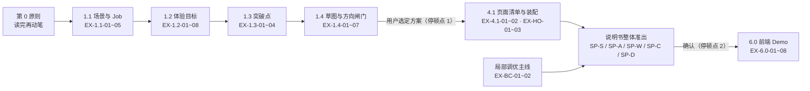

# 准出门禁总表（Gate Registry）· 唯一口径

> **本表是门禁的唯一口径来源。** 任何“能不能往下一步走”的判断，只认本表的编号与判据。
> 其余文档（1.1~1.4、5.0、6.0、各组件的自检清单）**只作为判据原文的出处**，不再各自对外宣称"过了我的闸门"。
>
> 两类门禁，互不替代：
>
> | 类 | 编号前缀 | 回答什么问题 | 什么时候跑 | 载体 |
> | :--- | :--- | :--- | :--- | :--- |
> | **A · 执行环节准出** | `EX-<环节>-nn` | 这一环的产物够不够格进入下一环 | 每环做完立刻跑 | `tools/gate-ex.sh <环节> <产物>` |
> | **B · 设计说明书整体准出** | `SP-<组>-nn` | 这份说明书能不能交给规划人员确认 | 说明书出稿后跑一次 | `tools/gate-sp.sh <spec>` |
>
> **为什么必须分开**：环节门禁管"这一步做没做对"，错了只需退回上一环；说明书门禁管"整份东西能不能交"，错了要退回可能好几环。混在一起跑的结果，就是上一轮的错——结构 11 项全绿，却把方向错了的说明书交出去。

---

## 零、门禁全景与依赖



**三条硬规则**

1. **不得跨环合跑**：`gate-sp` 只校验说明书，不校验 1.1~1.4 的产物是否存在；缺哪一环，SP 的 C 组直接判不合格。
2. **每一环只退一步**：EX 不过 → 退回本环重做，不许"带病往下走、最后在说明书里补"。
3. **脚本必须打印编号**：任何门禁输出都以编号开头，方便一眼对上本表，也便于留档追责。

### 🛑 门禁 ≠ 停顿点（全流程只有 3 次停顿，其余全部静默）

> 本表有 30+ 条门禁，但**与人交互的停顿点仍然只有 3 个**（`agent-interaction-protocol.md` 第 0 节）。**加门禁不等于加停顿**——否则流程会被自检切碎。

| 门禁 | 是否停顿 | 怎么执行 | 失败怎么办 |
| :--- | :---: | :--- | :--- |
| EX-0 / EX-1.1 / EX-1.2 / EX-1.3 | 否 | 内部静默自检，结论随产物一起给 | 自己退回本环重做，不向用户提问 |
| EX-1.4-01~04 / 07 | 否 | 内部静默自检 | 自己重修，不出草案给用户 |
| **EX-1.4-05（停顿点 1）** | **是** | 交草图 + 一句话选定问题 | 等用户选定；未定不进 Part2 |
| EX-4.1 / EX-HO | 否 | 定稿页面清单前静默跑 | 自己回补上游产物，不新增提问 |
| SP 全部（SP-S/A/W/C/D） | 否 | 出稿后静默跑 | 自己修到全绿 |
| **SP 交付（停顿点 2）** | **是** | 说明书确认 | 等用户确认；未确认不写代码 |
| EX-BC / EX-6.0 | 否 | 收尾自检 | 自己修 |

**一句话**：门禁只负责"拦住错"，不负责"找人问"。任何门禁都不得新增一次对话往返。

---

## 一、Part A · 执行环节准出门禁（EX）

### EX-0　动笔前（原则约束，不设机检）

> 🛑 这一环**不做机器门禁**，只由 `execution-sop.md` 顶部的「第 0 原则」约束：
> **禁止囫囵吞枣、不读完参考内容就草草完成任务，以输出质量第一、效率第二为原则。**
>
> 它不靠一张表证明，而由后面各环**暴露**：目标说不出人少干了哪件事、突破点只有一档、取舍说不出为什么不是另一条走法——这些都是没读透的痕迹。

| 编号 | 判据 | 类型 | 不过怎么办 |
| :--- | :--- | :---: | :--- |
| **EX-0-01** | 1.1 / 1.2 / 1.3 / 1.4 与命中决策域已读完再动笔；不以"更快 / 省一次往返"为由跳过任何一环 | 原则（H） | 停手回去读，禁止先写后补 |

### EX-1.1　场景与 Job

| 编号 | 判据 | 类型 | 通过证据 | 不过怎么办 |
| :--- | :--- | :---: | :--- | :--- |
| **EX-1.1-01** | 主场景 2~5 条（<2 是拆碎，>5 是没收敛） | M | 场景表行数 | 合并或补拆 |
| **EX-1.1-02** | 场景名不含阶段/操作词（追踪·结果·查看·定位·详情·下发·提交·编辑·导入·导出·新建） | M | 场景名逐条扫描 | 改名；A 的终态是 B 的触发情境则合并 |
| **EX-1.1-03** | 每个场景有 Job，且写成"一份要维护/交付的东西 + 覆盖的工作内容" | M+H | 场景表 Job 列 | 退回 1.1 重拆，不在 1.2 硬写 |
| **EX-1.1-04** | 每个场景 ≥1 条痛点，且标出"用户困在"（烦 / 看不全 / 不敢信 / 说不清） | H | 痛点列 | 补痛点；补不出说明场景不成立 |
| **EX-1.1-05** | 编号体系不外泄（不出现 `REQ-xxx`、`Sx-Py`） | M | 全文扫描 | 删编号，改自然语言 |

### EX-1.2　体验目标

| 编号 | 判据 | 类型 | 通过证据 | 不过怎么办 |
| :--- | :--- | :---: | :--- | :--- |
| **EX-1.2-01** | 条数 = 场景数，一场景一条，不重复 | M | 目标文件行数 vs 1.1 场景数 | 补齐或合并 |
| **EX-1.2-02** | 句式固定 `**场景名**：一句话`，场景名**逐字照抄** 1.1 | M | 行首粗体与场景名全等 | 改标题；禁止自造短语 |
| **EX-1.2-03** | 句内无界面痕迹，三类都查：**控件**（弹窗·抽屉·标签页·按钮·下拉框·复选框·搜索框·筛选栏·页签·卡片·列设置）+ **交互路径**（点开·点进·打开·进去·上来一趟·切到·悬浮·滑出·弹出·跳转·往返）+ **通知渠道**（手机·短信·邮件） | M | 关键词扫描 | 删界面痕迹，写成能力陈述句（名词词表抓不到动词型界面痕迹，故必须三类并列） |
| **EX-1.2-04** | 不出现虚词与**绝对词**（大幅·极致·更加·显著·全新·赋能·体验升级·明显提升·任何时刻·全过程·一次说清·百分之百）；且**"不用/不再/无需/不必"不得作句首或主句骨架**（句首 12 字内命中即 FAIL）；句中读得出"谁因此不必再做什么"；不是把原步骤加速 | M+H | 关键词 + 前缀正则 + 人工逐条念 | 删虚词与绝对词；把"不用…"开头改写为能力陈述句；终点往后推到工作终态 |
| **EX-1.2-05** | **门槛跃迁必含**：句内出现 `0 基础 / 零基础 / 无需经验 / 一线 / 不出二线 / 普通用户 / 新同事 / 非专家 / 新手` 之一 | M | 关键词白名单 | 找不出门槛跃迁 = 这条只是"加速"不是"改写"，退回 1.1 重找跃迁点 |
| **EX-1.2-06** | **可测锚必含**：句内出现一个可测锚（数字 / 一位 / 一名 / 一台 / 一个时间点 / 三个 / 三样 / 两项 / 一次 / 一条 / 一件 / 五段 / 十分钟 …） | M | 关键词白名单 | 补一个可测锚（人、次数、段数、时长任一）；无基线就写动作数与行为测法 |
| **EX-1.2-07** | **语域达标（防幼稚化）**：指示代词（这一次/那一个/这一段/这一条/同一条/某个人/某个应用/这一个）**≤2 个**；动补短语（调回/找回/查回/说清/讲清/交出去/发出去/关上/接上/排在前/上来一趟/捞出来/落下来/接住）**≤2 个** | M | 计数 | 代词换业务名词；动补换书面动词（"调回"→"还原"、"交出去"→"移交"、"说清"→"给出依据"） |
| **EX-1.2-08** | **必交证据三件**：①每条目标附「跃迁三问」（原角色→新角色 / 哪一步被删掉 / 谁的哪句话因此不用了）②附「删词后版本」（删掉交互路径与渠道后仍站得住）③附「口语→书面语对照」（1.1 原话 → 目标说法） | H | 产物文件内可见三节 | 缺一即 FAIL；只写"已自查"视为未做 |

### EX-1.3　体验突破点

| 编号 | 判据 | 类型 | 通过证据 | 不过怎么办 |
| :--- | :--- | :---: | :--- | :--- |
| **EX-1.3-01** | 突破点 2~5 处，编号不重复 | M | `Bx` 去重计数 | 合并去重，不许加编号蒙混 |
| **EX-1.3-02** | 每条标来源（目标 / 入口 1 / 入口 2 经验编号） | M | 来源列非空 | 补来源，补不出的删掉 |
| **EX-1.3-03** | 每条能落到具体场景（后续对应说明书 6.2 行） | M | 突破点表含场景列或映射 | 落不了 = 自嗨，退回重想 |
| **EX-1.3-04** | 每条有三档点子（常规 / 优化 / 创新）且三档真拉开 | H | 点子表 | 缺档、或三档只换容器 = 没想透 |

### EX-1.4　草图与方向闸门

| 编号 | 判据 | 类型 | 通过证据 | 不过怎么办 |
| :--- | :--- | :---: | :--- | :--- |
| **EX-1.4-01** | 只交两套，**名称只叫「方案一」「方案二」**（不写方案标题句、不标水位徽标），不画常规版，不凑第三套 | M | 两套 tab 是否存在 | 删多余方案 / 删标题句 |
| **EX-1.4-02** | 顶部有两段**对比表**：整体设计说明（末尾含代价）+ 各自的设计思考点（两套条数可不等、维度不强求对齐，每条带"为什么这么想"） | H | 「整体设计说明」「思考点」是否在 | 补对比表 |
| **EX-1.4-03** | 相同页用**占位条**交代（`P5 ×××：与方案一相同`），不重复画，无"见共用页面"跳转 | M | 占位条文案 | 补占位条 |
| **EX-1.4-04** | 结构级 5 条：主按钮主题蓝 / 主左取右 / 抽屉贴左弹窗贴右 / 容器不混用 / 无 `Ix*` 与 `px` | M | `sketch-selfcheck.sh` 5/5 | 修结构级规范 |
| **EX-1.4-05** | 图上与说明里**不出现内部词与经验编号**（采信/回执/留痕/处置/裁决/认领/`Bx`） | M | 禁用词扫描 | 换用户话 |
| **EX-1.4-06** | **页面总数置顶**；**用户明确选定一套**，并把"方案来源"写进下游交付物 | M+H | `本次需求一共 N 个页面` + `方案来源：用户选定 方案一` | 停下来问，未定不进 Part2 |
| **EX-1.4-07** | **文案表达机检**：①每页有图下说明且含「为什么」②「做法」与「为什么」条数配对 ③图上标号 = 图下编号（逐页比）④无空洞词（提升体验/更清晰/赋能…）⑤单条说明 ≤200 字 ⑥主按钮不写"确定/提交/保存" | M | `gate.js ex 1.4` 07 组 | 补说明 / 换用户话，重跑 |

### EX-4.1　页面清单与装配（Part2 入口，**静默执行，不停顿**）

| 编号 | 判据 | 类型 | 通过证据 | 不过怎么办 |
| :--- | :--- | :---: | :--- | :--- |
| **EX-4.1-01** | **页面清单覆盖率**：从 PRD 拆「业务对象 × 动作/状态」全集（增删改查 / 状态机 / 治理动作），逐项认领页面落点；落不了的显式写「本期不做 + 原因」 | M+H | 草图/清单里的动作覆盖表 | 缺项回补；严禁静默消失，也不向用户提问 |
| **EX-4.1-02** | **草图继承对账**：页面数 / 主结构 / 进入关系 / 突破点落点与 1.4 选定草图逐项对齐，结构差异 >30% 判为走偏 | M+H | 对账结论 | 回 1.4 补草图（内部回退，**不新增停顿**） |

### EX-HO　交接完整性（产物链，**静默执行，不停顿**）

| 编号 | 判据 | 类型 | 通过证据 | 不过怎么办 |
| :--- | :--- | :---: | :--- | :--- |
| **EX-HO-01** | **消费上游**：本环产物引用的每处上游内容都能指回原文（场景 / 目标 / `Bx` / 经验编号） | M | 与 SP-C-01 / SP-C-03 / SP-C-04 交叉覆盖 | 回补上游，禁止下游臆造 |
| **EX-HO-02** | **交付下游**：本环产出的东西必须全部进说明书（产出了不用的即无效工作） | M | SP-S-02 + SP-D-01 | 删无效产物，或补进说明书 |
| **EX-HO-03** | **回链编号**：引用上游时保留原编号（`Bx` / `D0x-EPxx` / `page-*` / `agentId`），不重命名、不新增自造编号 | M+H | 编号一致性抽查 | 恢复编号 |

### EX-BC　局部调优（b~c 步）

| 编号 | 判据 | 类型 | 通过证据 | 不过怎么办 |
| :--- | :--- | :---: | :--- | :--- |
| **EX-BC-01** | 未触碰转轨红线（骨架 / 流程 / 栅格被改） | H | 调优说明 | 触线即升级为方案设计，不打补丁 |
| **EX-BC-02** | 补丁前后差异可核对（截图或 diff + 一句通俗说明） | H | 交付说明 | 补证据 |

### EX-6.0　前端 Demo（回测七维 + 安全带，**静默执行**）

| 编号 | 判据 | 类型 | 通过证据 | 不过怎么办 |
| :--- | :--- | :---: | :--- | :--- |
| **EX-6.0-01** | 框架套头回测：页面外层确实用了选定的模板（导航 / 面包屑 / 操作区 / 向导底栏齐） | H | 回测表 | 按模板重装套头 |
| **EX-6.0-02** | 能力清单回测：说明书列出的业务能力 100% 有组件承载，无遗漏项 | H | 回测表 | 补实现或回说明书删条目 |
| **EX-6.0-03** | 组件硬指标回测：表头 32 / 行高 40 / 双字按钮 56 / 数字右对齐等命中 `03-design-assets/` 规范 | M+H | 抽查 + 截图 | 按规范改 |
| **EX-6.0-04** | 视觉降噪回测：无高饱和纯色，状态走"浅底 + 深字 + 浅边"三元组 | M | 色值扫描 | 换回 token |
| **EX-6.0-05** | 安全带回测：长文本截断 + Tooltip、防抖、空状态兜底均在位 | H | 抽查 | 补安全带 |
| **EX-6.0-06** | 可视化件回测：说明书声明的每个件都按"图形编码规则 + 风格"真画，无通用占位 | H | 对照声明表 | 按声明重画 |
| **EX-6.0-07** | 映射清单完整性回测：实现条目数 = 清单 `<tbody>` 内 `<tr>` 数（含折叠行，不含折叠按钮行） | M | 计数比对 | 补实现被折叠的那几行 |
| **EX-6.0-08** | 四重防破坏安全带：不删既有文件 / 不改公共样式 / 不动路由 / 不引外部依赖 | M+H | 变更清单 | 回退越界改动 |

---

## 二、Part B · 设计说明书整体准出门禁（SP）

> 分四组：**S 结构 → A 资产 → W 线框 → C 内容 → D 自包含**。前四组看"像不像、对不对"，D 组看"能不能脱离对话被复现"。

### SP-S　结构与规模

| 编号 | 判据 | 类型 | 脚本/人 |
| :--- | :--- | :---: | :--- |
| **SP-S-01** | 两段式：Part1（1~5 节）+ Part2（6~7 节），两段同文件双 tab、默认选中 Part2；**无第 8 节门禁检视、无末尾 checkpoint 浮层**，或旧五章 | M | `gate-sp` |
| **SP-S-02** | 页面清单与第 7 节分页面小节**数量一致**，每页都有线框 | M | `gate-sp` |
| **SP-S-03** | 主场景 2~5 条、名称不含阶段词（与 EX-1.1-01/02 同判据） | M | `gate-sp` |
| **SP-S-04** | 角色卡片固定 2 张（主 + 次），不凑审计/领导 | M | `gate-sp` |
| **SP-S-05** | 内容预算：目标 ≤5 · 突破点 ≤5 · 每页映射清单 ≤8 行 · 无说明性废列 | H | 人 |

### SP-A　资产真实性

| 编号 | 判据 | 类型 | 脚本/人 |
| :--- | :--- | :---: | :--- |
| **SP-A-01** | 所有 `Ix*` 组件在 `idux-component-map.md` 登记或已声明 | M | `selfcheck` |
| **SP-A-02** | 所有 `page-*` 模板 ID 真实存在或已声明借用 | M | `selfcheck` |
| **SP-A-03** | 色值 100% 命中设计资产白名单 | M | `selfcheck` |
| **SP-A-04** | 无红色实心按钮 / 无"危险型"按钮 | M | `selfcheck` |
| **SP-A-05** | 引用的 `.md` 全部可解析 | M | `selfcheck` |
| **SP-A-06** | 每条经验（`EP` / `D0x-EPxx`）在第 7 节有实际落点 | M | `selfcheck` |

### SP-W　线框与可视化

| 编号 | 判据 | 类型 | 脚本/人 |
| :--- | :--- | :---: | :--- |
| **SP-W-01** | 表单左右结构（左 Label 右 Control），非必填留星号占位 | M | `selfcheck` |
| **SP-W-02** | 线框规范：页脚主按钮在左 / 按钮无前置图标 / 宽度命中档位 / 容器选型一致 / 弹窗三段分区 / 提示条无边框无红底 | M | `selfcheck` |
| **SP-W-03** | 含可视化件的页面均有《可视化件声明》且五字段齐全 | M | `selfcheck` |
| **SP-W-04** | 线框区无 `__` 占位，示例数据跨页自洽，并在节首声明示例环境 | M | `selfcheck` + 人 |
| **SP-W-05** | 线框 UI 文案不出现经验编号 | M | `selfcheck` |

### SP-C　内容一致性（Part1 与 Part2 对得上）

| 编号 | 判据 | 类型 | 脚本/人 |
| :--- | :--- | :---: | :--- |
| **SP-C-01** | 第 3 节目标：条数 = 场景数、标题 = 场景名、句式合规（复用 EX-1.2 判据） | M | `gate-sp` |
| **SP-C-02** | 目标中无界面控件词（复用 EX-1.2-03） | M | `gate-sp` |
| **SP-C-03** | 每条 `Bx` 有来源，且在 6.2 落到具体场景行 | M | `gate-sp` |
| **SP-C-04** | 6.2 覆盖全部主场景（每个场景都有对应行） | M | `gate-sp` |
| **SP-C-05** | 页面清单每页都挂 `Bx`（无空头页面） | M | `gate-sp` |
| **SP-C-06** | **有"方案来源"记录**（用户选定 / 明示跳过），可追溯闸门；该行须在正文 **6.1 节开头**（第 8 节已取消，别再往文末放） | M | `gate-sp` |

### SP-D　自包含（能不能脱离对话交付）

| 编号 | 判据 | 类型 | 脚本/人 |
| :--- | :--- | :---: | :--- |
| **SP-D-01** | 六节编码契约齐备：交互状态机 / 数据口径 / 组件 Token / 固定文案 / 验收清单 / 实现边界 | M | `gate-sp` |
| **SP-D-02** | 交互状态机逐页给"元素 / 触发 / 响应 / 状态变化 / 不可用边界"，且有前端状态字段与浮层关系 | H | 人 |
| **SP-D-03** | 每个数字有定义与真源（对象 / 时间范围 / 去重 / 缺失处理） | H | 人 |
| **SP-D-04** | 责任边界文案逐字固定（如 Hook 安装说明），状态词表齐 | H | 人 |
| **SP-D-05** | 验收清单 + 手工自测步骤可照着点 | H | 人 |
| **SP-D-06** | 实现边界：不做清单 / 只读约束 / 禁令 | H | 人 |

**SP 总判据**：**把文件单独发给没参与对话的人或另一个 AI，他不问一句就能做出同款页面。** 缺 D 组任一节即判"未完本"。

---

## 三、旧散落位置 → 新编号（迁移对照）

> 原文档保留原文（判据出处），但**不再各自对外宣称"过闸门"**。以后只认本表编号。

| 旧位置 | 旧形式 | 归入 | 备注 |
| :--- | :--- | :--- | :--- |
| `1.1-需求理解与现状旅程.md` 第四节 | 场景切分判据 + 编号体系 | EX-1.1-01/02/05 | 判据原文保留 |
| `1.2-体验目标.md` §二 两条判定、§三.6 输出形态、§六.3 反低级化 | 目标判档 + 句式 + 禁用词 | EX-1.2-01~08 | 原文即判据 |
| `1.3-体验突破点拆解.md` 上限与来源要求 | 突破点条数与来源 | EX-1.3-01~04 | — |
| `1.4-草图发散与方向确认.md` §五 4. 草图自检表（28 条）、4.1 门禁脚本、§七 闸门 | 28 条人工表 + 结构 5 条脚本 + 文案机检 + 闸门铁律 | EX-1.4-01~06 | 28 条不再单独计数，按 6 条归并 |
| `5.0-设计说明书标准模板.md` §三.2 自检 11 项 | 11 项结构自检 | SP-S-01 · SP-A-01~06 · SP-W-01~05 | 脚本仍叫 `design-spec-selfcheck.sh`，但编号按本表报 |
| `5.0` §三.2 人工必核四条（D/A/B/C） | 场景切分 / 突破点落地 / 方向未被偷改 / 目标同步 | SP-S-03 · SP-C-03 · SP-S-02 · SP-C-01 | 四条并入门禁组，不再另列 |
| `6.0-前端 demo 输出要求.md` §3「6.3 保真度回测规程」 | 七个回测维度 + 四重安全带 | EX-6.0-01~08 | 原表七维逐条编号，不再压成 2 条 |
| `execution-sop.md` 第 84 行 | **「覆盖率自检闸门（定稿页面清单前必做）」**：业务对象 × 动作/状态全集认领，落不了写"本期不做" | **EX-4.1-01** | 原为**只活在 SOP 里、无编号**的一道门 |
| `execution-sop.md` 第 82 行 | 草图继承对账（页面数 / 主结构 / 进入关系 / 突破点落点，差异 >30% 回 1.4） | **EX-4.1-02** | 同上，补编号 |
| `execution-sop.md` 第 123–139 行 | 「三条交接铁律」+「收敛校验」（章节 ↔ 来源步骤映射） | **EX-HO-01~03** | 原为**无编号**的交接门禁 |
| `execution-sop.md` 第 59 行 / §四 / 全景图 Gate1 | 草图门禁 5/5、一道闸门、三个 gate | EX-1.4-01~05 | 同一件事的 3 处转述 |
| `execution-sop.md` 第 98 行 + 第 152–186 行 | 交付前自检（"另人工过**三条**"）与独立整节（11 项 + 三条纪律） | SP-S/A/W/C/D | **与 5.0 的"两条/四条"口径冲突，以总表为准** |
| `agent-interaction-protocol.md` 第 0 节 + 第 15/19–32 行 | 停顿点 1「草图方向闸门」 | EX-1.4-05 | 停顿点判定口径不重复，只引用 |
| `agent-interaction-protocol.md` 第 16 行 + 状态机 53–75 行 | 停顿点 2「说明书共识闸门」 | SP 交付（停顿点 2） | 同上 |
| `1.1` 第 154 行「追一问的自检法」 | Job 拆完必问 | EX-1.1-04 判据补充 | 原来挂在章节里，从未被执行 |
| `1.3` 第 82 行「把突破点念一遍」 | 主语应为"人/用户" | EX-1.3-04 判据补充 | 同上 |
| `tools/quality-gate.*`（2026-10-22 临时产物） | G0~G6 | EX-0-01 · EX-1.1~1.4 · SP-C · SP-D | **已删除**，避免第二套口径 |
| `tools/sketch-selfcheck.sh` | 5 条结构级 | EX-1.4-04 | 保留，作为 EX-1.4 的机检载体 |
| `tools/design-spec-selfcheck.sh` | 11 项 | SP-S-01 · SP-A · SP-W | 保留，作为 SP 的机检载体 |

---

## 四、冲突与去重裁决

| 冲突 | 裁决 |
| :--- | :--- |
| 同一判据在两处描述不一致（如场景数、目标条数） | **以本表为准**；发现不一致，改文档不改本表 |
| 脚本报的项与本表编号对不上 | 视为脚本过期，必须先改脚本再交付 |
| 某项"跳过"能否算通过 | **不算**。跳过必须在汇报里说明原因，且 SP 的 D 组不得跳过 |
| 环节门禁能否合并成一次跑 | 不能。EX 逐环跑，SP 只在出稿时跑一次 |
| 改了门禁判据 | 同时改三处：本表 + 脚本 + 引用该章节的文档标题 |

---

## 五、汇报格式（两段，缺一段不算交付）

```text
【Part A · 环节结果】
EX-0-01  读料：1.1/1.2/1.3/1.4 + 4 份决策域，结论已写 .......... 通过
EX-1.1   场景 4 条，名称无阶段词，Job 均为"一份东西+工作" ........ 通过
EX-1.2   目标 4 条 = 场景数，场景名开头，无界面词 ................ 通过
EX-1.3   突破点 5 处，均有来源，均落场景 ........................ 通过
EX-1.4   两套方案，结构 5/5，用户选定方案一 ..................... 通过

【Part B · 说明书结果】
SP-S  5 项：SP-S-01/02/03/04 机检通过，SP-S-05 人检通过
SP-A  6 项：全绿
SP-W  5 项：SP-W-04 含 1 处人工确认（示例环境已声明）
SP-C  6 项：全绿
SP-D  6 项：全绿
结论：SP 可交付确认
```

命令：

```bash
bash tools/gate-ex.sh 1.1 _output/<业务名>/01-场景与Job-<业务名>.md
bash tools/gate-ex.sh 1.2 _output/<业务名>/02-体验目标-<业务名>.md [_output/<业务名>/01-场景与Job-<业务名>.md]
bash tools/gate-ex.sh 1.3 _output/<业务名>/03-突破点-<业务名>.md
bash tools/gate-ex.sh 1.4 _output/<业务名>/草图-<业务名>.html
bash tools/gate-ex.sh 4.1 _output/<业务名>/草图-<业务名>.html            # 定稿页面清单前，静默跑
bash tools/gate-sp.sh _output/<业务名>/design-spec-<业务名>.html
```

> 📁 全部产物落在 `_output/<业务名>/`（已 gitignore，不入库），命名前缀不变，草图与说明书同目录。

退出码 0 才算过；不过就按编号退回对应的那一环。
