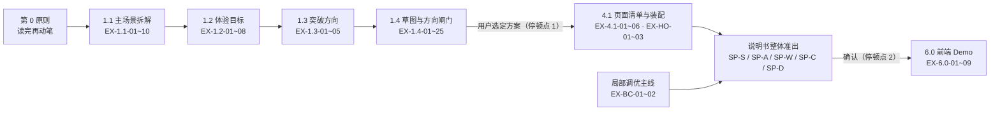

# 准出门禁总表（Gate Registry）· 唯一口径

> **本表是门禁的唯一口径来源。** 任何“能不能往下一步走”的判断，只认本表的编号与判据。
> 其余文档（1.1~1.4、5.0、6.0、各组件的自检清单）**只作为判据原文的出处**，不再各自对外宣称"过了我的闸门"。
>
> 两类门禁，互不替代：
>
> | 类 | 编号前缀 | 回答什么问题 | 什么时候跑 | 载体 |
> | :--- | :--- | :--- | :--- | :--- |
> | **A · 执行环节准出** | `EX-<环节>-nn` | 这一环的产物够不够格进入下一环 | 每环做完立刻跑 | `tools/gate-ex.sh <环节> <产物>` |
> | **B · 设计说明书整体准出** | `SP-<组>-nn` | 这份说明书能不能交给规划人员确认 | 说明书出稿后跑一次 | `tools/gate-sp.sh <spec>` |
>
> **为什么必须分开**：环节门禁管"这一步做没做对"，错了只需退回上一环；说明书门禁管"整份东西能不能交"，错了要退回可能好几环。混在一起跑的结果，就是上一轮的错——结构 11 项全绿，却把方向错了的说明书交出去。

---

## 零、门禁全景与依赖



**三条硬规则**

1. **不得跨环合跑**：`gate-sp` 只校验说明书，不校验 1.1~1.4 的产物是否存在；缺哪一环，SP 的 C 组直接判不合格。
2. **每一环只退一步**：EX 不过 → 退回本环重做，不许"带病往下走、最后在说明书里补"。
3. **脚本必须打印编号**：任何门禁输出都以编号开头，方便一眼对上本表，也便于留档追责。

### 🛑 门禁 ≠ 停顿点（全流程只有 3 次停顿，其余全部静默）

> 本表有 30+ 条门禁，但**与人交互的停顿点仍然只有 3 个**（`agent-interaction-protocol.md` 第 0 节）。**加门禁不等于加停顿**——否则流程会被自检切碎。

| 门禁 | 是否停顿 | 怎么执行 | 失败怎么办 |
| :--- | :---: | :--- | :--- |
| EX-0 / EX-1.1 / EX-1.2 / EX-1.3 | 否 | 内部静默自检，结论随产物一起给 | 自己退回本环重做，不向用户提问 |
| EX-1.4-01~04 / 07~20 | 否 | 内部静默自检 | 自己重修，不出草案给用户 |
| **EX-1.4-05（停顿点 1）** | **是** | 交草图 + 一句话选定问题 | 等用户选定；未定不进 Part2 |
| EX-4.1 / EX-HO | 否 | 定稿页面清单前静默跑（含功能域继承对账） | 自己回补上游产物，不新增提问 |
| SP 全部（SP-S/A/W/C/D） | 否 | 出稿后静默跑 | 自己修到全绿 |
| **SP 交付（停顿点 2）** | **是** | 说明书确认 | 等用户确认；未确认不写代码 |
| EX-BC / EX-6.0 | 否 | 收尾自检 | 自己修 |

**一句话**：门禁只负责"拦住错"，不负责"找人问"。任何门禁都不得新增一次对话往返。

---

## 一、Part A · 执行环节准出门禁（EX）

### 草图阶段门禁总账（跨 1.1 / 1.3 / 1.4，**分步运行**）

> 🛑 **这是草图相关门禁的唯一权威索引**。门禁按阶段分散在 1.1 / 1.3 / 1.4 与下方 `EX-1.x`，**本账只做索引与运行阶段登记，不重复判据**；各阶段只跑本阶段门禁，**不要求 1.4 一次跑完**。原 `EX-1.3-02`、`EX-1.4-16~24` 保留条文，作为本账细项。

| 编号 | 门禁 | 判据（详见来源） | 运行阶段 | 方式 | 不过怎么办 | 来源 |
| :---: | :--- | :--- | :---: | :---: | :--- | :--- |
| **G-01** | 来源可追 | 每条突破方向标来源（感受点 / 工作类型 + 原则号） | 1.3 | 人工 | 回退重找 | `EX-1.3-02` |
| **G-02** | 价值反问 | 真痛点 / 该不该做 / 有无更本质解，三问有答案 | 1.3 | 人工 | 回 1.1 | 1.3 §三 |
| **G-03** | IA 与页面清单分离 | IA 最多四级（四级条件性）、清单 5 列独立、场景聚合成立 | 1.4 | 人工 + 机检 | 重出 | R2 / `EX-1.4-16` |
| **G-04** | 清单 × 草图覆盖 | 清单每条在草图有呈现，或标"本期不做 + 原因" | 1.4 | 机检 + 人工 | 补画 / 标不做 | R3 / 1.4 §3.5 |
| **G-05** | 场景闭环覆盖 | 闭环环节有页面承接（或注明线下） | 1.4 | 人工 | 补页 / 注明 | R5 并入 |
| **G-06** | 层级 / 占位 / Tab / flow / view | `EX-1.4-16~24` 原判据（含 21 交付面 / 22 主图 / 24 框内禁令） | 1.4 | 机检 | 按原办法 | `EX-1.4-16~20` |

> 📌 **运行分步**：1.1 只跑 1.1 门禁；1.3 跑 G-01 / G-02；1.4 跑 G-03 ~ G-06。总账只保证"不漏、可追溯"，**不改变各阶段执行节奏**。
> 📌 **与 `EX-1.x` 的关系**：G-01 / G-06 是 `EX-1.3-02` / `EX-1.4-16~20` 的索引，**判据仍以下方 EX 条目为准**，本账不复制细则。

### EX-0　动笔前（原则约束，不设机检）

> 🛑 这一环**不做机器门禁**，只由 `execution-sop.md` 顶部的「第 0 原则」约束：
> **禁止囫囵吞枣、不读完参考内容就草草完成任务，以输出质量第一、效率第二为原则。**
>
> 它不靠一张表证明，而由后面各环**暴露**：目标说不出人少干了哪件事、突破点只有一档、取舍说不出为什么不是另一条走法——这些都是没读透的痕迹。

| 编号 | 判据 | 类型 | 不过怎么办 |
| :--- | :--- | :---: | :--- |
| **EX-0-01** | 1.1 / 1.2 / 1.3 / 1.4 与命中决策域已读完再动笔；不以"更快 / 省一次往返"为由跳过任何一环 | 原则（H） | 停手回去读，禁止先写后补 |

### EX-1.1　主场景拆解

| 编号 | 判据 | 类型 | 通过证据 | 不过怎么办 |
| :--- | :--- | :---: | :--- | :--- |
| **EX-1.1-01** | 主场景 **1~5 条**（**1 条合法，不设下限**；>5 是没收敛） | M | 场景表行数 | 合并（回 Step 4 · 4.1）或补拆 |
| **EX-1.1-02** | 场景名为**职责级命名**：不含阶段/操作词（追踪·结果·查看·定位·详情·下发·提交·编辑·导入·导出·新建），且必须命中职责词（运营·管理·治理·盘点·交付·上架·值守·复核·审计·维护） | M | 场景名逐条扫描 | 回 1.1 Step 2 改名；A 的终态是 B 的触发情境则合并 |
| **EX-1.1-03** | 每条主场景写成"一份要维护/交付的东西 + 覆盖的工作内容" | M+H | 场景表的"主场景要办成的事"列 | 退回 1.1 重拆，不在 1.2 硬写 |
| **EX-1.1-06** | 每条"要办成的事"至少列 3 个子事项（少于 3 项仍停在"点"上） | M | 该列顿号/分号切分计数 | 回 1.1 Step 1 换更宽的职责 |
| **EX-1.1-04** | 每个场景 ≥1 条痛点，且标出"用户困在"（烦 / 看不全 / 不敢信 / 说不清）；场景必须落在本次业务域内，域外职责只记一行、不成场景 | H | 痛点列 + Step 1 三锚 | 补痛点；域外场景删除或移入域外行 |
| **EX-1.1-05** | 编号体系不外泄（不出现 `REQ-xxx`、`Sx-Py`） | M | 全文扫描 | 删编号，改自然语言 |
| **EX-1.1-07** | 每条场景有**需求出处**（需求文档章节 / 原句），且不得用 `【假设】` 造场景 | M | 「需求出处」列非空、无【假设】 | 补出处；无出处 = 联想扩展，删掉该场景 |
| **EX-1.1-08** | 每条场景有**业务终态**（谁手上多了什么 / 什么状态变了），不得写成"提交了 / 下发了 / 看完了"；**任意两条终态不得指向同一产物或同一条流水线的前后节点** | M | 「业务终态」列非空、两两不互为子串 | 回 1.1 Step 4 · 4.1 合并（说明同一条闭环被切开） |
| **EX-1.1-09** | **分合判据逐对比较**：串行 / 同产物 / 同入口 / 半程，命中任一即合并；四条都不命中才可独立 | H | Step 4 · 4.1 逐对比较记录 | 合并；坚持不合并须逐条写明四条各自为何不成立 |
| **EX-1.1-10** | **Step 5 六问逐条有答案并填进「场景自检表」**（组①：日常任务 / 可拆旅程 / 行业 job；组②：独立价值目标 / 是否同任务子步骤 / 合并后有无发力点） | H | 场景自检表 | 补答；答不上来的那一条就是拆错的，回 Step 4 合并或拆回 |

### EX-1.2　体验目标

| 编号 | 判据 | 类型 | 通过证据 | 不过怎么办 |
| :--- | :--- | :---: | :--- | :--- |
| **EX-1.2-01** | 条数 = 场景数，一场景一条，不重复 | M | 目标文件行数 vs 1.1 场景数 | 补齐或合并 |
| **EX-1.2-02** | 句式固定 `**场景名**：一句话`，场景名**逐字照抄** 1.1 | M | 行首粗体与场景名全等 | 改标题；禁止自造短语 |
| **EX-1.2-03** | 句内无界面痕迹，三类都查：**控件**（弹窗·抽屉·标签页·按钮·下拉框·复选框·搜索框·筛选栏·页签·卡片·列设置）+ **交互路径**（点开·点进·打开·进去·上来一趟·切到·悬浮·滑出·弹出·跳转·往返）+ **通知渠道**（手机·短信·邮件） | M | 关键词扫描 | 删界面痕迹，写成能力陈述句（名词词表抓不到动词型界面痕迹，故必须三类并列） |
| **EX-1.2-04** | 不出现虚词与**绝对词**（大幅·极致·更加·显著·全新·赋能·体验升级·明显提升·任何时刻·全过程·一次说清·百分之百）；且**"不用/不再/无需/不必"不得作句首或主句骨架**（句首 12 字内命中即 FAIL）；句中读得出"谁因此不必再做什么"；不是把原步骤加速 | M+H | 关键词 + 前缀正则 + 人工逐条念 | 删虚词与绝对词；把"不用…"开头改写为能力陈述句；终点往后推到工作终态 |
| **EX-1.2-05** | **门槛跃迁必含**：句内出现 `0 基础 / 零基础 / 无需经验 / 一线 / 不出二线 / 普通用户 / 新同事 / 非专家 / 新手` 之一 | M | 关键词白名单 | 找不出门槛跃迁 = 这条只是"加速"不是"改写"，退回 1.1 重找跃迁点 |
| **EX-1.2-06** | **可测锚必含**：句内出现一个可测锚（数字 / 一位 / 一名 / 一台 / 一个时间点 / 三个 / 三样 / 两项 / 一次 / 一条 / 一件 / 五段 / 十分钟 …） | M | 关键词白名单 | 补一个可测锚（人、次数、段数、时长任一）；无基线就写动作数与行为测法 |
| **EX-1.2-07** | **语域达标（防幼稚化）**：指示代词（这一次/那一个/这一段/这一条/同一条/某个人/某个应用/这一个）**≤2 个**；动补短语（调回/找回/查回/说清/讲清/交出去/发出去/关上/接上/排在前/上来一趟/捞出来/落下来/接住）**≤2 个** | M | 计数 | 代词换业务名词；动补换书面动词（"调回"→"还原"、"交出去"→"移交"、"说清"→"给出依据"） |
| **EX-1.2-08** | **必交证据三件**：①每条目标附「跃迁三问」（原角色→新角色 / 哪一步被删掉 / 谁的哪句话因此不用了）②附「删词后版本」（删掉交互路径与渠道后仍站得住）③附「口语→书面语对照」（1.1 原话 → 目标说法） | H | 产物文件内可见三节 | 缺一即 FAIL；只写"已自查"视为未做 |

### EX-1.3　体验突破方向

| 编号 | 判据 | 类型 | 通过证据 | 不过怎么办 |
| :--- | :--- | :---: | :--- | :--- |
| **EX-1.3-01** | 突破方向 2~5 条（= 1.1 该场景 2~5 块任务），编号不重复 | M | `Bx` 去重计数 | 合并去重，不许加编号蒙混；槽位本期不做须写明理由 |
| **EX-1.3-02** | 每条标来源（感受点 / 经验类别 · 原则编号） | M | 「感受点」「命中经验 · 原则」两列非空 | 补来源；只写"参考了某类经验"、写不出原则名的，退回第 2 步重扫 |
| **EX-1.3-03** | 每条能落到具体场景（后续对应说明书 6.2 行） | M | 突破方向表含场景列或映射 | 落不了 = 自嗨，退回重想 |
| **EX-1.3-04** | 每条有三档点子（常规 / 优化 / 创新）且三档真拉开 | H | 点子表 | 缺档、或三档只换容器 = 没想透 |
| **EX-1.3-05** | **骨架对账**：方向数 = 1.1 该场景旅程任务块数（2~5），无槽位被静默删掉 | M（传上游时）+H | `gate-ex.sh 1.3 <产物> <01-主场景.md>` 的骨架对账行 | 缺步 → 回第 1 步定框架；确实不做 → 保留槽位 + 写理由 |

### EX-1.4　草图与方向闸门

| 编号 | 判据 | 类型 | 通过证据 | 不过怎么办 |
| :--- | :--- | :---: | :--- | :--- |
| **EX-1.4-01** | 只交两套，**名称只叫「方案一」「方案二」**（不写方案标题句、不标水位徽标），不画常规版，不凑第三套 | M | 两套 tab 是否存在 | 删多余方案 / 删标题句 |
| **EX-1.4-02** | 顶部有两段**对比表**：整体设计说明（末尾含代价）+ 各自的设计思考点（两套条数可不等、维度不强求对齐，每条带"为什么这么想"） | H | 「整体设计说明」「思考点」是否在 | 补对比表 |
| **EX-1.4-03** | 相同页用**占位条**交代（`P5 ×××：与方案一相同`），不重复画，无"见共用页面"跳转 | M | 占位条文案 | 补占位条 |
| **EX-1.4-04** | 结构级 6 条：主按钮主题蓝 / 主左取右 / 抽屉贴左弹窗贴右 / 容器不混用 / 无 `Ix*` 与 `px` / 切换条吸顶　**视觉归口**：主按钮主题蓝 → `V-18`、按钮宽度档位 → `V-01`、容器不混用 → `V-03`；本号只留"结构级 6 条"是否成立 | M | `sketch-selfcheck.sh` 6/6（含切换条吸顶） | 修结构级规范 |
| **EX-1.4-05** | 图上与说明里**不出现内部词与经验编号**（采信/回执/留痕/处置/裁决/认领/`Bx`） | M | 禁用词扫描 | 换用户话 |
| **EX-1.4-06** | **页面总数置顶**；**用户明确选定一套**，并把"方案来源"写进下游交付物 | M+H | `本次需求一共 N 个页面` + `方案来源：用户选定 方案一` | 停下来问，未定不进 Part2 |
| **EX-1.4-07** | **文案表达机检**：①每页有图下说明且含「为什么」②「做法」与「为什么」条数配对 ③图上标号 = 图下编号（逐页比）④无空洞词（提升体验/更清晰/赋能…）⑤单条说明 ≤200 字 ⑥主按钮不写"确定/提交/保存" | M | `gate.js ex 1.4` 07 组 | 补说明 / 换用户话，重跑 |
| **EX-1.4-08** | **页面命名合规**：名词化、≤6 字、不含问句与指示代词（谁 / 哪 / 怎么 / 一次 / 这一片）、不以动作词开头（打开 / 查看 / 交接 / 处理）；页面名要能进导航、权限与说明书目录 | M | `gate.js ex 1.4` 08 组（读页面清单的 `<b>` 名） | 改成名词术语（影响范围 / 访问诊断 / 监测策略），全篇引用同步 |
| **EX-1.4-09** | **信息架构先于页面（四件套）**：必须有**模块定位**（3 行结论）/ **信息架构树**（只到四级菜单）/ **页面清单（5 列：编号 / 所属菜单 / 页面名称 / 类型 / 说明）** / **页内视图清单 `view-ledger`**（有页内 Tab 时必交）；**不设「页面 × 对象 × 动作映射」表**（R2 已删，草图不展示）；动作覆盖表只用于内部校验落点，不许倒推页面 | M | 四件套关键字扫描（有 `tabbar` 时加查 `view-ledger`） | 补 IA 四件套；删掉映射表与档位列 |
| **EX-1.4-10** | **不线上化的能力必须标线下承接**：写 `❌ 否` + 交给谁 + 用什么载体；不许静默删掉，也不许造空壳页 | M | "本期不做 / 不线上化"与"线下"共现检查 | 补 `❌ 否 + 线下（邮件 / 群 / 人工台账）` 并口头点一次 |
| **EX-1.4-11** | **文案专业化**：块标题与页内小标题不许用自问式口语（盯谁 / 通知到谁 / 什么条件触发 / 改一下会怎样 / 交给谁）与内部黑话（口径 / 打标 / 兜底）；须写成专业配置项名 | M | `gate.js ex 1.4` 11 组（扫 box 首标题与 `<h4>`） | 改为「监测对象 / 通知配置 / 触发条件 / 变更影响预演 / 证据交接」 |
| **EX-1.4-12** | **必要配置项不得省略**：策略页须有 对象范围 / 触发条件 / 通知配置 / 生效状态 / 合并静默；采集页须有 接入形态 / 检查校验 / 对象圈定 / 数据可见；模型页须有 指标 / 阈值 / 权重或等级 / 版本。缺 ≥2 项判不合格 | M | 按页面名分组扫必备项（`gate.js` 12 组） | 补配置项；本期不做的写「本期不做 + 原因」，不许静默省略 |
| **EX-1.4-13** | **数据必须是仿真数据**：页头有声明（示例环境 + 快照时间 + 规模）；无 `__` 占位；对象带标识（如 `VU-2041`）、时间戳到分秒；量级自洽、时间线不倒序、跨页同一批数 | M | `gate.js` 13 组（声明 / 占位符 / 标识与时间戳密度） | 换成仿真样本；只换数值不换结构 |
| **EX-1.4-14** | **能力项必须在图上占位、且位置正确**：① 列表页必须有**筛选/时间范围**能力位（页头右侧或表格工具栏，**不许落在表格之后**）与**排序**能力位；② 详情 / 诊断页有多面信息时**必须画出页内 Tab 切换条**（写全 Tab 名 + 标当前选中），顺序为「标题栏 → 顶部主信息 → Tab 条 → 内容 → 操作区」，**主信息不进 Tab、Tab 条不顶到页头**；③ **禁用「视图①/②/③」自造词**，只写 `页内 Tab：…` / `抽屉：…`；④ 筛选项、搜索、新增、编辑、启停、复制、批量、导入导出、分页、刷新**各自在位置上有占位块 + 一句能力说明**，**不许只在正文里交代**；精度可以降（不画组件样式） | M | `gate.js` 14 组（列表页筛选位置 / 排序；多面页面的 Tab 条与禁词） | 按 `01-page-types.md` 骨架补能力位；把「视图①②」改成 `页内 Tab：…` 并画出切换条；筛选/排序挪回页头与工具栏 |
| **EX-1.4-15** | **多实例对象必须拆「集合页 + 详情页」**：策略 / 质量模型 / 任务 / 模板 / 名单 / 探针这类"客户手里很多份"的对象，必须有集合页（列表 + 新增 / 复制 / 启停 / 优先级 / 最近变更）与详情页（编辑态 / 保存 / 生效）；配置类对象还要列出**匹配维度**（主体：用户 / 用户组 / 终端；客体：应用 / 站点 / 域名 / IP；端口 / 时段 / 组织）。**只画单条详情 = 新增多条与差异化配置整块能力丢失** | H（人工判） | 内部留档里的「对象 \| 实例基数 \| 匹配维度 \| 拆分后页面」对照表 | 回 1.4 补集合页与匹配维度，再重跑 14 |
| **EX-1.4-16** | **信息架构树只到四级菜单 + 场景聚合**：一级 → 二级 → 三级 → 四级（三级下有**多个页面内容**才拆）；**菜单 ≤4 级**；**页面内Tab / 下钻 / 抽屉 / 弹窗不进 IA 树**；二级菜单按主场景归并（一条主场景尽量 1~2 个二级菜单内走完，跨 ≥3 判拆分过碎）。**IA 只写菜单层级与职责，不写承载形态** | H（人工判，规则见 `patterns/01-navigation-and-hierarchy.md`） | IA 树无浮层、无承载形态标注；二级菜单与 1.1 场景对得上 | 补层级 / 归并；浮层移入页面清单 |
| **EX-1.4-17** | **占位可交接（五类语义 + 机读标记 + 占位清单）**：① 每个 `.ph` / `.cap` / `.same` 元素都带 `data-ph`（`CAP` 能力位 / `KEEP` 沿用 / `SAME` 相同页 / `OFF` 本期不做 / `DATA` 数据缺口）与全篇唯一 `data-ph-id`；② 文件内有 `<table class="ph-ledger">` 占位清单（列：占位编号 / 方案 / 页面 / 类型 / 位置 / 占位文案 / **能力项（`/` 分隔）** / 下游动作）；③ **图上 `data-ph-id` 集合 = 清单编号集合**（多一个少一个都判不合格）；④ 至少 1 条 `CAP`，且每条 `CAP` 的「能力项」必填（写能力名，不写选项值与控件名）；⑤ **清单必须在所有页面之后**（文末折叠区 `<details class="handoff">`），不许夹在方案前面或中间干扰用户阅读。**没有身份证的占位，下游一律当"这处不用做"，功能静默丢失** | M | 草图 HTML 的 `data-ph` / `data-ph-id` / `ph-ledger` 三处扫描（`gate.js ex 1.4` 17 组） | 按 1.4 §五·1.1 给每个占位补类型与编号，补齐占位清单；`OFF` 不许画成可点控件，`SAME` 要标明从另一套取图 |
| **EX-1.4-18** | **页内 Tab 面板齐全且每面拆到块**：① 切换条 N 个 Tab 名 = N 块 `data-pane` 面板（名字逐字一致）；② **每块面板内 ≥2 个 `<b class="t">` 命名区块**，只有一块时必须标 `data-thin="sys"` 并写清系统接管了什么；③ 该面的能力位 / 数据缺口 / 空态在面内交代，不许全堆在默认面；④ 全篇禁止「切到 X 时此处换成…」「另 N 个 Tab 内容同上」「此处略」。**只画默认面、或每面只留一行字 = 下游线框直接变空白页** | M | `gate.js ex 1.4` 18 组（Tab 名 ↔ `data-pane` ↔ 面板内 `class="t"` 数） | 逐面补 ≥2 个命名区块；确实只剩一行的创新面标 `data-thin="sys"` 并写清系统接管了什么；本期不做的面写 `❌ 本期不做 + 原因` 并登记 `OFF` |
| **EX-1.4-19** | **场景链路可走通（图上有边）**：① 有 `<table class="flow-ledger">` 且每条 `Sx` 有完整链路（进入 → 操作 → 看到结果）；② 每个 `data-go` 目标页存在；③ 除根页外每页有入边（被 `data-go` 指向，或页头声明菜单 / 外部来源）；④ **全篇连通**：页面数 N、锚点边数 E ≥ N-1，且从根页可达所有页；⑤ 页头有 `进入 / 去向`，被进入页标 `data-from`。**只在图下说明里写"点这一行进详情"= 没画，新人走不完一条场景** | M | `gate.js ex 1.4` 19 组（`flow-ledger` / `data-go` 目标 / 入边 / BFS 连通） | 补 `data-go` / `data-from` 锚点与页头动线行；补 `flow-ledger`；孤岛页补入口或判定不需要独立成页 |
| **EX-1.4-20** | **页内视图清单闭合（`view-ledger`）**：① 有页内 Tab 的页面必须有 `<table class="view-ledger">`，一视图一行（`P2-V1` 形式），八列填满（视图编号 / 所属页面 / 视图名 / 这一面回答什么 / 主导图形 / **关键区块 ≥2** / 该面能力位 / 两套差异）；② 每个面板的 `data-view` 在清单里有一行；③ 清单里的每个视图都有对应面板；④ 表头含「视图编号 / 主导图形 / 关键区块」。**视图没有账 → 面板只能写一句话 → 下游自己编内容** | M | `gate.js ex 1.4` 20 组（`view-ledger` 行 ↔ `data-view` ↔ 关键区块数） | 补视图账与面板；关键区块写不出 2 项的，说明这面还没拆开，回 1.4 §1.2 重拆 |
| **EX-1.4-21** | **交付面纯净**：台账（`view-ledger` / `flow-ledger` / `ph-ledger` / 覆盖矩阵 / G-05 / 动作覆盖）不得出现在正文，必须在文末 `<details class="handoff">` 折叠区（先剥 handoff 与 notes-more 再判） | M | `gate.js ex 1.4` 21 组 | 把泄漏的台账移进文末交接区 |
| **EX-1.4-22** | **主图完整性（下限）**：每个非占位页须有 `data-hero` 主图区 + ≥2 数据单元 + ≥2 处真实数字；**纯文字/文字表格/空壳色块判 FAIL**；创新档极简页标 `data-thin="sys"` 豁免。**语法不限**（HTML/CSS/SVG/动态 demo 均可），**字体须继承页面体系、禁写死绝对字号**；画成什么、好不好看靠模型能力上限　**视觉归口**：承载空间与内容量 → `V-27`、字号字重 → `V-10`；`data-hero` 存在性与**字体继承**仍由本号判（V 组未接管） | M | `gate.js ex 1.4` 22 组 | 把文字/表格改成呈现真实数据的主图，字体继承正文 CSS |
| **EX-1.4-24** | **框内解释句禁令（词表 + 结构双判据）**：框里只写"是什么"——① `做法/为什么/即可/当场/放大 N 倍` 等已知解释词；② **图框内成句的"操作→结论"（按/点/选…就/便/即可…知道/看出）与"极值持续"（最久/最快…压了/等了/花了…）口语式**——两类任一命中即 FAIL。词表追不上口语变体，故加结构判据（实测漏检 repairs：「按状态筛一下就知道有没有压着的事」「最久压了 3 小时 12 分」）。解释一律放图下 notes；`data-go`/`data-from` 锚点按 §1.3 保持可见 | M | `gate.js ex 1.4` 24 组（词表命中 或 `.frame` 内结构式成句） | 框内解释搬到图下 notes；锚点写成蓝字/箭头而非灰字说明 |
| **EX-1.4-25** | **页面内禁止说明文字**：不许在页面写 `进入：…｜去向：…` 动线行、职责句（"看全部任务"等）、主图内元说明（"画法示意/一眼看出/实际由模型能力决定"）；"进入/去向"文字进交接区 flow-ledger，解读进图下 notes，主图只留图形与数据 | M | `gate.js ex 1.4` 25 组 | 删页面内说明文字，动线移交接区、解读移 notes |
| **EX-1.4-26** | **跨方案切换面板完整性（堵"方案二点开空白"）**：方案一/方案二两级切换（`.tab[data-tab]` → `.panel#id`）每一个 tab 都必须——① 有同 `id` / `data-panel` 的面板；② 面板内 ≥1 个**真画页面**（`class="page"`，`class="same"` 占位不算）；③ 面板内 ≥1 个命名区块（`class="t"`）；④ 恰好一个默认选中项。**盲区根因**：EX-1.4-18 只查页内 Tab（`tabbar/data-pane`），跨方案切换零检查，实测方案二整块缺失仍门禁全绿。另：`display:none` + JS 切换无 `noscript` 只提示不阻断（形态提醒，非内容缺失） | M | `gate.js ex 1.4` 26 组（tab ↔ panel#id ↔ page/t 数 ↔ 默认选中） | 给缺失的方案面板补真画页面与命名区块；纯 JS 切换按提示确认用户端可切换 |
| **EX-1.4-27** | **浮层页层级闭合**：抽屉 / 弹窗页必须 = 灰化背景页（`.ghost`，标出「背后页：Px」）+ 触发锚点（`.trig`，写清哪一行 / 哪个按钮点开）+ 单一浮层；`.blk / .sec / hero` 出现在浮层容器之前，判「页面里又套了一个抽屉」 | M | `gate.js` 27 组（浮层页识别 / ghost / trig / 内容位置） | 补背景页与触发锚点；内容全部搬进浮层 |
| **EX-1.4-28** | **序列关系不换行**：≥4 段的链路 / 流程必须一条轴排完（`.chain` + `nowrap` + 子项 `min-width:0`）；用会自动折行的 `.steps` 承载 ≥4 段判不合格 | M | `gate.js` 28 组（`.steps` 段数 / `.chain` 是否 wrap） | 换 `.chain`；删掉会把链路挤成两排的 `flex:1 1 Npx` |
| **EX-1.4-29** | **主图不得是卡片墙**：主图必须有共享承载空间（一条轴 / 一张网格 / 一条链路 / 一条构成条）；页内指标卡 ≥6 判卡片墙，纯卡片堆当主图判不合格　**视觉归口**：主图非卡片墙 → `V-27`；本号保留为入口索引，判据不在此重复 | M | `gate.js` 29 组（hero 内承载空间 / kpi 计数） | 卡片改成一排指标条；主图补承载空间 |
| **EX-1.4-30** | **每页必须声明视图数（堵自证豁免）**：每页写 `data-view-count="N"` 或 `data-single-view="原因"`；不声明判未完成。**根因**：旧口径只在出现 `tabbar` 时查视图，不画切换条 = 全部跳过且判绿 | M | `gate.js ex 1.4` 30 组（逐页扫声明） | 每页补一句声明；多面页同时补 `view-ledger` 与面板 |
| **EX-1.4-31** | **高保真区可交接**：`data-dx` 与 `dx-ledger` 逐条对账；同一元素不许既 `data-dx` 又 `data-ph`；有高保真区必须能在图下找到 `Token：` 行 | M | `gate.js ex 1.4` 31 组（dx 集合 ↔ 清单 ↔ Token） | 补 `dx-ledger` 行；把 Token 写到图下；处理身份冲突 |
| **EX-1.4-32** | **图框内禁规格值**：`.frame` 内可见文本不许出现色值（`#RRGGBB`）与 `px` 尺寸（含 `rgba()` 已移除，只判文本）；值一律写图下 Token 行，图内只放内容 | M | `gate.js ex 1.4` 32 组（frame 文本扫值） | 把规格值搬到图下 `Token：` 行 |
| **EX-1.4-33** | **切换方案后落到 P1**：有 `.tab[data-tab]` 跨方案切换条时，脚本必须含 `scrollTo(` 或 `scrollIntoView(` 且滚到切换条位置；页内 Tab（`.tabx`）不许用 `href="#"`（会把页面拉回顶部）。**根因**：实测用户切到方案二后停在方案一的中段，得自己往下找 P1 | M | `gate.js ex 1.4` 33 组（切换条 ↔ 滚动定位 ↔ `href="#"`） | 在切换回调里显示面板后滚到切换条；页内 Tab 改按钮语义 |
| **EX-1.4-34** | **四层结构与步骤齐**：方案 tab（`data-tab` + `data-plan`）→ 场景 tab（`data-scene-tab`，两套同组同序、默认 S1、**一次只显示一个场景**）→ 步骤头（`data-step="Sx-n"` 连续，步数与步名对得上 1.1 的步骤卡）→ 页面块；页面不许裸列在场景之外。**根因**：DEM 实测——页面按 P1→P10 罗列，报障入口掉到最后一页，用户"按图走不完一条场景" | M | `gate.js ex 1.4` 34 组（plan↔panel↔scene↔step↔page + 场景显示态 + 上游步骤对账） | 按 1.4 §三之先·1.4 重排；场景做成互斥面板；步名回 1.1 校准 |
| **EX-1.4-35** | **步骤-页面承接与闭环**：步骤头三要素齐（步名 / 意图 / 关联界面）+ **每步「本步骤操作」非空（写这一页做了什么动作，按方案分别校验、`data-act` 须与步骤号一致）**；`data-pages` 与页块顺序一致；`data-occ` 全篇唯一；首步 `data-enter` = 首屏；末步 `data-close` 且该步有 `scene-close`；**场景互斥 CSS（`.scene{display:none}` + `.scene.on{display:block}`）与切换脚本齐（切方案回 S1 + 滚到 Step1、切场景换面板并定位 Step1）**。**根因**：报障后无去向、页面不挂在步骤下；一个方案全部场景铺成长页，切场景失去定位 | M | `gate.js ex 1.4` 35 组（步骤头 ↔ 页块 ↔ 首末步 ↔ 实例号 ↔ 场景互斥 ↔ 脚本） | 补步骤头/页面/末态；场景改互斥面板；切换脚本按 1.4 §三之先·1.4 |
| **EX-1.4-36** | **重复副本一致**：同一 `data-page` 的多个副本，命名区块集合、视图集合、主图数、占位类型集合必须一致；只允许 `data-state` 与激活 Tab 不同 | M | `gate.js ex 1.4` 36 组（按 page 分组比签名） | 改母版并重生成；不许只改一个副本 |
| **EX-1.4-37** | **页面覆盖**：页头「一共 N 个页面」按**资产**计；页面清单每条至少出现 1 次；出现的 `data-page` 都在清单内 | M | `gate.js ex 1.4` 37 组（声明数 ↔ 资产数 ↔ 清单 ↔ 出现） | 补场景或删页；清单与剧本互相校准 |
| **EX-1.4-38** | **两套剧本对齐**：同一场景在两套里的步骤号、步名一致；页面集合可不同；方案二每个场景都真画过页面 | M | `gate.js ex 1.4` 38 组（两套 step 序列比对） | 对齐步骤；缺页补画 |
| **EX-1.4-39** | **监控 / 概览页可视化布局（按对象重要度 × 信息密度灵活排布，不数字符串、不一刀切禁全宽）**：页面名或形态命中「监控 / 概览 / 总览 / 驾驶舱 / 看板」时逐块验：①每块 `data-viz-q`（具体 3 秒问题，≥5 字、块间不得互含 / 相同）+ `data-viz-kind`（bar/mx/chain/rank/trend/compose/tl/topo/sankey/scatter，块内有对应载体）+ `data-viz-w`（full/half/main/aux）+ `data-viz-src`（数字真源锚点，真假人检）；②**布局按件型分流，不搞一刀切**：`full` 横向全宽**只允两类**——顶部概览统计卡 / KPI 条，以及需要大空间的核心主图视觉（拓扑 `topo`、桑基 `sankey`、热力 `mx`、散点 `scatter` 等）；**普通图表类（柱状 / 饼 / 趋势 / 词云等）与局部可视化（排名摘要 / 分布图等）拒绝单块横向全屏**，须横向并排 2–3 块，或把 2–3 块内容合并进同一横向容器；③同一横向容器内的多个可视化件型容器须**上下等高对齐**（人检：不得一块高一块矮、基线参差）；④两块数字集合全同时判换皮；⑤页级 `data-viz-rel`（parallel / primary / stack）须与宽度角色一致；⑥ MON 页不接受 `data-single-viz` 单独放行，仅 `data-viz-multi="判断A\|判断B"` + 可见「这一张承载」放行。顶部统计条 / KPI 横条不计入可视化块。**核心原则**：按对象的重要程度与页面信息密度灵活用布局——重要且需空间的给全宽，次要 / 局部的横向组合。**根因**：旧版只数 `data-viz="` 个数，DEM 实测「加一条全宽横条 + 造三数」即可骗过机检；一刀切禁全宽又误伤了本该给大空间的热力主图　**视觉归口**：② 通栏分流 → `V-04`、④ 两块数字全同 → `V-26`；① `data-viz-q`/`data-viz-src`（内容与真源）、③ 等高对齐（人检）仍由本号判 | M | `tools/viz-split-audit.js`（`node tools/viz-split-audit.js --selftest`；`gate.js ex 1.4` 39 组接入其 `audit()`） | 先判对象重要度与信息密度，再定全宽 / 横向组合；普通图表与局部件不许单块拉满；核心主图与 KPI 条允许全宽；等高对齐人检；补不出第二判断回 1.1 重拆意图 |
| **EX-1.4-40** | **相邻步骤整页重复必须声明变化**：同一场景内相邻两步的 `data-pages` 集合完全相同（都落在同一页）时，后一步的 `step-hd` 必须带非空 `data-delta="与上一屏相比变了哪一块"`。**没写 = 读者看不出两屏差在哪**（实测最常见的"重复屏"投诉：用户在 Step2 问"这和刚才那屏有什么区别"） | M | `gate.js ex 1.4` | 补 `data-delta`（写清变了哪一块 / 只换了哪个状态）；或合并这两步；或删掉重复那一步 |

> 🧪 **回归样例（正反各一）**：反例 `tools/fixtures/ex-1.4-bad-sample.html`（27~29 必红）；正例 `tools/fixtures/ex-1.4-good-sample.html`（全部 1.4 机检必绿，含 34~38）。**改任一判据后两条都要跑**：正例全绿 + 反例仍红才算生效。
> 🧪 **27~29 的回归样例**：`tools/fixtures/ex-1.4-bad-sample.html`（只犯这三类）。改这三条判据后先跑它——**必须红 3 项**；再跑任一在册草图，**不许因新判据误伤**。两条都过才算生效。

### EX-4.1　页面清单与装配（Part2 入口，**静默执行，不停顿**）

| 编号 | 判据 | 类型 | 通过证据 | 不过怎么办 |
| :--- | :--- | :---: | :--- | :--- |
| **EX-4.1-01** | **页面清单覆盖率**：从 PRD 拆「业务对象 × 动作/状态」全集（增删改查 / 状态机 / 治理动作），逐项认领页面落点；落不了的显式写「本期不做 + 原因」 | M+H | 草图/清单里的动作覆盖表 | 缺项回补；严禁静默消失，也不向用户提问 |
| **EX-4.1-02** | **草图继承对账**：页面数 / 主结构 / **进入关系（按 1.4 的 `flow-ledger` 与 `data-go` / `data-from` 逐条比，不许只写"已保留"）** / **页内视图数（`view-ledger` 一视图一行，不许压成页面一句话）** / 突破点落点与 1.4 选定草图逐项对齐，结构差异 >30% 判为走偏 | M+H | 对账结论 + 页面清单的「进入 / 去向」「页内视图」列 | 回 1.4 补草图（内部回退，**不新增停顿**） |
| **EX-4.1-03** | **菜单 / 页面名继承**：正式页面清单必须有「所属菜单」列，且菜单名与 1.4 的 IA 树同名；页面名与草图逐字一致（不许本步改名）。缺此列 = IA 在 4.1 断链 | M | 草图 IA 树 ↔ 清单「所属菜单」列比对 | 回 1.4 补 IA；挂错菜单当场改正；改名须回 1.4 并重跑 EX-1.4-08 |
| **EX-4.1-04** | **占位展开闭合**：1.4 `ph-ledger` 每行都有处置——`CAP` 落成具体控件与位置、`KEEP` 写明复用谁、`SAME` 从另一套取完整页、`OFF` 只进实现边界不画可点入口、`DATA` 落成显性异常态。**一条没处置 = 丢一处能力**；判据："指着草图那一行，能在线上框里点出来" | H（人工判，表见 4.1 §1.9） | 4.1 内部「占位展开对账」表（逐行含线框落点与判定） | 补线框；确实本期不做的，回 1.4 把该占位改标 `OFF` 并写线下承接，不许静默消失 |
| **EX-4.1-05** | **逐页决策域扫读（横向必经）**：每页都有一行，列全「页面内容要素 → 必查域 → 取值 → 命中编号（带档位）→ 落地 → 线框落点」。**页面里有筛选控件就必查 D-09，有表格必查 D-02/D-03，有统计图表必查 D-11/D-08，有表单必查 D-07，有批量导入导出必查 D-10**（桥协议 Step 2.5 特征物检测表）；必查域缺一个、或「命中」只写域号不写 EP+档位 = 这次没扫 | M+H | `_output/<业务名>/04-扫读-<业务名>.md`（按 `Page-0x` 逐行核对） | 回 4.1 §1.7.1 补扫并补编号；域内确实无经验，写「业务独立推导（含未覆盖场景号）」 |
| **EX-4.1-06** | **可视化件取料表（件型落地前置，2026-11-05 新增）**：凡命中 `D11-EPxx` / `D08-EPxx` 的页面，必须在画线框前交出 4.1 §1.6.1 取料表，**一件一行**，六列不许空——件型键（形态写全，如 `VIZ-01-A2`）／触发依据（`D11-EPxx` + 档位）／**线框原语类名**（照 `件型落地契约.md` 的 `root_class` + 必含类名）／几何出处（`件型线框.md` 节号）／风格六项／退化与异常。**行数 = 该页声明份数**；写"统计卡""4 卡概览"这类口语名 = 没取料 | M | `_output/<业务名>/` 内的取料表 | 回 D-11 母尺 ②.1 判型 → `内容件/README.md` §二 取键 → `node tools/viz-render.js <键>` 取四块还原包（结构／风格／图标／溯源） |

### EX-HO　交接完整性（产物链，**静默执行，不停顿**）

| 编号 | 判据 | 类型 | 通过证据 | 不过怎么办 |
| :--- | :--- | :---: | :--- | :--- |
| **EX-HO-01** | **消费上游**：本环产物引用的每处上游内容都能指回原文（场景 / 目标 / `Bx` / 经验编号） | M | 与 SP-C-01 / SP-C-03 / SP-C-04 交叉覆盖 | 回补上游，禁止下游臆造 |
| **EX-HO-02** | **交付下游**：本环产出的东西必须全部进说明书（产出了不用的即无效工作） | M | SP-S-02 + SP-D-01 | 删无效产物，或补进说明书 |
| **EX-HO-03** | **回链编号**：引用上游时保留原编号（`Bx` / `D0x-EPxx` / `page-*` / `agentId`），不重命名、不新增自造编号 | M+H | 编号一致性抽查 | 恢复编号 |

### EX-BC　局部调优（b~c 步）

| 编号 | 判据 | 类型 | 通过证据 | 不过怎么办 |
| :--- | :--- | :---: | :--- | :--- |
| **EX-BC-01** | 未触碰转轨红线（骨架 / 流程 / 栅格被改） | H | 调优说明 | 触线即升级为方案设计，不打补丁 |
| **EX-BC-02** | 补丁前后差异可核对（截图或 diff + 一句通俗说明） | H | 交付说明 | 补证据 |

### EX-6.0　前端 Demo（回测八维 + 安全带，**静默执行**）

| 编号 | 判据 | 类型 | 通过证据 | 不过怎么办 |
| :--- | :--- | :---: | :--- | :--- |
| **EX-6.0-01** | 框架套头回测：页面外层确实用了选定的模板（导航 / 面包屑 / 操作区 / 向导底栏齐） | H | 回测表 | 按模板重装套头 |
| **EX-6.0-02** | 能力清单回测：说明书列出的业务能力 100% 有组件承载，无遗漏项 | H | 回测表 | 补实现或回说明书删条目 |
| **EX-6.0-03** | 组件硬指标回测：表头 32 / 行高 40 / 双字按钮 56 / 数字右对齐等命中 `03-design-assets/` 规范　**视觉归口**：数值对齐 → `V-12`、表格视觉 → `V-21`；本号只留组件硬指标的非视觉部分 | M+H | 抽查 + 截图 | 按规范改 |
| **EX-6.0-04** | 视觉降噪回测：无高饱和纯色，状态走"浅底 + 深字 + 浅边"三元组　**视觉归口**：状态三元组 → `V-15`、色彩预算 → `V-14` | M | 色值扫描 | 换回 token |
| **EX-6.0-05** | 安全带回测：长文本截断 + Tooltip、防抖、空状态兜底均在位　**视觉归口**：长文本截断 → `V-13` | H | 抽查 | 补安全带 |
| **EX-6.0-06** | 可视化件回测：说明书声明的每个件都按"图形编码规则 + **风格规范值**"真画，无通用占位 | H | 对照声明表 | 按声明重画 |
| **EX-6.0-07** | 映射清单完整性回测：实现条目数 = 清单 `<tbody>` 内 `<tr>` 数（含折叠行，不含折叠按钮行） | M | 计数比对 | 补实现被折叠的那几行 |
| **EX-6.0-08** | 四重防破坏安全带：不删既有文件 / 不改公共样式 / 不动路由 / 不引外部依赖 | M+H | 变更清单 | 回退越界改动 |
| **EX-6.0-09** | **可视化件样式与取码溯源**：Demo 里每个可视化件按声明落地——在册 `VIZ-*` 走 `viz-ref.js`、规范外 `REF` 保骨直承 Part2 SVG/DOM 并补齐点击联动；回测报告附「件型 → 命名 token → 实际 CSS → 取码出处」四列表 | M+H | `回测报告-<业务>.md` 四列表 + `gate.js demo` 对账 | 按样式卡或 Part2 骨架重画，不许降级占位 |
| **EX-6.0-10** | **交互行为与动效落地**：逐条覆盖说明书 `SP-D` 结构化交互表，接入 `design-motion.md` 动效 Token（`--motion-dur-*` + `prefers-reduced-motion`），内置可折叠演示态切换器（`data-demo-chrome="true"`），零 `href="#"` 死链与零死按钮 | M+H | `gate.js demo` + 交互点测 | 补齐缺失交互、动效 Token 或清理死链 |
| **EX-6.0-11** | **7 条人工实证视觉红线（Demo 品质不打折）**：`visual-audit.js --profile=demo` 通过 `V-05 / V-06 / V-07 / V-20 / V-23 / V-24 / V-25`（自动豁免 `data-demo-chrome` 与 `REF` 内部图形） | M | `gate-demo.sh` 段 2 输出 | 按报错 V 编号修复布局/工具栏/语义色/对齐 |
| **EX-6.0-12** | **浏览器运行时冒烟零报错**：Headless Chrome 加载 `demo.html` 断言 0 `console.error` / 0 `pageerror`，1440 视口无横向溢出，自动遍历点击页面/子 Tab/抽屉/弹窗/演示态切换正常 | M | `demo-smoke.js`（`gate-demo.sh` 段 3） | 修复 JS 运行时错误或溢出布局 |

---

### 视觉专项账（`V-01~V-27`，**跨 EX-1.4 与 SP-W，不新增第三道门禁**）

> **这是 V 组的唯一编号索引**。判据原文、取值出处、正反例一律看 `04-workflows-and-cases/门禁-V-视觉专项.md`（v0.6.9），本账**不复述判据**。
> **执行**：`gate-ex.sh 1.4` → `--profile=sketch`（草图 **15 条实判**：10 条成品精度项不判、2 条 ⏸ 暂停，**9 条两段必检**照判）；`gate-sp.sh` → `--profile=wireframe`（说明书 **25 条实判**，另 2 条 ⏸ 暂停）。**demo 暂不纳入**。
> **开关**：`--no-visual` 整体跳过（回执须写"视觉未检视"）；`--no-measure` 只关量测项。
> **必检**：`V-04` `V-05` `V-06` `V-07` `V-09` `V-10` `V-14` `V-23` `V-25` 两段都必须出真判定（口径见 `门禁-V-视觉专项.md` §3.1）。**空集不得报绿**——找不到判定对象输出 `⚠️ 未判定（不是通过）`；缺 `data-region` / `data-act` 等钩子直接 FAIL。
> **暂停**：`V-26` / `V-27` 两阶段都不判（2026-11-26 用户裁定，见 §3.2），输出 `⏸`，不进 fails 也不进未量测。
> **门槛**：可执行 **27 条（全量）** FAIL 即不准出；**无未实现条目**。端口未开时 `V-01` / `V-02` / `V-05` / `V-24` 报 `⚠️ 未量测`，不计通过、不阻断，但回执必须逐条登记。`V-05` / `V-24` 的位置与占比靠 `tools/visual-measure.js` 连 9222 实测（`V-24` 仍保留类名顺序判）；`V-04` / `V-21` 有 metrics 用 bbox，无端口走静态近似。**观察期（至 2026-12-10）**：这两条的**量测部分只 WARN 不阻断**，静态部分照旧 FAIL；`--measure-fail` 可提前转 FAIL。

| 编号 | 一句话判据 | 手段 | 机检 | 阶段 |
| :--- | :--- | :---: | :---: | :---: |
| `V-01` | 唯一内容容器，左边界 = 页边距 24（≥1720 屏 48），不设全局 max-width | 量测 | ✅ | 仅说明书 |
| `V-02` | 一级块落 24 栅格列线（±1），gutter ∈{8,16,24,32} 且同 Row 唯一；span 白名单 / 自定义标注 | 量测 | ✅ | 仅说明书 |
| `V-03` | 可见边界容器祖先链深度 ≤2（结构容器不计层） | 机检 | ✅ | 仅说明书 |
| `V-04` | 通栏块形态 ∈{topo,sankey,mx,scatter,tl}，或时序点 ≥12 的折线；`data-viz-w=main/通栏` 即按通栏 | 量测+静态 | ✅ 双判 | 两段（必检） |
| `V-05` | 内容宽 ≥ 容器 80%、高 ≥ 60%；宽扁块单侧 ≤20%；单侧 > 25% 判 FAIL；**拿不到 bbox = 未取得判定** | 量测 | ✅ | 两段（必检） |
| `V-06` | 左按钮区 / 右查询区两段式（动作与查询不得同处一个子容器）、不掉行、顺序 日期→选择器→搜索框→刷新；**未标 `data-region="filter-bar"` 即 FAIL** | 机检+量测 | ✅ 顺序静态 + Δy 量测 | 两段（必检） |
| `V-07` | 动作标 `data-act`（7 值），同一值只出现在一个区域容器；**≥3 个动作未标即 FAIL** | 机检 | ✅ | 两段（必检） |
| `V-08` | 间距 px 非零值 ∈{2,4,8,12,16,24,32}，同页 ≤6 种 | 机检 | ✅ | 仅说明书 |
| `V-09` | 同类容器 padding 一致（草图只判一致，不判页面级 M）；页面级 padding 四值相等且 = 页边距 | 机检 | ✅ | 两段（必检） |
| `V-10` | 字号 ≤5 档 + 字重 ∈{400,600}（两段同判）；字号白名单只在说明书判 | 机检 | ✅ | 两段（必检） |
| `V-11` | 正文 lineHeight − fontSize = 8px（±1）；中文行长 30~40 字（走查） | 机检+走查 | ✅ | 仅说明书 |
| `V-12` | 数值列 tabular-nums、同列右对齐、单位字号 < 数值字号 | 机检 | ✅ | 仅说明书 |
| `V-13` | 截断有 title / tooltip；标签不旋转；关键值列 ≥12 字符宽（静态近似） | 量测 | ✅ | 仅说明书 |
| `V-14` | 语义色取自映射表（渐变按色停逐个判）；禁全屏渐变铺底。**彩色块个数不判**（2026-11-26 取消） | 机检 | ✅ | 两段（必检） |
| `V-15` | 状态标签 = l50 底 + d30 字（边可选），对比 ≥4.5:1 | 机检 | ✅ | 两段 |
| `V-16` | 正文对比 ≥4.5:1；≥24px 文字与图形 ≥3:1 | 机检 | ✅ | 仅说明书 |
| `V-17` | 状态同时有色、词、形，转灰度仍可辨 | 机检+走查 | ✅ | 两段 |
| `V-18` | 每个操作区主按钮 ≤1，无前置图标，危险不与主按钮同级实心；**同区主按钮在左、辅按钮（取消/关闭/忽略）在右** | 机检 | ✅ | 两段 |
| `V-19` | 圆角 ∈{0,2}；阴影 ∈{none,s1,s2,s3}；禁 Focus 蓝色外发光 | 机检 | ✅ | 仅说明书 |
| `V-20` | 语义色专用：红=故障/高危，橙+棕=中危，蓝=正常，绿=在线，灰=离线 | 机检 | ✅ | 两段 |
| `V-21` | 表头与正文有区分；同列行高一致；斑马线与分割线二选一；横滚才要求操作列 sticky | 量测+静态 | ✅ 双判 | 说明书 |
| `V-22` | 六态各有图形+文案+动作；一句"暂无数据"不得覆盖两态以上 | 机检+走查 | ✅ | 两段 |
| `V-23` | ≥3 个并列数字须落 `wf-kpi--strip` / `wf-kpi-item`（**两段同判 FAIL**，不再接受自命名结构） | 机检 | ✅ | 两段（必检） |
| `V-24` | 同类卡片主操作位置与顺序一致，无主操作卡保留占位 | 机检+量测 | ✅ 双判 | 两段 |
| `V-25` | 数值列右对齐；标签槽位 class 序列一致；left 极差 ≤2px；无表 → 未判定不报绿 | 机检+走查 | ◐ 静态 | 两段（必检） |
| `V-26` | 每块可视化只承担 1 个主关系，形态与关系匹配白名单 | 走查+机检 | ✅ | ⏸ 暂停（两段都不判，§3.2） |
| `V-27` | `[data-hero]` 内 1 个共享承载空间，单元 ≥3、数字 ≥2、比值 ≥0.8；认不出载体 ⚠️ 待核 | 机检 | ✅ | ⏸ 暂停（两段都不判，§3.2） |

> **与旧条款的关系（2026-11-26 已落地）**：旧编号（`EX-1.4-04/22/29/39`、`EX-6.0-03/04/05`、`SP-W-02/06/08/12`、`1.4 §五`、`execution-sop` 视觉九条、`SKILL.md` 铁律 11、`5.0` 铁律 24/25）**保留编号、判据让位**，已在 9 份判据原文加"视觉归口 → `V-xx`"指针（清单见 `项目备忘/视觉门禁专项-样板/视觉门禁专项-改造计划.md` §九）。**只删被 27 条覆盖的部分**：`EX-1.4-22` 字体继承 / `SP-W-06④` 禁斜体 / `SP-W-08` 复合日期筛选器结构，**27 条未接管，原处保留**。
> **状态**：可执行 **27 条（全量）**（`tools/visual-audit.js` + `tools/visual-measure.js`，`--selftest` **83/83** 绿，含 9222 下的量测用例）；待补 **0 条**。`V-05`/`V-24` 量测部分观察期至 2026-12-10 只 WARN（`--measure-fail` 可提前转 FAIL）。夹具 83 个（27×3 + `v-24-badm` + `v-18-bad-order`）。
> **改判据流程**：改 `门禁-V-视觉专项.md` → 改 `visual-audit.js` → `--selftest` 必绿 → 再跑 `tools/fixtures/ex-1.4-good-sample.html`（全绿）与 `ex-1.4-bad-sample.html`（必红）。


## 二、Part B · 设计说明书整体准出门禁（SP）

> 分四组：**S 结构 → A 资产 → W 线框 → C 内容 → D 自包含**。前四组看"像不像、对不对"，D 组看"能不能脱离对话被复现"。

### SP-S　结构与规模

| 编号 | 判据 | 类型 | 脚本/人 |
| :--- | :--- | :---: | :--- |
| **SP-S-01** | 两段式：Part1（1~5 节）+ Part2（6~7 节），两段同文件双 tab、默认选中 Part2；**无第 8 节门禁检视、无末尾 checkpoint 浮层**，或旧五章 | M | `gate-sp` |
| **SP-S-02** | 页面清单与第 7 节分页面小节**数量一致**，每页都有线框；页面小节写入对应功能域分组之下（`<h5>Page-0x</h5>`），不许按页面编号平铺 | M | `gate-sp` |
| **SP-S-03** | 主场景 **1~5 条**（1 条合法，不设下限）、名称不含阶段词（与 EX-1.1-01/02 同判据） | M | `gate-sp` |
| **SP-S-04** | 角色卡片 **1~2 张**（1 张主角色合法，≤2 张），不凑审计/领导 | M | `gate-sp` |
| **SP-S-05** | 内容预算：目标 ≤5 · 每页映射清单 ≤8 行 · 无说明性废列 | H | 人 |
| **SP-S-06** | **IA 单一来源**：5.1 页面清单必须带「所属菜单」（兼容旧稿「所属功能域」）列，菜单名与页面名**逐字沿用 1.4 选定方案的 IA 树** | M | `gate-sp`（扫第 5 节表头） | 回 1.4 补 IA 后重新投影 |
| **SP-S-07** | **第 7 节按菜单/功能域分组**：`<h4 class="domain">7.x 菜单名</h4>` 的组名与 5.1「所属菜单/功能域」逐字一致，组内页面用 `<h5>Page-0x</h5>`；"页面体验与异常保护规则"与六节编码契约作为末尾独立分组 | M | `gate-sp`（动态定位 5.1 列位比对） | 按 5.1 分组重排第 7 节 |

### SP-A　资产真实性

| 编号 | 判据 | 类型 | 脚本/人 |
| :--- | :--- | :---: | :--- |
| **SP-A-01** | 所有 `Ix*` 组件在 `idux-component-map.md` 登记或已声明 | M | `selfcheck` |
| **SP-A-02** | 所有 `page-*` 模板 ID 真实存在或已声明借用 | M | `selfcheck` |
| **SP-A-03** | 色值 100% 命中设计资产白名单（DX 区经 4.1 §1.6.2 `color-map` 映射后同样 100%；允许手法降级但须留痕） | M | `selfcheck` |
| **SP-A-04** | 无红色实心按钮 / 无"危险型"按钮 | M | `selfcheck` |
| **SP-A-05** | 引用的 `.md` 全部可解析 | M | `selfcheck` |
| **SP-A-06** | 每条经验（`EP` / `D0x-EPxx`）在第 7 节有实际落点 | M | `selfcheck` |

### SP-W　线框与可视化

| 编号 | 判据 | 类型 | 脚本/人 |
| :--- | :--- | :---: | :--- |
| **SP-W-01** | 表单左右结构（左 Label 右 Control），非必填留星号占位 | M | `selfcheck` |
| **SP-W-02** | 线框规范：页脚主按钮在左 / 按钮无前置图标 / 宽度命中档位 / 容器选型一致 / 弹窗三段分区 / 提示条无边框无红底　**视觉归口**：按钮无图标/主次 → `V-18`、宽度档位 → `V-01`、容器 → `V-03`、提示条 → `V-15`；页脚主按钮在左、弹窗三段分区仍由本号判 | M | `selfcheck` |
| **SP-W-03** | 含可视化件的页面均有《可视化件声明》，七字段齐全且落到件型键（`VIZ-xx-<形态>`）与 `件型线框.md` 具体节；**「风格规范」必须是可执行值**——档名（档 A/B）＋ ≥2 个命名 token（`bg-blue-wash` / `glow-blue-s1` / `graphite-l30` / `r2` …）＋ ≥1 个真值（渐变 / rgba / hex / px）。**只写"档 B（详见 token/README）"判空挂** | M | `selfcheck`（第 11 项） | 按 `件型样式卡.md` 补齐六项值；值缺登记回填 `visual-styles/token/`，不许在稿内自造 |
| **SP-W-04** | 线框区无 `__` 占位，示例数据跨页自洽，并在节首声明示例环境 | M | `selfcheck` + 人 |
| **SP-W-05** | 线框 UI 文案不出现经验编号 | M | `selfcheck` |
| **SP-W-06** | **占位已展开、能力位在线框里**：① 线框区不得残留草图占位形态与话术（`.ph` / `.cap` / `.same`、`data-ph`、`到线框再补`、`待补`、`沿用现有`）；② 列表 / 概览类页面的线框内必须有**筛选（或时间范围）+ 排序 + 分页**——**筛选按控件结构判定**（`wf-datefilter` / `wf-prosearch` / `wf-select` 任一即算），**不要求界面文案出现「筛选」二字**（旧口径会逼人把说明文字写进 UI，见 2026-10-26 修正）；③ 抽屉 / 弹窗 / 配置表单页的线框必须有保存类主按钮与取消；④ **线框区不得出现斜体（`font-style:italic`）**——常规区草图视觉不得复刻，须按组件规范与 Token 重新设计；DX 区见 ⑥（继承结构、不继承样式）；⑤ 若 5.2 内嵌了草图折叠区，须声明"📦 存档 / 实现以第 7 节为准"（缺失只告警，不判死）；⑥ **DX 高保真区有落点**：1.4 `dx-ledger` 每条 `data-dx` 在该页线框里指得到，且结构 / 编码 / 位次与草图一致（样式按映射后 Token）；DX 区被重画成另一个东西 = 用户选的那块丢了（**机检只验落点与占位；结构 / 编码 / 位次是否一致由人检**）。**草图上的能力位在线框里找不到 = 这条能力被交付丢了**　**视觉归口**：④ 禁斜体**仍由本号判**（V 组未接管）；其余为结构判定（占位展开 / 能力位落点），视觉取值见 V 组 | M | `gate.js sp`（按 `<h5 id="page-">` 分段扫 `wf-container`） | 回 4.1 §1.9 逐条补控件；`KEEP` 写"沿用 X"、`OFF` 进 ⑥ 实现边界，不许留占位块 |
| **SP-W-07** | **占位能力逐条落地（跨文件）**：把 1.4 草图 `ph-ledger` 里每条 `CAP` 的「能力项」（`/` 分隔）拿到说明书对应页（`P2 → Page-02`）的映射清单里逐词找，**缺一个报一条**（如"Page-02 缺「刷新」"）。没传草图路径时只告警。**这是"做了个样子"唯一能被机器抓住的位置** | M | `gate.js sp`（需传草图：`gate-sp.sh <spec> <草图>`） | 在对应页映射清单第一列按占位清单的用词逐项占行（一项一行，不改写）；确不做的回 1.4 改标 `OFF` |
| **SP-W-08** | **控件形态不许照抄草图**：① 线框内出现「时间范围 / 日期范围 / 时间窗」的页面，必须用 `comp-date-picker` 复合日期筛选器结构（`wf-datefilter`：左快捷 88px + 1px 分割 + 右日期 340px、共享外边框、高 32px、最小宽 428px）或 `IxProSearch` 复合搜索框（`wf-prosearch`，条件为内嵌 Tag + 右侧 32×32 蓝底搜索按钮）承载，**一排「今日/昨日/近7天」分段按钮＋独立日期框判不合规**；② 线框内不得出现 `①②③` 序号充当区块 / 表单分区标题，须用 `design-form` §5.4 蓝色竖条标题（`wf-form-title`：栏高 32px、14px/600、竖条 2×12px `#1C6EFF`）。判据：**常规区**的视觉一律不继承，详细设计按规范重画；**DX 高保真区**的结构 / 编码 / 位次必须继承草图，只有样式按映射后 Token 重做（5.0 铁律 24 / 25）　**视觉归口**：样式取值 → `V-14`/`V-15`；复合日期筛选器结构、蓝竖条标题仍由本号判 | M | `gate-sp`（按 `<h5 id="page-">` 分段扫 `wf-container`） | 时间筛选换复合日期筛选器 / 复合搜索框；分区标题换蓝竖条，删掉序号 |
| **SP-W-09** | **多视图页面的每个面板都要画，且不许是空壳**：页内 Tab / 分段切换出现 N 个 Tab 时，线框内必须有 N 个面板内容，每个挂 `wf-pane-label`（如「Tab 2 · 影响范围（点击 Tab 切换后）」），**且标签后要有实质线框结构**（表格 / 区块 / 结论，不是只有一句说明）。**只画默认 Tab、另两个只留标签 = 内容遗漏**——评审与 Coding AI 都会把没有线框的 Tab 做成空白页。缺一个报一条 | M | `gate-sp`（按 `<h5 id="page-">` 分段比对 `wf-tabs` 的 span 数与 `wf-pane-label` 数，并检查每个面板段的结构量） | 把每个 Tab 的面板内容补进线框，并挂面板标签 |
| **SP-W-11** | **跨页动线闭合**：① 每页批注（`wf-annotation` 的「🧭 这页能做什么」）首句写清"从哪页的哪个入口进来、办完去哪页"（须出现「进入」「去向」）；② 提到的 `Page-xx` 必须在本文件第 7 节真实存在（不许写"跳转到某页"或指向不存在的页）；③ 与 1.4 的 `flow-ledger` / 锚点对得上（跨文件核对由人工执行）。**线框里没有入口控件 = 用户走不进去** | M | `gate-sp`（逐页扫「进入 / 去向」与 `Page-\d{2}` 引用是否存在） | 在该页线框的真实位置补入口控件（行末操作 / 按钮 / 节点），并在批注首句补动线说明 |
| **SP-W-10** | **有特征物必有决策域经验（治「没学习就自由发挥」）**：逐页比对线框特征物与本页映射清单——① 有筛选控件（`wf-select` / `wf-prosearch` / `wf-datefilter` / `wf-basic-search`）→ 至少 2 条 `D09-EPxx`，且引用 `D09-EP02` 时必须写档位、档位与线框结构一致（④/⑤ → `wf-prosearch`；②/③ → 平铺下拉 ≥2）；② 有表格 → `D-02`/`D-03`；③ 有表单录入 → `D-07`；④ 有批量/导入导出 → `D-10`；⑤ 有删除/停用 → `D-05`；⑥ 有统计/图表件 → `D-11`/`D-08`；⑦ 有页内 Tab → `D-06`/`D-01`。**缺一项报一项**——页面里画了这块东西、却没有对应经验编号，就是自由发挥 | M | `gate.js sp`（按 `<h5 id="page-">` 分段取 `wf-container` 与页内映射清单；5.0 铁律 28） | 回桥协议 Step 2.5 补扫该域，在映射清单补 `D0x-EPxx + 档位`；确实无经验写「业务独立推导（含场景号）」，不许留白 |
| **SP-W-12** | **可视化件件型对账（治「资产很厚、落地成白卡」，2026-11-05 新增）**：逐页比对线框与本页《可视化件声明》，五条任一不过即 FAIL——① **键在册 / REF 分流**：`data-viz` 与声明里的键必须能在 `内容件/件型落地契约.json` 查到（`VIZ-13-T3` 这类杜撰键直接退回）；**声明为 `REF / 资产未覆盖` 的件不查契约，改查「语义 + 依据（语义不符 / 资产未覆盖）」齐全，且同样计入件数对账**；② **件数对账**：页内 `data-viz` 实例数 = 该页 `viz-decl` 块数（一件一声明）；③ **未打标探测**：线框出现件型原语类名却没有 `data-viz` 根元素；④ **形态一致**：`strict` 键的 `required` 类名必须全在、单元数 ≥ `min_items`（声明 `VIZ-01-A2` 却画成四张白卡 → 缺 `wf-kpi--strip` / `wf-kpi-item__label` / `wf-kpi-item__value`）；⑤ **值到位**：声明「风格规范」命中契约 `style_must` 每组一个；⑥ **节号归属**：声明引用的 `§x.y` 必须落在该键 `geometry` 的件型章段内（照别的件的节号写 = 出处错位）；⑦ **覆盖度**：`measured`/`partial` 键的风格规范须覆盖契约 tokens 关键值 ≥50%（手工转述漏项即报，改用 `node tools/viz-render.js <键>` 整块粘贴）；⑧ **索引对账**：D-11 ②.1b 还原包索引须与契约一致（`node tools/viz-index.js --check`）　**与 `V-23` 正交**：同一根 KPI 条共用 `wf-kpi-*` 钩子，不双判 | M | `tools/viz-audit.js`（`selfcheck 11b` ＋ `gate.js sp`） | 照 `件型落地契约.md` 补类名（图标按语义自绘内联 SVG，禁色块占位）；键不在册回 `内容件/README.md` §二 重新判型 |

### SP-C　内容一致性（Part1 与 Part2 对得上）

| 编号 | 判据 | 类型 | 脚本/人 |
| :--- | :--- | :---: | :--- |
| **SP-C-01** | 第 3 节目标：条数 = 场景数、标题 = 场景名、句式合规（复用 EX-1.2 判据） | M | `gate-sp` |
| **SP-C-02** | 目标中无界面控件词（复用 EX-1.2-03） | M | `gate-sp` |
| **SP-C-03** | 每条 `Bx` 有来源，且在 6.2 落到具体场景行 | M | `gate-sp` |
| **SP-C-04** | 6.2 覆盖全部主场景（每个场景都有对应行） | M | `gate-sp` |
| **SP-C-05** | 页面清单每页都挂 `Bx`（无空头页面） | M | `gate-sp` |
| **SP-C-06** | **有"方案来源"记录**（用户选定 / 明示跳过），可追溯闸门；该行须在正文 **6.1 节开头**（第 8 节已取消，别再往文末放） | M | `gate-sp` |

### SP-D　自包含（能不能脱离对话交付）

| 编号 | 判据 | 类型 | 脚本/人 |
| :--- | :--- | :---: | :--- |
| **SP-D-01** | 六节编码契约齐备：交互状态机 / 数据口径 / 组件 Token / 固定文案 / 验收清单 / 实现边界 | M | `gate-sp` |
| **SP-D-02** | 交互状态机逐页给"元素 / 触发 / 响应 / 状态变化 / 不可用边界"，且有前端状态字段与浮层关系 | H | 人 |
| **SP-D-03** | 每个数字有定义与真源（对象 / 时间范围 / 去重 / 缺失处理） | H | 人 |
| **SP-D-04** | 责任边界文案逐字固定（如 Hook 安装说明），状态词表齐 | H | 人 |
| **SP-D-05** | 验收清单 + 手工自测步骤可照着点 | H | 人 |
| **SP-D-06** | 实现边界：不做清单 / 只读约束 / 禁令 | H | 人 |

**SP 总判据**：**把文件单独发给没参与对话的人或另一个 AI，他不问一句就能做出同款页面。** 缺 D 组任一节即判"未完本"。

---

### SP-L　文档链接可达性（仓库级常规校验）

> 不属于"某份说明书"的准出，而是**仓库自身的健康度**：资产搬家后链接必须跟着走。改目录、挪文件、改名之后**必跑**。

| 编号 | 判据 | 类型 | 脚本/人 |
| :--- | :--- | :---: | :--- |
| **SP-L-01** | 全仓 `.md` 的相对链接全部可达（`node tools/check-links.js` 退出码 0）。代码块与行内代码内的伪链接不计入；`http(s)` 外链不校验 | M | `check-links` |
## 三、旧散落位置 → 新编号（迁移对照）

> 原文档保留原文（判据出处），但**不再各自对外宣称"过闸门"**。以后只认本表编号。

| 旧位置 | 旧形式 | 归入 | 备注 |
| :--- | :--- | :--- | :--- |
| `1.1-需求理解.md` 第四节 | 场景切分判据 + 编号体系 | EX-1.1-01/02/05 | 判据原文保留 |
| `1.2-体验目标.md` §二 两条判定、§三.6 输出形态、§六.3 反低级化 | 目标判档 + 句式 + 禁用词 | EX-1.2-01~08 | 原文即判据 |
| `1.3-体验突破点拆解.md` 骨架、上限与来源要求 | 方向条数（= 1.1 旅程步骤数）与来源 | EX-1.3-01~05 | — |
| `1.4-草图发散与方向确认.md` §五 4. 草图自检表（28 条）、4.1 门禁脚本、§七 闸门 | 28 条人工表 + 结构 5 条脚本 + 文案机检 + 闸门铁律 | EX-1.4-01~06 | 28 条不再单独计数，按 6 条归并 |
| `1.4` §五·1.1 占位五类语义 + 占位清单、`4.1` §1.9、`5.0` 铁律 23 | 原来占位只有一套灰底样式，语义靠人猜 | **EX-1.4-17 / EX-4.1-04 / SP-W-06** | 新增：占位从"灰块"升级为"带类型与编号的交接件"；三段串联，任一段断则能力静默丢失 |
| `5.0-设计说明书标准模板.md` §三.2 自检 11 项 | 11 项结构自检 | SP-S-01 · SP-A-01~06 · SP-W-01~05 | 脚本仍叫 `design-spec-selfcheck.sh`，但编号按本表报 |
| `5.0` §三.2 人工必核四条（D/A/B/C） | 场景切分 / 突破点落地 / 方向未被偷改 / 目标同步 | SP-S-03 · SP-C-03 · SP-S-02 · SP-C-01 | 四条并入门禁组，不再另列 |
| `6.0-前端 demo 输出要求.md` §3「6.3 保真度回测规程」 | 八个回测维度 + 四重安全带 | EX-6.0-01~09 | 原表七维逐条编号；2026-11-04 增 09 可视化件样式还原 |
| `execution-sop.md` 第 84 行 | **「覆盖率自检闸门（定稿页面清单前必做）」**：业务对象 × 动作/状态全集认领，落不了写"本期不做" | **EX-4.1-01** | 原为**只活在 SOP 里、无编号**的一道门 |
| `execution-sop.md` 第 82 行 | 草图继承对账（页面数 / 主结构 / 进入关系 / 突破点落点，差异 >30% 回 1.4） | **EX-4.1-02** | 同上，补编号 |
| `execution-sop.md` 第 123–139 行 | 「三条交接铁律」+「收敛校验」（章节 ↔ 来源步骤映射） | **EX-HO-01~03** | 原为**无编号**的交接门禁 |
| `execution-sop.md` 第 59 行 / §四 / 全景图 Gate1 | 草图门禁 6/6（含吸顶）、一道闸门、三个 gate | EX-1.4-01~25 | 同一件事的 3 处转述 |
| `execution-sop.md` 第 98 行 + 第 152–186 行 | 交付前自检（"另人工过**三条**"）与独立整节（11 项 + 三条纪律） | SP-S/A/W/C/D | **与 5.0 的"两条/四条"口径冲突，以总表为准** |
| `agent-interaction-protocol.md` 第 0 节 + 第 15/19–32 行 | 停顿点 1「草图方向闸门」 | EX-1.4-05 | 停顿点判定口径不重复，只引用 |
| `agent-interaction-protocol.md` 第 16 行 + 状态机 53–75 行 | 停顿点 2「说明书共识闸门」 | SP 交付（停顿点 2） | 同上 |
| `1.1` Step 3「追一问的自检法」 | 主场景拆完必问 | EX-1.1-04 判据补充 | 原来挂在章节里，从未被执行 |
| `1.3` 第 82 行「把突破点念一遍」 | 主语应为"人/用户" | EX-1.3-04 判据补充 | 同上 |
| `tools/quality-gate.*`（2026-10-22 临时产物） | G0~G6 | EX-0-01 · EX-1.1~1.4 · SP-C · SP-D | **已删除**，避免第二套口径 |
| `tools/sketch-selfcheck.sh` | 5 条结构级 | EX-1.4-04 | 保留，作为 EX-1.4 的机检载体 |
| `tools/design-spec-selfcheck.sh` | 11 项 | SP-S-01 · SP-A · SP-W | 保留，作为 SP 的机检载体 |

---

## 四、冲突与去重裁决

| 冲突 | 裁决 |
| :--- | :--- |
| 同一判据在两处描述不一致（如场景数、目标条数） | **以本表为准**；发现不一致，改文档不改本表 |
| 脚本报的项与本表编号对不上 | 视为脚本过期，必须先改脚本再交付 |
| 某项"跳过"能否算通过 | **不算**。跳过必须在汇报里说明原因，且 SP 的 D 组不得跳过 |
| 环节门禁能否合并成一次跑 | 不能。EX 逐环跑，SP 只在出稿时跑一次 |
| 改了门禁判据 | 同时改三处：本表 + 脚本 + 引用该章节的文档标题 |

---

## 五、汇报格式（两段，缺一段不算交付）

```text
【Part A · 环节结果】
EX-0-01  读料：1.1/1.2/1.3/1.4 + 4 份决策域，结论已写 .......... 通过
EX-1.1   场景 4 条，名称无阶段词，主场景均为"一份东西+工作" ........ 通过
EX-1.2   目标 4 条 = 场景数，场景名开头，无界面词 ................ 通过
EX-1.3   突破方向 5 条（= 旅程 5 块任务），均有来源，均落场景 ..... 通过
EX-1.4   两套方案，结构 6/6，占位已登记（CAP/SAME/DATA/OFF），交付面纯净/主图完整/无说明文字，用户选定方案一 . 通过

【Part B · 说明书结果】
SP-S  5 项：SP-S-01/02/03/04 机检通过，SP-S-05 人检通过
SP-A  6 项：全绿
SP-W  7 项：SP-W-04 含 1 处人工确认（示例环境已声明），SP-W-06 占位已全部展开，SP-W-07 占位能力 24 项逐条落地
SP-C  6 项：全绿
SP-D  6 项：全绿
结论：SP 可交付确认
```

命令：

```bash
bash tools/gate-ex.sh 1.1 _output/<业务名>/01-主场景-<业务名>.md
bash tools/gate-ex.sh 1.2 _output/<业务名>/02-体验目标-<业务名>.md [_output/<业务名>/01-主场景-<业务名>.md]
bash tools/gate-ex.sh 1.3 _output/<业务名>/03-突破点-<业务名>.md _output/<业务名>/01-主场景-<业务名>.md
bash tools/gate-ex.sh 1.4 _output/<业务名>/草图-<业务名>.html
bash tools/gate-ex.sh 4.1 _output/<业务名>/草图-<业务名>.html            # 定稿页面清单前，静默跑
bash tools/gate-sp.sh _output/<业务名>/design-spec-<业务名>.html _output/<业务名>/草图-<业务名>.html   # 带草图 → 跑 SP-W-07 占位能力对账
```

> 📁 全部产物落在 `_output/<业务名>/`（已 gitignore，不入库），命名前缀不变，草图与说明书同目录。

退出码 0 才算过；不过就按编号退回对应的那一环。
