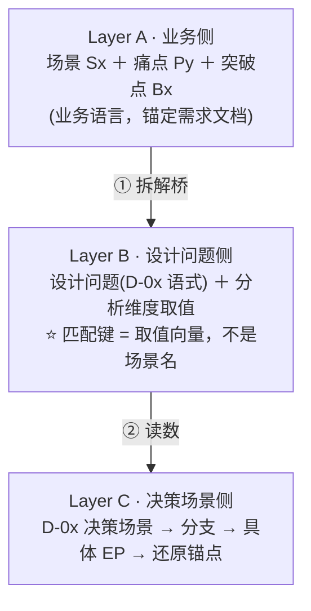

# 横向库承接与场景拆解桥协议 (Scene → Design-Decision Bridge)

> 💡 **定位**：本协议是 [`2.0-设计决策总览与调度.md`](../01-system-solution-design/②设计思考与决策/2.0-设计决策总览与调度.md) 中「**未命中需求大类 → 全量用通用设计决策推导**」这一支的**展开执行程序**。2.0 给规则，本协议给"怎么做"。
>
> 🔗 **优先级与边界**：本协议只在「纵向未覆盖 / 未蒸馏」时接管。完整的「**纵向优先 → 横向补缺**」优先级，与「**决策 / 部件 / 样式**」三层边界，一律以 `2.0` 的【四、调度优先级与三层边界】为准（尤记：决策归经验库，材料与规范归资产库，具体样式数值可优先沿用经验库案例 Token）。
>
> 🎯 **适用场景**：
> 1. 需求不属于 Type-01~07 任一大类；
> 2. 命中需求大类，但该类型分册**未覆盖某设计点**或**尚未蒸馏**。
>
> 🛑 **要根治的病**：通用设计决策库（横向库）只接受"**设计问题**"输入，不接受"业务场景"。以往跳过中间层、拿业务场景硬对经验，必然退化成"泛化判据 / 凭感觉画线框"（典型症候：嘴上一句"这是 D-09 的活"，线下却把复合搜索框画成了普通按钮）。本协议补上缺失的**拆解桥**：把业务场景降维成**可读数的设计问题（含分析维度取值）**，让横向匹配从"黑箱"变成"可验证的读数"。

---

## 一、三层坐标模型（核心）

> ⭐ **一句话铁律**：业务场景是"用户要办成什么"，经验项是"某个设计点该选哪种形态"——两者**坐标系不同、无法直接匹配**，必须先经 Layer B 降维。**匹配的键是"分析维度取值"，不是场景名称。**

---

## 二、执行总览（5 步闭环）

---

## 三、Step 1 · 需求锚定（防发散）

* 逐条主场景 `Sx` 与痛点 `Py` 必须**标注需求来源编号**（如 `REQ-xxx` / `SRC-xxx`）；
* 不得自创需求文档中不存在的痛点；确需补充的判断（如把后台能力落成前台取舍）必须**显式标注为设计判断**。

---

## 四、Step 2 · 拆解桥：设计问题语式库

把每个业务场景，用下表逐域翻译成"可判定的设计问题"，并**强制附上分析维度取值**（无取值 → 判为无效拆解）。

| 决策域 | 设计问题语式（模板） | 典型分析维度 |
| :--- | :--- | :--- |
| **D-01** 信息架构 | 这个需求拆成几页 / 几层？某能力该挂到哪一层？层内次级结构用什么形态？ | 能力域数量、是否主路径、配置项数量、层级深度 |
| **D-02** 信息承载与容器选型 | 这块内容（台账 / 表单 / 详情 / 明细）用哪个壳装？新增 / 编辑 / 查看分别用什么容器？ | 业务意图、量级、字段数、内容高度、是否需保留上下文 |
| **D-03** 信息密度与可读性 | 数据多 / 密时怎么排布与切分？冻结哪些列？分页还是加载更多？ | 条数、列数、字段规整度、行高 |
| **D-04** 状态与反馈表达 | 加载 / 空 / 失败 / 进行中怎么如实告知？ | 是否有终态、时长、失败可恢复性 |
| **D-05** 操作确认与防错 | 这个操作要不要拦、拦到什么程度？ | 可逆性、影响面、批量规模 |
| **D-06** 层级与动线 | 层与层怎么叠？返回 / 关闭是否保留上下文？ | 层级深度、是否需保留上下文、是否需 URL 直达 |
| **D-07** 对象录入与选择 | 字段用什么控件录？对象用什么控件选？ | 字段语义、枚举档数、对象是否有层级、是否多值 |
| **D-08** 页面级可视化 | 整页驾驶舱 / 大屏的版面与分组怎么组织？ | 指标组数、子域数、图表/视角数、使用频次 |
| **D-11** 局部嵌入式可视化 | 局部可视化件（列表顶统计卡 / 配置图解）嵌在哪、能不能收起、怎么联动？ | 指标数、语义是否＝当前结果集、主内容可用空间 |
| **D-09** 检索与筛选 | 用户怎么把目标数据找出来？筛选用什么壳、什么时候触发？ | 可筛字段数、条件数、字段是否固定、查询成本 |
| **D-10** 操作入口与批量 | 操作放在哪、怎么组织与触发？导入导出用什么壳与流程？ | 操作项数、使用频次、是否危险、是否文件类 |

---

## 五、Step 3 · 取值读数与命中判定

1. **读数**：拿每个设计问题的"分析维度取值向量"，进入对应 `D-0x` 的【决策场景清单（母尺）】逐条比对 → 命中某**分流分支** → 落到具体 `D0x-EPxx`；
2. **命中** → 采纳该 `D0x-EPxx`，并记下其**还原锚点**（`产线 · 模块 ▸ D-0x 场景`）；
3. **未命中任一分支** → 标 **`无库经验 · 业务独立推导`**，以现有设计资产规范自行设计，**严禁硬套**；
4. **取料**：命中后按还原锚点下探证据层，取「结构版式 + 物理特征物 + 真实 Token」三元组再画线框（沿用 [`execution-sop.md`](execution-sop.md) 的四阶段解引用逻辑）。

---

## 六、Step 4 · 覆盖索引（防漏清单）

按"交互形态"配齐**必查决策域**，避免漏读某个域导致设计点缺位。

| 交互形态 | 必查决策域 | 常见设计问题 |
| :--- | :--- | :--- |
| 列表 / 台账 | D-01 D-02 D-03 D-04 D-06 D-09 D-10 | 壳选型、密度、空态、筛选、批量入口 |
| 左树 + 表格 | 上述 ＋ **D-07**（组织 / 分类树） | 分类维度、树表联动 |
| 整页概览 / 驾驶舱 | **D-08** | 版面与分组（段落 / Tab / 网格）、时间、刷新 |
| 局部概览件（列表顶统计卡 / 配置图解） | **D-11** | 嵌在哪、能否收起、怎么联动 |
| 详情抽屉 / 下钻页 | D-02 D-04 D-05 D-06 | 容器、字段、返回契约 |
| 新增 / 编辑表单 | D-02 **D-07**（＋ D-05 校验） | 容器、控件选型、校验防错 |
| 导入 / 导出 | **D-10** D-04 | 壳与流程、进度与结果反馈 |
| 批量操作 | **D-05** D-10 | 置灰、影响面、结果分级 |
| 删除 / 高危 | **D-05** | 二次确认、回显对象名、影响面清单 |

---

## 七、Step 5 · 输出物（两份，直供《设计说明书》第二章）

### 输出一：匹配矩阵（→ 说明书第 2 节）
一行一个「业务场景」，列出命中的设计决策经验（**仅编号**）。

### 输出二：采纳明细（→ 说明书第 3 节）
一行一条经验，列全"是什么 / 因何命中 / 怎么落地 / 出处"。

| 经验编号 | 归属 | 经验名称与机制示意 | 命中点 | 采纳结论 | 证据锚点 |
| :--- | :--- | :--- | :--- | :--- | :--- |
| `D0x-EPxx` | D-0x [决策域名]（横） | [短名]：[一句机制] | 设计问题：[命中的设计问题] | [落地形态 + 落点页面] | `[产线 · 模块 ▸ D-0x 场景]` |
| `EP-xx` | Type-0x · 主场景N（纵） | [短名]：[一句机制] | 纵向子场景：[子场景 / 主场景节点] | [落地形态 + 落点页面] | `[产线 · 模块 ▸ EP-xx]` |

> 📌 **编号口径**：纵向沿用 `EP-xx`；横向用 `D0x-EPxx`（域前缀，避免与纵向混淆）。
> 🛑 **落点铁律**：纵向 `EP-xx` 必须在第四章有承载落点，否则判为空头引用（自检项 7）。

---

## 八、硬规则与与纵向库的协同

1. **匹配键是取值不是场景名**：任何"拿场景名直接对经验"的操作都视为无效；
2. **一处一采纳**：每个设计问题要么命中 `D0x-EPxx`，要么标"业务独立推导"，不允许模糊带过；
3. **有纵向时优先纵向**：命中需求大类且该分册有经验时，以纵向经验为候选池，横向转为**裁决器 / 兜底网**（多案例冲突用横向裁决、纵向未覆盖用横向兜底；落地规格中，**材料与框架以资产库为准、具体样式数值优先沿用经验库案例 Token**）；
4. **冲突与降级必须留痕**：谁裁决了谁、哪条退化为自研，都要在采纳明细里写清；
5. **与 2.0 的接口**：本协议不新增调度规则，只把 2.0 的"未命中分支"细化为可执行步骤；两库共享同一套分析维度坐标（见 [`2.0-设计决策总览与调度.md`](../01-system-solution-design/②设计思考与决策/2.0-设计决策总览与调度.md) 第五节）。
