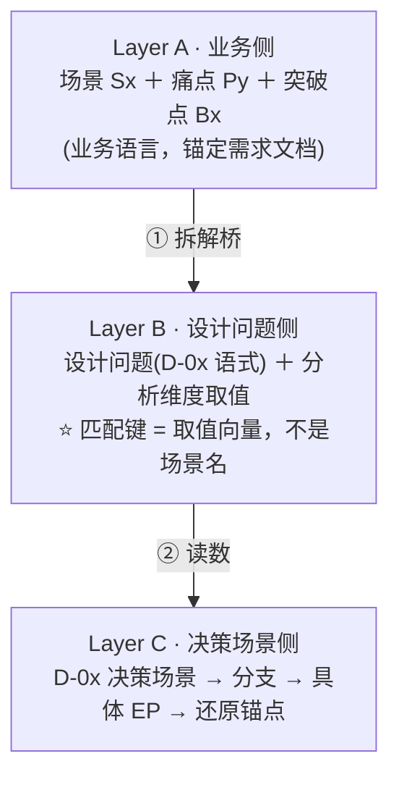

# 横向库承接与场景拆解桥协议 (Scene → Design-Decision Bridge)

> 💡 **定位**：本协议是 D-01~11 横向库的**唯一读数入口**，也是**每一个页面都必须走一遍的必经环节**——不是"纵向未命中才用的兜底"。
>
> 🔗 **优先级（2026-11-04 调整）**：**横向定域必经，纵向取料可选**。
> 1. 先用本协议把每个页面的**内容要素**翻译成**必查决策域**（Step 2 / 2.5）——这一步**不可跳过、不可由模型自行判断"要不要查"**；
> 2. 每个必查域内再取料：纵向分册命中且有料 → 纵向做法优先；否则用横向 `D0x-EPxx`；
> 3. 域内一个都读不到 → 进《经验未命中处理协议》第 ③ 级五步推导。
>
> 「决策 / 部件 / 样式」三层边界仍以 `2.0` 的【四、调度优先级与三层边界】为准（决策归经验库，材料与规范归资产库，具体样式数值可优先沿用经验库案例 Token）。
>
> 🎯 **适用场景**：**所有需求的全部页面**。纵向库（Type-01~07）今后默认不再扩充，横向库是设计与装配的主依据；纵向仅在"正好有料且更好"时作为加成素材，不再决定"要不要读横向"。
>
> 🛑 **要根治的病（两类，2026-11-04 补第二类）**：
> 1. 通用设计决策库只接受"**设计问题**"输入，不接受"业务场景"。以往跳过中间层、拿业务场景硬对经验，必然退化成"泛化判据 / 凭感觉画线框"（典型症候：嘴上一句"这是 D-09 的活"，线下却把复合搜索框画成了普通按钮）。→ 本协议补上**拆解桥**，把场景降维成可读数的设计问题。
> 2. **页面里明明有该域的特征物（表格上方的筛选、工具栏的批量、顶部的统计数），却没有去读对应决策域，直接自由发挥**——因为"要不要查"过去由模型自己判断，判断不出就不查，门禁也查不出来。→ 本协议补上 **Step 2.5 内容要素检测表** 与 **Step 4.5 逐页扫读表**：**先看线框里有什么，再决定必查哪些域；看到的特征物不许无经验落地**（机检 `SP-W-10`）。

---

## 一、三层坐标模型（核心）

> ⭐ **一句话铁律**：业务场景是"用户要办成什么"，经验项是"某个设计点该选哪种形态"——两者**坐标系不同、无法直接匹配**，必须先经 Layer B 降维。**匹配的键是"分析维度取值"，不是场景名称。**

---

## 二、执行总览（逐页闭环）

> 🛑 **执行顺序不可颠倒**：先由**页面里已有的东西**（表格、筛选、工具栏、统计数、表单、危险动作）反推必查域，再进域内读数。反过来"先想用哪条经验、再找地方摆"就是拼贴，也是自由发挥的起点。

---

## 三、Step 1 · 需求锚定（防发散）

* 逐条主场景 `Sx` 与痛点 `Py` 必须**标注需求来源编号**（如 `REQ-xxx` / `SRC-xxx`）；
* 不得自创需求文档中不存在的痛点；确需补充的判断（如把后台能力落成前台取舍）必须**显式标注为设计判断**。

---

## 四、Step 2 · 拆解桥：设计问题语式库

把每个业务场景，用下表逐域翻译成"可判定的设计问题"，并**强制附上分析维度取值**（无取值 → 判为无效拆解）。

| 决策域 | 设计问题语式（模板） | 典型分析维度 |
| :--- | :--- | :--- |
| **D-01** 信息架构 | 这个需求拆成几页 / 几层？某能力该挂到哪一层？层内次级结构用什么形态？ | 能力域数量、是否主路径、配置项数量、层级深度 |
| **D-02** 信息承载与容器选型 | 这块内容（台账 / 表单 / 详情 / 明细）用哪个壳装？新增 / 编辑 / 查看分别用什么容器？ | 业务意图、量级、字段数、内容高度、是否需保留上下文 |
| **D-03** 信息密度与可读性 | 数据多 / 密时怎么排布与切分？冻结哪些列？分页还是加载更多？ | 条数、列数、字段规整度、行高 |
| **D-04** 状态与反馈表达 | 加载 / 空 / 失败 / 进行中怎么如实告知？ | 是否有终态、时长、失败可恢复性 |
| **D-05** 操作确认与防错 | 这个操作要不要拦、拦到什么程度？ | 可逆性、影响面、批量规模 |
| **D-06** 层级与动线 | 层与层怎么叠？返回 / 关闭是否保留上下文？ | 层级深度、是否需保留上下文、是否需 URL 直达 |
| **D-07** 对象录入与选择 | 字段用什么控件录？对象用什么控件选？ | 字段语义、枚举档数、对象是否有层级、是否多值 |
| **D-08** 页面级可视化 | 整页驾驶舱 / 大屏的版面与分组怎么组织？ | 指标组数、子域数、图表/视角数、使用频次 |
| **D-11** 可视化件选型与还原 | 局部可视化件（列表顶统计卡 / 配置图解）嵌在哪、能不能收起、怎么联动？ | 指标数、语义是否＝当前结果集、主内容可用空间 |
| **D-09** 检索与筛选 | 用户怎么把目标数据找出来？筛选用什么壳、什么时候触发？ | 可筛字段数、条件数、字段是否固定、查询成本 |
| **D-10** 操作入口与批量 | 操作放在哪、怎么组织与触发？导入导出用什么壳与流程？ | 操作项数、使用频次、是否危险、是否文件类 |

---

## 四之二、Step 2.5 · 内容要素 ➔ 必查决策域（特征物检测表）

> 🛑 **这一步不看场景名、不看模型直觉，只看"这页打算画什么"**。逐页对着下表过：线框里会出现该特征物 → 该决策域**必查**，且**必须在该页映射清单留下该域的 EP 编号**；不查即判自由发挥。
> 📌 **判定顺序**：先逐项"有 / 没有"，有则进域读数，**"没有"要能指着线框说明为什么没有**（不许"感觉不需要"）。

| # | 页面里的特征物（线框里看得见的东西） | 必查域 | 域内至少回答的决策场景 | 该页最少经验条数 |
| :---: | :--- | :---: | :--- | :---: |
| 1 | **筛选控件**：下拉 / 复合搜索框 / 日期区间 / 关键字框，或表格上方的条件行 | **D-09** | ① 入口在哪、② 壳怎么选、③ 何时触发、⑦ 怎么回显、⑧ 排序哪一档、⑫ 时间用什么控件 | **≥2 条**（壳 + 触发/回显/排序任一条） |
| 2 | **表格 / 台账 / 卡片流**（≥3 列的横向对比区） | **D-02 · D-03** | 壳选型 + 密度（分页/冻结/行高/列设置） | ≥1 条 |
| 3 | **表单录入控件**：输入 / 下拉 / 树选 / 穿梭 / 条件构建器 | **D-07** | 控件选型与校验时机 | ≥1 条 |
| 4 | **新增 / 编辑容器**：抽屉 / 弹窗 / 整页 / 步骤条 | **D-02**（＋ D-06） | 壳选型、层级与返回契约 | ≥1 条 |
| 5 | **删除 / 停用 / 下线 / 覆盖**等不可逆动作 | **D-05** | 拦到什么程度、影响面怎么给 | ≥1 条 |
| 6 | **批量栏 / 导入 / 导出 / 转后台** | **D-10**（＋ D-05） | 入口挂载、组织与流程、全选作用域 | ≥1 条 |
| 7 | **≥3 个并列数字摘要、趋势 / 占比 / 分布、状态流程、拓扑、图解** | **D-11**（整页看数则 D-08） | ① 该不该上图、② 走内容件还是图表件、③ 嵌在哪占多大 | ≥1 条 |
| 8 | **页内 Tab / 分段切换 / 多视图** | **D-06**（＋ D-01） | 层级怎么组织、切 Tab 是否重置状态 | ≥1 条 |
| 9 | **加载 / 空 / 失败 / 进行中 / 部分成功** | **D-04** | 状态怎么如实分级告知 | ≥1 条 |
| 10 | **多页面归属 / 菜单层级 / 集合页与详情页** | **D-01** | 页面数、能力挂哪一层、实例基数 | 需求级 ≥1 条 |

**三条判定铁律**：

1. **特征物在、经验不在 = 自由发挥**：线框里画了筛选控件，映射清单却没有 `D09-EPxx`，一律判未学习，不回补不许出稿（机检 `SP-W-10`）。
2. **数量优先于完美**：上表给的是**最少条数**，不是上限。筛选这类高频矛盾，回答"壳选了什么、条件几个、放不放得下"三个问题，通常要 2~3 条才说清。
3. **"不适用"必须留证**：某特征物不触发该域时，在扫读表该行写"无此特征 + 依据"（如"详情页无列表，D-09 不适用"），不许整行删掉——**整行消失就等于这次没扫**。

---

## 五、Step 3 · 取值读数与命中判定

1. **读数**：拿每个设计问题的"分析维度取值向量"，进入对应 `D-0x` 的【决策场景清单（母尺）】逐条比对 → 命中某**分流分支** → 落到具体 `D0x-EPxx`；
2. **命中** → 采纳该 `D0x-EPxx`，并记下其**还原锚点**（`产线 · 模块 ▸ D-0x 场景`）；
3. **未命中任一分支** → 转 [经验未命中处理协议](经验未命中处理协议.md) **第 ③ 级**（五步自行推导），**不许停在这一句直接「自行设计」**；
4. **取料**：命中后按还原锚点下探证据层，取「结构版式 + 物理特征物 + 真实 Token」三元组再画线框（沿用 [`execution-sop.md`](execution-sop.md) 的四阶段解引用逻辑）。

---

## 六、Step 4 · 覆盖索引（按形态补查）

> 🔁 **与 Step 2.5 的分工**：Step 2.5 按**这一页具体画了什么**定必查域（精确、用于逐页扫读）；本表按**页面形态**给一张兜底清单（粗、用于补查）。两表取**并集**，任一表要求而另一表没有的域，也要查。

按"交互形态"配齐**必查决策域**，避免漏读某个域导致设计点缺位。

| 交互形态 | 必查决策域 | 常见设计问题 |
| :--- | :--- | :--- |
| 列表 / 台账 | D-01 D-02 D-03 D-04 D-06 D-09 D-10 | 壳选型、密度、空态、筛选、批量入口 |
| 左树 + 表格 | 上述 ＋ **D-07**（组织 / 分类树） | 分类维度、树表联动 |
| 整页概览 / 驾驶舱 | **D-08** | 版面与分组（段落 / Tab / 网格）、时间、刷新 |
| 局部概览件（列表顶统计卡 / 配置图解） | **D-11** | 嵌在哪、能否收起、怎么联动 |
| 详情抽屉 / 下钻页 | D-02 D-04 D-05 D-06 | 容器、字段、返回契约 |
| 新增 / 编辑表单 | D-02 **D-07**（＋ D-05 校验） | 容器、控件选型、校验防错 |
| 导入 / 导出 | **D-10** D-04 | 壳与流程、进度与结果反馈 |
| 批量操作 | **D-05** D-10 | 置灰、影响面、结果分级 |
| 删除 / 高危 | **D-05** | 二次确认、回显对象名、影响面清单 |

---

## 六之二、Step 4.5 · 逐页决策域扫读表（强制交付物）

> 🛑 **这份表不是可选记录，是 4.1 的准出产物**（`EX-4.1-05`）：**一个页面一行不少，一个必查域一格不空**。它同时是 5.0 §6.2 与第 7 节每页映射清单的**唯一来源**，不许另造一套。

| 页面 | 页面内容要素（按 Step 2.5 逐个列） | 必查域 | 分析维度取值 | 命中 `D0x-EPxx` / 纵向 `EP-xx` / 未命中 | 落地形态与控件 | 线框落点 |
| :--- | :--- | :--- | :--- | :--- | :--- | :--- |
| Page-01 | 筛选行（时间 + 对象 + 状态 + 2 关键字共 5 项）、主表格、工具栏（新增/批量/导出）、顶统计数 4 个 | D-09 · D-02 · D-03 · D-10 · D-11 | 条件 5 ｜ 字段固定 ｜ 需同屏 ｜ 指标 4 | `D09-EP02 ④ IxProSearch`、`D09-EP03`、`D09-EP07`、`D02-EP01`、`D10-EP03`、`D11-EP07 ②` | 复合搜索框（Tag 内嵌）＋ 平铺工具栏 ＋ 4 卡概览 | 筛选行 / 工具栏 / 卡组 |

**填表四条硬要求**：

1. **"必查域"列必须与 Step 2.5 检测结果一致**：该页线框里有筛选控件，D-09 就必须在本行出现；漏一个域即 `EX-4.1-05` FAIL。
2. **"命中"列必须是编号，不是域号**：写 `D-09` 不算读数，写 `D09-EP02 ④` 才算——**档位/形态必须写出来**，因为下游要靠它画控件。
3. **未命中要写推导标签**：`无经验背书 · 业务独立推导（D-09 ⑫ EQ-03 未采集 → 按 comp-date-picker 落地）`，把"哪个场景没经验"写清楚，不许只写"业务独立推导"。
4. **命中 `D11-EPxx` 时，"落地形态与控件"列必须写「件型键 ＋ 线框原语类名」，不许只写口语名**：`VIZ-01-A2 ｜ wf-kpi--strip（6 格等分 / 标签在上 / 值 24-700）` 才算；写"4 卡概览""统计条"这类话，等于当场丢件型——件型键从这一步起就必须带形态后缀，并同步进 4.1 §1.6.1 取料表（`EX-4.1-06`），5.0 才可能有对应声明（`SP-W-12` 按此对账）。

---

## 七、Step 5 · 输出物（三份，直供 4.1 与《设计说明书》）

### 输出一：匹配矩阵（→ 5.0 §6.2「业务场景 → 经验匹配」）
一行一个「业务场景」，列出该场景涉及页面命中的设计决策经验（**仅编号**，横纵各标）。

### 输出二：逐页映射（→ 5.0 第 7 节每页「设计经验与组件选型映射清单」）
一行一条经验，落到具体页面与控件；**每条必须带档位或形态**。

| 页面 | 界面区域 / 业务能力项 | 组件 / 件型 | 经验编号（含档位） | 关键尺寸与 Token | 来源 |
| :--- | :--- | :--- | :--- | :--- | :--- |
| Page-01 | 筛选区（5 条件） | `IxProSearch` | `D09-EP02 ④` ＋ `D09-EP03`（回车提交） | 高 `32px`、最小宽 `min(660px,100%)`、右侧 `32×32` 蓝底 | 横向决策 |

### 输出三：逐页决策域扫读表（→ 4.1 §1.7.1 留档）
即 Step 4.5 那张表，原样交付，供 4.1 准出与评审抽查。

> 📌 **编号口径**：纵向沿用 `EP-xx`；横向用 `D0x-EPxx`（域前缀，避免与纵向混淆）。
> 🛑 **落点铁律**：被引用的每条经验（纵 / 横）都必须在第 7 节有承载落点，否则判空头引用（自检第 7 项）。

---

## 八、硬规则与与纵向库的协同

1. **匹配键是取值不是场景名**：任何"拿场景名直接对经验"的操作都视为无效；
2. **一处一采纳**：每个设计问题要么命中 `D0x-EPxx`（带档位），要么标"业务独立推导（含未覆盖场景号）"，不允许模糊带过；
3. **横向定域必经、纵向取料可选**（2026-11-04）：必查哪些域由 Step 2.5 的页面特征物决定，**不由"有没有纵向经验"决定**；纵向仅在域内有料且更具体时优先；
4. **有特征物必有经验编号**：页面里画了该域的东西，映射清单却找不到该域编号 = 自由发挥，`SP-W-10` 直接 FAIL；
5. **冲突与降级必须留痕**：谁裁决了谁、哪条退化为自研，都要在扫读表里写清；
6. **与 2.0 的接口**：本协议是 2.0「逐页横向扫读」那一支的完整执行程序；两库共享同一套分析维度坐标（见 [`2.0-设计决策总览与调度.md`](../01-system-solution-design/②设计思考与决策/2.0-设计决策总览与调度.md) 第五节）。
