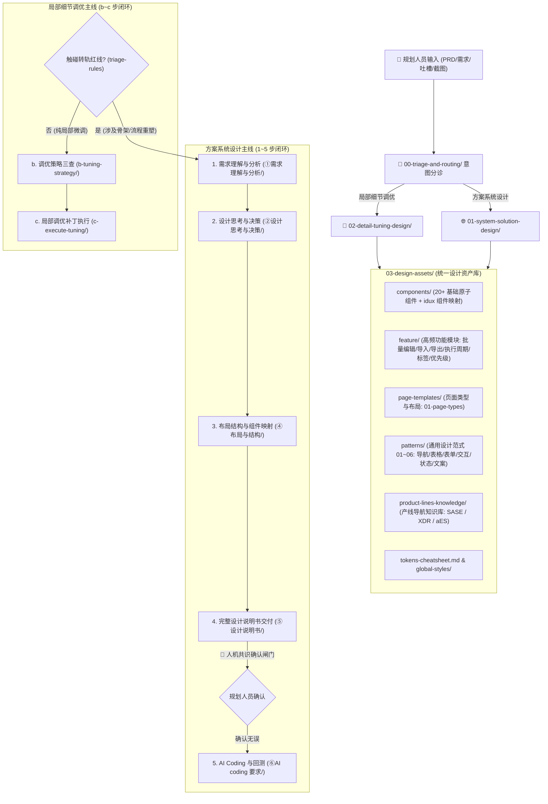

# 🌈 织雨 (Virtual Designer Zhiyu) - 个人设计 Agent 智脑

> **定位**：具备真人资深设计师思考逻辑与端到端执行链路的个人体验设计中枢 Agent。  
> **服务对象**：上游业务/产品规划人员（PM、业务架构师、运维规划师、个人开发者）。  
> **核心主线**：涵盖 **【方案系统设计 (1~5 步)】** 与 **【局部细节调优 (b~c 步)】** 双轨执行模型。  
> **三种设计用途**：**【需求大类设计决策】**（纵 · 按需求大类的方案经验，标杆案例背书）、**【通用设计决策】**（横 · 跨类型的通用选型决策）、**【局部细节调优】**（局部像素级修补）。

---

## 🗺️ 织雨认知与执行逻辑全景图



---

## 📂 项目模块目录架构导航 (Folder Containers)

```text
skill-designer-prism/
├── SKILL.md                                         # 核心规约、路由中枢与行为准则
├── README.md                                        # 本文件：项目全局唯一的总概览与使用指南
├── 系统方案设计全流程执行图.html                     # 全流程介绍：1.1 → 6.0 各环节、门禁卡点、人机交接与产物落点一览
│
├── 00-triage-and-routing/                           # 【分诊与转轨中枢】
│   └── triage-rules.md                              # 方案设计 vs 细节调优决策树与转轨红线
│
├── 01-system-solution-design/                       # 【方案系统设计主线 (Part1 → 🚦 → Part2)】
│   ├── ①需求理解与分析/                            # Part1：需求分析与思考
│   │   ├── 1.1-需求理解与现状旅程.md        # 涵盖现状痛点穿透 + 目标用户主要任务旅程 (JTBD)
│   │   ├── 1.2-体验目标.md                  # 涵盖体验收益与务实版体验目标推导指南 (去口号化)
│   │   ├── 1.3-体验突破点拆解.md            # 目标 → 突破点 → 分档点子（双入口扫法 + 来源标注 + 裁剪 + 指标回校）
│   │   ├── 1.4-草图发散与方向确认.md        # 两套方案（走法 × 档位：高水位/稳水位）的极简草图 + 🚦 方案闸门（确认前不得进 Part2）
│   │   ├── 方案设计思考经验/                # ①配置运维 ②运营分析 ③排障闭环 ④价值感知（入口 2 的经验底座）
│   │   ├── 草图样板-SASE合规检测任务.html    # 1.4 交付形态参照（两套方案 × 草图 + 方案依据，对着看长什么样）
│   │   └── 演练案例/                        # 1.3 突破点拆解演练集（方法验证用，主流程不读）
│   ├── ②设计思考与决策/                       # 双决策库（经验底座，Part2 的素材来源）
│   │   ├── 2.0-设计决策总览与调度.md           # 双库总入口 + 三用途定位 + 裁决/兜底调度
│   │   ├── 需求大类设计决策/                    # 【纵向库】按需求大类的方案经验（标杆案例背书）
│   │   │   ├── 00-总览与类型定性.md            # 类型全景图 + 类型定性判据 + 分册索引
│   │   │   ├── Type-01~07-*.md                 # 一类型一文件（经验层 EP + 案例层证据）
│   │   │   └── signatures/                     # 标杆特征物签名契约
│   │   └── 通用设计决策/                        # 【横向库】跨类型的通用设计决策
│   │       ├── 00-索引与决策域.md              # D-01~D-11 决策域与条目骨架
│   │       └── D-01~D-11-*.md                  # 信息架构/信息承载与容器选型/信息密度与可读性/状态表达/操作防错/层级动线/对象录入与选择/页面级可视化/局部嵌入式可视化/检索与筛选/操作入口与批量
│   ├── ③未来旅程/                                  # 原步骤 3：已从主线移除 (留档备查)
│   │   └── 3.1-未来旅程.md             # 3.1 本质任务旅程与 Mermaid 规划流程图 (历史资产)
│   ├── ④布局与结构/                                # 步骤 3：布局结构与组件映射
│   │   ├── 4.1-业务页面框架选型指引.md # 页面清单 / 继承对账 / 物料装配 / 字段落位 / 线框五要素 / 状态七态 / 档位兑现门禁 / 逐页经验匹配
│   │   └── 4.2-业务能力与组件选型指引.md           # 能力族裁决表（何时选 / 何时不许选 / 硬指标）＋ 能力 ➔ 组件 / 可视化件映射
│   ├── ⑤设计说明书/                                # 步骤 4：生成完整设计说明书
│   │   └── 5.0-设计说明书标准模板.md              # 5.0 标准设计说明书模板 (五章固定 · 交付一句话确认)
│   └── ⑥AI coding 要求/                             # 步骤 5：前端 Demo 输出与回测
│       └── 6.0-前端 demo 输出要求.md    # 6.0 前端 Demo 输出规则与清单反向回测
│
├── 02-detail-tuning-design/                         # 【局部细节调优主线 (4 阶闭环)】
│   ├── 细节调优中枢调度指南.md              # 调优中枢指南：4 阶精密闭环作业法
│   ├── b-tuning-strategy/                           # 步骤 b：调优策略思考三要素
│   │   ├── b.1-设计细节吐槽转译词典.md          # b.1 40+ 细节点吐槽转译词典
│   │   ├── b.2-界面体验与可用性.md           # b.2 UI/UX 走查评审缺陷库与可用性原则
│   │   └── b.3-避坑指南.md  # b.3 环节实战避坑经验与八重防破坏安全带
│   └── c-execute-tuning/                            # 步骤 c：执行调优修改
│       └── c-局部调优补丁执行模板.md                # c 局部调优补丁执行 Prompt 模板
│
├── 03-design-assets/                                # 【设计资产库基座】
│   ├── components/                                  # 20+ 基础原子组件规范 (Table/Button/Pro-Search/设计表单/图标语义) + idux 组件映射
│   ├── feature/                                     # 高频功能模块规范 (批量编辑/导入/导出/执行周期/优先级/标签)
│   ├── page-templates/                              # 页面类型与骨架选型 (01-page-types.md)
│   ├── patterns/                                    # 通用设计范式库 01~06 (导航/表格/表单/交互/状态/文案术语)
│   ├── product-lines-knowledge/                     # 产线导航知识库 (SASE / XDR / aES 分目录纳管菜单层级与业务归属)
│   ├── visual-styles/                               # 可视化件风格规范 (供说明书「可视化件声明」引用)
│   ├── global-styles/                               # 全局原子规范 (色彩、网格、字阶、栅格)
│   └── tokens-cheatsheet.md                         # 高频 Tokens 速查手册
│
├── 04-workflows-and-cases/                          # 【执行 SOP 与协作协议】
│   ├── agent-interaction-protocol.md                # 人机协作状态机 (含说明书确认闸门铁律)
│   ├── execution-sop.md                             # 5 步主线 + 4 阶调优执行作业程序
│   ├── few-shots.md                                 # 标杆实战 Few-Shot 样本库
│   └── cases/                                       # 真实业务需求用例库 (PRD 实战演练)
│
├── 05-learning-materials/                           # 【资料投喂与蒸馏暂存收件箱】
│   ├── learning-materials-guide.md                  # 经验蒸馏手册
│   └── (随时投喂原始 PRD 或复盘资料，蒸馏后随时清理)
│
├── tools/                                           # 【工程工具】(非设计知识)
│   ├── README.md                                    # 工具目录说明与用法指引
│   ├── gate-ex.sh / gate-sp.sh / gate.js            # 门禁两件套（环节准出 / 说明书准出）
│   └── internal-reverse-proxy.js                    # 内网系统访问通道 (供蒸馏取证)
│
└── _output/                                         # 【任务过程产物 · 本地工作台，已 gitignore 不入库】
    └── <业务名>/                                    # 一次需求 = 一个子文件夹
        ├── 01-主场景拆解 / 02-体验目标 / 03-突破点 / 04-Part2装配  # 1.x 过程备忘 md
        ├── 草图-<业务名>.html                        # 1.4 草图（结构级）
        ├── design-spec-<业务名>.html                 # 5.0 设计说明书（落地级）
        └── demo-<业务名>.html + 回测报告-<业务名>.md  # 6.0 高保真 demo 与回测
```

> 📁 **产物落盘约定**：所有执行任务时产生的文件（草图 / 中间 md / 说明书 / demo / 回测报告 / 复盘）一律落在 `_output/<业务名>/`，该目录已写进 `.gitignore`，**不进版本库、不参与推送**；技能本体（`00~05` / `tools`）保持干净。约定见 [`_output/README.md`](_output/README.md)。

---

## 🚀 核心协同铁律
1. **以说明书为共识契约**：在做方案系统设计时，织雨输出第 4 步《设计说明书》后必须主动停下来等待用户确认，绝不擅自偷跑第 5 步代码；
2. **转轨主动预警**：细节调优一旦触及结构栅格崩坏或任务流断裂，必须主动建议升级为方案系统设计；
3. **闭环回测验证**：代码落地必须 100% 反向核对第 3 步列出的业务套头与组件清单；
4. **设计资产统一归口 `03-design-assets/`**：范式（`patterns/`）、组件（`components/`）、套头（`page-templates/`）、Tokens 等资产实体一律存放于资产库；`01`/`02` 的思考类文档**只做引用、不内嵌资产明细**。
