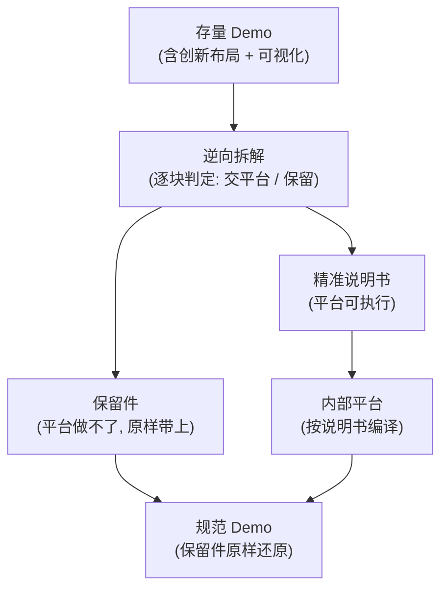

# 逆向工程（存量 Demo → 设计说明书）实现要点与思路

> 状态：**讨论稿，暂不动手**。本文把截至目前讨论达成的共识、设计决策与待定项沉淀下来，作为后续动手的依据。
> 样例对象：`/Users/wj/Desktop/项目文件/SMG-DEM/Demos/07-方案七`（SASE 产品线）

---

## 一、为什么要做这件事

- 内部有一个 **demo 设计平台**，里面已经封装好了页面模板和 IDUX 组件库。只要《设计说明书》足够精准，丢进去就能跑出符合规范的 demo。
- 但这个平台**不擅长两件事**：大型版本的创新布局、可视化（图表 / 拓扑 / 特殊图形）。
- 存量 demo 里恰好就带着这两类"平台做不了"的东西。
- 所以要做逆向：**把存量 demo 拆成两路**——平台能接的部分写成精准说明书；平台接不了的部分原样保住；最后拼回一个规范 demo。
- 直接诉求：**新平台还原时，原来的 mock 数据不能丢。**

---

## 二、总体通路

全链路里，**唯一需要人脑子的动作是中间那个"逆向拆解——逐块判定"**，其余都是既定动作。

---

## 三、已达成的共识与设计决策

### 1. 产物本体：结构清单 + 双渲染（不做"孤零零一份 HTML 说明书"）

- 先产出一份 **结构清单**（给机器读的结构化数据），再由它派生两样东西：
  1. 给人看的**说明书**（三章）；
  2. 用来**重出 demo** 的输入。
- 好处：说明书、保留件、数据都从同一份清单生成，**保证两边对得上、不打架**。
- 说明：这份"结构清单"不是给设计师看的代码，可以理解成一份"给机器看的设计交底 / 标注文档"。

### 2. 说明书只做"结构"，不做"意图"

- 只出**三章**：① 页面架构 ② 逐页线框与组件映射 ③ 状态与异常规则。
- **不做"为什么"**（用户痛点、设计经验 / 标杆复用）——这部分逆向拿不到，不硬编。

### 3. 自由度的边界：三层各归各（核心原则）

| 层 | 平台能不能发挥 | 举例 |
| :--- | :--- | :--- |
| **形式层** | ✅ 可以，按规范发挥 | 组件、颜色、间距、布局 |
| **内容层** | ❌ 冻结，原样用 | 文案、列名、状态枚举 |
| **数据层** | ❌ 冻结，原样用，**禁止生成** | mock 数据 |

一句话：**平台的自由只在"形式"，内容和数据它碰不了。**

### 4. 拆解的分界线：能对上就交，对不上就保

- **判定尺子**：用 skill 自带的设计资产——`03-design-assets/page-templates/01-page-types.md`（页面模板清单）+ `03-design-assets/components/idux-component-map.md`（组件清单）。
- 「对不上」必须拆成三档，不能凭感觉：

| 情形 | 处理 |
| :--- | :--- |
| 完全对得上 | 交平台，标准动作 |
| **相近**（平台有近似组件 / 模板，但形态有差异） | 先试"降级适配"，套得进就交并标注差异；套不进的再保留 |
| 完全没有 | 保留，**必须写一句理由** |

- **纪律**：保留的比例要看得见。保下来的太多，说明要么平台能力不足、要么判定太松，都要回头看。

### 5. 归一化 / 保留：四档处理

| 档 | 对象 | 处理方式 |
| :--- | :--- | :--- |
| **A 全局样式** | 布局 / 间距 / 色值 / 字号 / 圆角 | 100% 归一化到 Token |
| **B 标准组件** | 表格 / 按钮 / 表单 / 标签 / 抽屉 / 弹窗 / 搜索 / 树 / 步骤条 | 映射 IDUX + 注入硬指标 |
| **C 复合 / 可视化** | 图表 / 拓扑 / 特殊图形 | **外框归一 + 内芯原样保留** |
| **D 孤岛** | 归不了类的定制块 | 整体保留 + 显式声明 |

### 6. 两态流程：as-is → 偏差清单 → to-be

1. 先**忠实抓现状**（不美颜），同时列出"和规范不一样的地方"（偏差清单）；
2. **人来裁定**偏差（归一化 / 保留 / 待定）；
3. 再**定稿**（to-be），跑规范校验。
- 目的：防止"假合规"——不能把不合规的东西直接脑补成合规写进说明书。

### 7. 单位：以"需求"为单位，不是「1 HTML = 1 Spec」

- demo 文件怎么拆是**工程实现**，不是信息架构。
- 逆向要按**信息架构 / 业务对象重新组织**，而不是照着文件数切。

### 8. 保留件 = 自制组件，不是一次性贴图

- 跨页复用的可视化（比如端到端拓扑链）要**组件化**：命名、标参数、存进一个"**保留件库**"。
- 这个库长期就是**"平台能力清单"的补充**——记录着"平台做不了、但我们有"的东西。

### 9. 数据：快照为主 + 附"造数规则"

- 数据分两层，各配各的方式：

| 数据层 | 用什么 | 原因 |
| :--- | :--- | :--- |
| **手写种子**（如"张伟""西安研发中心""Digiplus 马尼拉办公室"） | **快照，冻结** | demo 的灵魂，只能保真、不能生成 |
| **批量填充**（循环生成的用户 / 分支 / 应用） | **快照打底 + 附规则** | 快照保当下原汁原味；规则说明"想扩就按这个规律扩" |

- **默认动作**：平台只读快照，**不许自己造数据**。
- **造数规则**：写成"给人看的说明"，**不交代码**；只在需要扩数据量 / 换参数时由人照着扩。
- **注意**："教平台自创数据"要分清——**让平台自由发挥造数据 = 不要**（会失真）；**留一套可扩展规则给人用 = 可以**。

### 10. 代码逻辑的四种归宿（不笼统说"留 / 不留"）

| 类型 | 例子 | 归宿 |
| :--- | :--- | :--- |
| **交互行为** | 开抽屉、切 Tab、筛选联动、勾选置灰 | **翻译成说明书的"交互规则"**（不保留代码，让平台重实现） |
| **数据逻辑** | mock 数据、图表数值来源 | **提取成数据包带走** |
| **平台做不了的特化逻辑** | 拓扑链渲染、散点时序图、SLO 标尺 | **走保留件，代码一起保** |
| **工程脚手架** | 跳转覆层淡入、localStorage 存底座、Alpine 初始化 | **丢弃**（不是设计） |

### 11. 信息架构与跳转：可还原

- **信息架构**：读每个文件的内容 + 导航菜单（写在 `_shell/shell.js` 里），重新组织成层级关系。
- **跳转逻辑**：`DEM_ROUTES_V2`（菜单→文件映射）+ `location.href`（含 `?appId=xxx` 带参跳转）可以直接读出"页面流转图"。
- **唯一会丢的**：隐式传参（靠内存 / 全局变量传数据，URL 上看不出）——会标注"依赖运行时状态，需人工确认"。
- **文件承载混合职能不是问题**：比如用户详情同时装了用户数据 + 分支数据（`x-data="demUserDetailState()"` 把两个生成器拼在一起），逆向时按业务对象拆开、各归各位即可。

---

## 四、针对 07-方案七 的实地发现（样例依据）

- **产品线**：SASE（aTrust + SASE 双底座），正好对得上 skill 里的 `product-lines-knowledge/SASE`。
- **技术形态**：Tailwind CDN + 自定义 CSS（`dem-*` 类）+ 大量内联 SVG。
- **Token 已经高度对齐**：`shell.css` 里的 `#1C6EFF / #E1E5EB / #EDF1F7 / #A1A7B3 / #454C59 / #272E38 / #12A679` 都在 skill 色板内；表格 32px 表头 / 40px 行高也和硬指标一致 → **归一化工作量比预想低**。
- **可视化是手绘 SVG**（不是 ECharts）→ 确认走 C 档"外框归一 + 内芯保留"。
- **mock 数据在 `Demos/assets/js/ai-dem-data.js`**：是**纯函数生成器**（`for` + `Math.random()` + 取模），只依赖 Math/Date → **能脱离浏览器直接跑出数据**。
- **页面间跳转写在 `_shell/shell.js`** 的 `DEM_ROUTES_V2`。

---

## 五、待定项（动手前要定）

| # | 待定项 | 说明 |
| :--- | :--- | :--- |
| **A** | 平台吃什么格式的说明书？ | 最卡脖子。需要向平台方确认"它需要说明书的哪些部分"（是否依赖"为什么"那两章） |
| **B** | 保留件按多大粒度打包？ | 按"一块"还是"一页"？粒度决定嵌回去时乱不乱 |
| **C** | 怎么验收"还原对了"？ | 没有验收标准就没法判断逆向成不成功 |

## 六、暂缓项（暂时不管）

- **内容体检**（术语 / 口径一致性，如"分支"vs"站点"）——后续慢慢调。
- **逆向说明书 vs 正向说明书的关系**——不用考虑，用户会另给一份需求文档。

---

## 七、落地时要建的东西（清单，供后续动手参考）

1. **提取器**：读 HTML / DOM → 产出结构清单（页面树、栅格、组件、内容真值、交互、跳转）。
2. **归一化判定器**：拿 skill 的设计资产当尺子，逐块判 A/B/C/D 与"交平台 / 保留"。
3. **偏差清单产出**：as-is 现状 vs 规范，逐条列差异供人裁定。
4. **保留件抽取与打包**：识别 C/D 档，抽成保留件 + 隔离标记。
5. **数据快照器**：跑纯函数生成器 → 按业务对象拍成数据包（用户 / 应用 / 分支 / 告警 / 性能），并保住对象间引用关系。
6. **说明书渲染**：结构清单 → 三章说明书（HTML）。
7. **校验闸门**：定稿后跑规范校验（对齐 skill 的 `tools/design-spec-selfcheck.sh` 思路）。

---

*本文为讨论沉淀，随讨论推进持续更新。动手前请先确认「五、待定项」。*
